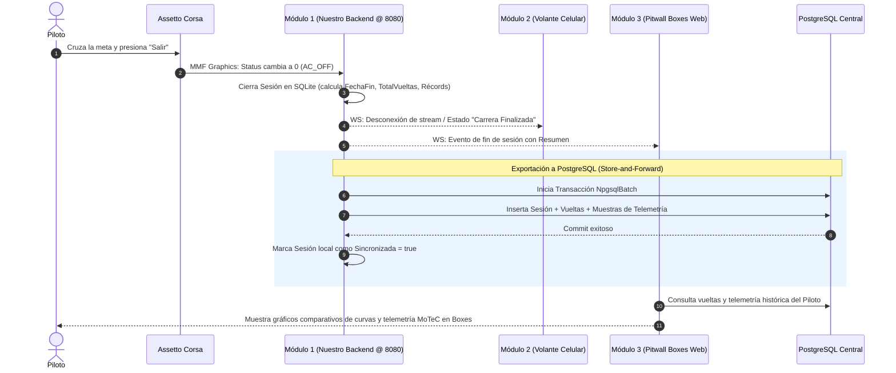

# Arquitectura Integral del Sistema de Telemetría: Los Tres Módulos

> **Propósito:** Clarificar el funcionamiento holístico del sistema, el ciclo de vida de una carrera, el flujo de datos en tiempo real (60 Hz), la detección de fin de sesión y la persistencia post-carrera hacia PostgreSQL para un piloto específico.

---

## 1. Mapa de Responsabilidades: Los Tres Módulos

El sistema está concebido bajo una arquitectura distribuida **Edge-to-Cloud / Pitwall**:

```
 ┌────────────────────────────────────────────────────────────────────────────────────────┐
 │                              PC DEL SIMULADOR (LOCAL / EDGE)                           │
 │                                                                                        │
 │   ┌───────────────────────┐                                                            │
 │   │    ASSETTO CORSA 1    │ (Simulador ejecutando físicas y carreras)                  │
 │   └───────────┬───────────┘                                                            │
 │               │ (60 Hz vía Memoria Compartida MMF: physics, graphics, static)          │
 │               ▼                                                                        │
 │   ┌────────────────────────────────────────────────────────────────────────────────┐   │
 │   │  MÓDULO 1 (DESARROLLADOR 1 - NUESTRO BACKEND .NET)                             │   │
 │   │  • LectorAssettoCorsaWin32 (SeqLock + Zero Allocation)                         │   │
 │   │  • ServicioTelemetriaRelay (Bucle 60 Hz con PeriodicTimer)                     │   │
 │   │  • Base Local SQLite (telemetria_local.db - Edge Store-and-Forward)            │   │
 │   │  • Puerto de Escucha: 8080                                                     │   │
 │   └───────────────┬────────────────────────────────────────┬───────────────────────┘   │
 └───────────────────┼────────────────────────────────────────┼───────────────────────────┘
                     │                                        │
     (WebSocket @ 60 Hz vía USB ADB)           (HTTP REST / WS LAN Wi-Fi)
                     │                                        │
                     ▼                                        ▼
   ┌────────────────────────────────────┐   ┌─────────────────────────────────────────┐
   │ MÓDULO 2 (DESARROLLADOR 2)         │   │ MÓDULO 3 (DESARROLLADOR 3)              │
   │ Dashboard del Volante (Móvil)      │   │ Panel Web de Boxes (Pitwall Next.js)    │
   ├────────────────────────────────────┤   ├─────────────────────────────────────────┤
   │ • App React Native en el celular.  │   │ • Pantalla de boxes para ingenieros.    │
   │ • Montado físicamente al volante.  │   │ • En carrera: posiciones y tiempos.     │
   │ • Muestra RPM, marcha, velocidad,  │   │ • Post-carrera: análisis de curvas,     │
   │   temperaturas, presiones y deltas │   │   comparativa de telemetría estilo      │
   │   en vivo a 60 FPS sin retardo.    │   │   MoTeC y gestión de campeonatos.       │
   │ • NO almacena datos en base.       │   │ • Conectado a PostgreSQL Central.       │
   └────────────────────────────────────┘   └─────────────────────────────────────────┘
```

---

## 2. ¿Cómo sabe el sistema cuándo termina una carrera?

El ciclo de vida de una carrera no requiere que el piloto presione un botón de "Terminar". El **Módulo 1 (nuestro backend)** lo detecta automáticamente por hardware y software a través de tres señales de Assetto Corsa:

1. **Retorno al Menú / Launcher (`Status == 0` / `AC_OFF`):**
   * Cuando el piloto cruza la meta, ve la bandera a cuadros y presiona "Salir", o cuando se cumple el tiempo de carrera y Assetto Corsa vuelve al launcher/Content Manager, la estructura gráfica cambia inmediatamente a `Status = 0`.
2. **Congelamiento de Cuadros (`PacketId` congelado por > 3.000 ms):**
   * Si el simulador se cierra bruscamente, se cuelga o el usuario finaliza la tarea, los cuadros dejan de cambiar. Tras 3 segundos de inactividad, el backend detecta el congelamiento.
3. **Cambio de Sesión (`Session != _ultimaSesionActiva`):**
   * Si el evento pasa de Clasificación (`Session = 1`) a Carrera (`Session = 2`), el backend cierra ordenadamente la sesión anterior y abre una nueva.

### ¿Qué hace el backend en ese instante exacto?
* Ejecuta el cierre transaccional en la base de datos local SQLite:
  ```csharp
  sesion.FechaFin = DateTimeOffset.UtcNow;
  sesion.TotalVueltas = vueltasRegistradas.Count;
  sesion.MejorTiempoMs = calcularMejorTiempo(vueltasRegistradas);
  await dbContext.SaveChangesAsync();
  ```
* La sesión queda marcada en SQLite con `sincronizado_servidor_central = false`.

---

## 3. ¿Cómo se asocian los datos a un usuario específico (Piloto)?

Para que los datos de la carrera se guarden asociados al piloto correcto, existen dos niveles de identificación:

1. **Identificación por Perfil de Simulador (Automática):**
   * En la estructura estática (`Local\acpmf_static`), Assetto Corsa entrega `PlayerName`, `PlayerSurname` y `PlayerNick`.
   * El backend guarda este apodo como referencia directa del piloto que condujo el vehículo.
2. **Identificación por ID de Usuario en Plataforma (Parametrizable):**
   * Nuestra entidad `Sesion` tiene la columna `usuario_id` (Guid).
   * Antes de salir a pista, el piloto puede autenticarse en el sistema (por ejemplo, mediante la app del Módulo 2 o el panel del Módulo 3). El frontend le envía al backend local:
     `POST /api/sesion/iniciar { "usuarioId": "a1b2c3d4-..." }`
   * Si no se especifica un ID previo, el sistema crea la sesión con el `PlayerNick` de Assetto Corsa y permite vincularla posteriormente.

---

## 4. ¿Los datos de la última carrera son los únicos que se exponen en nuestra API?

**No, nuestra API NO devuelve únicamente la última carrera; devuelve el historial completo.**

La base de datos local SQLite funciona como un almacenamiento persistente en el borde (*Edge*):
* `GET /api/sesiones?numeroPagina=1&tamanioPagina=10`:
  Devuelve la lista paginada de **todas las carreras y sesiones** disputadas en ese simulador (la última carrera aparece primera por orden cronológico).
* `GET /api/sesiones/{id}/vueltas`:
  Devuelve todas las vueltas (tiempos, sectores S1, S2, S3, validez y récords) de **cualquier carrera seleccionada**.
* `GET /api/vueltas/{id}/telemetria`:
  Devuelve las miles de muestras continuas (acelerador, freno, velocidad, marcha, fuerzas G y RPM) ordenadas por metro de circuito (`distancia_pista_metros`) de esa vuelta específica.

---

## 5. ¿Cómo viajan los datos hacia PostgreSQL Central? (Módulo 1 vs. Módulo 3)

Existen dos estrategias arquitectónicas posibles según cómo coordinen el Desarrollador 1 y el Desarrollador 3:

### Opción A: Sincronización Automática en Segundo Plano (Ya implementada en nuestro Backend)
* Nuestro backend incluye el servicio `SincronizadorSesionesPostgreSql`.
* Cuando termina la carrera y la sesión tiene `FechaFin`:
  1. El servicio en segundo plano detecta que hay una sesión con `sincronizado_servidor_central = false`.
  2. Si la PC del simulador tiene conexión de red con el servidor PostgreSQL central, abre una conexión transaccional con PostgreSQL.
  3. Exporta la cabecera de la sesión, las vueltas y los lotes de muestras de telemetría (500 por lote con `NpgsqlBatch`) directamente hacia PostgreSQL.
  4. Ejecuta `CommitAsync()` en PostgreSQL y marca en el SQLite local `sincronizado_servidor_central = true`.
* **Ventaja:** Si se corta internet durante la carrera, los datos no se pierden; quedan guardados en SQLite y se suben solos apenas vuelve la conexión (*Store-and-Forward*).

### Opción B: Ingesta Centralizada por el Desarrollador 3 (Vía API REST)
* Si el Desarrollador 3 prefiere que su propio servidor web gestione la ingesta:
  1. Al finalizar la carrera, el panel de Boxes (Módulo 3) recibe la notificación WebSocket de fin de sesión.
  2. El Módulo 3 hace una petición HTTP a nuestra API:
     `GET http://ip-simulador:8080/api/sesiones/{idUltimaSesion}/vueltas`
     `GET http://ip-simulador:8080/api/vueltas/{idVuelta}/telemetria`
  3. El Módulo 3 toma ese JSON y lo guarda en su base de datos PostgreSQL asignándole el `usuario_id` del piloto logueado en su plataforma web.

---

## 6. Diagrama de Secuencia del Fin de Carrera



---

## 7. Resumen de Flujo para el Desarrollador

1. **Durante la carrera:**
   * Dev 2 (Volante) lee `ws://localhost:8080/ws/telemetry` a 60 Hz para instrumental en vivo.
   * Dev 1 (Nuestro backend) guarda todo cuadro a cuadro en SQLite local.
2. **Al terminar la carrera:**
   * El simulador cambia `Status = 0`.
   * Nuestro backend sella la carrera con fecha de fin, total de vueltas y mejor tiempo.
   * La carrera se sube a PostgreSQL central (mediante nuestro sincronizador integrado o consumiendo los endpoints de nuestra API REST).
   * Dev 3 (Boxes) accede a los datos consolidados en PostgreSQL o consulta nuestra API REST para dibujar los análisis de telemetría del piloto.
