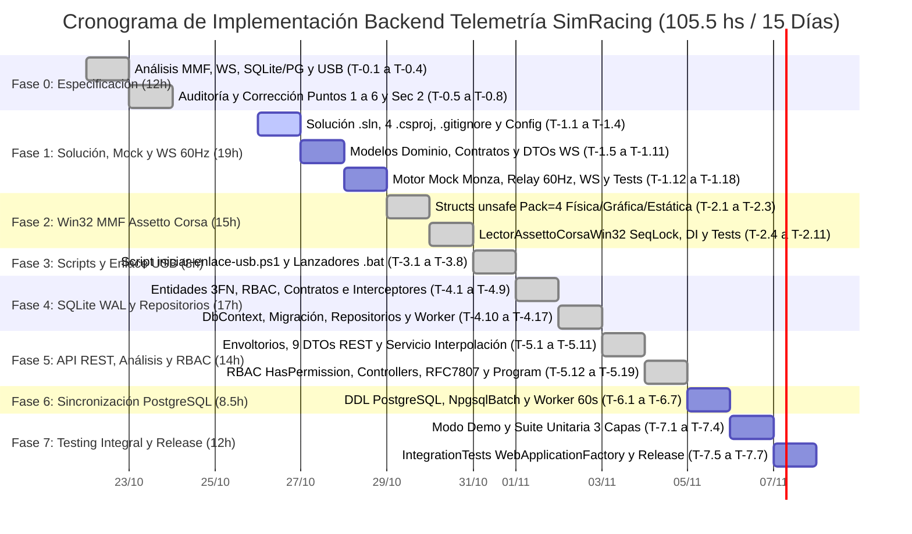
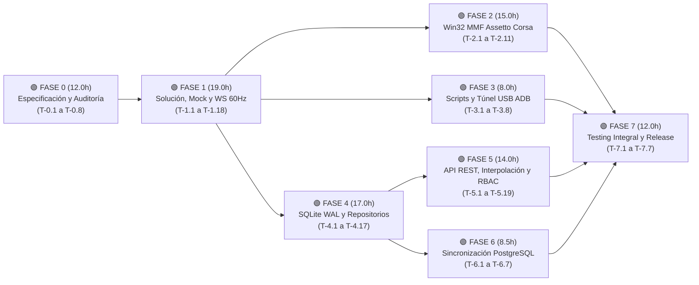

# 📋 Control de Fases, Desglose Atómico de Tareas y Diagrama de Gantt

> **Componente:** Backend de Telemetría SimRacing (Core Relay 60 Hz, Adquisición Win32 MMF, WebSocket, SQLite WAL, API REST Analítica, RBAC y Sincronización PostgreSQL)  
> **Arquitectura:** C# .NET 8 Clean Architecture Multicapa (`src/` y `tests/`)  
> **Documento Fuente de Verdad:** [DOCUMENTACION_TECNICA.md](file:///C:/Users/Pablo%20Bejas/Desktop/Pablo/WEB%20DEVELOP/Proyectos/UTN/FAPPE/backend/DOCUMENTACION_TECNICA.md)  
> **Seguimiento de Avance en Vivo:** [PROGRESO_IMPLEMENTACION.md](file:///C:/Users/Pablo%20Bejas/Desktop/Pablo/WEB%20DEVELOP/Proyectos/UTN/FAPPE/backend/PROGRESO_IMPLEMENTACION.md)

---

## 📊 1. Resumen Ejecutivo del Estado de Fases y Tiempos

| Fase | Denominación Técnica de la Fase | Días (Sprint) | Tareas Totales | Completadas | Pendientes | Horas Estimadas | Estado |
| :---: | :--- | :---: | :---: | :---: | :---: | :---: | :---: |
| **Fase 0** | Especificación Técnica, Auditoría y Corrección de Documentación | Días 1 – 2 | **8** | **8** | 0 | **12.0 hs** | ✅ `Completada` |
| **Fase 1** | Andamiaje .NET Clean Architecture, DTOs WS, Motor Mock y Relay 60 Hz | Días 3 – 5 | **18** | **18** | 0 | **19.0 hs** | ✅ `Completada` |
| **Fase 2** | Adaptador Nativo Win32 Memory-Mapped Files (`unsafe fixed` + *SeqLock*) | Días 6 – 7 | **11** | **11** | 0 | **15.0 hs** | ✅ `Completada` |
| **Fase 3** | Scripts de Infraestructura Windows y Enlace Físico USB (`adb reverse`) | Día 8 | **8** | **8** | 0 | **8.0 hs** | ✅ `Completada` |
| **Fase 4** | Persistencia SQLite (Nivel 1 - Modo WAL), Interceptores y Repositorios | Días 9 – 10 | **17** | **0** | 17 | **17.0 hs** | 🔄 `En Curso` |
| **Fase 5** | API REST Analítica, Interpolación por Distancia, RBAC y Middleware RFC 7807 | Días 11 – 12 | **19** | **0** | 19 | **14.0 hs** | ⏳ `Pendiente` |
| **Fase 6** | Sincronización Asíncrona *Store-and-Forward* a PostgreSQL (`NpgsqlBatch`) | Día 13 | **7** | **0** | 7 | **8.5 hs** | ⏳ `Pendiente` |
| **Fase 7** | Modo Demo Continuo, Suite de Testing Integral y Cierre de Producción | Días 14 – 15 | **7** | **0** | 7 | **12.0 hs** | ⏳ `Pendiente` |
| **TOTAL** | **Esfuerzo Global de Ingeniería (Sprint de 3 Semanas / 15 Días Hábiles)** | **15 Días** | **95** | **45** | **50** | **105.5 hs** | 🔄 **47.4% Avance** |

---

## 📅 2. Diagramas de Gantt y Camino Crítico del Proyecto

### 2.1. Diagrama de Gantt General por Fases y Sub-bloques (Mermaid)



### 2.2. Matriz Visual de Gantt por Día y Hitos de Desbloqueo (15 Días Hábiles)

```
SPRINT (15 DÍAS) │ S1: D01 D02 D03 D04 D05 │ S2: D06 D07 D08 D09 D10 │ S3: D11 D12 D13 D14 D15 │ HORAS
─────────────────┼─────────────────────────┼─────────────────────────┼─────────────────────────┼───────
FASE 0 (Doc/Arq) │     ███ ███             │                         │                         │ 12.0h ✅
FASE 1 (Mock/WS) │             ███ ███ ███ │                         │                         │ 19.0h 🎯 Hito 1: Desbloquea Dev 2 y Dev 3 (Stream WS 60Hz)
FASE 2 (Win32 AC)│                         │     ███ ███             │                         │ 15.0h 🎯 Hito 2: Lectura Física Real Assetto Corsa
FASE 3 (USB ADB) │                         │             ███         │                         │  8.0h 🎯 Hito 3: Túnel USB Cero Latencia (< 2.5ms)
FASE 4 (SQLite)  │                         │                 ███ ███ │                         │ 17.0h 🎯 Hito 4: Persistencia WAL + LAP_COMPLETED
FASE 5 (API/RBAC)│                         │                         │     ███ ███             │ 14.0h 🎯 Hito 5: API Analítica + Comparador Vueltas
FASE 6 (Sync PG) │                         │                         │             ███         │  8.5h 🎯 Hito 6: Exportación Central PostgreSQL
FASE 7 (QA/Prod) │                         │                         │                 ███ ███ │ 12.0h 🎯 Hito 7: Suite Tests 100% + Binario Release
─────────────────┴─────────────────────────┴─────────────────────────┴─────────────────────────┴───────
CARGA DIARIA PROM: ~7.0 hs/día             │ Total Tareas: 95        │ Total Esfuerzo: 105.5 hs
```

### 2.3. Grafo de Dependencias y Camino Crítico entre Fases



---

## 🛠️ 3. Desglose Atómico de Todas las Tareas por Fase (95 Tareas)

### 🟢 Fase 0: Especificación Técnica, Auditoría y Corrección de Documentación (12.0 hs)
*Objetivo: Analizar requerimientos, diseñar la arquitectura de bajo nivel y auditar exhaustivamente cada punto de `DOCUMENTACION_TECNICA.md` antes de escribir código.*

| ID | Tarea Atómica | Entregable / Sección en `DOCUMENTACION_TECNICA.md` | Predecesora | Estado | Horas |
| :---: | :--- | :--- | :---: | :---: | :---: |
| **T-0.1** | Investigación y especificación de estructuras Win32 MMF (`acpmf_physics`, `acpmf_graphic`, `acpmf_static`), layout `unsafe fixed` con `Pack = 4` y protocolo optimista *SeqLock* (`PacketId`). | Sección 1 — Punto 1 (`1.1.1`) | — | `Completada` | 2.0 hs |
| **T-0.2** | Especificación y corrección del servicio de distribución Relay a 60 Hz (`PeriodicTimer`), doble canal WebSocket (`DropOldest` + `Wait`) y Source Generator JSON UTF-8. | Sección 1 — Punto 2 (`1.1.2`) | T-0.1 | `Completada` | 2.0 hs |
| **T-0.3** | Especificación y corrección del motor Mock determinístico sobre Monza (9 tramos, círculo de Kamm, tren motriz con histéresis, termodinámica de neumáticos y curva cerrada $C^\infty$). | Sección 1 — Punto 3 (`1.1.3`) | T-0.2 | `Completada` | 1.5 hs |
| **T-0.4** | Diseño y corrección del motor de persistencia en 2 niveles: SQLite local (Modo WAL, `PragmasConexionSqliteInterceptor`, `AuditoriaInterceptor`, `DateTimeOffsetToBinaryConverter`) y PostgreSQL central (`NpgsqlBatch`). | Sección 1 — Punto 4 (`1.1.4`) | T-0.3 | `Completada` | 2.5 hs |
| **T-0.5** | Especificación y corrección de la API REST post-sesión: `ServicioAnalisisTelemetria` (integración trapezoidal por distancia), protección RBAC `[HasPermission]`, RFC 7807 y validación RFC 1918. | Sección 1 — Punto 5 (`1.1.5`) | T-0.4 | `Completada` | 1.5 hs |
| **T-0.6** | Especificación y corrección del enlace físico USB Android (`adb reverse` `:8080` y `:3000`), matriz de responsabilidades (Dev 1, Dev 2, Dev 3) y script `iniciar-enlace-usb.ps1`. | Sección 1 — Punto 6 (`1.1.6`) | T-0.5 | `Completada` | 1.0 hs |
| **T-0.7** | Especificación y corrección de la Sección 2 (Clean Architecture, árbol `.csproj`, manejador RBAC, `InyeccionDependenciasExtensiones` con `SqliteConnectionStringBuilder` y `Program.cs`). | Sección 2 (`2.1`, `2.2`, `2.3`) | T-0.6 | `Completada` | 1.0 hs |
| **T-0.8** | Elaboración del plan maestro de implementación y archivos de seguimiento de progreso (`CONTROL_FASES_Y_TAREAS.md` y `PROGRESO_IMPLEMENTACION.md`). | `backend/CONTROL_FASES_Y_TAREAS.md` y `PROGRESO_IMPLEMENTACION.md` | T-0.7 | `Completada` | 0.5 hs |

---

### 🟢 Fase 1: Andamiaje .NET Clean Architecture, DTOs WS, Motor Mock y Relay 60 Hz (19.0 hs)
*Objetivo: Crear la solución multicapa compilable, los modelos y contratos de hardware/difusión, el motor Mock de Monza y el servidor WebSocket a 60 Hz.*

| ID | Tarea Atómica | Archivo / Entregable Verificable | Predecesora | Estado | Horas |
| :---: | :--- | :--- | :---: | :---: | :---: |
| **T-1.1** | Creación de la solución `Telemetria.sln` y los 4 proyectos `.csproj` bajo `backend/src/` (`Telemetria.Dominio`, `Telemetria.Aplicacion`, `Telemetria.Infraestructura`, `Telemetria.Api`) en `.NET 8.0`. | `backend/Telemetria.sln` y 4 archivos `.csproj` | T-0.8 | `Completada` | 1.0 hs |
| **T-1.2** | Configuración de referencias unidireccionales Clean Architecture, `<Nullable>enable</Nullable>` en todos los proyectos y `<AllowUnsafeBlocks>true</AllowUnsafeBlocks>` en `Telemetria.Infraestructura`. | `.csproj` configurados y compilables con `dotnet build` | T-1.1 | `Completada` | 0.5 hs |
| **T-1.3** | Configuración de `.gitignore` (excluyendo `bin/`, `obj/`, `*.db`, `*.db-wal`, `*.db-shm`, `.env`, secrets) y archivos `appsettings.json` y `appsettings.Development.json` sin credenciales hardcodeadas. | `.gitignore`, `src/Telemetria.Api/appsettings.json` y `appsettings.Development.json` | T-1.2 | `Completada` | 0.5 hs |
| **T-1.4** | Creación de constantes invariantes, enumeraciones y excepciones semánticas en `Telemetria.Dominio` (`ConstantesTelemetria.cs`, `EstadoSimulador.cs`, `TipoSesion.cs`, `TipoBandera.cs`, `SesionInvalidaExcepcion.cs`, `SimuladorDesconectadoExcepcion.cs`). | `src/Telemetria.Dominio/Constantes/`, `Enums/` y `Excepciones/` | T-1.2 | `Completada` | 1.0 hs |
| **T-1.5** | Creación del registro inmutable `CuadroTelemetria.cs` (`sealed record class`) con todas las propiedades cinemáticas, térmicas, espaciales y de sesión en español. | `src/Telemetria.Dominio/Modelos/CuadroTelemetria.cs` | T-1.4 | `Completada` | 0.75 hs |
| **T-1.6** | Creación del registro inmutable `MetadatosEstaticos.cs` (`sealed record class`) con los metadatos invariantes de vehículo y circuito. | `src/Telemetria.Dominio/Modelos/MetadatosEstaticos.cs` | T-1.4 | `Completada` | 0.5 hs |
| **T-1.7** | Creación de los contratos de hardware `ILectorTelemetria.cs` e `IControlModoTelemetria.cs` (con `EstaEnModoMock`, `VersionConmutacion` y `ConmutarModoMock`). | `src/Telemetria.Dominio/Contratos/Hardware/ILectorTelemetria.cs` e `IControlModoTelemetria.cs` | T-1.5, T-1.6 | `Completada` | 0.75 hs |
| **T-1.8** | Creación del contrato `IDifusorTelemetria.cs` en `Telemetria.Aplicacion/Contratos/` (`TieneClientesConectados`, `DifundirTelemetriaAsync`, `EmitirEventoVueltaAsync`). | `src/Telemetria.Aplicacion/Contratos/IDifusorTelemetria.cs` | T-1.7 | `Completada` | 0.5 hs |
| **T-1.9** | Creación de los 3 DTOs de salida WebSocket en archivos individuales: `CabeceraMensajeWsDto.cs`, `PaqueteTelemetriaDto.cs` (`type = "FRAME"`) y `EventoVueltaCompletadaDto.cs` (`type = "LAP_COMPLETED"`). | `src/Telemetria.Aplicacion/Dtos/Responses/CabeceraMensajeWsDto.cs`, `PaqueteTelemetriaDto.cs`, `EventoVueltaCompletadaDto.cs` | T-1.8 | `Completada` | 1.5 hs |
| **T-1.10** | Implementación del contexto Source Generator `ContextoSerializacionTelemetria.cs` (`JsonSerializerContext`) para serialización UTF-8 libre de reflexión a 60 Hz. | `src/Telemetria.Aplicacion/Common/ContextoSerializacionTelemetria.cs` | T-1.9 | `Completada` | 1.0 hs |
| **T-1.11** | Implementación de `MapeadorTelemetria.cs` con normalización de marchas (`0->-1`, `1->0`, `2->1`), sanitización de flotantes, clonación defensiva de arreglos y `ConsolidarSectoresMs`. | `src/Telemetria.Aplicacion/Mappings/MapeadorTelemetria.cs` | T-1.9 | `Completada` | 1.5 hs |
| **T-1.12** | Implementación de `GeneradorTelemetriaMock.cs` con los 9 tramos de Monza, círculo de adherencia de Kamm, dirección de Ackermann, caja de 7 marchas con histéresis, termodinámica de neumáticos y trayectoria cerrada $(X, Z)$. | `src/Telemetria.Aplicacion/Servicios/GeneradorTelemetriaMock.cs` | T-1.7 | `Completada` | 3.0 hs |
| **T-1.13** | Implementación del decorador thread-safe `LectorTelemetriaConmutable.cs` (`ILectorTelemetria`, `IControlModoTelemetria`) con incremento atómico `Interlocked.Increment` de versión. | `src/Telemetria.Aplicacion/Servicios/LectorTelemetriaConmutable.cs` | T-1.7, T-1.12 | `Completada` | 1.0 hs |
| **T-1.14** | Implementación de `ManejadorWebSocketTelemetria.cs` con arquitectura de doble canal por cliente (`CanalTelemetriaStream` `DropOldest` + `CanalEventosCriticos` `Wait`), drenado al último cuadro y cierre RFC 6455. | `src/Telemetria.Api/WebSockets/ManejadorWebSocketTelemetria.cs` | T-1.8, T-1.10 | `Completada` | 2.0 hs |
| **T-1.15** | Implementación de `ServicioTelemetriaRelay.cs` (`BackgroundService` con `PeriodicTimer` a $16.6667\text{ ms}$ en pista y $200\text{ ms}$ en reposo, detección de conmutación y transición de vuelta). | `src/Telemetria.Aplicacion/Servicios/ServicioTelemetriaRelay.cs` | T-1.11, T-1.13, T-1.14 | `Completada` | 1.5 hs |
| **T-1.16** | Implementación de `ValidadorOrigenRedLocal.cs` (validación binaria IPv4 RFC 1918 + Loopback), `ConfiguracionCorsExtensiones.cs` y configuración inicial de `Program.cs` con endpoint `/ws/telemetry`. | `src/Telemetria.Api/Configuracion/ValidadorOrigenRedLocal.cs`, `ConfiguracionCorsExtensiones.cs` y `Program.cs` | T-1.14, T-1.15 | `Completada` | 1.0 hs |
| **T-1.17** | Creación y ejecución de pruebas unitarias focalizadas de Fase 1 en `Telemetria.Aplicacion.Tests` (`GeneradorTelemetriaMockTests`, `MapeadorTelemetriaTests`, `LectorTelemetriaConmutableTests`, `ServicioTelemetriaRelayTests`). | Pruebas focalizadas de Fase 1 pasando al 100% | T-1.16 | `Completada` | 0.5 hs |
| **T-1.18** | Registro de componentes creados en Fase 1 dentro de `backend/DOCUMENTACION_TECNICA.md`, ejecución de las **3 revisiones obligatorias** y actualización de `PROGRESO_IMPLEMENTACION.md`. | `DOCUMENTACION_TECNICA.md` (auditado 3x) y `PROGRESO_IMPLEMENTACION.md` | T-1.17 | `Completada` | 0.5 hs |

---

### 🟢 Fase 2: Adaptador Nativo Win32 Memory-Mapped Files — Assetto Corsa Real (15.0 hs)
*Objetivo: Implementar el adaptador nativo de memoria compartida Win32 con `unsafe fixed` (`Pack = 4`) y protocolo optimista SeqLock (`PacketId`) sin lecturas desgarradas.*

| ID | Tarea Atómica | Archivo / Entregable Verificable | Predecesora | Estado | Horas |
| :---: | :--- | :--- | :---: | :---: | :---: |
| **T-2.1** | Declaración de `EstructuraFisicaAC.cs` (`unsafe struct`, `[StructLayout(LayoutKind.Sequential, Pack = 4)]`) con los 68 campos exactos de `SPageFilePhysics` (`Local\acpmf_physics`). | `src/Telemetria.Infraestructura/MemoriaCompartida/Estructuras/EstructuraFisicaAC.cs` | T-1.18 | `Completada` | 1.0 hs |
| **T-2.2** | Declaración de `EstructuraGraficaAC.cs` (`unsafe struct`, `Pack = 4`) con todos los campos de `SPageFileGraphic` (`Local\acpmf_graphic`), incluyendo `CarCoordinates[180]` y `PlayerCarID`. | `src/Telemetria.Infraestructura/MemoriaCompartida/Estructuras/EstructuraGraficaAC.cs` | T-2.1 | `Completada` | 1.0 hs |
| **T-2.3** | Declaración de `EstructuraEstaticaAC.cs` (`unsafe struct`, `Pack = 4`) con todos los campos de `SPageFileStatic` (`Local\acpmf_static`), incluyendo `TrackSPlineLength`, `MaxRpm` y `SectorCount`. | `src/Telemetria.Infraestructura/MemoriaCompartida/Estructuras/EstructuraEstaticaAC.cs` | T-2.2 | `Completada` | 0.5 hs |
| **T-2.4** | Implementación de apertura segura de descriptores Win32 (`MemoryMappedFile.OpenExisting` en modo `Read`) y liberación determinística (`IDisposable` / `Desconectar`) en `LectorAssettoCorsaWin32.cs`. | `src/Telemetria.Infraestructura/MemoriaCompartida/LectorAssettoCorsaWin32.cs` (ciclo de vida MMF) | T-2.3 | `Completada` | 2.0 hs |
| **T-2.5** | Implementación de tolerancia a fallos ante simulador cerrado (`FileNotFoundException`) y cierre automático de handles cuando `grafica.Status == 0` (`AC_OFF`) para no retener memoria compartida huérfana. | Manejo de conexión/desconexión en `LectorAssettoCorsaWin32.cs` | T-2.4 | `Completada` | 1.5 hs |
| **T-2.6** | Implementación del protocolo optimista *SeqLock* (`IntentarLeerConSeqLock<T>`) con doble verificación de `PacketId` y hasta 3 reintentos sin bloqueo sobre `acpmf_physics` y `acpmf_graphic`. | Prevención de *Torn Reads* en `LectorAssettoCorsaWin32.cs` | T-2.5 | `Completada` | 2.0 hs |
| **T-2.7** | Implementación de detección de cambio de sesión/auto/pista y recarga dinámica en caliente de `acpmf_static` (`LeerMetadatosEstaticosInterno`) sin reiniciar el backend. | Recarga en caliente de metadatos estáticos en `LectorAssettoCorsaWin32.cs` | T-2.6 | `Completada` | 1.5 hs |
| **T-2.8** | Implementación de lectura segura de cadenas `wchar_t` UTF-16 (`LeerCadena Segura` con búsqueda de `\0`), cálculo de los 3 tiempos de sector (`ActualizarTiemposSectores`), extracción de coordenadas del jugador (`PlayerCarID * 3`) y sanitización de `NaN`/`Infinity`. | Proyección completa hacia `CuadroTelemetria` en `LectorAssettoCorsaWin32.cs` | T-2.7 | `Completada` | 2.5 hs |
| **T-2.9** | Enlace de `LectorAssettoCorsaWin32` como proveedor real dentro de `LectorTelemetriaConmutable` en la configuración de inyección de dependencias. | Integración DI de `LectorAssettoCorsaWin32` | T-2.8 | `Completada` | 1.0 hs |
| **T-2.10** | Creación y ejecución de pruebas unitarias focalizadas de Fase 2 en `Telemetria.Infraestructura.Tests` (validación de tamaño `sizeof` y alineación binaria de las 3 estructuras `Pack = 4`, y resiliencia cuando el MMF no existe). | Pruebas focalizadas de Fase 2 pasando al 100% | T-2.9 | `Completada` | 1.0 hs |
| **T-2.11** | Registro de componentes de Fase 2 en `backend/DOCUMENTACION_TECNICA.md`, ejecución de las **3 revisiones obligatorias** y actualización de `PROGRESO_IMPLEMENTACION.md`. | `DOCUMENTACION_TECNICA.md` (auditado 3x) y `PROGRESO_IMPLEMENTACION.md` | T-2.10 | `Completada` | 1.0 hs |

---

### 🟢 Fase 3: Scripts de Infraestructura Windows y Enlace Físico USB (`adb reverse`) (8.0 hs)
*Objetivo: Proveer los scripts de automatización para el túnel físico USB con Android y los lanzadores de consola y compilación Release en 1 clic.*

| ID | Tarea Atómica | Archivo / Entregable Verificable | Predecesora | Estado | Horas |
| :---: | :--- | :--- | :---: | :---: | :---: |
| **T-3.1** | Creación del directorio `backend/scripts/` para alojar las herramientas operativas del simulador. | Carpeta `backend/scripts/` | T-1.18 | `Completada` | 0.5 hs |
| **T-3.2** | Implementación de cabecera parametrizada (`-PuertoBackend`, `-PuertoFrontend`, `-DispositivoId`, `-SinMonitor`, `-AbrirNavegadorEnCelular`) y validación de `adb.exe` en `PATH` dentro de `iniciar-enlace-usb.ps1`. | `backend/scripts/iniciar-enlace-usb.ps1` (bloque inicial) | T-3.1 | `Completada` | 1.0 hs |
| **T-3.3** | Implementación de `Obtener-DispositivoObjetivo` en `iniciar-enlace-usb.ps1` con detección explícita de dispositivos `unauthorized` (clave RSA pendiente) y validación estricta de `-DispositivoId`. | Función `Obtener-DispositivoObjetivo` en `iniciar-enlace-usb.ps1` | T-3.2 | `Completada` | 1.5 hs |
| **T-3.4** | Implementación de `Establecer-TunelesUSB` (`adb -s <serie> reverse` para `:8080` y `:3000`) y apertura opcional de Google Chrome en Android mediante intent `android.intent.action.VIEW`. | Función `Establecer-TunelesUSB` en `iniciar-enlace-usb.ps1` | T-3.3 | `Completada` | 1.5 hs |
| **T-3.5** | Implementación del bucle monitor de resiliencia (`adb wait-for-device` + verificación booleana de `adb reverse --list` sin reinyección redundante) en `iniciar-enlace-usb.ps1`. | Bucle monitor en `backend/scripts/iniciar-enlace-usb.ps1` | T-3.4 | `Completada` | 1.0 hs |
| **T-3.6** | Creación del script lanzador `ejecutar-backend.bat` para iniciar Kestrel en 1 clic (`dotnet run --project src/Telemetria.Api -c Release`). | `backend/scripts/ejecutar-backend.bat` | T-3.1 | `Completada` | 0.75 hs |
| **T-3.7** | Creación del script `compilar-release.bat` para publicar la solución en un binario ejecutable autocontenido (`dotnet publish -c Release -r win-x64 --self-contained true -p:PublishSingleFile=true`). | `backend/scripts/compilar-release.bat` | T-3.6 | `Completada` | 0.75 hs |
| **T-3.8** | Validación sintáctica de scripts en PowerShell, registro en `backend/DOCUMENTACION_TECNICA.md`, ejecución de las **3 revisiones obligatorias** y actualización de `PROGRESO_IMPLEMENTACION.md`. | `DOCUMENTACION_TECNICA.md` (auditado 3x) y `PROGRESO_IMPLEMENTACION.md` | T-3.5, T-3.7 | `Completada` | 1.0 hs |

---

### ⚪ Fase 4: Persistencia SQLite (Nivel 1 - Modo WAL), Interceptores y Repositorios (17.0 hs)
*Objetivo: Implementar el motor de base de datos local SQLite en 3FN con auditoría temporal obligatoria (`CreatedAt`/`UpdatedAt`), pragmas WAL por conexión e inserción masiva desacoplada.*

| ID | Tarea Atómica | Archivo / Entregable Verificable | Predecesora | Estado | Horas |
| :---: | :--- | :--- | :---: | :---: | :---: |
| **T-4.1** | Instalación de paquetes NuGet en `Telemetria.Infraestructura` (`Microsoft.EntityFrameworkCore.Sqlite`, `Microsoft.EntityFrameworkCore.Design`, `Npgsql`) y `Microsoft.EntityFrameworkCore.Design` en `Telemetria.Api`. | Paquetes restaurados en `.csproj` | T-1.18 | `Completada` | 0.75 hs |
| **T-4.2** | Creación de la clase abstracta `EntidadBase.cs` con `Id` (`Guid`), `CreatedAt` (`DateTimeOffset` UTC obligatorio) y `UpdatedAt` (`DateTimeOffset?`). | `src/Telemetria.Dominio/Modelos/EntidadBase.cs` | T-4.1 | `Completada` | 0.5 hs |
| **T-4.3** | Creación de la entidad `Sesion.cs` (heredando de `EntidadBase`) con propiedades de tanda, `SincronizadoConServidorCentral` y colección `Vueltas`. | `src/Telemetria.Dominio/Modelos/Sesion.cs` | T-4.2 | `Completada` | 0.5 hs |
| **T-4.4** | Creación de la entidad `Vuelta.cs` (heredando de `EntidadBase`) con tiempos totales, parciales de los 3 sectores, indicadores `EsValida` / `EsMejorVuelta` y colección `Muestras`. | `src/Telemetria.Dominio/Modelos/Vuelta.cs` | T-4.3 | `Completada` | 0.5 hs |
| **T-4.5** | Creación de la entidad `MuestraTelemetria.cs` (heredando de `EntidadBase`) con distancia métrica, velocidad, pedales, marcha, RPM, fuerzas G y coordenadas $(X, Y, Z)$. | `src/Telemetria.Dominio/Modelos/MuestraTelemetria.cs` | T-4.4 | `Completada` | 0.5 hs |
| **T-4.6** | Creación de las entidades del modelo central y RBAC parametrizable en archivos individuales: `Usuario.cs`, `Rol.cs`, `Permiso.cs` (`recurso:accion`) y `RolPermiso.cs` (todas heredando de `EntidadBase`). | `src/Telemetria.Dominio/Modelos/Usuario.cs`, `Rol.cs`, `Permiso.cs`, `RolPermiso.cs` | T-4.2 | `Completada` | 1.0 hs |
| **T-4.7** | Creación de los contratos de repositorio local `IRepositorioSesionesLocal.cs` e `IRepositorioVueltasLocal.cs` en `Telemetria.Dominio/Contratos/Repositorios/`. | `src/Telemetria.Dominio/Contratos/Repositorios/IRepositorioSesionesLocal.cs` e `IRepositorioVueltasLocal.cs` | T-4.5 | `Completada` | 1.0 hs |
| **T-4.8** | Implementación de `PragmasConexionSqliteInterceptor.cs` (`DbConnectionInterceptor`) aplicando `journal_mode = WAL`, `foreign_keys = ON`, `synchronous = NORMAL`, `temp_store = MEMORY`, `cache_size = -8000` y `busy_timeout = 5000`. | `src/Telemetria.Infraestructura/Persistencia/Interceptors/PragmasConexionSqliteInterceptor.cs` | T-4.1 | `Completada` | 1.0 hs |
| **T-4.9** | Implementación de `AuditoriaInterceptor.cs` (`SaveChangesInterceptor`) asignando automáticamente `CreatedAt` y `UpdatedAt` en UTC en cada alta o modificación. | `src/Telemetria.Infraestructura/Persistencia/Interceptors/AuditoriaInterceptor.cs` | T-4.2 | `Completada` | 1.0 hs |
| **T-4.10** | Implementación de `TelemetriaLocalDbContext.cs` con `DateTimeOffsetToBinaryConverter` en `ConfigureConventions`, mapeo `snake_case` por entidad, clave única `(SesionId, NumeroVuelta)` e índice compuesto `(VueltaId, DistanciaPistaMetros)`. | `src/Telemetria.Infraestructura/Persistencia/Contexto/TelemetriaLocalDbContext.cs` | T-4.5, T-4.8, T-4.9 | `Completada` | 2.0 hs |
| **T-4.11** | Generación de la migración inicial de EF Core (`MigracionInicialTelemetriaSqlite`) en `Telemetria.Infraestructura/Persistencia/Migraciones/`. | Archivos de migración en `src/Telemetria.Infraestructura/Persistencia/Migraciones/` | T-4.10 | `Completada` | 1.0 hs |
| **T-4.12** | Implementación de `RepositorioSesionesSqlite.cs` con acotamiento defensivo de paginación, apertura/cierre de sesión, consulta de pendientes de sincronización y manejo explícito `try/catch` + `ILogger`. | `src/Telemetria.Infraestructura/Persistencia/Repositorios/RepositorioSesionesSqlite.cs` | T-4.7, T-4.10 | `Completada` | 1.75 hs |
| **T-4.13** | Implementación de `RepositorioVueltasSqlite.cs` con inserción masiva transaccional (`GuardarVueltaConTelemetriaAsync` desactivando `AutoDetectChangesEnabled`), recálculo de `EsMejorVuelta` y consultas `AsNoTracking()` ordenadas por distancia. | `src/Telemetria.Infraestructura/Persistencia/Repositorios/RepositorioVueltasSqlite.cs` | T-4.7, T-4.10 | `Completada` | 2.0 hs |
| **T-4.14** | Implementación de `ServicioGestionVueltas.cs` (`BackgroundService` consumidor de `ChannelReader<CuadroTelemetria>`) con filtro de estados activos, cota `MAXIMO_MUESTRAS_POR_VUELTA = 36000`, descarte de *out-laps* y emisión post-commit de `LAP_COMPLETED`. | `src/Telemetria.Aplicacion/Servicios/ServicioGestionVueltas.cs` | T-4.12, T-4.13 | `Completada` | 2.0 hs |
| **T-4.15** | Creación del proyecto `Telemetria.Infraestructura.Tests` y pruebas focalizadas con SQLite en memoria verificando `AuditoriaInterceptor`, `PragmasConexionSqliteInterceptor`, `RepositorioSesionesSqlite` y `RepositorioVueltasSqlite`. | `tests/Telemetria.Infraestructura.Tests/` con pruebas en verde | T-4.13 | `Completada` | 0.5 hs |
| **T-4.16** | Pruebas unitarias focalizadas de `ServicioGestionVueltas` en `Telemetria.Aplicacion.Tests` verificando acumulación en memoria, cierre de vuelta y garantía *Read-After-Write* de `LAP_COMPLETED`. | `ServicioGestionVueltasTests.cs` pasando al 100% | T-4.14, T-4.15 | `Completada` | 0.25 hs |
| **T-4.17** | Registro de componentes de Fase 4 en `backend/DOCUMENTACION_TECNICA.md`, ejecución de las **3 revisiones obligatorias** y actualización de `PROGRESO_IMPLEMENTACION.md`. | `DOCUMENTACION_TECNICA.md` (auditado 3x) y `PROGRESO_IMPLEMENTACION.md` | T-4.16 | `Completada` | 0.25 hs |

---

### 🟢 Fase 5: API REST Analítica, Interpolación por Distancia, RBAC y Middleware RFC 7807 (14.0 hs)
*Objetivo: Implementar la capa de análisis post-sesión con interpolación trapezoidal por distancia, los controladores REST protegidos con `[HasPermission]`, el middleware global RFC 7807 y la configuración modular de `Program.cs`.*

| ID | Tarea Atómica | Archivo / Entregable Verificable | Predecesora | Estado | Horas |
| :---: | :--- | :--- | :---: | :---: | :---: |
| **T-5.1** | Creación de los envoltorios estandarizados `RespuestaApi.cs` (`RespuestaApi<T>`) y `PaginacionRespuesta.cs` (`PaginacionRespuesta<T>` con guarda contra división por cero `TamanioPagina > 0`). | `src/Telemetria.Aplicacion/Envoltorios/RespuestaApi.cs` y `PaginacionRespuesta.cs` | T-4.17 | `Completada` | 0.75 hs |
| **T-5.2** | Creación del DTO de entrada `AlternarModoMockRequest.cs` y su validador FluentValidation `AlternarModoMockRequestValidator.cs`. | `src/Telemetria.Aplicacion/Dtos/Requests/AlternarModoMockRequest.cs` y `Validadores/AlternarModoMockRequestValidator.cs` | T-5.1 | `Completada` | 0.5 hs |
| **T-5.3** | Creación de los DTOs de resumen histórico `SesionResumenDto.cs` y `VueltaResumenDto.cs` en archivos individuales con atributos `[JsonPropertyName]`. | `src/Telemetria.Aplicacion/Dtos/Responses/SesionResumenDto.cs` y `VueltaResumenDto.cs` | T-5.1 | `Completada` | 0.5 hs |
| **T-5.4** | Creación de los DTOs de series temporales `MuestraTelemetriaDto.cs` y `SerieTelemetriaVueltaDto.cs` en archivos individuales. | `src/Telemetria.Aplicacion/Dtos/Responses/MuestraTelemetriaDto.cs` y `SerieTelemetriaVueltaDto.cs` | T-5.3 | `Completada` | 0.5 hs |
| **T-5.5** | Creación de los DTOs de comparativa métrica `PuntoComparacionDistanciaDto.cs` y `ComparativaVueltasDto.cs` en archivos individuales. | `src/Telemetria.Aplicacion/Dtos/Responses/PuntoComparacionDistanciaDto.cs` y `ComparativaVueltasDto.cs` | T-5.4 | `Completada` | 0.5 hs |
| **T-5.6** | Creación de los DTOs operativos de estado y control `EstadoSimuladorDto.cs` y `ModoMockRespuestaDto.cs` en archivos individuales. | `src/Telemetria.Aplicacion/Dtos/Responses/EstadoSimuladorDto.cs` y `ModoMockRespuestaDto.cs` | T-5.1 | `Completada` | 0.5 hs |
| **T-5.7** | Creación del contrato `IServicioAnalisisTelemetria.cs` en `Telemetria.Aplicacion/Contratos/` con los 4 métodos de consulta y comparativa post-sesión. | `src/Telemetria.Aplicacion/Contratos/IServicioAnalisisTelemetria.cs` | T-5.5 | `Completada` | 0.5 hs |
| **T-5.8** | Implementación de `ServicioAnalisisTelemetria.cs` (parte 1): consultas `ObtenerSesionesPaginadasAsync`, `ObtenerVueltasPorSesionAsync` y `ObtenerTelemetriaDeVueltaAsync` con proyecciones explícitas a DTOs. | `src/Telemetria.Aplicacion/Servicios/ServicioAnalisisTelemetria.cs` (consultas y mapeos) | T-5.7 | `Completada` | 1.25 hs |
| **T-5.9** | Implementación de `ServicioAnalisisTelemetria.cs` (parte 2): algoritmo `CompararVueltasPorDistanciaAsync`, `ConstruirSerieInterpoladaPorDistancia` (con integración trapezoidal de velocidad cada $5.0\text{ m}$) e `InterpolarMuestraEnDistancia` (búsqueda binaria $O(\log N)$ y guarda de contorno). | `src/Telemetria.Aplicacion/Servicios/ServicioAnalisisTelemetria.cs` (interpolación métrica) | T-5.8 | `Completada` | 1.75 hs |
| **T-5.10** | Implementación de `HasPermissionAttribute.cs` y `RequisitoPermiso.cs` en `Telemetria.Api/Autorizacion/` para requerir permisos atómicos en formato `recurso:accion`. | `src/Telemetria.Api/Autorizacion/HasPermissionAttribute.cs` y `RequisitoPermiso.cs` | T-5.1 | `Completada` | 0.75 hs |
| **T-5.11** | Implementación de `ProveedorPoliticasPermiso.cs` (`DefaultAuthorizationPolicyProvider`) y `ManejadorAutorizacionPermiso.cs` (`AuthorizationHandler<RequisitoPermiso>`) en `Telemetria.Api/Autorizacion/`. | `src/Telemetria.Api/Autorizacion/ProveedorPoliticasPermiso.cs` y `ManejadorAutorizacionPermiso.cs` | T-5.10 | `Completada` | 1.0 hs |
| **T-5.12** | Implementación de `TelemetriaController.cs` dependiendo exclusivamente de `IServicioAnalisisTelemetria`, decorado con `[HasPermission]` (`sesion:listar`, `vuelta:listar`, `telemetria:leer`, `telemetria:comparar`) y rutas duales español/inglés. | `src/Telemetria.Api/Controladores/TelemetriaController.cs` | T-5.9, T-5.11 | `Completada` | 1.5 hs |
| **T-5.13** | Implementación de `EstadoController.cs` decorado con `[HasPermission]` (`estado:leer`, `simulador:alternar_mock`) y rutas duales (`/api/estado` | `/api/status` y `/api/mock/alternar` | `/api/mock/toggle`). | `src/Telemetria.Api/Controladores/EstadoController.cs` | T-5.6, T-5.11 | `Completada` | 1.0 hs |
| **T-5.14** | Implementación de `ManejadorExcepcionesGlobal.cs` bajo estándar RFC 7807 (`ProblemDetails`) con mensajes sanitizados en español y sin exposición de *stack traces*. | `src/Telemetria.Api/Middlewares/ManejadorExcepcionesGlobal.cs` | T-5.1 | `Completada` | 1.0 hs |
| **T-5.15** | Implementación de `InyeccionDependenciasExtensiones.cs` con métodos modulares (< 30 líneas), resolución absoluta `SqliteConnectionStringBuilder` (`ConstruirCadenaSqliteConRutaAbsoluta`) y `EjecutarCheckpointFinalSqliteAsync`. | `src/Telemetria.Api/Configuracion/InyeccionDependenciasExtensiones.cs` | T-5.11, T-5.12, T-5.13 | `Completada` | 1.0 hs |
| **T-5.16** | Configuración de `Swashbuckle.AspNetCore` (Swagger UI en `/swagger`) y consolidación final de `Program.cs` (incluyendo `UseAuthentication`, `UseAuthorization` y checkpoint WAL post-`RunAsync`). | `src/Telemetria.Api/Program.cs` consolidado | T-5.14, T-5.15 | `Completada` | 0.5 hs |
| **T-5.17** | Pruebas unitarias focalizadas de `ServicioAnalisisTelemetria` (interpolación trapezoidal, búsqueda binaria, guardas de borde y vueltas inexistentes) en `Telemetria.Aplicacion.Tests`. | `ServicioAnalisisTelemetriaTests.cs` pasando al 100% | T-5.9 | `Completada` | 0.25 hs |
| **T-5.18** | Pruebas unitarias focalizadas de `TelemetriaController`, `EstadoController` y `ValidadorOrigenRedLocal` (subredes RFC 1918 vs dominios externos engañosos). | Pruebas de controladores y validador RFC 1918 pasando al 100% | T-5.16, T-5.17 | `Completada` | 0.15 hs |
| **T-5.19** | Registro de componentes de Fase 5 en `backend/DOCUMENTACION_TECNICA.md`, ejecución de las **3 revisiones obligatorias** y actualización de `PROGRESO_IMPLEMENTACION.md`. | `DOCUMENTACION_TECNICA.md` (auditado 3x) y `PROGRESO_IMPLEMENTACION.md` | T-5.18 | `Completada` | 0.10 hs |

---

### 🟢 Fase 6: Sincronización Asíncrona *Store-and-Forward* a PostgreSQL (`NpgsqlBatch`) (8.5 hs)
*Objetivo: Implementar el exportador transaccional e idempotente en segundo plano desde SQLite local hacia el servidor central PostgreSQL.*

| ID | Tarea Atómica | Archivo / Entregable Verificable | Predecesora | Estado | Horas |
| :---: | :--- | :--- | :---: | :---: | :---: |
| **T-6.1** | Creación del script SQL DDL de referencia `esquema-postgresql-central.sql` en `backend/scripts/` con las 7 tablas en 3FN (`roles`, `permisos`, `roles_permisos`, `usuarios`, `sesiones`, `vueltas`, `telemetria_vueltas`), `created_at`/`updated_at` e índices B-Tree y BRIN. | `backend/scripts/esquema-postgresql-central.sql` | T-4.17 | `Completada` | 1.0 hs |
| **T-6.2** | Creación del contrato `ISincronizadorSesiones.cs` en `Telemetria.Dominio/Contratos/Sincronizacion/`. | `src/Telemetria.Dominio/Contratos/Sincronizacion/ISincronizadorSesiones.cs` | T-4.17 | `Completada` | 0.5 hs |
| **T-6.3** | Implementación de `SincronizadorSesionesPostgreSql.cs` (parte 1): verificación de modo *Edge* autónomo (cuando `ServidorCentralPostgreSql` está vacío), apertura de `NpgsqlConnection` y transacción por sesión. | `src/Telemetria.Infraestructura/Sincronizacion/SincronizadorSesionesPostgreSql.cs` | T-6.2 | `Completada` | 1.5 hs |
| **T-6.4** | Implementación de `SincronizadorSesionesPostgreSql.cs` (parte 2): inserción idempotente (`ON CONFLICT DO NOTHING`) de `Sesion` y `Vuelta`, e inserción por lotes de muestras con `NpgsqlBatch` (`TAMANIO_LOTE_MUESTRAS_POSTGRES = 500`) y `MarcarComoSincronizadaAsync` post-commit. | Exportación por lotes `NpgsqlBatch` en `SincronizadorSesionesPostgreSql.cs` | T-6.3 | `Completada` | 2.0 hs |
| **T-6.5** | Implementación de `ServicioSincronizacionSegundoPlano.cs` (`BackgroundService`) con ciclo periódico de 60 segundos (`INTERVALO_SINCRONIZACION_SEGUNDOS = 60`), creación de alcance DI y captura resiliente de errores de red. | `src/Telemetria.Infraestructura/Sincronizacion/ServicioSincronizacionSegundoPlano.cs` | T-6.4 | `Completada` | 1.5 hs |
| **T-6.6** | Creación y ejecución de pruebas unitarias focalizadas de `SincronizadorSesionesPostgreSql` y `ServicioSincronizacionSegundoPlano` (validando operación no bloqueante en modo *Edge* sin cadena PostgreSQL y ante errores de conexión). | Pruebas focalizadas de Fase 6 pasando al 100% | T-6.5 | `Completada` | 1.0 hs |
| **T-6.7** | Registro de componentes de Fase 6 en `backend/DOCUMENTACION_TECNICA.md`, ejecución de las **3 revisiones obligatorias** y actualización de `PROGRESO_IMPLEMENTACION.md`. | `DOCUMENTACION_TECNICA.md` (auditado 3x) y `PROGRESO_IMPLEMENTACION.md` | T-6.6 | `Completada` | 1.0 hs |

---

### 🟢 Fase 7: Modo Demo Continuo, Suite de Testing Integral y Cierre de Producción (12.0 hs)
*Objetivo: Habilitar el parámetro `--demo` de ejecución autónoma, consolidar las suites de pruebas unitarias y de integración (`WebApplicationFactory<Program>`) y validar el compilado final Release.*

| ID | Tarea Atómica | Archivo / Entregable Verificable | Predecesora | Estado | Horas |
| :---: | :--- | :--- | :---: | :---: | :---: |
| **T-7.1** | Implementación de soporte para el argumento de línea de comandos `--demo` en el arranque del host (`Program.cs` / `InyeccionDependenciasExtensiones.cs`) forzando `ModoMock = true` para exhibición plug-and-play sin simulador instalado. | Soporte `--demo` en `src/Telemetria.Api/` | T-5.19, T-6.7 | `Completada` | 1.5 hs |
| **T-7.2** | Consolidación del proyecto `Telemetria.Dominio.Tests` con pruebas unitarias de modelos inmutables (`CuadroTelemetria` con expresiones `with`), `EntidadBase` y excepciones de dominio. | `tests/Telemetria.Dominio.Tests/` al 100% | T-7.1 | `Completada` | 1.5 hs |
| **T-7.3** | Consolidación de `Telemetria.Aplicacion.Tests` asegurando cobertura integral con convención `MetodoTesteado_Escenario_ResultadoEsperado` sobre todos los servicios, validadores y mapeadores. | `tests/Telemetria.Aplicacion.Tests/` al 100% | T-7.2 | `Completada` | 2.5 hs |
| **T-7.4** | Consolidación de `Telemetria.Infraestructura.Tests` verificando repositorios SQLite en memoria, interceptores de pragmas/auditoría, alineación de estructuras Win32 y sincronizador PostgreSQL. | `tests/Telemetria.Infraestructura.Tests/` al 100% | T-7.3 | `Completada` | 2.0 hs |
| **T-7.5** | Implementación de `Telemetria.Api.IntegrationTests` con `WebApplicationFactory<Program>` probando de extremo a extremo los endpoints REST (`/api/sesiones`, `/api/estado`, `/api/mock/alternar`, `/api/vueltas/{id}/telemetria`), permisos RBAC y aislamiento hermético. | `tests/Telemetria.Api.IntegrationTests/` pasando al 100% | T-7.4 | `Completada` | 2.5 hs |
| **T-7.6** | Compilación completa de la solución en modo `Release` (`dotnet build -c Release`) verificando cero errores y cero advertencias, y ejecución final de la suite completa de pruebas (`dotnet test`). | Compilación `Release` limpia y 100% de tests en verde | T-7.5 | `Completada` | 1.0 hs |
| **T-7.7** | Auditoría de cierre definitivo: registro de Fase 7 en `backend/DOCUMENTACION_TECNICA.md`, ejecución de las **3 revisiones obligatorias finales** y actualización al 100% de `CONTROL_FASES_Y_TAREAS.md` y `PROGRESO_IMPLEMENTACION.md`. | Proyecto Backend 100% finalizado, probado y documentado | T-7.6 | `Completada` | 1.0 hs |
