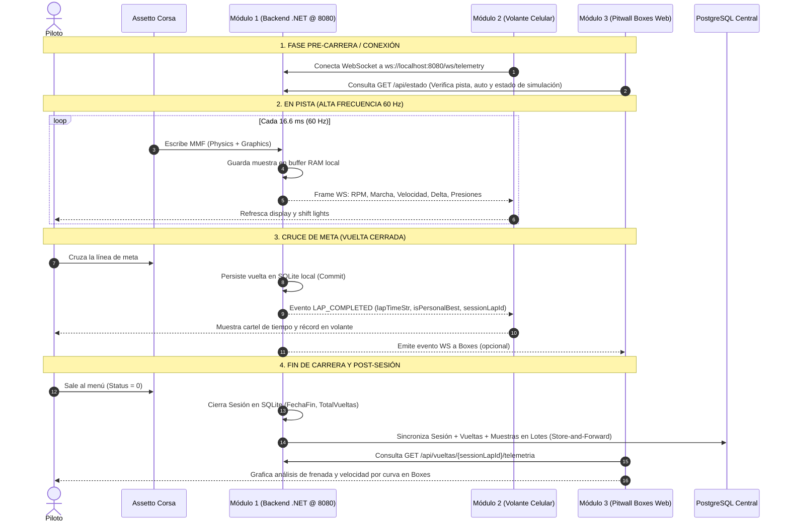

# Manual de Integración y Contratos de Datos: Módulo 2 y Módulo 3

> **Destinatarios:**  
> • **Desarrollador 2:** Dashboard Móvil en Volante (React Native / Android).  
> • **Desarrollador 3:** Panel Web de Boxes y Pitwall (Next.js / React + PostgreSQL Central).  
> **Origen de Datos:** Módulo 1 (Backend de Telemetría Edge en C# .NET 10 @ Puerto 8080).  
> **Versión de Especificación:** 2.2 (Auditada y alineada bit a bit con los DTOs de C# y Assetto Corsa v1.16).

---

## 1. Arquitectura de Integración y Relación de Módulos

```
                               ┌────────────────────────────────────────────────────────┐
                               │       MÓDULO 1: BACKEND TELEMETRÍA (Local @ 8080)      │
                               │   PC del Simulador (Adquisición MMF a 60 Hz + Edge)    │
                               └───────────┬───────────────────────────────┬────────────┘
                                           │                               │
                   (WebSocket @ 60 Hz USB) │                               │ (API REST / PostgreSQL)
                                           ▼                               ▼
            ┌──────────────────────────────────────────────┐ ┌──────────────────────────────────────────────┐
            │         MÓDULO 2 (DESARROLLADOR 2)           │ │         MÓDULO 3 (DESARROLLADOR 3)           │
            │         Dashboard Volante (Celular)          │ │         Panel Web de Boxes (Pitwall)         │
            ├──────────────────────────────────────────────┤ ├──────────────────────────────────────────────┤
            │ • Cliente móvil React Native / Android.      │ │ • Aplicación Web Next.js / React en Boxes.   │
            │ • Conectado por cable USB (reverse tether).  │ │ • Conectada por red local LAN / Wi-Fi.       │
            │ • Instrumental en tiempo real (60 FPS).      │ │ • Análisis histórico post-carrera estilo     │
            │ • Cero almacenamiento de base de datos.      │ │   MoTeC, comparativas y persistencia central.│
            └──────────────────────────────────────────────┘ └──────────────────────────────────────────────┘
```

### 1.1 Identificadores de Correlación
* **`sesionId` (UUID / Guid):** Identificador unívoco de una tanda de pista o carrera completa. Se genera automáticamente por el Módulo 1 en cuanto el simulador entra a pista.
* **`sessionLapId` / `vueltaId` (UUID / Guid):** Identificador unívoco de una vuelta cerrada en base de datos. Permite que el Módulo 3 consulte la telemetría continua de esa vuelta específica.
* **`usuarioId` (UUID / Guid opcional):** Identificador del piloto. En la arquitectura Edge-to-Cloud, el Módulo 3 (Servidor Central) asocia el `sesion.id` con la cuenta del piloto correspondiente.

---

## 2. Especificación para el MÓDULO 2 (Dashboard Móvil del Volante)

El Módulo 2 es un display instrumental de alta velocidad montado físicamente en el volante. Se conecta al Módulo 1 mediante **WebSocket**.

* **Endpoint WebSocket:** 
  * Por Cable USB (Recomendado): `ws://127.0.0.1:8080/ws/telemetry` (requiere ejecutar en la PC: `adb reverse tcp:8080 tcp:8080`).
  * Por Wi-Fi LAN: `ws://<IP_PC_SIMULADOR>:8080/ws/telemetry`.
* **Protocolo:** JSON sobre WebSocket de texto UTF-8.
* **Frecuencias de Emisión:**
  * **En Pista (Simulador Activo - Status 2):** 60 cuadros por segundo (cada ~16.6 ms).
  * **En Reposo / Menú / Pausa (Status 0, 1 o 3):** 5 cuadros por segundo (cada 200 ms) para evitar consumo innecesario de batería en el celular.
* **Política de Red:** Descarte de cuadros antiguos (`DropOldest`) con búfer de 2 cuadros. El volante **siempre recibe telemetría viva con 0 ms de retardo perceptual**.

El Módulo 2 procesa dos tipos de mensajes identificados por el campo `"type"`:

---

### 2.1 Mensaje `FRAME` (Telemetría en Vivo a 60 Hz)

#### Carga Útil JSON Exacta (Over-The-Wire):
```json
{
  "type": "FRAME",
  "timestamp": 1729987200123,
  "car": {
    "speedKmh": 284.5,
    "rpms": 11850,
    "maxRpm": 13000,
    "gear": 6,
    "throttle": 1.0,
    "brake": 0.0,
    "steer": -0.05,
    "drsAvailable": true,
    "drsEnabled": true
  },
  "tyres": {
    "pressurePsi": [32.4, 32.6, 30.1, 30.3],
    "tempCoreC": [94.2, 96.1, 88.5, 89.2],
    "wear": [98.4, 98.1, 99.2, 99.0]
  },
  "timing": {
    "lapTimeMs": 45230,
    "lapTimeStr": "00:45.230",
    "bestTimeMs": 83450,
    "bestTimeStr": "01:23.450",
    "deltaMs": -320,
    "currentLap": 4,
    "sector": 2,
    "lapProgress": 0.542
  },
  "dynamics": {
    "gForce": {
      "lat": -1.85,
      "lon": 0.42,
      "vert": 1.02
    },
    "worldPos": {
      "x": 124.5,
      "y": 12.3,
      "z": -450.8
    }
  },
  "session": {
    "flag": "GREEN",
    "position": 2,
    "track": "monza",
    "carModel": "ks_ferrari_sf70h"
  }
}
```

#### Diccionario de Datos y Reglas de UI (Dev 2):

| Campo JSON | Tipo | Unidad / Rango | Regla de Negocio e Implementación en UI |
| :--- | :--- | :--- | :--- |
| `car.speedKmh` | `number` | km/h (0 a 400+) | Velocímetro digital central. |
| `car.rpms` | `number` | RPM | Tacómetro digital. |
| `car.maxRpm` | `number` | RPM | Límite máximo de revoluciones. |
| `car.gear` | `number` | `-1`, `0`, `1` a `8` | **Mapeo de marchas:** `-1` = Reversa (**R**), `0` = Neutral (**N**), `1+` = Número de marcha (**1, 2, 3...**). |
| `car.throttle` | `number` | `0.0` a `1.0` | Barra vertical de acelerador (verde). |
| `car.brake` | `number` | `0.0` a `1.0` | Barra vertical de freno (roja). |
| `car.steer` | `number` | `-1.0` a `1.0` | Ángulo normalizado de volante (negativo = izquierda, positivo = derecha). |
| `car.drsAvailable` | `boolean`| `true`/`false` | Icono DRS en color gris (disponible para activación). |
| `car.drsEnabled` | `boolean`| `true`/`false` | DRS abierto: icono DRS en verde brillante y alerta visual. |
| `tyres.pressurePsi` | `number[4]`| PSI (~26 a 38) | **Indexación estándar de 4 ruedas:**<br>`[0]` = Delantero Izquierdo (**FL**)<br>`[1]` = Delantero Derecho (**FR**)<br>`[2]` = Trasero Izquierdo (**RL**)<br>`[3]` = Trasero Derecho (**RR**) |
| `tyres.tempCoreC` | `number[4]`| °C (~50 a 120) | Colorear rueda: Azul (< 75°C fría), Verde (75-100°C óptima), Rojo (> 105°C caliente). Mismo orden `[FL, FR, RL, RR]`. |
| `tyres.wear` | `number[4]`| % (100.0 a 0.0) | **Vida útil restante** (100% = nueva, 0% = destruida). Mismo orden `[FL, FR, RL, RR]`. |
| `timing.lapTimeStr` | `string` | `"m:ss:fff"` | Cronómetro en vivo de la vuelta actual. |
| `timing.bestTimeStr`| `string` | `"m:ss:fff"` | Mejor tiempo registrado en la tanda. Si no hay vuelta cerrada: `"--:--.---"`. |
| `timing.deltaMs` | `number` | Milisegundos (±) | **Delta de tiempo en vivo respecto a la mejor vuelta:**<br>Si es **negativo** (ej. `-320`), pintar en **Verde** (`-0.32s` ganando tiempo).<br>Si es **positivo** (ej. `+150`), pintar en **Rojo** (`+0.15s` perdiendo tiempo). |
| `timing.currentLap` | `number` | Entero (1, 2...) | Número de vuelta en curso. |
| `timing.sector` | `number` | `1`, `2` o `3` | Sector actual del circuito. |
| `timing.lapProgress`| `number` | `0.0` a `1.0` | Progreso métrico normalizado de la vuelta (0.0 en largada a 1.0 en meta). |
| `dynamics.gForce` | `object` | Gs (`lat`, `lon`, `vert`) | Fuerzas G acelerómetras. Usar `lat` y `lon` para dibujar el Círculo de Rozamiento (Friction Circle). |
| `session.flag` | `string` | Cadenas estándar | Banderas de carrera: `"GREEN"` (pista libre), `"YELLOW"` (precaución), `"BLUE"` (ceder paso), `"WHITE"` (vehículo lento), `"CHECKERED"` (fin de carrera), `"PENALTY"` (penalización). |

#### Lógica de LEDs de Corte (*Shift Lights*):
```javascript
const porcentajeRpm = car.rpms / car.maxRpm;

// 10 LEDs progresivos en el volante:
// LEDs 1 a 4 (Verdes): 80% a 88% de RPM
// LEDs 5 a 8 (Rojos): 88% a 95% de RPM
// LEDs 9 y 10 (Azules parpadeantes - Cambio óptimo): > 96% de RPM
```

---

### 2.2 Mensaje `LAP_COMPLETED` (Evento de Cruce de Meta)

Se emite una sola vez cada vez que el coche cruza la meta para cerrar una vuelta:

#### Carga Útil JSON Exacta:
```json
{
  "type": "LAP_COMPLETED",
  "lapNumber": 3,
  "lapTimeMs": 83450,
  "lapTimeStr": "01:23.450",
  "isPersonalBest": true,
  "isValidLap": true,
  "sectors": [28120, 31400, 23930],
  "telemetrySamplesCount": 5007,
  "sessionLapId": "c4a7b28e-89e2-4951-aea3-4a741a0ed849"
}
```

#### Comportamiento Esperado en el Volante (Dev 2):
1. **Banner Temporal:** Congelar un cartel emergente durante 4 segundos con `lapTimeStr`.
2. **Animación de Récord (`isPersonalBest: true`):** Fondo púrpura (*Purple Lap*) celebrando la vuelta rápida de la sesión.
3. **Vuelta Anulada (`isValidLap: false`):** Texto tachado en rojo si el piloto excedió los límites de pista.
4. **Sectores:** Mostrar resumen de los 3 sectores (`sectors[0] = S1`, `sectors[1] = S2`, `sectors[2] = S3`).

---

### 2.3 Estrategia de Conexión y Reconexión WebSocket (Móvil)
* **Keep-Alive:** El servidor envía pings de WebSocket cada 2 segundos.
* **Reconexión Automática:** Si el cable USB se desconecta momentáneamente, la app móvil debe intentar reconectar con backoff exponencial: 1s, 2s y 5s.
* **Estado en Espera:** Si `car.rpms === 0` y `session.track === ""`, el simulador está cerrado o en el menú principal. El volante debe mostrar una pantalla de espera: *"ESPERANDO SIMULADOR..."*.

---

## 3. Especificación para el MÓDULO 3 (Panel Web de Boxes / Pitwall)

El Módulo 3 es la aplicación web utilizada por el equipo de ingenieros y mecánicos. Se comunica con el backend mediante **HTTP REST** (y opcionalmente WebSocket `/ws/telemetry` para monitoreo en vivo durante la carrera).

* **Base URL:** `http://<IP_PC_SIMULADOR>:8080/api`
* **Formato de Envoltorio:** Todas las respuestas de la API devuelven el esquema estándar:
  ```json
  {
    "datos": T,
    "mensaje": "Operación completada satisfactoriamente",
    "exitoso": true,
    "errores": []
  }
  ```

---

### 3.1 Catálogo de Endpoints REST

#### A. Estado del Servicio y Simulador (`GET /api/estado`)
Permite saber si el simulador está conectado, si se está usando el generador de pruebas (Mock) y qué circuito/vehículo está cargado.

* **Ruta:** `GET /api/estado`
* **Respuesta 200 OK:**
```json
{
  "datos": {
    "isConnected": true,
    "isMockMode": false,
    "circuit": "monza",
    "carModel": "ks_ferrari_sf70h",
    "trackLengthMeters": 5793.0,
    "activeCars": 1
  },
  "mensaje": "Operación completada satisfactoriamente",
  "exitoso": true,
  "errores": []
}
```

---

#### B. Alternar Modo Mock Determinístico (`POST /api/mock/alternar`)
Permite a los desarrolladores de frontend probar toda la interfaz y gráficos sin tener Assetto Corsa abierto en su máquina.

* **Ruta:** `POST /api/mock/alternar`
* **Encabezado:** `Content-Type: application/json`
* **Cuerpo de la Petición:**
```json
{
  "usarMock": true
}
```
* **Respuesta 200 OK:**
```json
{
  "datos": {
    "isMockActive": true,
    "message": "Generador sintético determinístico activado (Monza - ks_ferrari_sf70h)."
  },
  "mensaje": "Operación completada satisfactoriamente",
  "exitoso": true,
  "errores": []
}
```

---

#### C. Listar Historial de Carreras y Sesiones (`GET /api/sesiones`)
Devuelve la lista paginada de todas las carreras disputadas en ese simulador.

* **Ruta:** `GET /api/sesiones?numeroPagina=1&tamanioPagina=10`
* **Parámetros Query:**
  * `numeroPagina` (int, default 1, base 1).
  * `tamanioPagina` (int, default 10).
* **Respuesta 200 OK:**
```json
{
  "datos": {
    "elementos": [
      {
        "id": "e5b7ef9b-89e2-4951-aea3-4a741a0ed849",
        "circuit": "monza",
        "trackConfig": "gp",
        "carModel": "ks_ferrari_sf70h",
        "sessionType": 2,
        "isMockSimulation": false,
        "startTime": "2026-10-27T01:30:00Z",
        "endTime": "2026-10-27T01:52:15Z",
        "totalLaps": 15,
        "bestLapTimeMs": 83450
      }
    ],
    "paginaActual": 1,
    "tamanioPagina": 10,
    "totalRegistros": 42,
    "totalPaginas": 5,
    "tienePaginaAnterior": false,
    "tienePaginaSiguiente": true
  },
  "mensaje": "Operación completada satisfactoriamente",
  "exitoso": true,
  "errores": []
}
```

##### Tabla de Tipos de Sesión (`sessionType`):
| Valor | Nombre | Descripción |
| :--- | :--- | :--- |
| `0` | Practice | Práctica Libre / Entrenamientos |
| `1` | Qualify | Clasificación oficial |
| `2` | Race | Carrera |
| `3` | Hotlap | Vuelta rápida en solitario |
| `4` | TimeAttack | Contrarreloj |
| `5` | Drift | Prueba de Drift |
| `6` | Drag | Picadas / Aceleración en recta |

---

#### D. Obtener Detalle de Vueltas de una Carrera (`GET /api/sesiones/{sesionId}/vueltas`)
* **Ruta:** `GET /api/sesiones/{sesionId}/vueltas`
* **Respuesta 200 OK:**
```json
{
  "datos": [
    {
      "id": "c4a7b28e-89e2-4951-aea3-4a741a0ed849",
      "lapNumber": 1,
      "lapTimeMs": 89200,
      "lapTimeStr": "01:29.200",
      "sector1Ms": 30100,
      "sector2Ms": 34100,
      "sector3Ms": 25000,
      "isValidLap": true,
      "isBestLap": false
    },
    {
      "id": "d8b1c4f5-1122-3344-5566-778899aabbcc",
      "lapNumber": 2,
      "lapTimeMs": 83450,
      "lapTimeStr": "01:23.450",
      "sector1Ms": 28120,
      "sector2Ms": 31400,
      "sector3Ms": 23930,
      "isValidLap": true,
      "isBestLap": true
    }
  ],
  "mensaje": "Operación completada satisfactoriamente",
  "exitoso": true,
  "errores": []
}
```

---

#### E. Obtener Telemetría Continua por Metro (`GET /api/vueltas/{vueltaId}/telemetria`)
Devuelve la serie completa de muestras de la vuelta para dibujar las curvas estilo MoTeC.

* **Ruta:** `GET /api/vueltas/{vueltaId}/telemetria`
* **Respuesta 200 OK:**
```json
{
  "datos": [
    {
      "distanceMeters": 0.0,
      "speedKmh": 285.4,
      "throttle": 1.0,
      "brake": 0.0,
      "gear": 6,
      "rpm": 11900,
      "gLat": -0.02,
      "gLon": 0.35,
      "worldPositionX": 124.5,
      "worldPositionY": 12.3,
      "worldPositionZ": -450.8
    },
    {
      "distanceMeters": 12.5,
      "speedKmh": 287.1,
      "throttle": 1.0,
      "brake": 0.0,
      "gear": 6,
      "rpm": 12050,
      "gLat": -0.05,
      "gLon": 0.31,
      "worldPositionX": 126.1,
      "worldPositionY": 12.3,
      "worldPositionZ": -438.4
    },
    {
      "distanceMeters": 450.2,
      "speedKmh": 110.2,
      "throttle": 0.0,
      "brake": 0.95,
      "gear": 2,
      "rpm": 7800,
      "gLat": 0.12,
      "gLon": -1.95,
      "worldPositionX": 180.2,
      "worldPositionY": 12.5,
      "worldPositionZ": -5.1
    }
  ],
  "mensaje": "Operación completada satisfactoriamente",
  "exitoso": true,
  "errores": []
}
```
* **Implementación Gráfica en Boxes:** El eje horizontal (X) del gráfico debe configurarse con `distanceMeters`. Se pueden graficar 3 canales sincronizados en vertical:
  1. Velocidad (`speedKmh`).
  2. Pedales (`throttle` en verde 0-1, `brake` en rojo 0-1).
  3. Fuerzas G (`gLat` y `gLon`).

---

#### F. Comparativa Superpuesta de Dos Vueltas (`GET /api/vueltas/comparativa`)
Permite superponer la vuelta rápida contra la vuelta en análisis para ver exactamente en qué curva se perdieron milésimas.

* **Ruta:** `GET /api/vueltas/comparativa?vueltaBaseId={guidA}&vueltaComparadaId={guidB}`
* **Respuesta 200 OK:**
```json
{
  "datos": {
    "baseLapId": "c4a7b28e-89e2-4951-aea3-4a741a0ed849",
    "comparedLapId": "d8b1c4f5-1122-3344-5566-778899aabbcc",
    "baseLapSamplesCount": 5007,
    "comparedLapSamplesCount": 4982,
    "points": [
      {
        "distanceMeters": 500.0,
        "baseSpeedKmh": 130.5,
        "comparedSpeedKmh": 142.1,
        "deltaSpeedKmh": 11.6,
        "baseThrottle": 0.0,
        "comparedThrottle": 1.0,
        "baseBrake": 0.8,
        "comparedBrake": 0.0,
        "accumulatedDeltaTimeMs": -450
      }
    ]
  },
  "mensaje": "Comparativa de telemetría calculada satisfactoriamente",
  "exitoso": true,
  "errores": []
}
```

---

### 3.2 Manejo de Errores HTTP en la API
* **404 Not Found:** Identificador de sesión o vuelta inexistente:
```json
{
  "datos": null,
  "mensaje": "No se encontraron vueltas para la sesión especificada.",
  "exitoso": false,
  "errores": ["No se encontraron vueltas para la sesión especificada."]
}
```
* **400 Bad Request:** Parámetros inválidos o identificadores vacíos:
```json
{
  "datos": null,
  "mensaje": "Los identificadores de vuelta base y vuelta comparada son obligatorios.",
  "exitoso": false,
  "errores": ["Los identificadores de vuelta base y vuelta comparada son obligatorios."]
}
```

---

### 3.3 Configuración de Seguridad y CORS para Dev 3
* **CORS:** El backend tiene habilitado CORS para orígenes locales (`localhost:3000`, `127.0.0.1:3000` y subredes privadas RFC 1918 `192.168.x.x`, `10.x.x.x`, `172.16-31.x.x`). Las peticiones desde Next.js o navegadores en la red local no serán bloqueadas por CORS.
* **Autenticación en Modo Edge:** Por defecto, el backend local opera con `"PermitirAccesoLocalEdgeSinToken": true`, lo que permite a las pantallas de Boxes consultar la API sin enviar tokens JWT. Si se conecta a un servidor en la nube con seguridad activada, se debe incluir el encabezado `Authorization: Bearer <token_jwt>`.

---

## 4. Interfaces TypeScript Oficiales (Para Copiar y Pegar en el Frontend)

```typescript
// ==========================================
// TELEMETRÍA EN VIVO A 60 HZ (MÓDULO 2 Y 3)
// ==========================================

export interface DatosAutoDto {
  speedKmh: number;
  rpms: number;
  maxRpm: number;
  gear: number; // -1: R, 0: N, 1+: Marchas hacia adelante
  throttle: number; // 0.0 a 1.0
  brake: number; // 0.0 a 1.0
  steer: number; // -1.0 a 1.0
  drsAvailable: boolean;
  drsEnabled: boolean;
}

export interface DatosNeumaticosDto {
  pressurePsi: [number, number, number, number]; // [FL, FR, RL, RR]
  tempCoreC: [number, number, number, number]; // [FL, FR, RL, RR]
  wear: [number, number, number, number]; // [FL, FR, RL, RR] (100.0 a 0.0)
}

export interface DatosTiemposDto {
  lapTimeMs: number;
  lapTimeStr: string;
  bestTimeMs: number;
  bestTimeStr: string;
  deltaMs: number;
  currentLap: number;
  sector: number;
  lapProgress: number; // 0.0 a 1.0
}

export interface PaqueteTelemetriaFrame {
  type: "FRAME";
  timestamp: number;
  car: DatosAutoDto;
  tyres: DatosNeumaticosDto;
  timing: DatosTiemposDto;
  dynamics: {
    gForce: { lat: number; lon: number; vert: number };
    worldPos: { x: number; y: number; z: number };
  };
  session: {
    flag: "GREEN" | "YELLOW" | "BLUE" | "WHITE" | "CHECKERED" | "PENALTY";
    position: number;
    track: string;
    carModel: string;
  };
}

export interface EventoVueltaCompletada {
  type: "LAP_COMPLETED";
  lapNumber: number;
  lapTimeMs: number;
  lapTimeStr: string;
  isPersonalBest: boolean;
  isValidLap: boolean;
  sectors: number[]; // [S1, S2, S3] en milisegundos
  telemetrySamplesCount: number;
  sessionLapId: string; // GUID para consultar la vuelta por REST
}

// ==========================================
// API REST POST-CARRERA (MÓDULO 3)
// ==========================================

export interface RespuestaApi<T> {
  datos: T;
  mensaje: string;
  exitoso: boolean;
  errores: string[];
}

export interface PaginacionRespuesta<T> {
  elementos: T[];
  paginaActual: number;
  tamanioPagina: number;
  totalRegistros: number;
  totalPaginas: number;
  tienePaginaAnterior: boolean;
  tienePaginaSiguiente: boolean;
}

export interface EstadoServicioDto {
  isConnected: boolean;
  isMockMode: boolean;
  circuit: string;
  carModel: string;
  trackLengthMeters: number;
  activeCars: number;
}

export interface EstadoMockDto {
  isMockActive: boolean;
  message: string;
}

export interface SesionResumenDto {
  id: string;
  circuit: string;
  trackConfig: string;
  carModel: string;
  sessionType: number; // 0: Practice, 1: Qualify, 2: Race, 3: Hotlap...
  isMockSimulation: boolean;
  startTime: string;
  endTime: string | null;
  totalLaps: number;
  bestLapTimeMs: number;
}

export interface VueltaDto {
  id: string;
  lapNumber: number;
  lapTimeMs: number;
  lapTimeStr: string;
  sector1Ms: number;
  sector2Ms: number;
  sector3Ms: number;
  isValidLap: boolean;
  isBestLap: boolean;
}

export interface MuestraTelemetriaDto {
  distanceMeters: number;
  speedKmh: number;
  throttle: number;
  brake: number;
  gear: number;
  rpm: number;
  gLat: number;
  gLon: number;
  worldPositionX: number;
  worldPositionY: number;
  worldPositionZ: number;
}

export interface PuntoComparativaTelemetriaDto {
  distanceMeters: number;
  baseSpeedKmh: number;
  comparedSpeedKmh: number;
  deltaSpeedKmh: number;
  baseThrottle: number;
  comparedThrottle: number;
  baseBrake: number;
  comparedBrake: number;
  accumulatedDeltaTimeMs: number;
}

export interface ComparativaVueltasDto {
  baseLapId: string;
  comparedLapId: string;
  baseLapSamplesCount: number;
  comparedLapSamplesCount: number;
  points: PuntoComparativaTelemetriaDto[];
}
```

---

## 5. Ciclo de Vida y Flujo Completo


