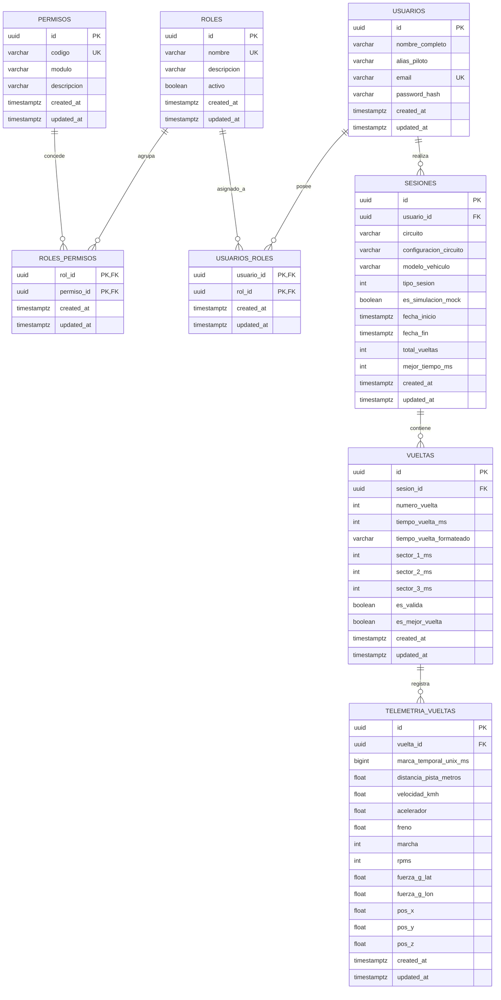
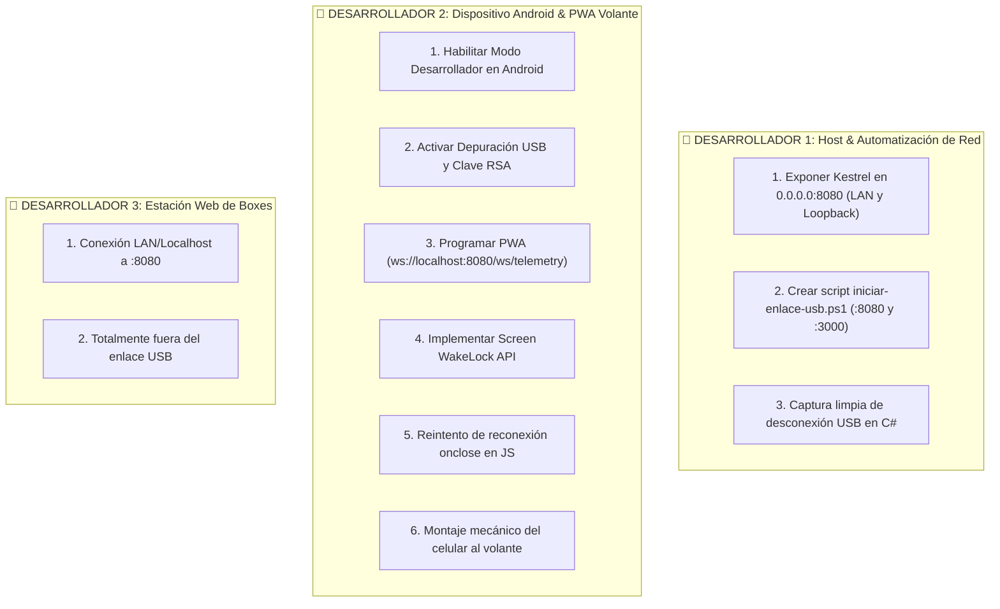

# 📚 Documentación Técnica Oficial del Backend: Sistema de Telemetría SimRacing

> **Componente:** Core Relay de Telemetría, Adquisición MMF, WebSocket y Persistencia  
> **Tecnologías Centrales:** C# .NET (ASP.NET Core), SQLite (Modo WAL), WebSockets Nativos (RFC 6455), Win32 Memory-Mapped Files  
> **Naturaleza del Desarrollo:** Proyecto Privado de Ingeniería de Software de Alto Rendimiento

---

## 🏛️ 1. Arquitectura y Fundamentación Conceptual

### 1.1. Propósito y Módulos Fundamentales del Backend

El backend del sistema opera como un concentrador de datos (*Relay*) de alta frecuencia, baja latencia y procesamiento en tiempo real. Su función primordial es desacoplar por completo la ejecución del simulador automovilístico (**Assetto Corsa**) de los múltiples clientes consumidores (instrumentación digital de cabina y plataformas web de ingeniería de pista).

A continuación, se detalla conceptual y técnicamente cada uno de los seis módulos y responsabilidades nucleares que componen el sistema:

---

#### 1. Extracción en Tiempo Real de Físicas mediante Win32 Memory-Mapped Files (MMF)

##### A. Fundamento Teórico del Mecanismo
En sistemas operativos modernos como Windows, los mecanismos convencionales de comunicación entre procesos (IPC - *Inter-Process Communication*), tales como Sockets TCP/UDP, Named Pipes o llamadas RPC, introducen una penalización de rendimiento significativa debido a la necesidad de realizar llamadas al sistema (*syscalls*), conmutaciones de contexto de CPU (*context switches*) y copias redundantes de memoria entre el espacio de usuario (*User Space*) y el espacio de núcleo (*Kernel Space*).

Para resolver esta limitación, el sistema operativo provee la arquitectura de **Memory-Mapped Files (MMF)** a través de la API Win32 (`OpenFileMappingW`, `MapViewOfFile`). Este mecanismo permite proyectar un rango de páginas de la memoria virtual directamente sobre el mismo espacio de memoria RAM física compartida entre procesos independientes:

```
┌─────────────────────────────────────────────────────────────┐
│                    MEMORIA RAM DEL SISTEMA                  │
│       ┌─────────────────────────────────────────────┐       │
│       │   Bloque MMF Compartido ("Local\\acpmf_...") │       │
│       └─────────────────────────────────────────────┘       │
│              ▲                               ▲              │
│      Escribe │ (Zero-Copy)           Lee     │ (Zero-Copy)  │
│              │                               │              │
│ ┌─────────────────────────┐     ┌─────────────────────────┐ │
│ │  Assetto Corsa (C++)    │     │   Backend Relay (.NET)  │ │
│ │  Espacio de Usuario 1   │     │   Espacio de Usuario 2  │ │
│ └─────────────────────────┘     └─────────────────────────┘ │
└─────────────────────────────────────────────────────────────┘
```

El acceso a los datos ocurre en tiempo constante $O(1)$, con una latencia de lectura inferior a **$0.001\text{ ms}$ ($1\text{ }\mu\text{s}$, escala de sub-microsegundos)** y sin necesidad de realizar ninguna operación de entrada/salida a disco ni transferencias de red.

##### B. Arquitectura de Estructuras de Assetto Corsa
Kunos Simulazioni expone el estado interno de la simulación mediante tres objetos de memoria compartida identificados bajo el espacio de nombres de sesión de Windows (`Local\`):

1. **`Local\acpmf_physics` (Frecuencia interna del motor de físicas: ~333 Hz; muestreado a 60 Hz por el Relay):**
   - **Controles de conducción:** Acelerador (`gas`, normalizado de $0.0$ a $1.0$), freno (`brake`, $0.0$ a $1.0$), ángulo de dirección (`steerAngle`, normalizado sobre el rango de bloqueo de dirección en $[-1.0, +1.0]$).
   - **Cinemática y mecánica:** Velocidad instantánea (`speedKmh`), régimen de giro del motor (`rpms`), marcha engranada (`gear`: $0 = \text{Reversa}$, $1 = \text{Neutral}$, $2 = \text{1ra}$, etc.).
   - **Dinámica de chasis:** Vector de aceleraciones / fuerzas G tridimensionales (`accG[3]` con componentes lateral, vertical y longitudinal) y orientación de carrocería (`heading`, `pitch`, `roll`).
   - **Matriz de neumáticos:** Presión en PSI (`wheelsPressure[4]`), temperatura interna del compuesto en grados Celsius (`tyreCoreTemperature[4]`) y desgaste (`tyreWear[4]`) para cada una de las cuatro ruedas independientes.

2. **`Local\acpmf_graphic` (Frecuencia sincronizada con el hilo de renderizado gráfico del simulador, típicamente 60 Hz a 144+ Hz, con consolidación de cronometraje por sector/vuelta):**
   - **Estado operativo de simulación:** `status` ($0 = \text{Off}$, $1 = \text{Replay}$, $2 = \text{Live en Pista}$, $3 = \text{Pausa}$).
   - **Cronometraje y tiempos oficiales:** Tiempo actual transcurrido en la vuelta (`currentTime` en texto y `iCurrentTime` en milisegundos enteros), tiempo de la última vuelta completada (`lastTime` / `iLastTime`), mejor marca registrada en la sesión (`bestTime` / `iBestTime`), último sector (`lastSectorTime`) y split delta sectorizado (`split`).
   - **Control de competencia y coordenadas espaciales:** Contador atómico de vueltas finalizadas (`completedLaps`), progreso normalizado sobre el perímetro del trazado (`normalizedCarPosition`, de $0.0$ a $1.0$), coordenadas tridimensionales de los vehículos en el mundo virtual (`carCoordinates[60 * 3]` con ternas $X, Y, Z$ e índice de jugador `playerCarID`), cantidad de autos activos (`activeCars`) y código de banderas activas (`flag`: $0 = \text{Sin bandera/Verde}$, $1 = \text{Azul}$, $2 = \text{Amarilla}$, $3 = \text{Negra}$, $4 = \text{Blanca}$, $5 = \text{Cuadros}$, $6 = \text{Penalización}$).

3. **`Local\acpmf_static` (Lectura durante inicialización y en cada transición de sesión):**
   - **Metadatos invariantes de sesión:** Denominación técnica del vehículo (`carModel`), nombre del circuito (`track`), configuración o variante (`trackConfiguration`), longitud real de la línea central en metros (`trackSPlineLength`), corte de revoluciones del motor (`maxRpm`) y segmentación del circuito (`sectorCount`).

##### C. Implementación en C# .NET, Interoperabilidad Unmanaged y Garantías de Concurrencia

###### 1. Ciclo de Vida del Descriptor y Abstracción Gestionada en .NET
En el entorno de ejecución de Windows, la memoria compartida se gestiona mediante identificadores de kernel (*Kernel Object Handles*). En C# .NET, la interacción con estos descriptores se realiza a través de `System.IO.MemoryMappedFiles`, el cual envuelve las llamadas nativas de la API Win32 (`OpenFileMappingW`, `MapViewOfFile`, `UnmapViewOfFile` y `CloseHandle`) dentro de tipos administrados que implementan el patrón `IDisposable` (`SafeMemoryMappedFileHandle`).

###### 2. Interoperabilidad Binaria Unmanaged: Eliminación de Referencias y `Read<T>` Seguro
Un aspecto crítico al intercomunicar un proceso nativo en C++ (Assetto Corsa) con .NET es la **disposición y alineación de bytes en memoria**.
* **La Restricción Crítica de `MemoryMappedViewAccessor.Read<T>`:** En .NET, `Read<T>` exige que `T` sea un tipo de valor completamente no administrado (*unmanaged*). Si la estructura contuviera arreglos administrados (`float[]`) o cadenas (`string`), incluso decorados con `[MarshalAs(UnmanagedType.ByValArray)]`, el runtime lanzaría una excepción crítica `ArgumentException` en tiempo de ejecución ("*The specified type must be a value type containing no managed object references*"), pues `Read<T>` copia bytes en bruto sin invocar al subsistema de marshaling de P/Invoke.
* **Solución Zero-Marshaling con `unsafe fixed`:** Para garantizar compatibilidad binaria 100% con el bloque de memoria compartida sin invocar marshaling dinámico, las estructuras se declaran como `public unsafe struct` con campos `fixed float` y `fixed char`, alineados con empaquetamiento estricto de 4 bytes (`Pack = 4`), calcando el archivo de cabecera oficial de Kunos Simulazioni (`SharedFileOut.h`). Esto requiere habilitar explícitamente bloques no seguros en `Telemetria.Infraestructura.csproj`:

```xml
<Project Sdk="Microsoft.NET.Sdk">
  <PropertyGroup>
    <TargetFramework>net8.0</TargetFramework>
    <ImplicitUsings>enable</ImplicitUsings>
    <Nullable>enable</Nullable>
    <AllowUnsafeBlocks>true</AllowUnsafeBlocks>
  </PropertyGroup>
</Project>
```

* **Ubicación de Coordenadas y Metadatos:** En Assetto Corsa, las coordenadas mundiales del monoplaza (`CarCoordinates[60 * 3]`) residen en **`acpmf_graphic`** (correspondientes a los vehículos en pista), mientras que la longitud física real del circuito (`TrackSPlineLength`) reside en **`acpmf_static`**.
* **Convención de Nomenclatura de Interoperabilidad SDK:** En las tres estructuras nativas de interoperabilidad se conservan deliberadamente los nombres de campos en inglés definidos en el archivo de cabecera oficial `SharedFileOut.h` de Kunos Simulazioni para mantener trazabilidad 1 a 1 de offsets binarios con la documentación del SDK de C++; al proyectarse hacia el dominio (`CuadroTelemetria` y `MetadatosEstaticos`), todas las propiedades se exponen íntegramente en español. Cada estructura reside en su propio archivo físico:

```csharp
// Archivo: src/Telemetria.Infraestructura/MemoriaCompartida/Estructuras/EstructuraFisicaAC.cs
namespace Telemetria.Infraestructura.MemoriaCompartida.Estructuras;

using System.Runtime.InteropServices;

[StructLayout(LayoutKind.Sequential, Pack = 4)]
public unsafe struct EstructuraFisicaAC
{
    public int PacketId;
    public float Gas;
    public float Brake;
    public float Fuel;
    public int Gear;
    public int Rpms;
    public float SteerAngle;
    public float SpeedKmh;
    public fixed float Velocity[3];
    public fixed float AccG[3];
    public fixed float WheelSlip[4];
    public fixed float WheelLoad[4];
    public fixed float WheelsPressure[4];
    public fixed float WheelAngularSpeed[4];
    public fixed float TyreWear[4];
    public fixed float TyreDirtyLevel[4];
    public fixed float TyreCoreTemperature[4];
    public fixed float CamberRAD[4];
    public fixed float SuspensionTravel[4];
    public float Drs;
    public float Tc;
    public float Heading;
    public float Pitch;
    public float Roll;
    public float CgHeight;
    public fixed float CarDamage[5];
    public int NumberOfTyresOut;
    public int PitLimiterOn;
    public float Abs;
    public float KersCharge;
    public float KersInput;
    public int AutoShifterOn;
    public fixed float RideHeight[2];
    public float TurboBoost;
    public float Ballast;
    public float AirDensity;
    public float AirTemp;
    public float RoadTemp;
    public fixed float LocalAngularVel[3];
    public float FinalFF;
    public float PerformanceMeter;
    public int EngineBrake;
    public int ErsRecoveryLevel;
    public int ErsPowerLevel;
    public int ErsHeatCharging;
    public int ErsIsCharging;
    public float KersCurrentKJ;
    public int DrsAvailable;
    public int DrsEnabled;
    public fixed float BrakeTemp[4];
    public float Clutch;
    public fixed float TyreTempI[4];
    public fixed float TyreTempM[4];
    public fixed float TyreTempO[4];
    public int IsAIControlled;
    public fixed float TyreContactPoint[12];   // 4 ruedas x 3 coordenadas
    public fixed float TyreContactNormal[12];  // 4 ruedas x 3 coordenadas
    public fixed float TyreContactHeading[12]; // 4 ruedas x 3 coordenadas
    public float BrakeBias;
    public fixed float LocalVelocity[3];
}
```

```csharp
// Archivo: src/Telemetria.Infraestructura/MemoriaCompartida/Estructuras/EstructuraGraficaAC.cs
namespace Telemetria.Infraestructura.MemoriaCompartida.Estructuras;

using System.Runtime.InteropServices;

[StructLayout(LayoutKind.Sequential, Pack = 4)]
public unsafe struct EstructuraGraficaAC
{
    public int PacketId;
    public int Status; // 0=Off, 1=Replay, 2=Live, 3=Pause
    public int Session;
    public fixed char CurrentTime[15];
    public fixed char LastTime[15];
    public fixed char BestTime[15];
    public fixed char Split[15];
    public int CompletedLaps;
    public int Position;
    public int ICurrentTime;
    public int ILastTime;
    public int IBestTime;
    public float SessionTimeLeft;
    public float DistanceTraveled;
    public int IsInPit;
    public int CurrentSectorIndex;
    public int LastSectorTime;
    public int NumberOfLaps;
    public fixed char TyreCompound[33];
    public float ReplayTimeMultiplier;
    public float NormalizedCarPosition;
    public int ActiveCars;
    public fixed float CarCoordinates[60 * 3]; // Posición mundo de hasta 60 autos en pista (X, Y, Z)
    public fixed int CarID[60];
    public int PlayerCarID;
    public float PenaltyTime;
    public int Flag; // 0=None, 1=Blue, 2=Yellow, 3=Black, 4=White, 5=Checkered, 6=Penalty
    public int Penalty;
    public int IdealLineOn;
    public int IsInPitLane;
    public float SurfaceGrip;
    public int MandatoryPitDone;
    public float WindSpeed;
    public float WindDirection;
}
```

```csharp
// Archivo: src/Telemetria.Infraestructura/MemoriaCompartida/Estructuras/EstructuraEstaticaAC.cs
namespace Telemetria.Infraestructura.MemoriaCompartida.Estructuras;

using System.Runtime.InteropServices;

[StructLayout(LayoutKind.Sequential, Pack = 4)]
public unsafe struct EstructuraEstaticaAC
{
    public fixed char SmVersion[15];
    public fixed char AcVersion[15];
    public int NumberOfSessions;
    public int NumCars;
    public fixed char CarModel[33];
    public fixed char Track[33];
    public fixed char PlayerName[33];
    public fixed char PlayerSurname[33];
    public fixed char PlayerNick[33];
    public int SectorCount;
    public float MaxTorque;
    public float MaxPower;
    public int MaxRpm;
    public float MaxFuel;
    public fixed float SuspensionMaxTravel[4];
    public fixed float TyreRadius[4];
    public float MaxTurboBoost;
    public float Deprecated_1;
    public float Deprecated_2;
    public int PenaltiesEnabled;
    public float AidFuelRate;
    public float AidTireRate;
    public float AidMechanicalDamage;
    public int AidAllowTyreBlankets;
    public float AidStability;
    public int AidAutoClutch;
    public int AidAutoBlip;
    public int HasDRS;
    public int HasERS;
    public int HasKERS;
    public float KersMaxJ;
    public int EngineBrakeSettingsCount;
    public int ErsPowerControllerCount;
    public float TrackSPlineLength; // Longitud real del circuito en metros
    public fixed char TrackConfiguration[33];
    public float ErsMaxJ;
    public int IsTimedRace;
    public int HasExtraLap;
    public fixed char CarSkin[33];
    public int ReversedGridPositions;
    public int PitWindowStart;
    public int PitWindowEnd;
    public int IsOnline;
}
```

###### 3. Protocolo de Lectura Optimista sin Bloqueo (Patrón *SeqLock*) y Liberación de Descriptores del Kernel
Dado que el motor de físicas de Assetto Corsa se ejecuta a $333\text{ Hz}$ en C++, el simulador **no utiliza un `Mutex` global del kernel de Windows** al volcar telemetría en RAM, ya que cualquier espera provocada por un proceso lector externo congelaría los cuadros del juego. En consecuencia, si el backend leyera el bloque de memoria justo mientras Assetto Corsa está sobrescribiéndolo a mitad de estructura, se produciría una **lectura desgarrada (*Torn Read*)** combinando bytes del cuadro $N$ con bytes del cuadro $N+1$.

Para garantizar lecturas atómicas sin bloquear al simulador ni corromper datos, `LectorAssettoCorsaWin32` implementa:
1. **Verificación Optimista Tipo *SeqLock* con Barreras de Memoria (`Thread.MemoryBarrier()`):** Antes de copiar cada estructura, se lee el entero `PacketId` en el offset `0`, se inserta una barrera de memoria para impedir el reordenamiento de instrucciones por parte del JIT o la CPU, se copia la estructura completa con `Read<T>` y se vuelve a leer `PacketId` tras una segunda barrera. La muestra solo se acepta si `packetIdAntes == estructura.PacketId && packetIdAntes == packetIdDespues`; de lo contrario, se reintenta inmediatamente (hasta 3 veces).
2. **Liberación Determinística de Descriptores ante Cierre del Simulador:** En Windows, el kernel mantiene vivos los objetos `Local\acpmf_*` mientras cualquier proceso conserve descriptores (`SafeMemoryMappedFileHandle`) abiertos. Si Assetto Corsa informa `Status == 0` (`AC_OFF`, salida normal hacia el launcher) o si los contadores `PacketId` permanecen congelados por más de $3.000\text{ ms}$ (cierre abrupto del proceso `acs.exe`), el adaptador invoca `Desconectar()` para liberar inmediatamente los descriptores y permitir que el sistema operativo destruya los bloques de memoria compartida.

###### 4. Utilitarios de Normalización y Lectura de Cadenas Nativas (`UtilitariosInteroperabilidadAC.cs`)
```csharp
// Archivo: src/Telemetria.Infraestructura/MemoriaCompartida/UtilitariosInteroperabilidadAC.cs
namespace Telemetria.Infraestructura.MemoriaCompartida;

public static class UtilitariosInteroperabilidadAC
{
    public static unsafe string LeerCadenaFija(char* puntero, int longitudMaxima)
    {
        int longitudReal = 0;
        while (longitudReal < longitudMaxima && puntero[longitudReal] != '\0')
        {
            longitudReal++;
        }
        return new string(puntero, 0, longitudReal);
    }

    public static unsafe string LeerTiempoTextoNormalizado(
        char* puntero,
        int longitudMaxima,
        string valorPorDefecto)
    {
        string texto = LeerCadenaFija(puntero, longitudMaxima).Trim();
        return string.IsNullOrWhiteSpace(texto) ? valorPorDefecto : texto;
    }

    public static int NormalizarMarcha(int marchaCrudaAssettoCorsa)
    {
        return marchaCrudaAssettoCorsa switch
        {
            <= 0 => -1, // Reversa (0 en AC) o valor no inicializado
            1 => 0,     // Neutral (Punto Muerto)
            _ => marchaCrudaAssettoCorsa - 1 // 2 -> 1, 3 -> 2, etc.
        };
    }

    public static string MapearBanderaTexto(int codigoBandera)
    {
        return codigoBandera switch
        {
            1 => "BLUE",
            2 => "YELLOW",
            3 => "BLACK",
            4 => "WHITE",
            5 => "CHECKERED",
            6 => "PENALTY",
            _ => "GREEN" // 0 (AC_NO_FLAG) representa pista limpia / bandera verde
        };
    }
}
```

###### 5. Implementación Completa y Modular del Adaptador Win32 (`LectorAssettoCorsaWin32.cs`)
La clase de infraestructura implementa `ILectorTelemetria` respetando el principio de responsabilidad única (métodos cortos y cohesivos), sincronizando el acceso concurrente entre el hilo de 60 Hz y las consultas de estado HTTP mediante `_cerrojoConexion`, y garantizando que la suma de los 3 sectores coincida con `ILastTime`:

```csharp
// Archivo: src/Telemetria.Infraestructura/MemoriaCompartida/LectorAssettoCorsaWin32.cs
namespace Telemetria.Infraestructura.MemoriaCompartida;

using System.IO.MemoryMappedFiles;
using System.Threading;
using Microsoft.Extensions.Logging;
using Telemetria.Dominio.Contratos.Hardware;
using Telemetria.Dominio.Modelos;
using Telemetria.Infraestructura.MemoriaCompartida.Estructuras;

public sealed class LectorAssettoCorsaWin32 : ILectorTelemetria
{
    private const int MAXIMO_REINTENTOS_LECTURA_ATOMICA = 3;
    private const long TIEMPO_MAXIMO_PACKET_ID_CONGELADO_MS = 3000;

    private readonly object _cerrojoConexion = new();
    private readonly ILogger<LectorAssettoCorsaWin32> _logger;

    private MemoryMappedFile? _archivoFisica;
    private MemoryMappedViewAccessor? _lectorFisica;
    private MemoryMappedFile? _archivoGrafica;
    private MemoryMappedViewAccessor? _lectorGrafica;
    private MemoryMappedFile? _archivoEstatica;
    private MemoryMappedViewAccessor? _lectorEstatica;

    private MetadatosEstaticos? _metadatosEstaticosCache;
    private CuadroTelemetria? _ultimoCuadroLeido;

    private int _ultimoPacketIdFisica = -1;
    private int _ultimoPacketIdGrafica = -1;
    private long _marcaUltimoCambioPacketIdMs = 0;
    private int _ultimoEstadoSimulador = -1;
    private int _ultimaSesionActiva = -1;
    private int _ultimaVueltaConocida = -1;
    private int _ultimoSectorConocido = 1;
    private bool _vueltaActualEsValida = true;
    private readonly int[] _tiemposSectoresVueltaMs = new int[3];

    public LectorAssettoCorsaWin32(ILogger<LectorAssettoCorsaWin32> logger)
    {
        _logger = logger;
    }

    public bool EstaConectado()
    {
        lock (_cerrojoConexion)
        {
            return TieneDescriptoresAbiertos();
        }
    }

    public bool IntentarConectar()
    {
        if (!OperatingSystem.IsWindows())
        {
            _logger.LogWarning("La lectura de memoria compartida Win32 ('Local\\acpmf_...') requiere Windows.");
            return false;
        }

        lock (_cerrojoConexion)
        {
            if (TieneDescriptoresAbiertos()) return true;

            try
            {
                _archivoFisica = MemoryMappedFile.OpenExisting("Local\\acpmf_physics", MemoryMappedFileRights.Read);
                _lectorFisica = _archivoFisica.CreateViewAccessor(0, 0, MemoryMappedFileAccess.Read);

                _archivoGrafica = MemoryMappedFile.OpenExisting("Local\\acpmf_graphic", MemoryMappedFileRights.Read);
                _lectorGrafica = _archivoGrafica.CreateViewAccessor(0, 0, MemoryMappedFileAccess.Read);

                _archivoEstatica = MemoryMappedFile.OpenExisting("Local\\acpmf_static", MemoryMappedFileRights.Read);
                _lectorEstatica = _archivoEstatica.CreateViewAccessor(0, 0, MemoryMappedFileAccess.Read);

                // Si Assetto Corsa está en el launcher (Status == 0 en offset 4), liberar descriptores sin iniciar sesión activa
                if (_lectorGrafica.ReadInt32(4) == 0)
                {
                    LiberarDescriptoresInterno();
                    return false;
                }

                _metadatosEstaticosCache = LeerMetadatosEstaticosInterno();
                _marcaUltimoCambioPacketIdMs = DateTimeOffset.UtcNow.ToUnixTimeMilliseconds();
                _logger.LogInformation("Enlace exitoso con Assetto Corsa. Pista: {Pista}, Auto: {Auto}",
                    _metadatosEstaticosCache.NombrePista, _metadatosEstaticosCache.NombreAuto);

                return true;
            }
            catch (FileNotFoundException)
            {
                LiberarDescriptoresInterno();
                return false;
            }
            catch (Exception excepcion)
            {
                _logger.LogWarning(excepcion, "Excepción al intentar abrir memoria compartida de Assetto Corsa");
                LiberarDescriptoresInterno();
                return false;
            }
        }
    }

    public CuadroTelemetria ObtenerCuadroActual()
    {
        lock (_cerrojoConexion)
        {
            if (!TieneDescriptoresAbiertos())
            {
                throw new InvalidOperationException("No hay conexión activa con la memoria compartida de Assetto Corsa");
            }

            long ahoraUnixMs = DateTimeOffset.UtcNow.ToUnixTimeMilliseconds();
            if (!IntentarLeerEstructurasConsistentes(out var fisica, out var grafica))
            {
                _logger.LogWarning("Se descartó un cuadro por lectura desgarrada tras {Intentos} intentos.", MAXIMO_REINTENTOS_LECTURA_ATOMICA);
                return _ultimoCuadroLeido ?? new CuadroTelemetria { MarcaTemporalUnixMs = ahoraUnixMs, EstadoSimulador = 0 };
            }

            if (!SimuladorSigueActivo(in fisica, in grafica, ahoraUnixMs))
            {
                LiberarDescriptoresInterno();
                return new CuadroTelemetria { MarcaTemporalUnixMs = ahoraUnixMs, EstadoSimulador = 0 };
            }

            ActualizarMetadatosSiCorresponde(in grafica);
            var (sectorActualBase1, esVueltaValida, sectoresReportados) = ProcesarSectoresYValidezVuelta(in fisica, in grafica);

            CuadroTelemetria cuadro = ConstruirCuadroTelemetria(
                in fisica, in grafica, ahoraUnixMs, sectorActualBase1, esVueltaValida, sectoresReportados);

            _ultimoCuadroLeido = cuadro;
            return cuadro;
        }
    }

    public CuadroTelemetria ObtenerUltimoCuadroConocido()
    {
        lock (_cerrojoConexion)
        {
            if (_ultimoCuadroLeido != null) return _ultimoCuadroLeido;
            return TieneDescriptoresAbiertos() ? ObtenerCuadroActual() : new CuadroTelemetria { EstadoSimulador = 0 };
        }
    }

    public MetadatosEstaticos ObtenerMetadatosEstaticos()
    {
        lock (_cerrojoConexion)
        {
            if (!TieneDescriptoresAbiertos()) return new MetadatosEstaticos();
            return _metadatosEstaticosCache ??= LeerMetadatosEstaticosInterno();
        }
    }

    public void Desconectar()
    {
        lock (_cerrojoConexion)
        {
            LiberarDescriptoresInterno();
        }
    }

    public void Dispose() => Desconectar();

    private bool TieneDescriptoresAbiertos() =>
        _lectorFisica != null && _lectorGrafica != null && _lectorEstatica != null;

    private bool IntentarLeerEstructurasConsistentes(
        out EstructuraFisicaAC fisica,
        out EstructuraGraficaAC grafica)
    {
        fisica = default;
        grafica = default;

        for (int intento = 0; intento < MAXIMO_REINTENTOS_LECTURA_ATOMICA; intento++)
        {
            int packetIdAntesFisica = _lectorFisica!.ReadInt32(0);
            Thread.MemoryBarrier();
            _lectorFisica.Read(0, out fisica);
            Thread.MemoryBarrier();
            int packetIdDespuesFisica = _lectorFisica.ReadInt32(0);

            int packetIdAntesGrafica = _lectorGrafica!.ReadInt32(0);
            Thread.MemoryBarrier();
            _lectorGrafica.Read(0, out grafica);
            Thread.MemoryBarrier();
            int packetIdDespuesGrafica = _lectorGrafica.ReadInt32(0);

            bool fisicaIntegra = (fisica.PacketId == packetIdAntesFisica) && (packetIdAntesFisica == packetIdDespuesFisica);
            bool graficaIntegra = (grafica.PacketId == packetIdAntesGrafica) && (packetIdAntesGrafica == packetIdDespuesGrafica);

            if (fisicaIntegra && graficaIntegra) return true;
        }

        return false;
    }

    private bool SimuladorSigueActivo(
        in EstructuraFisicaAC fisica,
        in EstructuraGraficaAC grafica,
        long ahoraUnixMs)
    {
        // Si Assetto Corsa pasó a Status == 0 (AC_OFF), el simulador cerró la sesión hacia el launcher
        if (grafica.Status == 0)
        {
            _logger.LogInformation("Assetto Corsa reportó Status=0 (AC_OFF). Liberando descriptores MMF.");
            return false;
        }

        if (fisica.PacketId != _ultimoPacketIdFisica || grafica.PacketId != _ultimoPacketIdGrafica)
        {
            _ultimoPacketIdFisica = fisica.PacketId;
            _ultimoPacketIdGrafica = grafica.PacketId;
            _marcaUltimoCambioPacketIdMs = ahoraUnixMs;
            return true;
        }

        if ((ahoraUnixMs - _marcaUltimoCambioPacketIdMs) > TIEMPO_MAXIMO_PACKET_ID_CONGELADO_MS)
        {
            _logger.LogInformation("PacketId sin cambios por más de {TiempoMs} ms. Liberando descriptores MMF.", TIEMPO_MAXIMO_PACKET_ID_CONGELADO_MS);
            return false;
        }

        return true;
    }

    private void ActualizarMetadatosSiCorresponde(in EstructuraGraficaAC grafica)
    {
        bool cambioSesionOEstado = (grafica.Status == 2 && _ultimoEstadoSimulador != 2) ||
                                   (grafica.Session != _ultimaSesionActiva);
        _ultimoEstadoSimulador = grafica.Status;
        _ultimaSesionActiva = grafica.Session;

        if (_metadatosEstaticosCache == null || _metadatosEstaticosCache.LongitudPistaMetros <= 0.0f || cambioSesionOEstado)
        {
            _metadatosEstaticosCache = LeerMetadatosEstaticosInterno();
        }
    }

    private (int SectorActualBase1, bool EsVueltaValida, int[] SectoresMs) ProcesarSectoresYValidezVuelta(
        in EstructuraFisicaAC fisica,
        in EstructuraGraficaAC grafica)
    {
        int sectorActualBase1 = Math.Clamp(grafica.CurrentSectorIndex + 1, 1, 3);
        bool fueraDePistaEnCuadro = fisica.NumberOfTyresOut >= 4;

        // 1. Detectar reinicio de sesión (el contador de vueltas retrocede)
        if (_ultimaVueltaConocida != -1 && grafica.CompletedLaps < _ultimaVueltaConocida)
        {
            Array.Clear(_tiemposSectoresVueltaMs, 0, _tiemposSectoresVueltaMs.Length);
            _ultimoSectorConocido = sectorActualBase1;
            _vueltaActualEsValida = !fueraDePistaEnCuadro;
            _ultimaVueltaConocida = grafica.CompletedLaps;
            return (sectorActualBase1, _vueltaActualEsValida, (int[])_tiemposSectoresVueltaMs.Clone());
        }

        // 2. Detectar cruce de línea de meta (avance de vuelta completada)
        if (_ultimaVueltaConocida != -1 && grafica.CompletedLaps > _ultimaVueltaConocida)
        {
            int sumaSectoresPrevios = _tiemposSectoresVueltaMs[0] + _tiemposSectoresVueltaMs[1];
            _tiemposSectoresVueltaMs[2] = (_tiemposSectoresVueltaMs[0] > 0 && _tiemposSectoresVueltaMs[1] > 0 && grafica.ILastTime > sumaSectoresPrevios)
                ? (grafica.ILastTime - sumaSectoresPrevios)
                : Math.Max(0, grafica.LastSectorTime);

            bool validezVueltaCerrada = _vueltaActualEsValida;
            int[] sectoresCerrados = (int[])_tiemposSectoresVueltaMs.Clone();

            Array.Clear(_tiemposSectoresVueltaMs, 0, _tiemposSectoresVueltaMs.Length);
            _vueltaActualEsValida = !fueraDePistaEnCuadro;
            _ultimaVueltaConocida = grafica.CompletedLaps;
            _ultimoSectorConocido = sectorActualBase1;
            return (sectorActualBase1, validezVueltaCerrada, sectoresCerrados);
        }

        // 3. Progresión normal dentro de la misma vuelta
        if (_ultimaVueltaConocida == -1) _ultimaVueltaConocida = grafica.CompletedLaps;
        if (sectorActualBase1 != _ultimoSectorConocido && grafica.LastSectorTime > 0)
        {
            int indiceSectorCerrado = Math.Clamp(_ultimoSectorConocido - 1, 0, 2);
            _tiemposSectoresVueltaMs[indiceSectorCerrado] = grafica.LastSectorTime;
            _ultimoSectorConocido = sectorActualBase1;
        }

        if (fueraDePistaEnCuadro) _vueltaActualEsValida = false;
        return (sectorActualBase1, _vueltaActualEsValida, (int[])_tiemposSectoresVueltaMs.Clone());
    }

    private static unsafe (float X, float Y, float Z) ObtenerCoordenadasAutoJugador(
        in EstructuraGraficaAC grafica,
        int cantidadAutos)
    {
        int indiceAutoJugador = 0;
        for (int indice = 0; indice < cantidadAutos; indice++)
        {
            if (grafica.CarID[indice] == grafica.PlayerCarID)
            {
                indiceAutoJugador = indice;
                break;
            }
        }

        int baseOffset = indiceAutoJugador * 3;
        return (
            grafica.CarCoordinates[baseOffset + 0],
            grafica.CarCoordinates[baseOffset + 1],
            grafica.CarCoordinates[baseOffset + 2]
        );
    }

    private unsafe CuadroTelemetria ConstruirCuadroTelemetria(
        in EstructuraFisicaAC fisica,
        in EstructuraGraficaAC grafica,
        long ahoraUnixMs,
        int sectorActualBase1,
        bool esVueltaValida,
        int[] sectoresReportados)
    {
        int cantidadAutos = Math.Clamp(grafica.ActiveCars, 1, 60);
        var (posicionX, posicionY, posicionZ) = ObtenerCoordenadasAutoJugador(in grafica, cantidadAutos);

        float longitudCircuito = (_metadatosEstaticosCache is { LongitudPistaMetros: > 0.0f })
            ? _metadatosEstaticosCache.LongitudPistaMetros
            : 5793.0f;

        int tiempoEsperadoPosicionMs = (int)Math.Round(grafica.NormalizedCarPosition * grafica.IBestTime);
        int deltaInstantaneoMs = (grafica.IBestTime > 0 && grafica.ICurrentTime > 0)
            ? (grafica.ICurrentTime - tiempoEsperadoPosicionMs)
            : 0;

        fixed (char* punteroActual = grafica.CurrentTime, punteroUltimo = grafica.LastTime, punteroMejor = grafica.BestTime)
        {
            return new CuadroTelemetria
            {
                MarcaTemporalUnixMs = ahoraUnixMs,
                EstadoSimulador = grafica.Status,
                TipoSesion = grafica.Session,
                EsSimulacionMock = false,
                EstaEnBoxes = grafica.IsInPit == 1 || grafica.IsInPitLane == 1,
                EsVueltaValida = esVueltaValida,
                VelocidadKmh = fisica.SpeedKmh,
                Rpms = fisica.Rpms,
                MaxRpm = _metadatosEstaticosCache?.MaxRpm > 0 ? _metadatosEstaticosCache.MaxRpm : 13000,
                Marcha = UtilitariosInteroperabilidadAC.NormalizarMarcha(fisica.Gear),
                Acelerador = fisica.Gas,
                Freno = fisica.Brake,
                Direccion = Math.Clamp(fisica.SteerAngle, -1.0f, 1.0f),
                DrsDisponible = fisica.DrsAvailable == 1,
                DrsHabilitado = fisica.DrsEnabled == 1,
                PresionNeumaticosPsi = new[] { fisica.WheelsPressure[0], fisica.WheelsPressure[1], fisica.WheelsPressure[2], fisica.WheelsPressure[3] },
                TemperaturaNeumaticosC = new[] { fisica.TyreCoreTemperature[0], fisica.TyreCoreTemperature[1], fisica.TyreCoreTemperature[2], fisica.TyreCoreTemperature[3] },
                DesgasteNeumaticos = new[] { fisica.TyreWear[0], fisica.TyreWear[1], fisica.TyreWear[2], fisica.TyreWear[3] },
                TiempoVueltaActualMs = grafica.ICurrentTime,
                TiempoVueltaActualTexto = UtilitariosInteroperabilidadAC.LeerTiempoTextoNormalizado(punteroActual, 15, "00:00.000"),
                UltimoTiempoVueltaMs = grafica.ILastTime,
                UltimoTiempoVueltaTexto = UtilitariosInteroperabilidadAC.LeerTiempoTextoNormalizado(punteroUltimo, 15, "00:00.000"),
                MejorTiempoMs = grafica.IBestTime,
                MejorTiempoTexto = UtilitariosInteroperabilidadAC.LeerTiempoTextoNormalizado(punteroMejor, 15, "--:--.---"),
                DeltaMs = deltaInstantaneoMs,
                VueltasCompletadas = grafica.CompletedLaps,
                SectorActual = sectorActualBase1,
                UltimoTiempoSectorMs = grafica.LastSectorTime,
                TiemposSectoresMs = sectoresReportados,
                ProgresoPistaNormalizado = grafica.NormalizedCarPosition,
                DistanciaMetros = grafica.NormalizedCarPosition * longitudCircuito,
                FuerzaGLat = fisica.AccG[0],
                FuerzaGLon = fisica.AccG[2],
                FuerzaGVert = fisica.AccG[1],
                PosicionX = posicionX,
                PosicionY = posicionY,
                PosicionZ = posicionZ,
                Bandera = UtilitariosInteroperabilidadAC.MapearBanderaTexto(grafica.Flag),
                PosicionCarrera = grafica.Position,
                CantidadAutosActivos = cantidadAutos,
                Circuito = _metadatosEstaticosCache?.NombrePista ?? string.Empty,
                ConfiguracionCircuito = _metadatosEstaticosCache?.ConfiguracionPista ?? string.Empty,
                ModeloAuto = _metadatosEstaticosCache?.NombreAuto ?? string.Empty
            };
        }
    }

    private unsafe MetadatosEstaticos LeerMetadatosEstaticosInterno()
    {
        if (!TieneDescriptoresAbiertos()) return new MetadatosEstaticos();

        _lectorEstatica!.Read(0, out EstructuraEstaticaAC estatica);

        return new MetadatosEstaticos
        {
            VersionSm = UtilitariosInteroperabilidadAC.LeerCadenaFija(estatica.SmVersion, 15),
            VersionAc = UtilitariosInteroperabilidadAC.LeerCadenaFija(estatica.AcVersion, 15),
            NombreAuto = UtilitariosInteroperabilidadAC.LeerCadenaFija(estatica.CarModel, 33),
            NombrePista = UtilitariosInteroperabilidadAC.LeerCadenaFija(estatica.Track, 33),
            ConfiguracionPista = UtilitariosInteroperabilidadAC.LeerCadenaFija(estatica.TrackConfiguration, 33),
            MaxRpm = estatica.MaxRpm,
            MaxCombustible = estatica.MaxFuel,
            CantidadSectores = estatica.SectorCount,
            LongitudPistaMetros = estatica.TrackSPlineLength
        };
    }

    private void LiberarDescriptoresInterno()
    {
        _lectorFisica?.Dispose();
        _archivoFisica?.Dispose();
        _lectorGrafica?.Dispose();
        _archivoGrafica?.Dispose();
        _lectorEstatica?.Dispose();
        _archivoEstatica?.Dispose();

        _lectorFisica = null;
        _archivoFisica = null;
        _lectorGrafica = null;
        _archivoGrafica = null;
        _lectorEstatica = null;
        _archivoEstatica = null;
        _metadatosEstaticosCache = null;
        _ultimoCuadroLeido = null;
        _ultimoPacketIdFisica = -1;
        _ultimoPacketIdGrafica = -1;
        _ultimoEstadoSimulador = -1;
        _ultimaSesionActiva = -1;
        _ultimaVueltaConocida = -1;
    }
}
```

###### 6. Conmutador en Caliente del Proveedor de Telemetría (`IControlModoTelemetria.cs` y `LectorTelemetriaConmutable.cs`)
Para resolver la conmutación dinámica en caliente (`POST /api/mock/alternar`) desacoplando los controladores mediante una interfaz específica en la capa de Dominio (`IControlModoTelemetria`) y notificando los cambios de fuente para reiniciar los contadores de vuelta en el relay:

```csharp
// Archivo: src/Telemetria.Dominio/Contratos/Hardware/IControlModoTelemetria.cs
namespace Telemetria.Dominio.Contratos.Hardware;

public interface IControlModoTelemetria
{
    bool EstaEnModoMock { get; }
    long VersionConmutacion { get; }
    void ConmutarModoMock(bool activarMock);
}
```

```csharp
// Archivo: src/Telemetria.Aplicacion/Servicios/LectorTelemetriaConmutable.cs
namespace Telemetria.Aplicacion.Servicios;

using System.Threading;
using Telemetria.Dominio.Contratos.Hardware;
using Telemetria.Dominio.Modelos;

public sealed class LectorTelemetriaConmutable : ILectorTelemetria, IControlModoTelemetria
{
    private readonly ILectorTelemetria _lectorReal;
    private readonly ILectorTelemetria _lectorMock;
    private volatile bool _usarMock;
    private long _versionConmutacion;

    public LectorTelemetriaConmutable(
        ILectorTelemetria lectorReal, 
        ILectorTelemetria lectorMock, 
        bool usarMockInicial = false)
    {
        _lectorReal = lectorReal;
        _lectorMock = lectorMock;
        _usarMock = usarMockInicial;
    }

    public bool EstaEnModoMock => _usarMock;
    public long VersionConmutacion => Interlocked.Read(ref _versionConmutacion);

    public void ConmutarModoMock(bool activarMock)
    {
        if (_usarMock != activarMock)
        {
            _usarMock = activarMock;
            Interlocked.Increment(ref _versionConmutacion);
        }
    }

    private ILectorTelemetria ProveedorActivo => _usarMock ? _lectorMock : _lectorReal;

    public bool EstaConectado() => ProveedorActivo.EstaConectado();
    public bool IntentarConectar() => ProveedorActivo.IntentarConectar();
    public CuadroTelemetria ObtenerCuadroActual() => ProveedorActivo.ObtenerCuadroActual();
    public CuadroTelemetria ObtenerUltimoCuadroConocido() => ProveedorActivo.ObtenerUltimoCuadroConocido();
    public MetadatosEstaticos ObtenerMetadatosEstaticos() => ProveedorActivo.ObtenerMetadatosEstaticos();
    public void Desconectar() => ProveedorActivo.Desconectar();

    public void Dispose()
    {
        _lectorReal.Dispose();
        _lectorMock.Dispose();
    }
}
```

###### 7. Desacoplamiento Arquitectónico mediante Inversión de Dependencias (`ILectorTelemetria.cs`)
El contrato `ILectorTelemetria` pertenece a `Telemetria.Dominio/Contratos/Hardware/` y opera exclusivamente con modelos puros de dominio (`CuadroTelemetria` y `MetadatosEstaticos`), impidiendo cualquier fuga de DTOs hacia el núcleo del negocio:

```csharp
// Archivo: src/Telemetria.Dominio/Contratos/Hardware/ILectorTelemetria.cs
namespace Telemetria.Dominio.Contratos.Hardware;

using Telemetria.Dominio.Modelos;

public interface ILectorTelemetria : IDisposable
{
    bool EstaConectado();
    bool IntentarConectar();
    CuadroTelemetria ObtenerCuadroActual();
    CuadroTelemetria ObtenerUltimoCuadroConocido();
    MetadatosEstaticos ObtenerMetadatosEstaticos();
    void Desconectar();
}
```

###### 8. Modelos Puros de Adquisición de Dominio (`CuadroTelemetria.cs` y `MetadatosEstaticos.cs`) y Tabla de Unidades
Para blindar el núcleo de la aplicación contra dependencias externas (Clean Architecture), los datos unmanaged leídos desde la memoria compartida Win32 o generados sintéticamente por el motor mock se proyectan a registros de dominio (`record class`) en archivos individuales dentro de `Telemetria.Dominio/Modelos/`. Sus propiedades escalares poseen inmutabilidad por inicialización (`{ get; init; }`) —habilitando clonación no destructiva mediante expresiones `with` (Patrón Prototype)—, mientras que los vectores de ruedas y sectores se instancian o clonan por cuadro para impedir mutaciones colaterales entre hilos:

```csharp
// Archivo: src/Telemetria.Dominio/Modelos/CuadroTelemetria.cs
namespace Telemetria.Dominio.Modelos;

public sealed record class CuadroTelemetria
{
    // Marcas temporales y estado de sesión/control
    public long MarcaTemporalUnixMs { get; init; }
    public int EstadoSimulador { get; init; } = 2; // 0=Off, 1=Replay, 2=Live, 3=Pause
    public int TipoSesion { get; init; } = 0;      // 0=Practice, 1=Qualify, 2=Race
    public bool EsSimulacionMock { get; init; }
    public bool EstaEnBoxes { get; init; }
    public bool EsVueltaValida { get; init; } = true;

    // Cinemática y controles del monoplaza
    public float VelocidadKmh { get; init; }
    public int Rpms { get; init; }
    public int MaxRpm { get; init; }
    public int Marcha { get; init; }
    public float Acelerador { get; init; }
    public float Freno { get; init; }
    public float Direccion { get; init; }
    public bool DrsDisponible { get; init; }
    public bool DrsHabilitado { get; init; }

    // Dinámica de neumáticos (4 ruedas: 0=FL, 1=FR, 2=RL, 3=RR)
    public float[] PresionNeumaticosPsi { get; init; } = Array.Empty<float>();
    public float[] TemperaturaNeumaticosC { get; init; } = Array.Empty<float>();
    public float[] DesgasteNeumaticos { get; init; } = Array.Empty<float>();

    // Cronometraje, sectores (base 1..3) y correlación con persistencia
    public int TiempoVueltaActualMs { get; init; }
    public string TiempoVueltaActualTexto { get; init; } = string.Empty;
    public int UltimoTiempoVueltaMs { get; init; }
    public string UltimoTiempoVueltaTexto { get; init; } = string.Empty;
    public int MejorTiempoMs { get; init; }
    public string MejorTiempoTexto { get; init; } = string.Empty;
    public int DeltaMs { get; init; }
    public int VueltasCompletadas { get; init; }
    public int SectorActual { get; init; } = 1;
    public int UltimoTiempoSectorMs { get; init; }
    public int[] TiemposSectoresMs { get; init; } = Array.Empty<int>();
    public Guid? VueltaCerradaId { get; init; }
    public int MuestrasVueltaCerrada { get; init; }
    public bool EsMejorVueltaCerrada { get; init; }
    public float ProgresoPistaNormalizado { get; init; }
    public float DistanciaMetros { get; init; }

    // Fuerzas G y coordenadas métricas espaciales
    public float FuerzaGLat { get; init; }
    public float FuerzaGLon { get; init; }
    public float FuerzaGVert { get; init; }
    public float PosicionX { get; init; }
    public float PosicionY { get; init; }
    public float PosicionZ { get; init; }

    // Contexto de carrera y circuito
    public string Bandera { get; init; } = "GREEN";
    public int PosicionCarrera { get; init; } = 1;
    public int CantidadAutosActivos { get; init; } = 1;
    public string Circuito { get; init; } = string.Empty;
    public string ConfiguracionCircuito { get; init; } = string.Empty;
    public string ModeloAuto { get; init; } = string.Empty;
}
```

```csharp
// Archivo: src/Telemetria.Dominio/Modelos/MetadatosEstaticos.cs
namespace Telemetria.Dominio.Modelos;

public sealed record class MetadatosEstaticos
{
    public string VersionSm { get; init; } = string.Empty;
    public string VersionAc { get; init; } = string.Empty;
    public string NombreAuto { get; init; } = string.Empty;
    public string NombrePista { get; init; } = string.Empty;
    public string ConfiguracionPista { get; init; } = string.Empty;
    public int MaxRpm { get; init; }
    public float MaxCombustible { get; init; }
    public int CantidadSectores { get; init; }
    public float LongitudPistaMetros { get; init; }
}
```

Para garantizar semántica idéntica entre `LectorAssettoCorsaWin32` y `GeneradorTelemetriaMock`, todos los canales respetan la siguiente especificación de unidades y rangos:

| Canal (`CuadroTelemetria` / JSON) | Unidad Física | Rango / Dominio | Convención de Signo y Semántica |
| :--- | :--- | :--- | :--- |
| `VelocidadKmh` / `speedKmh` | $\text{km/h}$ | $[0.0, 400.0]$ | Velocidad escalar instantánea del vehículo. |
| `Rpms` / `rpms` y `MaxRpm` | $\text{RPM}$ | $[0, 20000]$ | Régimen de giro actual y límite de corte de inyección del motor. |
| `Marcha` / `gear` | Adimensional | $[-1, 8]$ | Normalizada: $-1 = \text{Reversa}$, $0 = \text{Neutral}$, $1..8 = \text{1ra a 8va marcha}$. |
| `Acelerador` / `throttle` y `Freno` / `brake` | Normalizado | $[0.0, 1.0]$ | $0.0 = \text{pedal suelto (0\%)}$, $1.0 = \text{recorrido máximo (100\%)}$. |
| `Direccion` / `steer` | Normalizado | $[-1.0, +1.0]$ | $-1.0 = \text{tope izquierdo}$, $0.0 = \text{recto}$, $+1.0 = \text{tope derecho}$. |
| `PresionNeumaticosPsi` / `pressurePsi[4]` | $\text{PSI}$ | $[10.0, 40.0]$ | Orden estándar de 4 ruedas: `[0]=FL, [1]=FR, [2]=RL, [3]=RR`. |
| `TemperaturaNeumaticosC` / `tempCoreC[4]` | $^\circ\text{C}$ | $[20.0, 160.0]$ | Temperatura interna del núcleo del compuesto por rueda. |
| `DesgasteNeumaticos` / `wear[4]` | $\%$ | $[0.0, 100.0]$ | Porcentaje de **vida útil restante** del compuesto ($100\% = \text{nuevo}$). |
| `VueltasCompletadas` / `completedLaps` | Vueltas | $\ge 0$ (Base 0) | Cantidad de vueltas cerradas en la sesión ($0$ durante la vuelta de salida). |
| `SectorActual` / `sector` | Índice Base 1 | $\{1, 2, 3\}$ | Sector del circuito transitado actualmente (normalizado a $1..3$). |
| `DeltaMs` / `deltaMs` | $\text{ms}$ | $[-\infty, +\infty]$ | Diferencia contra referencia en la posición actual ($<0 = \text{más rápido}$). |
| `FuerzaGLat`, `FuerzaGLon`, `FuerzaGVert` | $G$ ($9.81\text{ m/s}^2$) | $[-5.0, +5.0]$ | Aceleraciones del chasis en ejes lateral, longitudinal y vertical. |

Tanto la implementación real (`LectorAssettoCorsaWin32`) como el motor de pruebas (`GeneradorTelemetriaMock`) implementan esta misma interfaz. Mediante la inyección de dependencias en `Program.cs`, el sistema puede conmutar entre la captura en vivo del juego y la simulación sintética de desarrollo sin que el servidor WebSocket, los repositorios de persistencia o los controladores REST tengan que modificar una sola línea de código.

---

#### 2. Servicio de Distribución (Relay) a 60 Hz mediante WebSockets

##### A. Fundamento Teórico del Protocolo WebSocket (RFC 6455) y Proceso de Negociación

###### 1. Limitaciones Críticas de HTTP Polling y Server-Sent Events (SSE)
Para la transmisión continua de telemetría automovilística a alta frecuencia (60 cuadros por segundo), los esquemas tradicionales de transferencia sobre HTTP presentan deficiencias estructurales:
* **HTTP Polling / Long Polling:** En HTTP convencional, cada ciclo de consulta demanda una solicitud completa iniciada por el cliente. Una cabecera HTTP estándar transporta entre 400 y 800 bytes (cookies, tokens de autorización, negociación de contenido, directivas de caché). A una tasa de 60 Hz por cliente, esto representa un desperdicio de ancho de banda superior a $48\text{ KB/s}$ únicamente en metadatos redundantes, además de saturar la tabla de conexiones del kernel con sockets en estado de espera (`TIME_WAIT`). Adicionalmente, el tiempo de ida y vuelta (*Round-Trip Time - RTT*) induce latencias variables e impredecibles (> 30 ms).
* **Server-Sent Events (SSE):** Si bien SSE permite el flujo unidireccional persistente desde el servidor hacia el cliente bajo HTTP/1.1 y HTTP/2, carece de soporte nativo para comunicación bidireccional sobre el mismo canal de transporte y adolece de sobrecarga de codificación textual (`data: ...\n\n`), limitando la interoperabilidad con clientes embebidos y displays de instrumentación.

###### 2. Mecánica de Conexión y Negociación (Handshake RFC 6455)
El protocolo **WebSocket (RFC 6455)** resuelve estas limitaciones estableciendo un canal bidireccional, persistente y full-dúplex sobre un único socket TCP subyacente. La conexión se inicializa mediante un mecanismo de actualización de protocolo (*Protocol Upgrade*):

```
[ Cliente (Display Volante / Web) ]                 [ Servidor ASP.NET Core Kestrel ]
                 │                                                    │
                 │ 1. HTTP GET /ws/telemetry                          │
                 │    Connection: Upgrade                             │
                 │    Upgrade: websocket                              │
                 │    Sec-WebSocket-Key: dGhlIHNhbXBsZSBub25jZQ==    │
                 │    Sec-WebSocket-Version: 13                       │
                 ├───────────────────────────────────────────────────>│
                 │                                                    │ 2. Computa SHA-1(Key + GUID)
                 │                                                    │    y codifica en Base64
                 │ 3. HTTP/1.1 101 Switching Protocols                │
                 │    Upgrade: websocket                              │
                 │    Connection: Upgrade                             │
                 │    Sec-WebSocket-Accept: s3pPLMBiTxaQ9kYGzzhZRbK+xOo=│
                 │<───────────────────────────────────────────────────┤
                 │                                                    │
                 │  4. CANAL DÚPLEX PERSISTENTE TCP ABIERTO           │
                 │     (Tramas binarias/texto con overhead de 2-10 B) │
                 │<==================================================>│
```

El servidor calcula el encabezado `Sec-WebSocket-Accept` concatenando el valor de `Sec-WebSocket-Key` enviado por el cliente con el GUID constante estandarizado `258EAFA5-E914-47DA-95CA-C5AB0DC85B11`, aplicando un hash SHA-1 y transformando el resultado a Base64. A partir de la respuesta `101 Switching Protocols`, el socket TCP abandona el parser HTTP y pasa al modo de tramas binarias (*Framing Protocol*).

###### 3. Formato Binario de la Trama y Sobrecarga Mínima
La trama de datos de WebSocket posee un encabezado compacto de **2 a 10 bytes**:
- **FIN (1 bit):** Indica si el fragmento actual es el final del mensaje.
- **Opcode (4 bits):** Define la naturaleza del payload (`0x1` para texto UTF-8, `0x2` para binario, `0x8` para cierre de conexión, `0x9` para ping y `0xA` para pong).
- **MASK (1 bit) y Masking Key (4 bytes):** Obligatorio en tramas enviadas desde el cliente hacia el servidor para prevenir ataques de envenenamiento de caché intermedia (*Cache Poisoning*). No se requiere en tramas enviadas del servidor al cliente.
- **Payload Length (7 bits, 7+16 bits, o 7+64 bits):** Para paquetes de telemetría típicos (~500 a 1.200 bytes), el tamaño se codifica con solo 3 bytes (7 bits fijados en 126 seguidos de 16 bits de longitud).

Esto reduce la sobrecarga de transporte por cuadro a menos del **0.5% del volumen del mensaje**, permitiendo una transmisión local por loopback/USB con latencia típica en el orden de **$1\text{ a } 2\text{ ms}$**.

###### 4. Especificación del Protocolo de Mensajes WebSocket (`/ws/telemetry`)
El canal `/ws/telemetry` implementa un protocolo JSON tipado discriminado por la propiedad raíz `"type"`:
* **Dirección del Flujo:** Servidor $\to$ Cliente (*Server Push* unidireccional para datos). El cliente no necesita enviar comandos de suscripción tras el handshake; únicamente responde tramas de control `PING/PONG` (RFC 6455) gestionadas automáticamente por el navegador/cliente y envía la trama `CLOSE` (`0x8`) al desconectarse.
* **Mensaje `FRAME` (Flujo Continuo a 60 Hz / 5 Hz):** Transporta el estado instantáneo completo del vehículo (`car`, `tyres`, `timing`, `dynamics`, `session`) con pérdida permitida ante congestión (`DropOldest`).
* **Mensaje `LAP_COMPLETED` (Evento Discreto Prioritario sin Pérdida y Consistencia *Read-After-Write*):** Se emite cuando el monoplaza cruza la línea de meta (`VueltasCompletadas` incrementa de $N \to N+1$ con $N \ge 0$ y tiempo oficial $> 0$). Incluye el identificador único `sessionLapId` (`Guid` correlacionado con la clave primaria en SQLite) y `telemetrySamplesCount`. Para evitar condiciones de carrera (*404 Not Found*) cuando la estación de boxes consulta inmediatamente `GET /api/vueltas/{sessionLapId}/telemetria`, la emisión de `LAP_COMPLETED` hacia los clientes WebSocket se dispara **inmediatamente después de confirmar el `CommitAsync` de la transacción en SQLite** dentro de `ServicioGestionVueltas` (o directamente desde el Relay si se ejecuta en modo aislado sin canal de persistencia).

---

##### B. Temporización de Alta Frecuencia y Mitigación de Deriva Temporal (*Jitter & Drift*)

###### 1. La Problemática del Temporizador en Sistemas Operativos Preemptivos
En sistemas Windows de propósito general (*Non-Hard Real-Time OS*), el planificador de hilos (*Thread Scheduler*) opera por defecto con una resolución de interrupción de reloj de aproximadamente $15.625\text{ ms}$ ($64\text{ Hz}$), salvo que un proceso multimedia o el propio simulador Assetto Corsa eleve la resolución global del kernel a $1\text{ ms}$ mediante `timeBeginPeriod(1)`. Primitivas clásicas como `Thread.Sleep(16)` o `Task.Delay(16)` sufren de **deriva acumulativa (*Cumulative Drift*)**: como la espera es relativa al instante en que termina el procesamiento del cuadro anterior, el tiempo de ejecución del código se suma al intervalo de espera en cada ciclo.

###### 2. Arquitectura de `PeriodicTimer` y Cadencia de Período Fijo
En C# .NET, el bucle de despacho de telemetría se implementa mediante `PeriodicTimer`. A diferencia de `Task.Delay` (que agenda una demora relativa tras cada iteración), `PeriodicTimer` mantiene una cadencia periódica referenciada al reloj del sistema:
* Si una iteración consume $2.5\text{ ms}$ en leer la memoria compartida, serializar y encolar en los canales en memoria, el siguiente pulso del temporizador sigue programado sobre la grilla periódica de $16.6667\text{ ms}$ (`TimeSpan.FromTicks(166_667)`), evitando que el tiempo de procesamiento del bucle sume deriva acumulativa a lo largo de la tanda.
* **Regla Crítica de Mutación de `Period`:** En .NET 8+, asignar la propiedad `temporizador.Period` reinicia internamente el temporizador desde el instante de la asignación. Por ello, el orquestador **solo modifica `temporizador.Period` cuando el estado del simulador cambia** entre modo activo y modo reposo, preservando intacta la grilla temporal durante el manejo en pista.

###### 3. Frecuencia de Muestreo Adaptativa según el Estado del Simulador (`EstadoSimulador`)
El orquestador del relay supervisa continuamente la propiedad `EstadoSimulador` (`Status` en `Local\acpmf_graphic`) operando bajo tres regímenes bien diferenciados:
* **Modo Activo en Vivo (`EstadoSimulador == 2` / `AC_LIVE`):** El bucle opera a su máxima tasa de refresco de **60 Hz ($16.6667\text{ ms}$)** tanto en movimiento como detenido en la parrilla de largada o en el cajón de boxes, garantizando respuesta instantánea en los 15 Rev LEDs del volante durante las aceleraciones en vacío previas a la largada.
* **Modo Pausa o Repetición (`EstadoSimulador == 1` o `EstadoSimulador == 3`):** La tasa de emisión se conmuta dinámicamente a **5 Hz ($200\text{ ms}$)**, manteniendo abiertos los descriptores de memoria compartida mientras se reduce drásticamente el consumo de CPU y red cuando el piloto no está conduciendo en vivo.
* **Modo Inactivo / Launcher (`EstadoSimulador == 0` / `AC_OFF` o simulador cerrado):** El adaptador Win32 libera los descriptores del kernel (`Desconectar()`) y evita reconectar mientras `Status == 0`, pasando el orquestador a espera pasiva con *backoff* de reconexión (`1.000 ms` / **1 Hz**) sin emitir tráfico WebSocket innecesario.

---

##### C. Serialización de Baja Asignación (*Low-Allocation*) y Prevención de Pausas del Garbage Collector

###### 1. El Riesgo de Saturación del Heap a 60 Hz
A una cadencia de 60 paquetes por segundo, el uso de mecanismos tradicionales de serialización basados en reflexión en tiempo de ejecución, conversión intermedia a cadenas UTF-16 (`string`) o inicializadores por defecto redundantes incrementa la presión sobre la Generación 0 (Gen 0) del recolector de basura (*Garbage Collector - GC*).

En aplicaciones de simulación, minimizar las pausas del recolector de basura (*GC Pauses*) evita micro-cortes en la cadencia de envío hacia los displays de instrumentación.

###### 2. Estrategia de Optimización en .NET
Para reducir drásticamente las asignaciones en el Heap por cuadro y eliminar toda sobrecarga de reflexión, el sistema implementa cuatro optimizaciones fundamentales:
1. **Source Generators de `System.Text.Json`:** Se utiliza el generador de código en tiempo de compilación mediante `JsonSerializerContext` (`ContextoSerializacionTelemetria`). Esto genera en tiempo de compilación los descriptores tipados `JsonTypeInfo<T>` con delegados de escritura directa (`Utf8JsonWriter`), eliminando por completo el uso de reflexión e inspección de metadatos en tiempo de ejecución:
   ```csharp
   [JsonSourceGenerationOptions(
       PropertyNamingPolicy = JsonKnownNamingPolicy.CamelCase,
       GenerationMode = JsonSourceGenerationMode.Default,
       DefaultIgnoreCondition = JsonIgnoreCondition.WhenWritingNull
   )]
   [JsonSerializable(typeof(PaqueteTelemetriaDto))]
   [JsonSerializable(typeof(EventoVueltaCompletadaDto))]
   public partial class ContextoSerializacionTelemetria : JsonSerializerContext
   {
   }
   ```
2. **Serialización Directa a UTF-8 (`SerializeToUtf8Bytes` con `JsonTypeInfo<T>`) y Fan-Out Compartido:** En lugar de serializar a una cadena intermedia UTF-16 (`string`) y recodificarla por cada cliente, el DTO se serializa una única vez por ciclo directamente a un arreglo compacto `byte[]` en UTF-8, cuya referencia inmutable se comparte entre todos los canales de clientes conectados (*Zero-Copy Fan-Out* del payload serializado).
3. **Eliminación de Asignaciones Redundantes en Constructores y Cortocircuito sin Clientes (`TieneClientesConectados`):**
   - Los DTOs anidados y vectores utilizan referencias vacías estáticas (`Array.Empty<float>()`) o inicialización directa desde `MapeadorTelemetria`, evitando que el constructor por defecto instancie objetos y arreglos en Gen 0 que serían sobrescritos inmediatamente por el inicializador de propiedades.
   - Si no existen clientes WebSocket activos (`!_difusor.TieneClientesConectados`), el bucle del Relay omite por completo el mapeo a DTO y la serialización JSON, reduciendo a cero las asignaciones de red mientras continúa enviando el `CuadroTelemetria` al canal de persistencia SQLite.
4. **Garantía de Invarianza Cultural (`CultureInfo.InvariantCulture`):** Si bien `System.Text.Json` formatea nativamente los tipos numéricos con punto decimal según el estándar RFC 8259, el sistema fija `CultureInfo.InvariantCulture` a nivel de proceso en `Program.cs` para garantizar que todo formateo textual de cronometraje (`FormatearTiempo`), interpolación de cadenas, registros de telemetría y conversiones numéricas auxiliares sean 100% independientes de la configuración regional del sistema operativo anfitrión (como `es-AR`).

---

##### D. Arquitectura de Distribución Concurrente (*Fan-Out*), Contrapresión (*Backpressure*) y Manejo de Clientes Lentos

###### 1. El Problema del Consumidor Lento (*Slow Consumer Problem*) y la Restricción de `WebSocket.SendAsync`
En un entorno con múltiples receptores simultáneos (por ejemplo, el display del volante conectado por USB a latencia de 1 ms y una estación de boxes conectada por una red inalámbrica con pérdidas de paquetes), un bucle de emisión secuencial directo (`foreach (var socket in clientes) await socket.SendAsync(...)`) provocaría que el cliente con retraso **ralentice y bloquee la entrega de datos a los demás receptores**, degradando la instrumentación en cabina.

Adicionalmente, la implementación nativa de `WebSocket` en .NET **admite únicamente una operación `SendAsync` activa a la vez por instancia de socket**: si dos hilos intentaran enviar simultáneamente un cuadro `FRAME` y un evento `LAP_COMPLETED` sobre el mismo `WebSocket`, el runtime lanzaría una `InvalidOperationException`.

###### 2. Desacoplamiento mediante Doble Canal por Cliente y Multiplexación Reactiva (`System.Threading.Channels`)
Para aislar el rendimiento de cada receptor y multiplexar sin bloqueos los dos tipos de mensajes sobre un único hilo escritor por socket, el gestor (`ManejadorWebSocketTelemetria`) asigna a cada cliente conectado dos colas independientes coordinadas por una señal reactiva (`SemaphoreSlim`):

```
┌────────────────────────────────────────────────────────────────────────────┐
│       Productores: ServicioTelemetriaRelay (60 Hz) / Persistencia          │
└─────────────────────────────────────┬──────────────────────────────────────┘
                                      │ TryWrite (No bloqueante) + Release(1)
            ┌─────────────────────────┴─────────────────────────┐
            ▼ Cliente 1 (Display USB)                           ▼ Cliente N (Boxes WiFi)
┌───────────────────────────────────────┐           ┌───────────────────────────────────────┐
│ 1. CanalEventosCriticos (Cap: 64)     │           │ 1. CanalEventosCriticos (Cap: 64)     │
│    QoS: Sin pérdida (LAP_COMPLETED)   │           │    QoS: Sin pérdida (LAP_COMPLETED)   │
│ 2. CanalTelemetriaStream (Cap: 2)     │           │ 2. CanalTelemetriaStream (Cap: 2)     │
│    QoS: DropOldest (FRAME 60 Hz)      │           │    QoS: DropOldest (FRAME 60 Hz)      │
└───────────────────┬───────────────────┘           └───────────────────┬───────────────────┘
                    │ Despierta vía SenalDatosDisponibles               │ Despierta vía SenalDatosDisponibles
                    ▼ Único Hilo Escritor Cliente 1                     ▼ Único Hilo Escritor Cliente N
┌───────────────────────────────────────┐           ┌───────────────────────────────────────┐
│ Prioridad 1: Drena todos los eventos  │           │ Prioridad 1: Drena todos los eventos  │
│ Prioridad 2: Drena y envía SOLO el    │           │ Prioridad 2: Drena y envía SOLO el    │
│              último FRAME disponible  │           │              último FRAME disponible  │
└───────────────────────────────────────┘           └───────────────────────────────────────┘
```

###### 3. Política de Contrapresión Diferenciada (*Drop Oldest* con Drenado al Último Cuadro vs. Entrega Garantizada)
Cada cliente conectado dispone de dos canales acotados con políticas acordes a la criticidad del mensaje:
```csharp
var opcionesStream = new BoundedChannelOptions(capacity: CAPACIDAD_CANAL_STREAM) // 2 cuadros
{
    FullMode = BoundedChannelFullMode.DropOldest, // Descartar el cuadro más antiguo si el búfer se llena
    SingleWriter = false,
    SingleReader = true
};

var opcionesEventos = new BoundedChannelOptions(capacity: CAPACIDAD_CANAL_EVENTOS) // 64 eventos
{
    FullMode = BoundedChannelFullMode.Wait, // Conserva todos los cierres de vuelta; se escribe con TryWrite
    SingleWriter = false,
    SingleReader = true
};
```
* **Drenado al Último Cuadro en `CanalTelemetriaStream`:** Si un cliente experimenta una saturación temporal de red, un paquete emitido hace 30 milisegundos carece de utilidad para el piloto. Además de la política `DropOldest` al escribir, cuando el hilo escritor del cliente se despierta, **extrae todos los cuadros acumulados en el canal (`while (lectorStream.TryRead(out var cuadro)) ultimoCuadro = cuadro;`) y ejecuta `SendAsync` únicamente para `ultimoCuadro`**. Esto garantiza que jamás se desperdicie ancho de banda enviando por red el penúltimo cuadro obsoleto antes del cuadro actual.
* **Prioridad Estricta en `CanalEventosCriticos`:** Antes de enviar cualquier cuadro de telemetría continua, el hilo escritor drena y transmite en orden todos los eventos `LAP_COMPLETED` pendientes en `CanalEventosCriticos`.

###### 4. Cierre Ordenado (*RFC 6455 Close Handshake*) y Liberación Segura sin `ObjectDisposedException`
Cuando un cliente inicia el cierre enviando una trama `Close` (`0x8`) o cuando se interrumpe físicamente la conexión:
1. El bucle receptor pasivo detecta `WebSocketMessageType.Close` (o `WebSocketException`) y señaliza `origenCancelacion.Cancel()`.
2. Se espera de forma determinística la finalización del hilo escritor (`await tareaDespacho`) **antes** de destruir ningún descriptor. Esto impide que `Socket.Dispose()` o `SemaphoreSlim.Dispose()` se ejecuten mientras `SendAsync` o `WaitAsync` siguen en vuelo, erradicando cualquier `ObjectDisposedException`.
3. Si el socket quedó en estado `WebSocketState.CloseReceived`, se completa formalmente el apretón de manos de cierre del estándar RFC 6455 invocando `CloseOutputAsync(WebSocketCloseStatus.NormalClosure, ...)` antes de liberar los recursos y remover al cliente del `ConcurrentDictionary<Guid, ClienteConectado>`.

---

##### E. Implementación de Código de Referencia

A continuación se detalla la implementación modular de los componentes que materializan esta arquitectura, respetando la regla de un archivo físico por clase y métodos cohesivos de responsabilidad única:

###### 1. Definición de Contratos Fuertemente Tipados (DTOs de Telemetría a 60 Hz)
Para cumplir estrictamente con el principio de código y variables en español mientras se asegura la compatibilidad unívoca con los clientes en JavaScript/TypeScript de la instrumentación móvil (Dev 2) y boxes (Dev 3), cada DTO en `Telemetria.Aplicacion.Dtos.Responses` reside en su propio archivo físico con propiedades en español y decoradores explícitos `[JsonPropertyName]`, evitando instanciaciones redundantes en constructores:

```csharp
// Archivo: src/Telemetria.Aplicacion/Dtos/Responses/PaqueteTelemetriaDto.cs
namespace Telemetria.Aplicacion.Dtos.Responses;

using System.Text.Json.Serialization;

public sealed class PaqueteTelemetriaDto
{
    [JsonPropertyName("type")]
    public string Tipo { get; set; } = "FRAME";

    [JsonPropertyName("timestamp")]
    public long MarcaTemporalUnixMs { get; set; }

    [JsonPropertyName("car")]
    public required DatosAutoDto Auto { get; set; }

    [JsonPropertyName("tyres")]
    public required DatosNeumaticosDto Neumaticos { get; set; }

    [JsonPropertyName("timing")]
    public required DatosTiemposDto Tiempos { get; set; }

    [JsonPropertyName("dynamics")]
    public required DatosDinamicaDto Dinamica { get; set; }

    [JsonPropertyName("session")]
    public required DatosSesionDto Sesion { get; set; }
}
```

```csharp
// Archivo: src/Telemetria.Aplicacion/Dtos/Responses/DatosAutoDto.cs
namespace Telemetria.Aplicacion.Dtos.Responses;

using System.Text.Json.Serialization;

public sealed class DatosAutoDto
{
    [JsonPropertyName("speedKmh")]
    public float VelocidadKmh { get; set; }

    [JsonPropertyName("rpms")]
    public int Rpms { get; set; }

    [JsonPropertyName("maxRpm")]
    public int MaxRpm { get; set; }

    [JsonPropertyName("gear")]
    public int Marcha { get; set; }

    [JsonPropertyName("throttle")]
    public float Acelerador { get; set; }

    [JsonPropertyName("brake")]
    public float Freno { get; set; }

    [JsonPropertyName("steer")]
    public float Direccion { get; set; }

    [JsonPropertyName("drsAvailable")]
    public bool DrsDisponible { get; set; }

    [JsonPropertyName("drsEnabled")]
    public bool DrsHabilitado { get; set; }
}
```

```csharp
// Archivo: src/Telemetria.Aplicacion/Dtos/Responses/DatosNeumaticosDto.cs
namespace Telemetria.Aplicacion.Dtos.Responses;

using System;
using System.Text.Json.Serialization;

public sealed class DatosNeumaticosDto
{
    [JsonPropertyName("pressurePsi")]
    public float[] PresionPsi { get; set; } = Array.Empty<float>();

    [JsonPropertyName("tempCoreC")]
    public float[] TemperaturaInternaC { get; set; } = Array.Empty<float>();

    [JsonPropertyName("wear")]
    public float[] DesgastePorcentaje { get; set; } = Array.Empty<float>();
}
```

```csharp
// Archivo: src/Telemetria.Aplicacion/Dtos/Responses/DatosTiemposDto.cs
namespace Telemetria.Aplicacion.Dtos.Responses;

using System.Text.Json.Serialization;

public sealed class DatosTiemposDto
{
    [JsonPropertyName("lapTimeMs")]
    public int TiempoVueltaMs { get; set; }

    [JsonPropertyName("lapTimeStr")]
    public string TiempoVueltaTexto { get; set; } = "00:00.000";

    [JsonPropertyName("bestTimeMs")]
    public int MejorTiempoMs { get; set; }

    [JsonPropertyName("bestTimeStr")]
    public string MejorTiempoTexto { get; set; } = "--:--.---";

    [JsonPropertyName("deltaMs")]
    public int DeltaMs { get; set; }

    [JsonPropertyName("currentLap")]
    public int VueltaActual { get; set; }

    [JsonPropertyName("sector")]
    public int Sector { get; set; }

    [JsonPropertyName("lapProgress")]
    public float ProgresoVuelta { get; set; }
}
```

```csharp
// Archivo: src/Telemetria.Aplicacion/Dtos/Responses/DatosDinamicaDto.cs
namespace Telemetria.Aplicacion.Dtos.Responses;

using System.Text.Json.Serialization;

public sealed class DatosDinamicaDto
{
    [JsonPropertyName("gForce")]
    public required FuerzasGDto FuerzaG { get; set; }

    [JsonPropertyName("worldPos")]
    public required PosicionMundoDto PosicionMundo { get; set; }
}
```

```csharp
// Archivo: src/Telemetria.Aplicacion/Dtos/Responses/FuerzasGDto.cs
namespace Telemetria.Aplicacion.Dtos.Responses;

using System.Text.Json.Serialization;

public sealed class FuerzasGDto
{
    [JsonPropertyName("lat")]
    public float Lat { get; set; }

    [JsonPropertyName("lon")]
    public float Lon { get; set; }

    [JsonPropertyName("vert")]
    public float Vert { get; set; }
}
```

```csharp
// Archivo: src/Telemetria.Aplicacion/Dtos/Responses/PosicionMundoDto.cs
namespace Telemetria.Aplicacion.Dtos.Responses;

using System.Text.Json.Serialization;

public sealed class PosicionMundoDto
{
    [JsonPropertyName("x")]
    public float X { get; set; }

    [JsonPropertyName("y")]
    public float Y { get; set; }

    [JsonPropertyName("z")]
    public float Z { get; set; }
}
```

```csharp
// Archivo: src/Telemetria.Aplicacion/Dtos/Responses/DatosSesionDto.cs
namespace Telemetria.Aplicacion.Dtos.Responses;

using System.Text.Json.Serialization;

public sealed class DatosSesionDto
{
    [JsonPropertyName("flag")]
    public string Bandera { get; set; } = "GREEN";

    [JsonPropertyName("position")]
    public int Posicion { get; set; } = 1;

    [JsonPropertyName("track")]
    public string Circuito { get; set; } = string.Empty;

    [JsonPropertyName("carModel")]
    public string ModeloAuto { get; set; } = string.Empty;
}
```

```csharp
// Archivo: src/Telemetria.Aplicacion/Dtos/Responses/EventoVueltaCompletadaDto.cs
namespace Telemetria.Aplicacion.Dtos.Responses;

using System;
using System.Text.Json.Serialization;

public sealed class EventoVueltaCompletadaDto
{
    [JsonPropertyName("type")]
    public string Tipo { get; set; } = "LAP_COMPLETED";

    [JsonPropertyName("lapNumber")]
    public int NumeroVuelta { get; set; }

    [JsonPropertyName("lapTimeMs")]
    public int TiempoVueltaMs { get; set; }

    [JsonPropertyName("lapTimeStr")]
    public string TiempoVueltaTexto { get; set; } = string.Empty;

    [JsonPropertyName("isPersonalBest")]
    public bool EsMejorPersonal { get; set; }

    [JsonPropertyName("isValidLap")]
    public bool EsVueltaValida { get; set; } = true;

    [JsonPropertyName("sectors")]
    public int[] SectoresMs { get; set; } = Array.Empty<int>();

    [JsonPropertyName("telemetrySamplesCount")]
    public int CantidadMuestrasTelemetria { get; set; }

    [JsonPropertyName("sessionLapId")]
    public string IdentificadorVueltaSesion { get; set; } = string.Empty;
}
```

###### 2. Mapeador Explícito de Dominio a DTOs y Consolidador de Sectores (`MapeadorTelemetria.cs`)
Siguiendo el principio de mantener la lógica de transformación en `Telemetria.Aplicacion/Mappings/` fuera de los servicios de orquestación y sin números mágicos duplicados:

```csharp
// Archivo: src/Telemetria.Aplicacion/Mappings/MapeadorTelemetria.cs
namespace Telemetria.Aplicacion.Mappings;

using System;
using Telemetria.Aplicacion.Dtos.Responses;
using Telemetria.Dominio.Modelos;

public static class MapeadorTelemetria
{
    private const double PROPORCION_SECTOR_1_POR_DEFECTO = 0.346;
    private const double PROPORCION_SECTOR_2_POR_DEFECTO = 0.338;

    public static int[] ConsolidarSectoresMs(int[]? sectoresReales, int tiempoVueltaMs)
    {
        int s1Real = (sectoresReales is { Length: >= 1 }) ? sectoresReales[0] : 0;
        int s2Real = (sectoresReales is { Length: >= 2 }) ? sectoresReales[1] : 0;
        int s3Real = (sectoresReales is { Length: >= 3 }) ? sectoresReales[2] : 0;

        int sector1Ms = s1Real > 0 ? s1Real : (int)Math.Round(tiempoVueltaMs * PROPORCION_SECTOR_1_POR_DEFECTO);
        int sector2Ms = s2Real > 0 ? s2Real : (int)Math.Round(tiempoVueltaMs * PROPORCION_SECTOR_2_POR_DEFECTO);
        int sector3Ms = s3Real > 0 ? s3Real : Math.Max(0, tiempoVueltaMs - sector1Ms - sector2Ms);

        return new int[] { sector1Ms, sector2Ms, sector3Ms };
    }

    public static PaqueteTelemetriaDto MapearAPaqueteDto(CuadroTelemetria cuadro)
    {
        return new PaqueteTelemetriaDto
        {
            Tipo = "FRAME",
            MarcaTemporalUnixMs = cuadro.MarcaTemporalUnixMs,
            Auto = new DatosAutoDto
            {
                VelocidadKmh = cuadro.VelocidadKmh,
                Rpms = cuadro.Rpms,
                MaxRpm = cuadro.MaxRpm,
                Marcha = cuadro.Marcha,
                Acelerador = cuadro.Acelerador,
                Freno = cuadro.Freno,
                Direccion = cuadro.Direccion,
                DrsDisponible = cuadro.DrsDisponible,
                DrsHabilitado = cuadro.DrsHabilitado
            },
            Neumaticos = new DatosNeumaticosDto
            {
                PresionPsi = cuadro.PresionNeumaticosPsi,
                TemperaturaInternaC = cuadro.TemperaturaNeumaticosC,
                DesgastePorcentaje = cuadro.DesgasteNeumaticos
            },
            Tiempos = new DatosTiemposDto
            {
                TiempoVueltaMs = cuadro.TiempoVueltaActualMs,
                TiempoVueltaTexto = cuadro.TiempoVueltaActualTexto,
                MejorTiempoMs = cuadro.MejorTiempoMs,
                MejorTiempoTexto = cuadro.MejorTiempoTexto,
                DeltaMs = cuadro.DeltaMs,
                VueltaActual = cuadro.VueltasCompletadas,
                Sector = cuadro.SectorActual,
                ProgresoVuelta = cuadro.ProgresoPistaNormalizado
            },
            Dinamica = new DatosDinamicaDto
            {
                FuerzaG = new FuerzasGDto { Lat = cuadro.FuerzaGLat, Lon = cuadro.FuerzaGLon, Vert = cuadro.FuerzaGVert },
                PosicionMundo = new PosicionMundoDto { X = cuadro.PosicionX, Y = cuadro.PosicionY, Z = cuadro.PosicionZ }
            },
            Sesion = new DatosSesionDto
            {
                Bandera = cuadro.Bandera,
                Posicion = cuadro.PosicionCarrera,
                Circuito = cuadro.Circuito,
                ModeloAuto = cuadro.ModeloAuto
            }
        };
    }

    public static EventoVueltaCompletadaDto MapearAEventoVueltaDto(
        CuadroTelemetria cuadro,
        Guid vueltaId,
        int cantidadMuestras)
    {
        return new EventoVueltaCompletadaDto
        {
            Tipo = "LAP_COMPLETED",
            NumeroVuelta = cuadro.VueltasCompletadas,
            TiempoVueltaMs = cuadro.UltimoTiempoVueltaMs,
            TiempoVueltaTexto = cuadro.UltimoTiempoVueltaTexto,
            EsMejorPersonal = cuadro.EsMejorVueltaCerrada,
            EsVueltaValida = cuadro.EsVueltaValida,
            SectoresMs = cuadro.TiemposSectoresMs,
            CantidadMuestrasTelemetria = cantidadMuestras,
            IdentificadorVueltaSesion = vueltaId.ToString()
        };
    }
}
```

###### 3. Contexto de Serialización AOT / Source Generator (`ContextoSerializacionTelemetria.cs`)
Definido en `Telemetria.Aplicacion/Common/`, provee los metadatos precompilados `JsonTypeInfo<T>` para eliminar la reflexión en el flujo de 60 Hz:

```csharp
// Archivo: src/Telemetria.Aplicacion/Common/ContextoSerializacionTelemetria.cs
namespace Telemetria.Aplicacion.Common;

using System.Text.Json.Serialization;
using Telemetria.Aplicacion.Dtos.Responses;

[JsonSourceGenerationOptions(
    PropertyNamingPolicy = JsonKnownNamingPolicy.CamelCase,
    GenerationMode = JsonSourceGenerationMode.Default,
    DefaultIgnoreCondition = JsonIgnoreCondition.WhenWritingNull
)]
[JsonSerializable(typeof(PaqueteTelemetriaDto))]
[JsonSerializable(typeof(EventoVueltaCompletadaDto))]
public partial class ContextoSerializacionTelemetria : JsonSerializerContext
{
}
```

###### 4. Interfaz de Difusión Desacoplada (`IDifusorTelemetria.cs`)
Para respetar estrictamente los principios de **Clean Architecture**, la capa de Aplicación define la abstracción de salida para emisión en vivo, exponiendo `TieneClientesConectados` para evitar mapeos innecesarios cuando no hay suscriptores activos:

```csharp
// Archivo: src/Telemetria.Aplicacion/Contratos/IDifusorTelemetria.cs
namespace Telemetria.Aplicacion.Contratos;

using System.Threading;
using System.Threading.Tasks;
using Telemetria.Aplicacion.Dtos.Responses;

public interface IDifusorTelemetria
{
    bool TieneClientesConectados { get; }
    ValueTask DifundirTelemetriaAsync(PaqueteTelemetriaDto paquete, CancellationToken token = default);
    ValueTask EmitirEventoVueltaAsync(EventoVueltaCompletadaDto evento, CancellationToken token = default);
}
```

###### 5. Gestor Concurrente de Clientes WebSocket (`ManejadorWebSocketTelemetria.cs`)
En `Telemetria.Api/WebSockets/`, este componente implementa `IDifusorTelemetria` con métodos cortos y cohesivos (< 30 líneas), drenado al último cuadro en el canal de stream, apretón de manos de cierre RFC 6455 (`CloseOutputAsync`) y liberación segura de recursos tras aguardar `tareaDespacho`:

```csharp
// Archivo: src/Telemetria.Api/WebSockets/ManejadorWebSocketTelemetria.cs
namespace Telemetria.Api.WebSockets;

using System;
using System.Collections.Concurrent;
using System.Net.WebSockets;
using System.Text.Json;
using System.Threading;
using System.Threading.Channels;
using System.Threading.Tasks;
using Microsoft.Extensions.Logging;
using Telemetria.Aplicacion.Common;
using Telemetria.Aplicacion.Contratos;
using Telemetria.Aplicacion.Dtos.Responses;

public sealed class ManejadorWebSocketTelemetria : IDifusorTelemetria, IDisposable
{
    private const int CAPACIDAD_CANAL_STREAM = 2;
    private const int CAPACIDAD_CANAL_EVENTOS = 64;
    private const int TAMANIO_BUFFER_RECEPCION_BYTES = 512;

    private sealed class ClienteConectado
    {
        public required WebSocket Socket { get; init; }
        public required Channel<byte[]> CanalTelemetriaStream { get; init; }
        public required Channel<byte[]> CanalEventosCriticos { get; init; }
        public required SemaphoreSlim SenalDatosDisponibles { get; init; }
        public required CancellationTokenSource OrigenCancelacion { get; init; }
    }

    private readonly ConcurrentDictionary<Guid, ClienteConectado> _clientes = new();
    private readonly ILogger<ManejadorWebSocketTelemetria> _logger;

    public ManejadorWebSocketTelemetria(ILogger<ManejadorWebSocketTelemetria> logger)
    {
        _logger = logger;
    }

    public bool TieneClientesConectados => !_clientes.IsEmpty;

    public async Task ConectarClienteAsync(WebSocket socket, CancellationToken tokenDetencion)
    {
        Guid clienteId = Guid.NewGuid();
        ClienteConectado cliente = CrearClienteConectado(socket, tokenDetencion);

        _clientes.TryAdd(clienteId, cliente);
        _logger.LogInformation("Cliente WebSocket conectado: {ClienteId}. Activos: {Total}", clienteId, _clientes.Count);

        Task tareaDespacho = Task.Run(
            () => EjecutarBucleEscrituraAsync(clienteId, cliente),
            CancellationToken.None);

        try
        {
            await RecibirHastaCierreDelClienteAsync(socket, cliente.OrigenCancelacion);
        }
        finally
        {
            await CerrarYRemoverClienteAsync(clienteId, tareaDespacho);
        }
    }

    public ValueTask DifundirTelemetriaAsync(PaqueteTelemetriaDto paquete, CancellationToken token = default)
    {
        if (_clientes.IsEmpty || token.IsCancellationRequested) return ValueTask.CompletedTask;

        byte[] bytes = JsonSerializer.SerializeToUtf8Bytes(
            paquete,
            ContextoSerializacionTelemetria.Default.PaqueteTelemetriaDto);

        foreach (var par in _clientes)
        {
            ClienteConectado cliente = par.Value;
            if (cliente.Socket.State == WebSocketState.Open && cliente.CanalTelemetriaStream.Writer.TryWrite(bytes))
            {
                NotificarDatosDisponibles(cliente);
            }
        }

        return ValueTask.CompletedTask;
    }

    public ValueTask EmitirEventoVueltaAsync(EventoVueltaCompletadaDto evento, CancellationToken token = default)
    {
        if (_clientes.IsEmpty || token.IsCancellationRequested) return ValueTask.CompletedTask;

        byte[] bytes = JsonSerializer.SerializeToUtf8Bytes(
            evento,
            ContextoSerializacionTelemetria.Default.EventoVueltaCompletadaDto);

        foreach (var par in _clientes)
        {
            ClienteConectado cliente = par.Value;
            if (cliente.Socket.State != WebSocketState.Open) continue;

            if (cliente.CanalEventosCriticos.Writer.TryWrite(bytes))
            {
                NotificarDatosDisponibles(cliente);
            }
            else
            {
                _logger.LogWarning("Cola de eventos llena para cliente {ClienteId}. Cancelando consumidor inactivo.", par.Key);
                cliente.OrigenCancelacion.Cancel();
            }
        }

        return ValueTask.CompletedTask;
    }

    private static ClienteConectado CrearClienteConectado(WebSocket socket, CancellationToken tokenDetencion)
    {
        var opcionesStream = new BoundedChannelOptions(capacity: CAPACIDAD_CANAL_STREAM)
        {
            FullMode = BoundedChannelFullMode.DropOldest,
            SingleWriter = false,
            SingleReader = true
        };

        var opcionesEventos = new BoundedChannelOptions(capacity: CAPACIDAD_CANAL_EVENTOS)
        {
            FullMode = BoundedChannelFullMode.Wait,
            SingleWriter = false,
            SingleReader = true
        };

        return new ClienteConectado
        {
            Socket = socket,
            CanalTelemetriaStream = Channel.CreateBounded<byte[]>(opcionesStream),
            CanalEventosCriticos = Channel.CreateBounded<byte[]>(opcionesEventos),
            SenalDatosDisponibles = new SemaphoreSlim(0, int.MaxValue),
            OrigenCancelacion = CancellationTokenSource.CreateLinkedTokenSource(tokenDetencion)
        };
    }

    private async Task EjecutarBucleEscrituraAsync(Guid clienteId, ClienteConectado cliente)
    {
        CancellationToken token = cliente.OrigenCancelacion.Token;
        try
        {
            while (!token.IsCancellationRequested && cliente.Socket.State == WebSocketState.Open)
            {
                await cliente.SenalDatosDisponibles.WaitAsync(token);
                await DespacharColaEventosAsync(cliente.Socket, cliente.CanalEventosCriticos.Reader, token);
                await DespacharUltimoCuadroStreamAsync(cliente.Socket, cliente.CanalTelemetriaStream.Reader, token);
            }
        }
        catch (Exception excepcion) when (excepcion is OperationCanceledException or WebSocketException or ObjectDisposedException)
        {
            _logger.LogDebug("Bucle de escritura finalizado para el cliente {ClienteId}.", clienteId);
        }
        finally
        {
            cliente.OrigenCancelacion.Cancel();
        }
    }

    private static async Task DespacharColaEventosAsync(
        WebSocket socket,
        ChannelReader<byte[]> lectorEventos,
        CancellationToken token)
    {
        while (lectorEventos.TryRead(out byte[]? paqueteEvento))
        {
            await socket.SendAsync(new ArraySegment<byte>(paqueteEvento), WebSocketMessageType.Text, true, token);
        }
    }

    private static async Task DespacharUltimoCuadroStreamAsync(
        WebSocket socket,
        ChannelReader<byte[]> lectorStream,
        CancellationToken token)
    {
        byte[]? ultimoPaqueteStream = null;
        while (lectorStream.TryRead(out byte[]? candidato))
        {
            ultimoPaqueteStream = candidato;
        }

        if (ultimoPaqueteStream is not null)
        {
            await socket.SendAsync(new ArraySegment<byte>(ultimoPaqueteStream), WebSocketMessageType.Text, true, token);
        }
    }

    private static async Task RecibirHastaCierreDelClienteAsync(
        WebSocket socket,
        CancellationTokenSource origenCancelacion)
    {
        byte[] bufferRecepcion = new byte[TAMANIO_BUFFER_RECEPCION_BYTES];
        try
        {
            while (socket.State == WebSocketState.Open && !origenCancelacion.Token.IsCancellationRequested)
            {
                WebSocketReceiveResult resultado = await socket.ReceiveAsync(
                    new ArraySegment<byte>(bufferRecepcion),
                    origenCancelacion.Token);

                if (resultado.MessageType == WebSocketMessageType.Close)
                {
                    origenCancelacion.Cancel();
                    break;
                }
            }
        }
        catch (Exception excepcion) when (excepcion is OperationCanceledException or WebSocketException or ObjectDisposedException)
        {
            origenCancelacion.Cancel();
        }
    }

    private static void NotificarDatosDisponibles(ClienteConectado cliente)
    {
        try
        {
            if (cliente.SenalDatosDisponibles.CurrentCount == 0)
            {
                cliente.SenalDatosDisponibles.Release();
            }
        }
        catch (ObjectDisposedException)
        {
            // El cliente ya fue desconectado y liberado
        }
    }

    private async Task CerrarYRemoverClienteAsync(Guid clienteId, Task tareaDespacho)
    {
        if (!_clientes.TryRemove(clienteId, out ClienteConectado? cliente)) return;

        try
        {
            cliente.OrigenCancelacion.Cancel();
            await tareaDespacho;

            if (cliente.Socket.State == WebSocketState.CloseReceived)
            {
                using var timeoutCierre = new CancellationTokenSource(TimeSpan.FromSeconds(1));
                await cliente.Socket.CloseOutputAsync(
                    WebSocketCloseStatus.NormalClosure,
                    "Cierre ordenado confirmado por el servidor",
                    timeoutCierre.Token);
            }
        }
        catch (Exception excepcion)
        {
            _logger.LogDebug(excepcion, "Cierre controlado de socket para el cliente {ClienteId}.", clienteId);
        }
        finally
        {
            LiberarRecursosCliente(cliente);
            _logger.LogInformation("Cliente WebSocket desconectado: {ClienteId}. Restantes: {Total}", clienteId, _clientes.Count);
        }
    }

    private static void LiberarRecursosCliente(ClienteConectado cliente)
    {
        cliente.OrigenCancelacion.Dispose();
        cliente.SenalDatosDisponibles.Dispose();
        cliente.Socket.Dispose();
    }

    public void Dispose()
    {
        foreach (var par in _clientes)
        {
            if (_clientes.TryRemove(par.Key, out ClienteConectado? cliente))
            {
                cliente.OrigenCancelacion.Cancel();
                LiberarRecursosCliente(cliente);
            }
        }
    }
}
```

###### 6. Servicio en Segundo Plano del Relay (`ServicioTelemetriaRelay.cs`)
Coordina el bucle de alta frecuencia gobernado por `PeriodicTimer`, leyendo los intervalos con `GetValue<double>` (compatible tanto con valores enteros como decimales en `appsettings.json`), detectando conmutaciones en caliente o cambios de sesión/circuito/auto, alineando el conteo de muestras con la persistencia y evitando asignaciones de DTO cuando no hay clientes WebSocket conectados:

```csharp
// Archivo: src/Telemetria.Aplicacion/Servicios/ServicioTelemetriaRelay.cs
namespace Telemetria.Aplicacion.Servicios;

using System;
using System.Threading;
using System.Threading.Channels;
using System.Threading.Tasks;
using Microsoft.Extensions.Configuration;
using Microsoft.Extensions.Hosting;
using Microsoft.Extensions.Logging;
using Telemetria.Aplicacion.Contratos;
using Telemetria.Aplicacion.Dtos.Responses;
using Telemetria.Aplicacion.Mappings;
using Telemetria.Dominio.Contratos.Hardware;
using Telemetria.Dominio.Modelos;

public sealed class ServicioTelemetriaRelay : BackgroundService
{
    private const int ESTADO_SIMULADOR_EN_PISTA = 2;

    private readonly ILectorTelemetria _lectorTelemetria;
    private readonly IControlModoTelemetria? _controlModo;
    private readonly IDifusorTelemetria _difusor;
    private readonly ChannelWriter<CuadroTelemetria>? _canalPersistencia;
    private readonly ILogger<ServicioTelemetriaRelay> _logger;

    private readonly TimeSpan _periodoPista60Hz;
    private readonly TimeSpan _periodoReposo5Hz;
    private readonly TimeSpan _intervaloReconexion;

    private long _ultimaVersionConmutacion = -1;
    private int _ultimaVueltaRegistrada = -1;
    private int _mejorTiempoSesionMs = 0;
    private int _muestrasAcumuladasVuelta = 0;
    private string _circuitoActivo = string.Empty;
    private string _modeloAutoActivo = string.Empty;
    private int _tipoSesionActiva = -1;

    public ServicioTelemetriaRelay(
        ILectorTelemetria lectorTelemetria,
        IDifusorTelemetria difusor,
        IConfiguration configuracion,
        ILogger<ServicioTelemetriaRelay> logger,
        IControlModoTelemetria? controlModo = null,
        ChannelWriter<CuadroTelemetria>? canalPersistencia = null)
    {
        _lectorTelemetria = lectorTelemetria;
        _difusor = difusor;
        _logger = logger;
        _controlModo = controlModo;
        _canalPersistencia = canalPersistencia;

        double msPista = configuracion.GetValue<double>("Telemetria:FrecuenciaPistaMs", 16.6667);
        double msReposo = configuracion.GetValue<double>("Telemetria:FrecuenciaReposoMs", 200.0);
        double msReconexion = configuracion.GetValue<double>("Telemetria:BackoffReconexionMs", 1000.0);

        _periodoPista60Hz = TimeSpan.FromTicks((long)Math.Round(msPista * TimeSpan.TicksPerMillisecond));
        _periodoReposo5Hz = TimeSpan.FromMilliseconds(msReposo);
        _intervaloReconexion = TimeSpan.FromMilliseconds(msReconexion);
    }

    protected override async Task ExecuteAsync(CancellationToken tokenDetencion)
    {
        _logger.LogInformation("Iniciando bucle orquestador de telemetría con PeriodicTimer ({PeriodoPistaMs:F4} ms)...", _periodoPista60Hz.TotalMilliseconds);
        TimeSpan periodoActual = _periodoPista60Hz;
        using var temporizador = new PeriodicTimer(periodoActual);

        while (!tokenDetencion.IsCancellationRequested)
        {
            try
            {
                VerificarConmutacionDeModo();

                if (!_lectorTelemetria.EstaConectado() && !_lectorTelemetria.IntentarConectar())
                {
                    await Task.Delay(_intervaloReconexion, tokenDetencion);
                    continue;
                }

                CuadroTelemetria cuadroActual = _lectorTelemetria.ObtenerCuadroActual();
                cuadroActual = await ProcesarTransicionDeVueltaAsync(cuadroActual, tokenDetencion);

                if (cuadroActual.EstadoSimulador == ESTADO_SIMULADOR_EN_PISTA && !string.IsNullOrWhiteSpace(cuadroActual.Circuito))
                {
                    _muestrasAcumuladasVuelta++;
                }

                if (_difusor.TieneClientesConectados)
                {
                    PaqueteTelemetriaDto paqueteDto = MapeadorTelemetria.MapearAPaqueteDto(cuadroActual);
                    await _difusor.DifundirTelemetriaAsync(paqueteDto, tokenDetencion);
                }

                _canalPersistencia?.TryWrite(cuadroActual);
                ActualizarPeriodoSiCorresponde(temporizador, ref periodoActual, cuadroActual.EstadoSimulador);

                await temporizador.WaitForNextTickAsync(tokenDetencion);
            }
            catch (OperationCanceledException)
            {
                break;
            }
            catch (Exception excepcion)
            {
                _logger.LogError(excepcion, "Excepción en el bucle de telemetría relay");
                await temporizador.WaitForNextTickAsync(tokenDetencion);
            }
        }
    }

    private void VerificarConmutacionDeModo()
    {
        if (_controlModo == null || _controlModo.VersionConmutacion == _ultimaVersionConmutacion)
        {
            return;
        }

        _ultimaVersionConmutacion = _controlModo.VersionConmutacion;
        ReiniciarEstadoSeguimientoSesion(-1, string.Empty, string.Empty, -1, 0);
    }

    private void ActualizarPeriodoSiCorresponde(
        PeriodicTimer temporizador,
        ref TimeSpan periodoActual,
        int estadoSimulador)
    {
        TimeSpan periodoObjetivo = estadoSimulador == ESTADO_SIMULADOR_EN_PISTA ? _periodoPista60Hz : _periodoReposo5Hz;
        if (periodoActual != periodoObjetivo)
        {
            periodoActual = periodoObjetivo;
            temporizador.Period = periodoObjetivo;
        }
    }

    private async Task<CuadroTelemetria> ProcesarTransicionDeVueltaAsync(
        CuadroTelemetria cuadroActual,
        CancellationToken tokenDetencion)
    {
        if (_ultimaVueltaRegistrada == -1 || CambioContextoDeSesion(cuadroActual))
        {
            int mejorTiempoInicial = cuadroActual.MejorTiempoMs > 0 ? cuadroActual.MejorTiempoMs : 0;
            ReiniciarEstadoSeguimientoSesion(
                cuadroActual.VueltasCompletadas,
                cuadroActual.Circuito,
                cuadroActual.ModeloAuto,
                cuadroActual.TipoSesion,
                mejorTiempoInicial);
            return cuadroActual;
        }

        if (cuadroActual.VueltasCompletadas < _ultimaVueltaRegistrada)
        {
            _logger.LogInformation("Reinicio de sesión detectado. Reset de vueltas: {Anterior} -> {Actual}",
                _ultimaVueltaRegistrada, cuadroActual.VueltasCompletadas);
            ReiniciarEstadoSeguimientoSesion(
                cuadroActual.VueltasCompletadas,
                cuadroActual.Circuito,
                cuadroActual.ModeloAuto,
                cuadroActual.TipoSesion,
                0);
            return cuadroActual;
        }

        if (cuadroActual.VueltasCompletadas == _ultimaVueltaRegistrada)
        {
            return cuadroActual;
        }

        if (cuadroActual.UltimoTiempoVueltaMs > 0)
        {
            cuadroActual = await ConsolidarCierreDeVueltaAsync(cuadroActual, tokenDetencion);
        }

        _ultimaVueltaRegistrada = cuadroActual.VueltasCompletadas;
        _muestrasAcumuladasVuelta = 0;
        return cuadroActual;
    }

    private async Task<CuadroTelemetria> ConsolidarCierreDeVueltaAsync(
        CuadroTelemetria cuadroActual,
        CancellationToken tokenDetencion)
    {
        Guid idVueltaCerrada = Guid.NewGuid();
        int tiempoCerradoMs = cuadroActual.UltimoTiempoVueltaMs;
        bool esRecord = (_mejorTiempoSesionMs == 0 || tiempoCerradoMs < _mejorTiempoSesionMs) && cuadroActual.EsVueltaValida;
        if (esRecord) _mejorTiempoSesionMs = tiempoCerradoMs;

        int[] sectoresConsolidados = MapeadorTelemetria.ConsolidarSectoresMs(cuadroActual.TiemposSectoresMs, tiempoCerradoMs);

        cuadroActual = cuadroActual with
        {
            TiemposSectoresMs = sectoresConsolidados,
            VueltaCerradaId = idVueltaCerrada,
            MuestrasVueltaCerrada = _muestrasAcumuladasVuelta,
            EsMejorVueltaCerrada = esRecord
        };

        // Si el relay opera sin canal de persistencia (ej. pruebas unitarias aisladas), emite el evento directamente
        if (_canalPersistencia is null)
        {
            EventoVueltaCompletadaDto eventoVuelta = MapeadorTelemetria.MapearAEventoVueltaDto(
                cuadroActual, idVueltaCerrada, _muestrasAcumuladasVuelta);
            await _difusor.EmitirEventoVueltaAsync(eventoVuelta, tokenDetencion);
        }

        return cuadroActual;
    }

    private bool CambioContextoDeSesion(CuadroTelemetria cuadro) =>
        !string.Equals(_circuitoActivo, cuadro.Circuito, StringComparison.OrdinalIgnoreCase) ||
        !string.Equals(_modeloAutoActivo, cuadro.ModeloAuto, StringComparison.OrdinalIgnoreCase) ||
        _tipoSesionActiva != cuadro.TipoSesion;

    private void ReiniciarEstadoSeguimientoSesion(
        int vueltaInicial,
        string circuito,
        string modeloAuto,
        int tipoSesion,
        int mejorTiempoMs)
    {
        _ultimaVueltaRegistrada = vueltaInicial;
        _circuitoActivo = circuito;
        _modeloAutoActivo = modeloAuto;
        _tipoSesionActiva = tipoSesion;
        _mejorTiempoSesionMs = mejorTiempoMs;
        _muestrasAcumuladasVuelta = 0;
    }
}
```

---

#### 3. Motor Mock de Telemetría (Generador Sintético Determinístico)

##### A. Fundamento Arquitectónico, Desacoplamiento y Principio de Sustitución de Liskov (LSP)

###### 1. El Problema del Acoplamiento Temporal y Dependencias Externas en Ingeniería de Software
En el ciclo de desarrollo de sistemas integrados de telemetría y visualización, la dependencia obligatoria de hardware físico de conducción (bases de volante de tracción directa, pedaleras con célula de carga), software propietario de simulación ejecutándose en segundo plano y estaciones con GPU dedicada introduce bloqueos críticos:
* **Inviabilidad en Entornos de Integración Continua (CI/CD):** Los servidores de compilación y pruebas automatizadas carecen de tarjetas gráficas de gama alta y periféricos Win32, impidiendo ejecutar pruebas de integración sobre los módulos de distribución y visualización.
* **Bloqueo del Desarrollo Front-End:** Los desarrolladores encargados del display de volante en cabina (Android) y de la plataforma de ingeniería de boxes (Next.js) se ven forzados a esperar a que el entorno de captura de memoria compartida esté terminado y activo para poder diseñar y validar la respuesta visual de sus interfaces.

###### 2. Abstracción mediante el Patrón Strategy y Cumplimiento Estricto de LSP
El **Motor Mock de Telemetría** resuelve esta fricción desacoplando completamente el origen de los datos de su transporte y consumo. La arquitectura define la interfaz común `ILectorTelemetria`.

Bajo el **Principio de Sustitución de Liskov (LSP)**, la clase `GeneradorTelemetriaMock` es un sustituto exacto y transparente de `LectorAssettoCorsaWin32`:
* Ambos componentes exponen idénticos métodos del contrato `ILectorTelemetria`: `EstaConectado()`, `IntentarConectar()`, `Desconectar()`, `ObtenerCuadroActual()`, `ObtenerUltimoCuadroConocido()` y `ObtenerMetadatosEstaticos()`.
* El orquestador de fondo (`ServicioTelemetriaRelay`), el pipeline de WebSockets y los repositorios de base de datos procesan los datos con total ignorancia sobre si provienen de la RAM de Windows o de las ecuaciones cinemáticas del motor mock.
* **Garantía de Determinismo:** El generador produce un flujo de datos matemáticamente reproducible cuadro a cuadro, permitiendo validar que las curvas analíticas de velocidad, acelerador y freno dibujadas en la web sean idénticas en cada ejecución de prueba.

---

##### B. Modelado Matemático y Cinemático de la Dinámica Vehicular

###### 1. Cinemática Longitudinal en Tiempo Discreto ($\Delta t = 1/60\text{ s}$)
El generador opera en un espacio temporal discreto con un paso fijo de integración $\Delta t = \frac{1}{60}\text{ s} \approx 0.016667\text{ s}$. En cada cuadro temporal $k+1$, la velocidad $v_{k+1}$ y la distancia acumulada $d_{k+1}$ se integran según las leyes del movimiento rectilíneo y circular:
$$v_{k+1} = v_k + a_{\text{lon}}(t) \cdot \Delta t$$
$$d_{k+1} = d_k + v_k \cdot \Delta t$$

La aceleración longitudinal $a_{\text{lon}}(t)$ modela la interacción entre la tracción del motor y la resistencia aerodinámica:
* **Fases de Tracción Plena ($100\%$ Acelerador, $0\%$ Freno):** La aceleración neta disminuye de forma cuadrática a medida que la velocidad se aproxima a la velocidad punta ($v_{\max} \approx 325\text{ km/h}$), simulando la fuerza de arrastre aerodinámico proporcional al cuadrado de la velocidad ($F_{\text{aero}} = \frac{1}{2} \rho C_d A v^2$):
  $$a_{\text{lon}} = a_{\text{motor\_base}} \cdot \left(1 - \left(\frac{v}{v_{\max}}\right)^2\right)$$
  con valores iniciales de $a_{\text{lon}} \approx 1.25\text{ G}$ ($12.25\text{ m/s}^2$) en marchas bajas, descendiendo progresivamente hasta anularse en velocidad terminal.
* **Fases de Frenada Intensa ($0\%$ Acelerador, $100\%$ Freno):** Se modela una desaceleración constante e intensa de hasta **$-2.8\text{ G}$ ($-27.46\text{ m/s}^2$)**, simulando el rendimiento de frenos carbono-cerámicos de monoplazas de competición, provocando caídas bruscas de velocidad desde más de $300\text{ km/h}$ hasta $75\text{ km/h}$ en menos de $2.5\text{ segundos}$.

###### 2. Dinámica Lateral y Círculo de Fricción de Tracción de Kamm
Para recrear la aceleración lateral $a_{\text{lat}}$ durante el tránsito en curva, el modelo calcula la aceleración centrípeta a partir del radio de curvatura local $R(s)$ del trazado y la velocidad instantánea:
$$a_{\text{lat}}(t) = \frac{v(t)^2}{R(s)}$$
El modelo respeta conceptualmente el **Círculo de Adherencia de Kamm (*Kamm's Friction Circle*)**: la adherencia total disponible de los neumáticos está acotada por el coeficiente de fricción del compuesto $\mu$:
$$a_{\text{total}} = \sqrt{a_{\text{lon}}^2 + a_{\text{lat}}^2} \le \mu \cdot g$$
Esto reproduce con fidelidad la técnica de conducción de *Trail-Braking*: a medida que el monoplaza incrementa la fuerza lateral al entrar en una chicana, la presión de frenado longitudinal debe liberarse proporcionalmente para no saturar los neumáticos.

###### 3. Simulación del Tren Motriz (*Powertrain*) y Transmisión Secuencial
El motor emula una unidad de potencia de alto régimen con corte de inyección fijado en `maxRpm = 13000 RPM`:
* **Escalonamiento de Marchas:** Se definen 7 relaciones de transmisión ($R_1$ a $R_7$). Las revoluciones instantáneas del motor se determinan en función de la velocidad del vehículo y la marcha activa:
  $$\text{RPM} = \text{Clamp}\left(v \cdot K_{\text{marcha}}, \text{RPM}_{\text{ralentí}}, \text{RPM}_{\text{corte}}\right)$$
  donde $\text{RPM}_{\text{ralentí}} = 4.200\text{ RPM}$ y $\text{RPM}_{\text{corte}} = 13.000\text{ RPM}$.
* **Lógica de Cambio Ascendente (*Upshift*):** Cuando las RPM alcanzan las **12.750 RPM ($98\%$ del régimen máximo)**, el modelo dispara una transición de cambio de marcha:
  1. Se simula una interrupción de encendido (*Ignition Cut*) de $45\text{ ms}$.
  2. La marcha se incrementa ($N \to N+1$).
  3. Las revoluciones caen bruscamente al rango de par óptimo (~9.400 RPM).
  *Esta oscilación permite a los desarrolladores de la instrumentación móvil validar que los 15 Rev LEDs se iluminen progresivamente (Verde al 80%, Rojo al 90% y Azul intermitente de corte al 98%) y se reinicien al engranar la marcha superior.*
* **Lógica de Cambio Descendente (*Downshift*) con Histéresis:** Durante las frenadas intensas, a medida que la velocidad desciende y las RPM caen por debajo del umbral de histéresis de **8.200 RPM**, el generador reduce secuencialmente la marcha activa ($N \to N-1$) aplicando un golpe virtual de acelerador (*Throttle Blip / Rev-Matching* de $+650\text{ RPM}$ durante 4 cuadros), elevando momentáneamente las revoluciones para simular la sincronización del embrague sin provocar oscilaciones parásitas (*gear hunting*) respecto al umbral de subida ($12.750\text{ RPM}$).

###### 4. Modelo Térmico y Termodinámico de Neumáticos
Para suministrar datos coherentes a la matriz de 4 neumáticos en los dashboards, el generador calcula la temperatura interna y presión de cada rueda:
* **Generación de Calor:** La temperatura del neumático $T_i$ se eleva en función de la carga lateral ($a_{\text{lat}}$) y del trabajo de frenado:
  $$\frac{dT_i}{dt} = k_{\text{friccion}} \cdot |a_{\text{lat}}| + k_{\text{freno}} \cdot \text{brake} - k_{\text{disipacion}} \cdot (T_i - T_{\text{ambiente}})$$
  con temperaturas operativas calibradas en el rango óptimo de **$85^\circ\text{C}$ a $105^\circ\text{C}$**.
* **Presión Termodinámica (Ley de Gases Ideales):** La presión en PSI evoluciona linealmente con la temperatura:
  $$P_i = P_{\text{base}} + \alpha \cdot (T_i - T_0)$$
  oscilando entre $20.5\text{ PSI}$ en frío y $23.4\text{ PSI}$ en régimen térmico de carrera.

---

##### C. Reconstrucción Paramétrica de la Geometría Espacial del Circuito (Monza)

###### 1. Parametrización en Longitud de Arco Normalizada ($s \in [0.0, 1.0]$)
Para desacoplar el trazado del circuito del tiempo transcurrido (ya que una vuelta más lenta o más rápida desfasaría los sectores), la geometría del circuito se parametriza en función de la **progresión normalizada de pista $s \in [0.0, 1.0]$**.

El modelo reproduce matemáticamente la configuración canónica del **Autodromo Nazionale di Monza** ($5.793\text{ metros}$ de cuerda), estructurado en 9 tramos consecutivos característicos:

```
                                  [ Tramo 5: Lesmo 1 & 2 ]
                                         ┌───────┐
                                         │       │
                                  ┌──────┘       └──────┐ [ Tramo 6: Recta Serraglio ]
   [ Tramo 4: Variante Roggia ]  │                     │
                ┌────────────────┘                     └───────────────┐
                │                                                      │
   [ Tramo 3:   │                                                      ▼ [ Tramo 7: Ascari ]
    Curva       │                                                    ┌─┴─┐
    Grande ]    │                                                    │   │
                │                                                    │   │
                │                                                    └───┘
   [ Tramo 2:   │                                                      │
    Variante    ▼                                                      │ [ Tramo 8:
    Rettifilo ] ┌─┐                                                    │  Parabólica ]
                └─┘                                                    │
                 ▲                                                     ▼
                 │                                                   ┌───┐
                 └───────────────────────────────────────────────────┤   │
                   [ Tramo 1: Recta Principal ]   [ Tramo 9: Meta ]  └───┘
```

###### 2. Segmentación de Tramos y Perfiles Dinámicos de Monza
El generador discretiza el perímetro del trazado en los siguientes sectores dinámicos:

| Tramo | Sector del Circuito | Rango $s$ | Dinámica Vehicular Simulada | Marcha / Velocidad |
| :--- | :--- | :--- | :--- | :--- |
| **1** | **Rettifilo Tribune (Recta de Boxes)** | $0.00 - 0.14$ | Aceleración plena al 100%. Velocidad subiendo de 240 a 325 km/h. Fuerzas G longitudinales positivas. | $5^\text{ta} \to 7^\text{ma}$ ($325\text{ km/h}$) |
| **2** | **Variante del Rettifilo (Chicana 1)** | $0.14 - 0.20$ | Frenada crítica al 100%. Desaceleración a $-2.8\text{ G}$. Reducción rápida de 7ma a 2da. Transición rápida izquierda-derecha ($a_{\text{lat}} = \pm 1.4\text{ G}$). | $7^\text{ma} \to 2^\text{da}$ ($75\text{ km/h}$) |
| **3** | **Curva Biassono (Curva Grande)** | $0.20 - 0.34$ | Aceleración sostenida en curva abierta hacia la derecha. Fuerza lateral constante de $+1.9\text{ G}$. | $2^\text{da} \to 6^\text{ta}$ ($290\text{ km/h}$) |
| **4** | **Variante della Roggia (Chicana 2)** | $0.34 - 0.44$ | Frenada intensa de 290 a 95 km/h. Reducción a 3ra marcha. Chicana izquierda-derecha sobre pianos. | $6^\text{ta} \to 3^\text{ra}$ ($95\text{ km/h}$) |
| **5** | **Curvas di Lesmo 1 y 2** | $0.44 - 0.58$ | Sector técnico de media-alta velocidad. Frenadas breves seguidas de apoyos laterales fuertes de $+2.2\text{ G}$. | $4^\text{ta} \to 5^\text{ta}$ ($160 - 210\text{ km/h}$) |
| **6** | **Curva del Serraglio y Recta** | $0.58 - 0.70$ | Recta en suave declive hacia el puente. Tracción plena alcanzando 295 km/h en 6ta marcha. | $5^\text{ta} \to 6^\text{ta}$ ($295\text{ km/h}$) |
| **7** | **Variante Ascari** | $0.70 - 0.82$ | Complejo rápido de tres vértices (izquierda-derecha-izquierda). Transición violenta de fuerzas G ($+1.8\text{ G} \to -2.0\text{ G}$). | $6^\text{ta} \to 4^\text{ta} \to 5^\text{ta}$ ($160\text{ km/h}$) |
| **8** | **Curva Alboreto (Parabólica)** | $0.82 - 0.94$ | Frenada en aproximación a 170 km/h y aceleración progresiva de radio creciente hacia la recta. | $4^\text{ta} \to 6^\text{ta}$ ($245\text{ km/h}$) |
| **9** | **Recta de Meta y Enlace** | $0.94 - 1.00$ | Salida de Parabólica a fondo, cierre de vuelta y cruce de línea de meta a más de 270 km/h. | $6^\text{ta} \to 7^\text{ma}$ ($270+\text{ km/h}$) |

###### 3. Generación de Coordenadas Espaciales $(X, Z)$ en Lazo Cerrado
Para que la plataforma web (Dev 3) pueda renderizar el trazado geométrico bidimensional sin deformaciones ni discontinuidades, el generador computa las coordenadas cartesianas mundiales $(X, Z)$ mediante funciones paramétricas armónicas periódicas sobre $s \in [0.0, 1.0]$:
$$X(s) = R_x(s) \cdot \cos(2\pi s), \quad Z(s) = R_z(s) \cdot \sin(2\pi s)$$
donde se cumple analíticamente la condición de frontera periódica de continuidad suave ($C^\infty$):
$$C(0.0) = C(1.0) \quad \text{y} \quad \left.\frac{dC}{ds}\right|_{s=0.0} = \left.\frac{dC}{ds}\right|_{s=1.0}$$
Esto garantiza que la última coordenada de la vuelta coincida milimétricamente con el origen de la siguiente, formando un circuito cerrado perfecto.

El ángulo de dirección normalizado de las ruedas (`steerAngle` $\in [-1.0, +1.0]$) se calcula bajo el modelo geométrico de Ackermann a partir de la curvatura instantánea de la trayectoria ($\kappa(s) = 1 / R_{\text{curva}}(s)$), la batalla del monoplaza ($L_{\text{batalla}} \approx 3.6\text{ m}$) y el factor de ganancia de bloqueo de dirección ($G_{\text{steer}} = 4.0 \equiv 1 / \theta_{\max}$):
$$\theta_{\text{steer}}(s) = \text{Clamp}\left(\arctan\left(L_{\text{batalla}} \cdot \kappa(s)\right) \cdot G_{\text{steer}}, -1.0, +1.0\right)$$
permitiendo que el tablero web y el display del volante visualicen el ángulo de giro real del monoplaza en cada curva y sus transiciones de signo en chicanas enlazadas.

---

##### D. Máquina de Estados de Carrera y Cronometraje Virtual

###### 1. Detección y Emisión del Evento `LAP_COMPLETED`
El motor mock implementa un ciclo de vuelta calibrado en aproximadamente **$81.240\text{ ms}$ ($01:21.240$)**, representativo de una vuelta de clasificación en Monza:
1. En cada cuadro de 60 Hz, el parámetro $s$ progresa según la velocidad actual:
   $$\Delta s = \frac{v(t) \cdot \Delta t}{L_{\text{circuito}}}$$
2. **Cruce de Línea de Meta ($s \ge 1.0$):**
   - El parámetro $s$ se reinicia automáticamente restando $1.0$ ($s \leftarrow s - 1.0$), preservando el residuo espacial y temporal sin pérdida de precisión.
   - El contador de vueltas completadas `VueltasCompletadas` se incrementa en 1 y se preserva el último parcial en `_ultimoTiempoSectorCerradoMs` para mantener la lectura de `UltimoTiempoSectorMs` durante el Sector 1 de la nueva vuelta.
   - El orquestador (`ServicioTelemetriaRelay`) detecta el incremento de `VueltasCompletadas` y emite de forma prioritaria el evento formal `LAP_COMPLETED` conteniendo el contrato completo:
     - `lapNumber`: Número de la vuelta recién culminada.
     - `lapTimeMs`: Tiempo total exacto de la vuelta en milisegundos.
     - `lapTimeStr`: Cadena formateada bajo estándar de cronometraje internacional (`"01:21.240"`).
     - `isPersonalBest`: Booleano calculado comparando contra el mejor registro histórico de la tanda (`MejorTiempoMs`).
     - `isValidLap`: Indicador de validez reglamentaria de la vuelta (`true` cuando no se registran salidas de pista).
     - `sectors`: Vector de tiempos individuales correspondientes a los 3 sectores de Monza ($[28100, 27450, 25690]$ ms nominales).
     - `telemetrySamplesCount`: Cantidad total de muestras de 60 Hz capturadas en la vuelta (~4.874 muestras).
     - `sessionLapId`: Identificador único global (`Guid`) asignado al persistir la vuelta en SQLite.
3. **Cálculo Dinámico del Delta en Tiempo Real (`deltaMs`):**
   Durante el transcurso de la vuelta, el sistema computa cuadro a cuadro la diferencia temporal contra la curva de tiempo ideal de referencia ponderada por sector:
   $$\text{DeltaMs}(s) = t_{\text{actual}}(s) - t_{\text{referencia}}(s)$$
   oscilando dinámicamente entre valores negativos ($-350\text{ ms}$, iluminando el indicador en color verde en el display móvil) y positivos ($+350\text{ ms}$, iluminando el indicador en color rojo).

---

##### E. Implementación de Código de Referencia (`GeneradorTelemetriaMock.cs`)

A continuación se detalla la implementación en C# .NET que materializa este generador cinemático determinístico, estructurada en métodos cohesivos de responsabilidad única (SRP) y protegida para acceso concurrente:

```csharp
// Archivo: src/Telemetria.Aplicacion/Servicios/GeneradorTelemetriaMock.cs
using Telemetria.Dominio.Contratos.Hardware;
using Telemetria.Dominio.Modelos;

namespace Telemetria.Aplicacion.Servicios;

public sealed class GeneradorTelemetriaMock : ILectorTelemetria
{
    private const double LONGITUD_MONZA_METROS = 5793.0;
    private const double VELOCIDAD_MAXIMA_MS = 325.0 / 3.6;
    private const double VELOCIDAD_MINIMA_MS = 72.0 / 3.6;
    private const double PASO_TIEMPO_DELTA = 1.0 / 60.0;
    private const double ACELERACION_GRAVEDAD_MS2 = 9.80665;
    private const double BATALLA_MONOPLAZA_METROS = 3.6;
    private const double GANANCIA_DIRECCION_ACKERMANN = 4.0;
    private const double LIMITE_ADHERENCIA_KAMM_G = 2.8;
    private const double LIMITE_FUERZA_LATERAL_G = 2.4;
    private const double ACELERACION_TRACCION_MAXIMA_G = 1.25;
    private const double DESACELERACION_FRENADO_MAXIMA_G = 2.8;
    private const double DESACELERACION_CORTE_ENCENDIDO_G = -0.05;

    private const int TIEMPO_REFERENCIA_MONZA_MS = 81240;
    private const int RPM_RALENTI = 4200;
    private const int RPM_MAXIMAS = 13000;
    private const int RPM_CAMBIO_ASCENDENTE = 12750;
    private const int RPM_CAMBIO_DESCENDENTE = 8200;
    private const double INCREMENTO_RPM_BLIP_REBAJE = 650.0;
    private const int CUADROS_CORTE_ENCENDIDO_UPSHIFT = 3;
    private const int CUADROS_BLIP_REBAJE_DOWNSHIFT = 4;

    private const double LIMITE_PROGRESO_SECTOR_1 = 0.35;
    private const double LIMITE_PROGRESO_SECTOR_2 = 0.70;
    private const float UMBRAL_VELOCIDAD_DRS_DISPONIBLE_KMH = 260.0f;
    private const float UMBRAL_VELOCIDAD_DRS_HABILITADO_KMH = 285.0f;

    private const float TEMPERATURA_AMBIENTE_NEUMATICO_C = 88.0f;
    private const float TEMPERATURA_MINIMA_NEUMATICO_C = 85.0f;
    private const float TEMPERATURA_MAXIMA_NEUMATICO_C = 105.0f;
    private const float PRESION_BASE_NEUMATICO_PSI = 20.5f;
    private const float TEMPERATURA_REFERENCIA_PRESION_C = 75.0f;
    private const float COEFICIENTE_TERMICO_PRESION_PSI = 0.095f;

    // Relaciones de transmisión efectivas K_marcha (RPM por km/h) para las 7 marchas (R1..R7)
    private static readonly double[] FACTORES_MARCHA_RPM_POR_KMH = { 0.0, 165.0, 118.0, 88.0, 68.0, 54.0, 44.5, 39.8 };

    private readonly object _cerrojoSimulacion = new();
    private readonly MetadatosEstaticos _metadatosEstaticos;
    private readonly int[] _tiemposSectoresMs = new int[3];
    private readonly float[] _temperaturasNeumaticosC = { 92.0f, 92.5f, 88.5f, 89.0f };
    private readonly float[] _desgasteNeumaticosPorcentaje = { 100.0f, 100.0f, 100.0f, 100.0f };

    private double _progresoCircuito = 0.0;
    private double _velocidadMetrosPorSegundo = 75.5;
    private int _numeroVueltaActual = 0;
    private int _cuadroVueltaActual = 0;
    private int _ultimoTiempoVueltaMs = TIEMPO_REFERENCIA_MONZA_MS;
    private int _mejorTiempoVueltaMs = TIEMPO_REFERENCIA_MONZA_MS;
    private int _ultimoTiempoSectorCerradoMs = 25690;
    private int _marchaActual = 6;
    private int _cuadrosCorteEncendido = 0;
    private int _cuadrosBlipRebaje = 0;
    private int _ultimoSectorRegistrado = 1;
    private int _tiempoInicioSectorMs = 0;
    private CuadroTelemetria? _ultimoCuadroGenerado;

    public GeneradorTelemetriaMock()
    {
        _metadatosEstaticos = new MetadatosEstaticos
        {
            NombreAuto = "ks_ferrari_sf70h",
            NombrePista = "monza",
            ConfiguracionPista = "grand_prix",
            MaxRpm = RPM_MAXIMAS,
            MaxCombustible = 105.0f,
            CantidadSectores = 3,
            LongitudPistaMetros = (float)LONGITUD_MONZA_METROS,
            VersionSm = "1.7",
            VersionAc = "1.16.4"
        };
    }

    public bool EstaConectado() => true;

    public bool IntentarConectar() => true;

    public void Desconectar() { }

    public void Dispose() { }

    public MetadatosEstaticos ObtenerMetadatosEstaticos() => _metadatosEstaticos;

    public CuadroTelemetria ObtenerUltimoCuadroConocido()
    {
        lock (_cerrojoSimulacion)
        {
            return _ultimoCuadroGenerado ?? CrearCuadroInicialPorDefecto();
        }
    }

    public CuadroTelemetria ObtenerCuadroActual()
    {
        lock (_cerrojoSimulacion)
        {
            _cuadroVueltaActual++;

            double velocidadActualKmh = _velocidadMetrosPorSegundo * 3.6;
            var perfilTramo = EvaluarPerfilSector(_progresoCircuito, velocidadActualKmh);
            var dinamicaChasis = IntegrarDinamicaChasis(perfilTramo.acelerador, perfilTramo.freno, perfilTramo.radioCurva);

            double velocidadActualizadaKmh = _velocidadMetrosPorSegundo * 3.6;
            float[] presionesPsi = ActualizarTermodinamicaNeumaticos(
                dinamicaChasis.aceleracionLateralG,
                dinamicaChasis.aceleracionLongitudinalG,
                perfilTramo.freno);

            var (marcha, revolucionesPorMinuto) = ComputarTrenMotriz(velocidadActualizadaKmh);
            var cronometraje = AvanzarProgresionYCronometraje();
            var coordenadas = ComputarCoordenadasMonza(_progresoCircuito);

            var cuadro = ConstruirCuadroDominio(
                velocidadActualizadaKmh,
                marcha,
                revolucionesPorMinuto,
                perfilTramo.acelerador,
                perfilTramo.freno,
                dinamicaChasis,
                presionesPsi,
                cronometraje,
                coordenadas);

            _ultimoCuadroGenerado = cuadro;
            return cuadro;
        }
    }

    private (double aceleracionLateralG, double aceleracionLongitudinalG, double anguloDireccion) IntegrarDinamicaChasis(
        double acelerador,
        double freno,
        double radioCurva)
    {
        double aceleracionLateralG = 0.0;
        double anguloDireccion = 0.0;

        if (Math.Abs(radioCurva) > 1.0)
        {
            aceleracionLateralG = (Math.Pow(_velocidadMetrosPorSegundo, 2.0) / radioCurva) / ACELERACION_GRAVEDAD_MS2;
            aceleracionLateralG = Math.Clamp(aceleracionLateralG, -LIMITE_FUERZA_LATERAL_G, LIMITE_FUERZA_LATERAL_G);
            anguloDireccion = Math.Clamp(
                Math.Atan(BATALLA_MONOPLAZA_METROS / radioCurva) * GANANCIA_DIRECCION_ACKERMANN,
                -1.0,
                1.0);
        }

        double adherenciaLongitudinalMaximaG = Math.Sqrt(
            Math.Max(0.25, Math.Pow(LIMITE_ADHERENCIA_KAMM_G, 2.0) - Math.Pow(aceleracionLateralG, 2.0)));

        double aceleracionLongitudinalG = CalcularAceleracionLongitudinalG(acelerador, freno, adherenciaLongitudinalMaximaG);
        _velocidadMetrosPorSegundo += (aceleracionLongitudinalG * ACELERACION_GRAVEDAD_MS2) * PASO_TIEMPO_DELTA;
        _velocidadMetrosPorSegundo = Math.Clamp(_velocidadMetrosPorSegundo, VELOCIDAD_MINIMA_MS, VELOCIDAD_MAXIMA_MS);

        return (aceleracionLateralG, aceleracionLongitudinalG, anguloDireccion);
    }

    private double CalcularAceleracionLongitudinalG(
        double acelerador,
        double freno,
        double adherenciaLongitudinalMaximaG)
    {
        if (freno > 0.05)
        {
            return -Math.Min(DESACELERACION_FRENADO_MAXIMA_G * freno, adherenciaLongitudinalMaximaG);
        }

        if (_cuadrosCorteEncendido > 0)
        {
            _cuadrosCorteEncendido--;
            return DESACELERACION_CORTE_ENCENDIDO_G;
        }

        double factorArrastre = Math.Pow(_velocidadMetrosPorSegundo / VELOCIDAD_MAXIMA_MS, 2.0);
        return Math.Min(ACELERACION_TRACCION_MAXIMA_G * acelerador * (1.0 - factorArrastre), adherenciaLongitudinalMaximaG);
    }

    private float[] ActualizarTermodinamicaNeumaticos(
        double aceleracionLateralG,
        double aceleracionLongitudinalG,
        double freno)
    {
        float[] presionesPsi = new float[4];

        for (int indiceRueda = 0; indiceRueda < 4; indiceRueda++)
        {
            float factorEjeDelantero = indiceRueda < 2 ? 1.15f : 0.90f;
            float aporteCalor = (float)((Math.Abs(aceleracionLateralG) * 1.8 + freno * 3.2) * factorEjeDelantero * PASO_TIEMPO_DELTA);
            float disipacion = (_temperaturasNeumaticosC[indiceRueda] - TEMPERATURA_AMBIENTE_NEUMATICO_C) * 0.08f * (float)PASO_TIEMPO_DELTA;

            _temperaturasNeumaticosC[indiceRueda] = Math.Clamp(
                _temperaturasNeumaticosC[indiceRueda] + aporteCalor - disipacion,
                TEMPERATURA_MINIMA_NEUMATICO_C,
                TEMPERATURA_MAXIMA_NEUMATICO_C);

            presionesPsi[indiceRueda] = (float)Math.Round(
                PRESION_BASE_NEUMATICO_PSI + (_temperaturasNeumaticosC[indiceRueda] - TEMPERATURA_REFERENCIA_PRESION_C) * COEFICIENTE_TERMICO_PRESION_PSI,
                2);

            float tasaDesgaste = (float)((Math.Abs(aceleracionLateralG) + Math.Abs(aceleracionLongitudinalG)) * 0.00025 * factorEjeDelantero * PASO_TIEMPO_DELTA);
            _desgasteNeumaticosPorcentaje[indiceRueda] = Math.Max(0.0f, _desgasteNeumaticosPorcentaje[indiceRueda] - tasaDesgaste);
        }

        return presionesPsi;
    }

    private (int marcha, int revolucionesPorMinuto) ComputarTrenMotriz(double velocidadKmh)
    {
        double rpmEnMarchaActual = velocidadKmh * FACTORES_MARCHA_RPM_POR_KMH[_marchaActual];

        if (rpmEnMarchaActual >= RPM_CAMBIO_ASCENDENTE && _marchaActual < 7)
        {
            _marchaActual++;
            _cuadrosCorteEncendido = CUADROS_CORTE_ENCENDIDO_UPSHIFT;
        }
        else if (rpmEnMarchaActual <= RPM_CAMBIO_DESCENDENTE && _marchaActual > 1)
        {
            _marchaActual--;
            _cuadrosBlipRebaje = CUADROS_BLIP_REBAJE_DOWNSHIFT;
        }

        double rpmBruto = velocidadKmh * FACTORES_MARCHA_RPM_POR_KMH[_marchaActual];
        if (_cuadrosBlipRebaje > 0)
        {
            _cuadrosBlipRebaje--;
            rpmBruto += INCREMENTO_RPM_BLIP_REBAJE;
        }

        int revolucionesPorMinuto = Math.Clamp((int)Math.Round(rpmBruto), RPM_RALENTI, RPM_MAXIMAS);
        return (_marchaActual, revolucionesPorMinuto);
    }

    private (int tiempoVueltaMs, int sectorActual, int ultimoSectorMs, int[] sectoresReportados, int deltaMs) AvanzarProgresionYCronometraje()
    {
        double factorRitmoVuelta = 1.0 + Math.Sin(_numeroVueltaActual * 1.7) * 0.0035;
        double distanciaAvanzada = (_velocidadMetrosPorSegundo * factorRitmoVuelta) * PASO_TIEMPO_DELTA;
        _progresoCircuito += distanciaAvanzada / LONGITUD_MONZA_METROS;

        int tiempoTranscurridoVueltaMs = (int)Math.Round(_cuadroVueltaActual * (1000.0 * PASO_TIEMPO_DELTA));
        int sectorActual = _progresoCircuito < LIMITE_PROGRESO_SECTOR_1
            ? 1
            : (_progresoCircuito < LIMITE_PROGRESO_SECTOR_2 ? 2 : 3);

        if (sectorActual != _ultimoSectorRegistrado && _progresoCircuito < 1.0)
        {
            int indiceSectorCerrado = Math.Clamp(_ultimoSectorRegistrado - 1, 0, 2);
            int duracionSectorMs = Math.Max(1, tiempoTranscurridoVueltaMs - _tiempoInicioSectorMs);
            _tiemposSectoresMs[indiceSectorCerrado] = duracionSectorMs;
            _ultimoTiempoSectorCerradoMs = duracionSectorMs;
            _tiempoInicioSectorMs = tiempoTranscurridoVueltaMs;
            _ultimoSectorRegistrado = sectorActual;
        }

        if (_progresoCircuito >= 1.0)
        {
            return ProcesarCruceLineaMeta(tiempoTranscurridoVueltaMs);
        }

        int[] sectoresEnCurso = (int[])_tiemposSectoresMs.Clone();
        int deltaMs = CalcularDeltaTiempoRealMs(_progresoCircuito);
        return (tiempoTranscurridoVueltaMs, sectorActual, _ultimoTiempoSectorCerradoMs, sectoresEnCurso, deltaMs);
    }

    private (int tiempoVueltaMs, int sectorActual, int ultimoSectorMs, int[] sectoresReportados, int deltaMs) ProcesarCruceLineaMeta(
        int tiempoTranscurridoVueltaMs)
    {
        _progresoCircuito -= 1.0;
        int duracionSectorFinalMs = Math.Max(1, tiempoTranscurridoVueltaMs - _tiempoInicioSectorMs);
        _tiemposSectoresMs[2] = duracionSectorFinalMs;
        _ultimoTiempoSectorCerradoMs = duracionSectorFinalMs;

        int[] sectoresCerrados = (int[])_tiemposSectoresMs.Clone();
        _ultimoTiempoVueltaMs = tiempoTranscurridoVueltaMs;

        if (_ultimoTiempoVueltaMs < _mejorTiempoVueltaMs)
        {
            _mejorTiempoVueltaMs = _ultimoTiempoVueltaMs;
        }

        _cuadroVueltaActual = 0;
        _numeroVueltaActual++;
        _tiempoInicioSectorMs = 0;
        _ultimoSectorRegistrado = 1;
        Array.Clear(_tiemposSectoresMs, 0, _tiemposSectoresMs.Length);

        int deltaMs = CalcularDeltaTiempoRealMs(_progresoCircuito);
        return (0, 1, _ultimoTiempoSectorCerradoMs, sectoresCerrados, deltaMs);
    }

    private int CalcularDeltaTiempoRealMs(double progresoNormalizado)
    {
        double oscilacionArmonica = Math.Sin((progresoNormalizado + _numeroVueltaActual * 0.25) * 2.0 * Math.PI) * 350.0;
        return (int)Math.Round(oscilacionArmonica);
    }

    private static (double acelerador, double freno, double radioCurva) EvaluarPerfilSector(
        double progreso,
        double velocidadActualKmh)
    {
        var (velocidadObjetivoKmh, aceleradorBase, frenoBase, radioCurva) = ObtenerParametrosTramoMonza(progreso);

        if (velocidadActualKmh > velocidadObjetivoKmh + 3.0)
        {
            double excesoVelocidad = Math.Clamp((velocidadActualKmh - velocidadObjetivoKmh) / 40.0, 0.25, 1.0);
            return (0.0, Math.Max(frenoBase, excesoVelocidad), radioCurva);
        }

        if (velocidadActualKmh < velocidadObjetivoKmh - 2.0)
        {
            return (aceleradorBase, 0.0, radioCurva);
        }

        return (0.35, 0.0, radioCurva);
    }

    private static (double velocidadObjetivoKmh, double aceleradorBase, double frenoBase, double radioCurva) ObtenerParametrosTramoMonza(
        double progreso)
    {
        // Tramo 2: Variante del Rettifilo (Chicana 1: derecha -> izquierda, vértice a 75 km/h en 2da)
        if (progreso is >= 0.14 and < 0.16) return (75.0, 0.35, 1.0, 32.0);
        if (progreso is >= 0.16 and < 0.20) return (185.0, 0.85, 0.0, -35.0);

        // Tramo 3: Curva Biassono / Curva Grande (derecha rápida a fondo, hasta 290 km/h en 6ta)
        if (progreso is >= 0.20 and < 0.34) return (292.0, 1.0, 0.0, 340.0);

        // Tramo 4: Variante della Roggia (Chicana 2: izquierda -> derecha, vértice a 95 km/h en 3ra)
        if (progreso is >= 0.34 and < 0.37) return (95.0, 0.40, 0.95, -45.0);
        if (progreso is >= 0.37 and < 0.44) return (220.0, 0.90, 0.0, 48.0);

        // Tramo 5: Curvas di Lesmo 1 (160 km/h, 4ta) y Lesmo 2 (210 km/h, 5ta)
        if (progreso is >= 0.44 and < 0.49) return (160.0, 0.75, 0.75, 105.0);
        if (progreso is >= 0.49 and < 0.58) return (225.0, 0.92, 0.40, 145.0);

        // Tramo 6: Curva del Serraglio y Recta hacia Ascari (295 km/h en 6ta)
        if (progreso is >= 0.58 and < 0.70) return (295.0, 1.0, 0.0, 0.0);

        // Tramo 7: Variante Ascari (izquierda -> derecha -> izquierda, 160 a 245 km/h, 4ta -> 5ta)
        if (progreso is >= 0.70 and < 0.73) return (160.0, 0.65, 0.85, -105.0);
        if (progreso is >= 0.73 and < 0.77) return (195.0, 0.88, 0.0, 115.0);
        if (progreso is >= 0.77 and < 0.82) return (245.0, 0.95, 0.0, -160.0);

        // Tramo 8: Curva Alboreto / Parabólica (entrada a 170 km/h en 4ta y salida a 255 km/h en 6ta)
        if (progreso is >= 0.82 and < 0.85) return (170.0, 0.65, 0.80, 130.0);
        if (progreso is >= 0.85 and < 0.94) return (255.0, 0.95, 0.0, 210.0);

        // Tramos 1 y 9: Recta Principal Rettifilo Tribune y Enlace de Meta (270 a 325 km/h, 6ta -> 7ma)
        return (325.0, 1.0, 0.0, 0.0);
    }

    private static (double coordenadaX, double coordenadaZ) ComputarCoordenadasMonza(double progreso)
    {
        double anguloRadianes = progreso * 2.0 * Math.PI;
        double radioX = 750.0 + 280.0 * Math.Sin(anguloRadianes * 2.0);
        double radioZ = 350.0 + 120.0 * Math.Cos(anguloRadianes * 3.0);

        double coordenadaX = Math.Round(Math.Cos(anguloRadianes) * radioX, 2);
        double coordenadaZ = Math.Round(Math.Sin(anguloRadianes) * radioZ, 2);

        return (coordenadaX, coordenadaZ);
    }

    private CuadroTelemetria ConstruirCuadroDominio(
        double velocidadKmh,
        int marcha,
        int revolucionesPorMinuto,
        double acelerador,
        double freno,
        (double aceleracionLateralG, double aceleracionLongitudinalG, double anguloDireccion) dinamicaChasis,
        float[] presionesPsi,
        (int tiempoVueltaMs, int sectorActual, int ultimoSectorMs, int[] sectoresReportados, int deltaMs) cronometraje,
        (double coordenadaX, double coordenadaZ) coordenadas)
    {
        return new CuadroTelemetria
        {
            MarcaTemporalUnixMs = DateTimeOffset.UtcNow.ToUnixTimeMilliseconds(),
            EstadoSimulador = 2,
            TipoSesion = 0,
            EsSimulacionMock = true,
            EstaEnBoxes = false,
            EsVueltaValida = true,
            VelocidadKmh = (float)Math.Round(velocidadKmh, 1),
            Rpms = revolucionesPorMinuto,
            MaxRpm = _metadatosEstaticos.MaxRpm,
            Marcha = marcha,
            Acelerador = (float)Math.Round(acelerador, 3),
            Freno = (float)Math.Round(freno, 3),
            Direccion = (float)Math.Round(dinamicaChasis.anguloDireccion, 3),
            DrsDisponible = velocidadKmh > UMBRAL_VELOCIDAD_DRS_DISPONIBLE_KMH,
            DrsHabilitado = velocidadKmh > UMBRAL_VELOCIDAD_DRS_HABILITADO_KMH && marcha == 7,
            PresionNeumaticosPsi = presionesPsi,
            TemperaturaNeumaticosC = (float[])_temperaturasNeumaticosC.Clone(),
            DesgasteNeumaticos = (float[])_desgasteNeumaticosPorcentaje.Clone(),
            TiempoVueltaActualMs = cronometraje.tiempoVueltaMs,
            TiempoVueltaActualTexto = FormatearTiempo(cronometraje.tiempoVueltaMs),
            UltimoTiempoVueltaMs = _ultimoTiempoVueltaMs,
            UltimoTiempoVueltaTexto = FormatearTiempo(_ultimoTiempoVueltaMs),
            MejorTiempoMs = _mejorTiempoVueltaMs,
            MejorTiempoTexto = FormatearTiempo(_mejorTiempoVueltaMs),
            DeltaMs = cronometraje.deltaMs,
            VueltasCompletadas = _numeroVueltaActual,
            SectorActual = cronometraje.sectorActual,
            UltimoTiempoSectorMs = cronometraje.ultimoSectorMs,
            TiemposSectoresMs = cronometraje.sectoresReportados,
            ProgresoPistaNormalizado = (float)Math.Round(_progresoCircuito, 4),
            DistanciaMetros = (float)(_progresoCircuito * LONGITUD_MONZA_METROS),
            FuerzaGLat = (float)Math.Round(dinamicaChasis.aceleracionLateralG, 2),
            FuerzaGLon = (float)Math.Round(dinamicaChasis.aceleracionLongitudinalG, 2),
            FuerzaGVert = 0.05f,
            PosicionX = (float)coordenadas.coordenadaX,
            PosicionY = 12.0f,
            PosicionZ = (float)coordenadas.coordenadaZ,
            Bandera = "GREEN",
            PosicionCarrera = 1,
            CantidadAutosActivos = 1,
            Circuito = _metadatosEstaticos.NombrePista,
            ConfiguracionCircuito = _metadatosEstaticos.ConfiguracionPista,
            ModeloAuto = _metadatosEstaticos.NombreAuto
        };
    }

    private CuadroTelemetria CrearCuadroInicialPorDefecto()
    {
        return new CuadroTelemetria
        {
            EstadoSimulador = 2,
            TipoSesion = 0,
            EsSimulacionMock = true,
            Circuito = _metadatosEstaticos.NombrePista,
            ConfiguracionCircuito = _metadatosEstaticos.ConfiguracionPista,
            ModeloAuto = _metadatosEstaticos.NombreAuto,
            MaxRpm = _metadatosEstaticos.MaxRpm,
            CantidadAutosActivos = 1
        };
    }

    private static string FormatearTiempo(long milisegundos)
    {
        var tiempo = TimeSpan.FromMilliseconds(milisegundos);
        return $"{tiempo.Minutes:D2}:{tiempo.Seconds:D2}.{tiempo.Milliseconds:D3}";
    }
}
```

---

#### 4. Motor de Persistencia con SQLite y Patrón Repositorio

##### A. Fundamento Arquitectónico de la Persistencia en Dos Niveles (Edge Local vs. Servidor Central Dedicado)

###### 1. El Desafío de la Telemetría de Alta Frecuencia y la Resiliencia de Red
En sistemas de telemetría automovilística en tiempo real, vincular la persistencia de datos directamente a un servidor de base de datos centralizado remoto (o alojado en la red/nube) presenta riesgos operativos inaceptables:
* **Dependencia de Red y Latencia:** Una ráfaga de 60 cuadros por segundo genera miles de escrituras periódicas. Si la red local o remota experimenta congestión, fluctuaciones de latencia o micro-cortes, las llamadas de inserción a través de sockets TCP remotos colapsarían el hilo de adquisición del simulador o provocarían la pérdida irreversible de muestras de telemetría.
* **Bloqueo del Simulador:** Bajo ninguna circunstancia una falla en la autenticación de usuarios, una migración de esquema en un servidor corporativo o un reinicio de base de datos puede impedir que el piloto continúe rodando en pista con telemetría activa en su cabina.

###### 2. Solución: Arquitectura en Dos Niveles (*Two-Tier Edge-to-Central Architecture*)
Para resolver esta problemática con un diseño de alta disponibilidad y tolerancia a fallos, el sistema implementa una **arquitectura de persistencia desacoplada en dos niveles**:

```
┌────────────────────────────────────────────────────────────────────────────────────────┐
│                        ESTACIÓN LOCAL DEL SIMULADOR (EDGE)                             │
│                                                                                        │
│ ┌───────────────────────────┐                ┌───────────────────────────────────────┐ │
│ │  Orquestador Telemetría   │                │   Motor SQLite Embebido (Modo WAL)    │ │
│ │  (Bucle 60 Hz en RAM)     │                │   Archivo Local: telemetria_local.db  │ │
│ └─────────────┬─────────────┘                └───────────────────▲───────────────────┘ │
│               │                                                  │                     │
│               │ 1. Batch Insert (~4.800 muestras en < 150 ms)    │                     │
│               └──────────────────────────────────────────────────┘                     │
│                                                                                        │
│ ┌────────────────────────────────────────────────────────────────────────────────────┐ │
│ │ ServicioSincronizacionSegundoPlano (Worker Asíncrono no bloqueante)                │ │
│ └────────────────────────────────────────┬───────────────────────────────────────────┘ │
└──────────────────────────────────────────┼─────────────────────────────────────────────┘
                                           │
                                           │ 2. Sincronización Store-and-Forward
                                           │    (Exportación segura de tanda terminada)
                                           ▼
┌────────────────────────────────────────────────────────────────────────────────────────┐
│             SERVIDOR CENTRAL DEDICADO DE HISTORIAL Y USUARIOS (PostgreSQL)             │
│                                                                                        │
│  ┌───────────────────────┐  ┌───────────────────────┐  ┌───────────────────────────┐  │
│  │   Tabla: usuarios     │  │   Tabla: sesiones     │  │   Tabla: vueltas          │  │
│  │   (Pilotos, perfiles) │  │   (Tandas, usuario_id)│  │   (Historial, tiempos)    │  │
│  └───────────────────────┘  └───────────────────────┘  └───────────────────────────┘  │
│  ┌──────────────────────────────────────────────────────────────────────────────────┐  │
│  │   Tabla: telemetria_vueltas (Series temporales normalizadas para análisis web)   │  │
│  └──────────────────────────────────────────────────────────────────────────────────┘  │
└────────────────────────────────────────────────────────────────────────────────────────┘
```

* **Nivel 1 (Edge Local - SQLite):**
  - **Ubicación:** Memoria y disco local de la PC que ejecuta el simulador.
  - **Propósito:** Captura inmediata, ultrarrápida y transaccional de las series temporales de telemetría a 60 Hz.
  - **Ventaja Operativa:** Cero dependencia de conectividad externa. Si el simulador opera en un entorno sin internet, el sistema funciona al 100%, almacenando cada pedalada, frenada y trayectoria en el archivo local `.db`.
* **Nivel 2 (Central Dedicado - PostgreSQL):**
  - **Ubicación:** Servidor de datos centralizado (en red local o infraestructura cloud).
  - **Propósito:** Gestión integral de usuarios (perfiles de pilotos, credenciales hasheadas, permisos RBAC), historial consolidado de competencias de múltiples simuladores, tablas de clasificación (*Leaderboards*) y minería analítica de telemetría histórica.
* **Mecanismo de Sincronización (*Store and Forward*):**
  - Un servicio de exportación en segundo plano (`ServicioSincronizacionSegundoPlano`) monitorea el cierre de tandas reales (`!EsSimulacionMock && FechaFin != null`).
  - Cuando una tanda culmina y existe conectividad con el servidor central PostgreSQL configurado, extrae las sesiones, vueltas y muestras de la base SQLite local y las transmite de manera transaccional e idempotente (`ON CONFLICT DO NOTHING`). Si la red no está disponible, las sesiones permanecen resguardadas en SQLite local para reintentarse en el siguiente ciclo.

---

##### B. Nivel 1: Almacenamiento Local de Alta Frecuencia (SQLite, WAL Mode y Batch Inserts)

###### 1. Mecánica del Motor Embebido (*In-Process Engine*)
SQLite se compila directamente como una biblioteca nativa enlazada dentro del proceso de ASP.NET Core a través del proveedor `Microsoft.EntityFrameworkCore.Sqlite`.
* A diferencia de motores cliente-servidor externos que requieren llamadas de red por socket TCP, SQLite ejecuta las sentencias SQL sobre el sistema de archivos local dentro del mismo proceso.
* Configurando un límite de caché de páginas acotado (`PRAGMA cache_size = -8000`, equivalente a ~8 MB), la huella de memoria del motor embebido se mantiene por debajo de **$15\text{ MB}$**, evitando competir por recursos con la GPU o el simulador.

###### 2. Optimización Transaccional en Lote (*Batch Insertion*) y Desacoplamiento
A una tasa de 60 Hz, una vuelta típica de $80\text{ segundos}$ genera aproximadamente **$4.800\text{ registros}$ de telemetría**. 

Si se ejecutaran 4.800 transacciones unitarias independientes (cada una con su propia llamada a `fsync` en disco), el subsistema de almacenamiento bloquearía el hilo de muestreo. Para desacoplar por completo la escritura a disco del bucle de tiempo real:
1. Durante la vuelta activa (`EstadoSimulador == 2`), las muestras emitidas por el relay se encolan hacia un `Channel<CuadroTelemetria>` independiente y se acumulan en memoria dentro de `ServicioGestionVueltas` (`List<MuestraTelemetria>` con cota máxima de seguridad `MAXIMO_MUESTRAS_POR_VUELTA = 36000`).
2. Al cruzarse la línea de meta y confirmarse un tiempo de vuelta válido (`UltimoTiempoVueltaMs > 0`), el servicio consumidor ejecuta una **única transacción atómica en lote** (`BeginTransactionAsync`) en segundo plano.
3. Al correr dentro de un `BackgroundService` independiente del hilo del `PeriodicTimer`, el tiempo que demande EF Core / SQLite en persistir el lote en segundo plano no introduce latencia ni bloqueos en la emisión WebSocket de 60 Hz.

###### 3. Configuración de Alta Concurrencia con WAL Mode e Interceptor de Pragmas por Conexión
Por defecto, SQLite utiliza un diario de reversión tradicional (*Rollback Journal*), el cual bloquea completamente la base de datos para lectura mientras se realiza una escritura. Dado que la plataforma web puede solicitar consultar vueltas anteriores al mismo tiempo que el simulador cruza la meta y guarda la vuelta actual, este bloqueo causaría excepciones de concurrencia (`SQLite busy / Database is locked`).

Para erradicar este bloqueo y optimizar el motor local:
1. **Modo WAL Persistente e Integridad Referencial:** Al abrir cada conexión se garantiza `PRAGMA journal_mode = WAL;` (que permite lecturas concurrentes no bloqueantes desde el archivo `.db` mientras las escrituras se registran secuencialmente en `-wal`) y `PRAGMA foreign_keys = ON;` (indispensable en SQLite para activar las restricciones de clave foránea y borrado en cascada).
2. **Pragmas por Conexión (`PragmasConexionSqliteInterceptor`):** Parámetros críticos como `foreign_keys`, `journal_mode`, `synchronous`, `temp_store`, `cache_size` y `busy_timeout` deben aplicarse en cada apertura de conexión local. Se implementa un `DbConnectionInterceptor` de EF Core que los ejecuta automáticamente:
   ```csharp
   // Archivo: src/Telemetria.Infraestructura/Persistencia/Interceptors/PragmasConexionSqliteInterceptor.cs
   namespace Telemetria.Infraestructura.Persistencia.Interceptors;

   using System.Data.Common;
   using Microsoft.EntityFrameworkCore.Diagnostics;

   public sealed class PragmasConexionSqliteInterceptor : DbConnectionInterceptor
   {
       public override void ConnectionOpened(DbConnection conexion, ConnectionEndEventData datosEvento)
       {
           AplicarPragmas(conexion);
           base.ConnectionOpened(conexion, datosEvento);
       }

       public override async Task ConnectionOpenedAsync(
           DbConnection conexion,
           ConnectionEndEventData datosEvento,
           CancellationToken tokenCancelacion = default)
       {
           AplicarPragmas(conexion);
           await base.ConnectionOpenedAsync(conexion, datosEvento, tokenCancelacion);
       }

       private static void AplicarPragmas(DbConnection conexion)
       {
           using var comando = conexion.CreateCommand();
           comando.CommandText = @"
               PRAGMA journal_mode = WAL;
               PRAGMA foreign_keys = ON;
               PRAGMA synchronous = NORMAL;
               PRAGMA temp_store = MEMORY;
               PRAGMA cache_size = -8000; -- 8 MB de caché en RAM (coherente con huella total < 15 MB)
               PRAGMA busy_timeout = 5000; -- Espera hasta 5s ante bloqueos transitorios antes de fallar
           ";
           comando.ExecuteNonQuery();
       }
   }
   ```
3. **Eliminación Obligatoria de `Cache=Shared`:** Se retira deliberadamente la directiva `Cache=Shared` de la cadena de conexión, ya que en entornos multi-hilo de SQLite el caché compartido introduce contención de bloqueos a nivel de tabla y suele provocar errores `SQLITE_LOCKED`. La cadena canónica se declara limpiamente como:
   `Data Source=.../telemetria_local.db;Mode=ReadWriteCreate;`

---

##### C. Nivel 2: Almacenamiento Centralizado de Usuarios, Historial y Ranking (PostgreSQL)

###### 1. Normalización en Tercera Forma Normal (3FN), Desnormalización Justificada y Modelo Relacional
El servidor central de datos dedicado (PostgreSQL) estructura la información respetando rigurosamente la **Tercera Forma Normal (3FN)**: todo atributo no clave depende de manera directa y no transitiva de la clave primaria.

> [!NOTE]
> **Justificación Técnica de Campos Derivados (Desnormalización Controlada):**
> De acuerdo con las reglas de arquitectura y diseño relacional, todo modelo debe respetar 3FN salvo justificación técnica indispensable:
> * Los campos `total_vueltas` y `mejor_tiempo_ms` en `SESIONES`, y `es_mejor_vuelta` en `VUELTAS`, representan **desnormalizaciones deliberadas por rendimiento analítico**.
> * Almacenar estos valores consolidados al cerrar la sesión evita ejecutar costosos escaneos de agregación (`COUNT(*)`, `MIN(tiempo_vuelta_ms)`) sobre millones de filas de series temporales cada vez que un cliente abre el listado de sesiones en boxes, reduciendo la complejidad de lectura a tiempo constante $O(1)$.
> * El campo `tiempo_vuelta_formateado` en `VUELTAS` evita el costo de CPU de formatear cadenas de texto en el motor de consultas masivas de boxes.
> * En operación local autónoma (*Edge*), `usuario_id` es anulable (`NULL`); cuando la estación se vincula a un perfil autenticado en el servidor central, la sesión queda asociada al piloto correspondiente.

###### 2. Indexación Compuesta B-Tree e Índices BRIN en PostgreSQL
Para sostener millones de registros de muestras con tiempos de respuesta óptimos según el patrón de consulta:
* **Índice Compuesto B-Tree para Consulta de Vuelta Ordenada por Distancia:** La consulta principal de análisis en boxes (`WHERE vuelta_id = @id ORDER BY distancia_pista_metros ASC`) requiere filtrar por igualdad de UUID y entregar los puntos ordenados espacialmente sin etapa de ordenamiento en memoria (*Index Scan sin Sort*). Para ello se define un índice B-Tree compuesto:
  ```sql
  CREATE INDEX idx_telemetria_vueltas_vuelta_distancia 
  ON telemetria_vueltas USING BTREE (vuelta_id, distancia_pista_metros);
  ```
* **Índice BRIN (*Block Range Index*) para Series Temporales:** Complementariamente, para auditorías y barridos por rango cronológico (`marca_temporal_unix_ms` / `created_at`), cuya inserción correlaciona con el orden físico de las páginas en disco, se define un índice BRIN ultraligero:
  ```sql
  CREATE INDEX idx_telemetria_vueltas_tiempo_brin 
  ON telemetria_vueltas USING BRIN (marca_temporal_unix_ms);
  ```
* **Idempotencia en Sincronización (*Store and Forward*):** La exportación desde SQLite hacia PostgreSQL utiliza claves únicas en `sesiones (id)` y `vueltas (sesion_id, numero_vuelta)` con cláusulas `ON CONFLICT DO NOTHING`, garantizando que cualquier reintento tras un corte de red sea 100% idempotente.



###### 3. Auditoría Temporal Obligatoria y Conversión Binaria de `DateTimeOffset` en SQLite
En concordancia con los estándares de diseño del proyecto:
* **Todas las tablas** del esquema relacional incorporan sin excepción las columnas de auditoría temporal:
  - `created_at` (`TIMESTAMP WITH TIME ZONE NOT NULL DEFAULT NOW()`)
  - `updated_at` (`TIMESTAMP WITH TIME ZONE NULL`)
* En las entidades C#, estas columnas (junto con `FechaInicio` y `FechaFin`) se mapean como `DateTimeOffset` y `DateTimeOffset?`, gestionadas automáticamente por `AuditoriaInterceptor` en los eventos `SavingChanges`.
* **Compatibilidad nativa con `ORDER BY` en SQLite:** Dado que el proveedor `Microsoft.EntityFrameworkCore.Sqlite` no soporta cláusulas `ORDER BY` sobre columnas `DateTimeOffset` almacenadas como texto, `TelemetriaLocalDbContext` registra globalmente en `ConfigureConventions` el convertidor oficial `DateTimeOffsetToBinaryConverter`, almacenando los valores como enteros de 64 bits ordenables de forma nativa por el motor SQL.

---

##### D. Desacoplamiento mediante el Patrón Repositorio y Unidad de Trabajo (*Unit of Work*)

###### 1. Interfaces de Abstracción en la Capa de Dominio
Para asegurar el desacoplamiento total y permitir que el sistema opere indistintamente con SQLite en el simulador y con PostgreSQL en el servidor central, se declaran los contratos segregados en archivos individuales dentro de `Telemetria.Dominio/Contratos/Repositorios/` y `Telemetria.Dominio/Contratos/Sincronizacion/`:

```csharp
// Archivo: src/Telemetria.Dominio/Contratos/Repositorios/IRepositorioSesionesLocal.cs
namespace Telemetria.Dominio.Contratos.Repositorios;

using Telemetria.Dominio.Modelos;

public interface IRepositorioSesionesLocal
{
    Task<Guid> IniciarSesionAsync(
        string circuito,
        string configuracionCircuito,
        string modeloVehiculo,
        int tipoSesion,
        bool esSimulacionMock,
        CancellationToken tokenCancelacion = default);
    Task FinalizarSesionAsync(Guid sesionId, CancellationToken tokenCancelacion = default);
    Task<List<Sesion>> ObtenerHistorialSesionesAsync(int pagina, int tamanioPagina, CancellationToken tokenCancelacion = default);
    Task<int> ContarTotalSesionesAsync(CancellationToken tokenCancelacion = default);
    Task<List<Sesion>> ObtenerSesionesPendientesSincronizacionAsync(CancellationToken tokenCancelacion = default);
    Task MarcarComoSincronizadaAsync(Guid sesionId, CancellationToken tokenCancelacion = default);
}
```

```csharp
// Archivo: src/Telemetria.Dominio/Contratos/Repositorios/IRepositorioVueltasLocal.cs
namespace Telemetria.Dominio.Contratos.Repositorios;

using Telemetria.Dominio.Modelos;

public interface IRepositorioVueltasLocal
{
    Task GuardarVueltaConTelemetriaAsync(
        Vuelta vuelta,
        List<MuestraTelemetria> muestras,
        CancellationToken tokenCancelacion = default);
    Task<List<Vuelta>> ObtenerVueltasPorSesionAsync(Guid sesionId, CancellationToken tokenCancelacion = default);
    Task<List<MuestraTelemetria>> ObtenerTelemetriaVueltaAsync(Guid vueltaId, CancellationToken tokenCancelacion = default);
    Task<Vuelta?> ObtenerMejorVueltaAsync(string circuito, CancellationToken tokenCancelacion = default);
}
```

```csharp
// Archivo: src/Telemetria.Dominio/Contratos/Sincronizacion/ISincronizadorSesiones.cs
namespace Telemetria.Dominio.Contratos.Sincronizacion;

public interface ISincronizadorSesiones
{
    Task SincronizarSesionesPendientesAsync(CancellationToken tokenCancelacion = default);
}
```

###### 2. Inversión de Dependencias y Registro en `Program.cs`
En `Program.cs`, el registro de servicios permite conmutar la infraestructura sin modificar una sola línea de lógica de negocio, aplicando los interceptores y la ruta canónica absoluta sin `Cache=Shared`:
```csharp
// Registro de Persistencia Local (SQLite - Nivel 1) con interceptores de concurrencia y auditoría
var rutaBaseDatosSqlite = Path.Combine(AppContext.BaseDirectory, "telemetria_local.db");
var cadenaConexionSqlite = builder.Configuration.GetConnectionString("TelemetriaLocal") 
    ?? $"Data Source={rutaBaseDatosSqlite};Mode=ReadWriteCreate;";

builder.Services.AddSingleton<PragmasConexionSqliteInterceptor>();
builder.Services.AddSingleton<AuditoriaInterceptor>();

builder.Services.AddDbContext<TelemetriaLocalDbContext>((proveedorServicios, opciones) =>
{
    opciones.UseSqlite(cadenaConexionSqlite);
    opciones.AddInterceptors(
        proveedorServicios.GetRequiredService<PragmasConexionSqliteInterceptor>(),
        proveedorServicios.GetRequiredService<AuditoriaInterceptor>()
    );
});

builder.Services.AddScoped<IRepositorioSesionesLocal, RepositorioSesionesSqlite>();
builder.Services.AddScoped<IRepositorioVueltasLocal, RepositorioVueltasSqlite>();

// Registro del Servicio de Sincronización en Segundo Plano hacia PostgreSQL (Nivel 2)
builder.Services.AddScoped<ISincronizadorSesiones, SincronizadorSesionesPostgreSql>();
builder.Services.AddHostedService<ServicioSincronizacionSegundoPlano>();
```

---

##### E. Implementación de Código de Referencia

###### 1. Entidades de Dominio con Auditoría Temporal
Cada entidad de dominio se estructura en su propio archivo dentro de `Telemetria.Dominio/Modelos/`, heredando los campos de auditoría temporal obligatoria (`CreatedAt` y `UpdatedAt`) desde `EntidadBase`:

```csharp
// Archivo: src/Telemetria.Dominio/Modelos/EntidadBase.cs
namespace Telemetria.Dominio.Modelos;

public abstract class EntidadBase
{
    public Guid Id { get; set; } = Guid.NewGuid();
    public DateTimeOffset CreatedAt { get; set; } = DateTimeOffset.UtcNow;
    public DateTimeOffset? UpdatedAt { get; set; }
}
```

```csharp
// Archivo: src/Telemetria.Dominio/Modelos/Sesion.cs
namespace Telemetria.Dominio.Modelos;

public class Sesion : EntidadBase
{
    public Guid? UsuarioId { get; set; }
    public string Circuito { get; set; } = string.Empty;
    public string ConfiguracionCircuito { get; set; } = string.Empty;
    public string ModeloVehiculo { get; set; } = string.Empty;
    public int TipoSesion { get; set; }
    public bool EsSimulacionMock { get; set; }
    public DateTimeOffset FechaInicio { get; set; } = DateTimeOffset.UtcNow;
    public DateTimeOffset? FechaFin { get; set; }
    public int TotalVueltas { get; set; }
    public int MejorTiempoMs { get; set; }
    public bool SincronizadoConServidorCentral { get; set; } = false;

    public List<Vuelta> Vueltas { get; set; } = new();
}
```

```csharp
// Archivo: src/Telemetria.Dominio/Modelos/Vuelta.cs
namespace Telemetria.Dominio.Modelos;

public class Vuelta : EntidadBase
{
    public Guid SesionId { get; set; }
    public Sesion? Sesion { get; set; }

    public int NumeroVuelta { get; set; }
    public int TiempoVueltaMs { get; set; }
    public string TiempoVueltaTexto { get; set; } = string.Empty;
    public int Sector1Ms { get; set; }
    public int Sector2Ms { get; set; }
    public int Sector3Ms { get; set; }
    public bool EsValida { get; set; } = true;
    public bool EsMejorVuelta { get; set; } = false;

    public List<MuestraTelemetria> Muestras { get; set; } = new();
}
```

```csharp
// Archivo: src/Telemetria.Dominio/Modelos/MuestraTelemetria.cs
namespace Telemetria.Dominio.Modelos;

public class MuestraTelemetria : EntidadBase
{
    public Guid VueltaId { get; set; }
    public long MarcaTemporalUnixMs { get; set; }
    public float DistanciaPistaMetros { get; set; }
    public float VelocidadKmh { get; set; }
    public float Acelerador { get; set; }
    public float Freno { get; set; }
    public int Marcha { get; set; }
    public int Rpms { get; set; }
    public float FuerzaGLat { get; set; }
    public float FuerzaGLon { get; set; }
    public float PosicionX { get; set; }
    public float PosicionY { get; set; }
    public float PosicionZ { get; set; }
}
```

###### 2. Interceptor de Auditoría Temporal Obligatoria (`AuditoriaInterceptor.cs`)
Garantiza automáticamente que toda inserción o modificación en base de datos asigne `CreatedAt` y `UpdatedAt` en formato UTC (`TIMESTAMP WITH TIME ZONE`):

```csharp
// Archivo: src/Telemetria.Infraestructura/Persistencia/Interceptors/AuditoriaInterceptor.cs
namespace Telemetria.Infraestructura.Persistencia.Interceptors;

using Microsoft.EntityFrameworkCore;
using Microsoft.EntityFrameworkCore.Diagnostics;
using Telemetria.Dominio.Modelos;

public sealed class AuditoriaInterceptor : SaveChangesInterceptor
{
    public override InterceptionResult<int> SavingChanges(
        DbContextEventData datosEvento,
        InterceptionResult<int> resultado)
    {
        ActualizarMarcasTemporales(datosEvento.Context);
        return base.SavingChanges(datosEvento, resultado);
    }

    public override ValueTask<InterceptionResult<int>> SavingChangesAsync(
        DbContextEventData datosEvento,
        InterceptionResult<int> resultado,
        CancellationToken tokenCancelacion = default)
    {
        ActualizarMarcasTemporales(datosEvento.Context);
        return base.SavingChangesAsync(datosEvento, resultado, tokenCancelacion);
    }

    private static void ActualizarMarcasTemporales(DbContext? contexto)
    {
        if (contexto == null) return;

        DateTimeOffset ahoraUtc = DateTimeOffset.UtcNow;

        foreach (var entrada in contexto.ChangeTracker.Entries<EntidadBase>())
        {
            if (entrada.State == EntityState.Added)
            {
                entrada.Entity.CreatedAt = ahoraUtc;
                entrada.Entity.UpdatedAt = null;
            }
            else if (entrada.State == EntityState.Modified)
            {
                entrada.Entity.UpdatedAt = ahoraUtc;
            }
        }
    }
}
```

###### 3. Contexto de Base de Datos Local con Convertidor `DateTimeOffset` e Índices Analíticos (`TelemetriaLocalDbContext.cs`)
Configura mediante Fluent API el mapeo relacional en `snake_case` a través de métodos cohesivos por entidad, registra globalmente `DateTimeOffsetToBinaryConverter` en `ConfigureConventions` para habilitar `ORDER BY` nativo en SQLite y define el índice compuesto `(VueltaId, DistanciaPistaMetros)`:

```csharp
// Archivo: src/Telemetria.Infraestructura/Persistencia/Contexto/TelemetriaLocalDbContext.cs
namespace Telemetria.Infraestructura.Persistencia.Contexto;

using Microsoft.EntityFrameworkCore;
using Microsoft.EntityFrameworkCore.Metadata.Builders;
using Microsoft.EntityFrameworkCore.Storage.ValueConversion;
using Telemetria.Dominio.Modelos;

public sealed class TelemetriaLocalDbContext : DbContext
{
    public TelemetriaLocalDbContext(DbContextOptions<TelemetriaLocalDbContext> opciones)
        : base(opciones)
    {
    }

    public DbSet<Sesion> Sesiones => Set<Sesion>();
    public DbSet<Vuelta> Vueltas => Set<Vuelta>();
    public DbSet<MuestraTelemetria> MuestrasTelemetria => Set<MuestraTelemetria>();

    protected override void ConfigureConventions(ModelConfigurationBuilder constructorConfiguracion)
    {
        // SQLite no soporta ORDER BY sobre DateTimeOffset en texto; se persiste como entero binario de 64 bits ordenable
        constructorConfiguracion.Properties<DateTimeOffset>()
            .HaveConversion<DateTimeOffsetToBinaryConverter>();

        constructorConfiguracion.Properties<DateTimeOffset?>()
            .HaveConversion<DateTimeOffsetToBinaryConverter>();
    }

    protected override void OnModelCreating(ModelBuilder constructorModelo)
    {
        base.OnModelCreating(constructorModelo);

        ConfigurarEntidadSesion(constructorModelo.Entity<Sesion>());
        ConfigurarEntidadVuelta(constructorModelo.Entity<Vuelta>());
        ConfigurarEntidadMuestraTelemetria(constructorModelo.Entity<MuestraTelemetria>());
    }

    private static void ConfigurarEntidadSesion(EntityTypeBuilder<Sesion> entidad)
    {
        entidad.ToTable("sesiones");
        entidad.HasKey(sesion => sesion.Id);
        entidad.Property(sesion => sesion.Id).HasColumnName("id");
        entidad.Property(sesion => sesion.UsuarioId).HasColumnName("usuario_id");
        entidad.Property(sesion => sesion.Circuito).HasColumnName("circuito").HasMaxLength(64).IsRequired();
        entidad.Property(sesion => sesion.ConfiguracionCircuito).HasColumnName("configuracion_circuito").HasMaxLength(64);
        entidad.Property(sesion => sesion.ModeloVehiculo).HasColumnName("modelo_vehiculo").HasMaxLength(64).IsRequired();
        entidad.Property(sesion => sesion.TipoSesion).HasColumnName("tipo_sesion");
        entidad.Property(sesion => sesion.EsSimulacionMock).HasColumnName("es_simulacion_mock");
        entidad.Property(sesion => sesion.FechaInicio).HasColumnName("fecha_inicio").IsRequired();
        entidad.Property(sesion => sesion.FechaFin).HasColumnName("fecha_fin");
        entidad.Property(sesion => sesion.TotalVueltas).HasColumnName("total_vueltas");
        entidad.Property(sesion => sesion.MejorTiempoMs).HasColumnName("mejor_tiempo_ms");
        entidad.Property(sesion => sesion.SincronizadoConServidorCentral).HasColumnName("sincronizado_servidor_central");
        entidad.Property(sesion => sesion.CreatedAt).HasColumnName("created_at").IsRequired();
        entidad.Property(sesion => sesion.UpdatedAt).HasColumnName("updated_at");
        entidad.HasIndex(sesion => sesion.FechaInicio);
        entidad.HasIndex(sesion => new { sesion.SincronizadoConServidorCentral, sesion.EsSimulacionMock, sesion.FechaFin });
    }

    private static void ConfigurarEntidadVuelta(EntityTypeBuilder<Vuelta> entidad)
    {
        entidad.ToTable("vueltas");
        entidad.HasKey(vuelta => vuelta.Id);
        entidad.Property(vuelta => vuelta.Id).HasColumnName("id");
        entidad.Property(vuelta => vuelta.SesionId).HasColumnName("sesion_id");
        entidad.Property(vuelta => vuelta.NumeroVuelta).HasColumnName("numero_vuelta");
        entidad.Property(vuelta => vuelta.TiempoVueltaMs).HasColumnName("tiempo_vuelta_ms");
        entidad.Property(vuelta => vuelta.TiempoVueltaTexto).HasColumnName("tiempo_vuelta_formateado").HasMaxLength(16).IsRequired();
        entidad.Property(vuelta => vuelta.Sector1Ms).HasColumnName("sector_1_ms");
        entidad.Property(vuelta => vuelta.Sector2Ms).HasColumnName("sector_2_ms");
        entidad.Property(vuelta => vuelta.Sector3Ms).HasColumnName("sector_3_ms");
        entidad.Property(vuelta => vuelta.EsValida).HasColumnName("es_valida");
        entidad.Property(vuelta => vuelta.EsMejorVuelta).HasColumnName("es_mejor_vuelta");
        entidad.Property(vuelta => vuelta.CreatedAt).HasColumnName("created_at").IsRequired();
        entidad.Property(vuelta => vuelta.UpdatedAt).HasColumnName("updated_at");
        entidad.HasIndex(vuelta => new { vuelta.SesionId, vuelta.NumeroVuelta }).IsUnique();

        entidad.HasOne(vuelta => vuelta.Sesion)
            .WithMany(sesion => sesion.Vueltas)
            .HasForeignKey(vuelta => vuelta.SesionId)
            .OnDelete(DeleteBehavior.Cascade);
    }

    private static void ConfigurarEntidadMuestraTelemetria(EntityTypeBuilder<MuestraTelemetria> entidad)
    {
        entidad.ToTable("telemetria_vueltas");
        entidad.HasKey(muestra => muestra.Id);
        entidad.Property(muestra => muestra.Id).HasColumnName("id");
        entidad.Property(muestra => muestra.VueltaId).HasColumnName("vuelta_id");
        entidad.Property(muestra => muestra.MarcaTemporalUnixMs).HasColumnName("marca_temporal_unix_ms");
        entidad.Property(muestra => muestra.DistanciaPistaMetros).HasColumnName("distancia_pista_metros");
        entidad.Property(muestra => muestra.VelocidadKmh).HasColumnName("velocidad_kmh");
        entidad.Property(muestra => muestra.Acelerador).HasColumnName("acelerador");
        entidad.Property(muestra => muestra.Freno).HasColumnName("freno");
        entidad.Property(muestra => muestra.Marcha).HasColumnName("marcha");
        entidad.Property(muestra => muestra.Rpms).HasColumnName("rpms");
        entidad.Property(muestra => muestra.FuerzaGLat).HasColumnName("fuerza_g_lat");
        entidad.Property(muestra => muestra.FuerzaGLon).HasColumnName("fuerza_g_lon");
        entidad.Property(muestra => muestra.PosicionX).HasColumnName("pos_x");
        entidad.Property(muestra => muestra.PosicionY).HasColumnName("pos_y");
        entidad.Property(muestra => muestra.PosicionZ).HasColumnName("pos_z");
        entidad.Property(muestra => muestra.CreatedAt).HasColumnName("created_at").IsRequired();
        entidad.Property(muestra => muestra.UpdatedAt).HasColumnName("updated_at");
        entidad.HasIndex(muestra => new { muestra.VueltaId, muestra.DistanciaPistaMetros });

        entidad.HasOne<Vuelta>()
            .WithMany(vuelta => vuelta.Muestras)
            .HasForeignKey(muestra => muestra.VueltaId)
            .OnDelete(DeleteBehavior.Cascade);
    }
}
```

###### 4. Repositorio Local de Sesiones (`RepositorioSesionesSqlite.cs`)
Implementa el ciclo de vida completo de tandas en SQLite con manejo explícito de errores y trazabilidad mediante `ILogger`, excluyendo las sesiones sintéticas (`EsSimulacionMock`) de la cola de sincronización hacia el servidor central PostgreSQL:

```csharp
// Archivo: src/Telemetria.Infraestructura/Persistencia/Repositorios/RepositorioSesionesSqlite.cs
namespace Telemetria.Infraestructura.Persistencia.Repositorios;

using Microsoft.EntityFrameworkCore;
using Microsoft.Extensions.Logging;
using Telemetria.Dominio.Contratos.Repositorios;
using Telemetria.Dominio.Modelos;
using Telemetria.Infraestructura.Persistencia.Contexto;

public sealed class RepositorioSesionesSqlite : IRepositorioSesionesLocal
{
    private readonly TelemetriaLocalDbContext _contexto;
    private readonly ILogger<RepositorioSesionesSqlite> _logger;

    public RepositorioSesionesSqlite(
        TelemetriaLocalDbContext contexto,
        ILogger<RepositorioSesionesSqlite> logger)
    {
        _contexto = contexto;
        _logger = logger;
    }

    public async Task<Guid> IniciarSesionAsync(
        string circuito,
        string configuracionCircuito,
        string modeloVehiculo,
        int tipoSesion,
        bool esSimulacionMock,
        CancellationToken tokenCancelacion = default)
    {
        try
        {
            var nuevaSesion = new Sesion
            {
                Id = Guid.NewGuid(),
                Circuito = circuito,
                ConfiguracionCircuito = configuracionCircuito,
                ModeloVehiculo = modeloVehiculo,
                TipoSesion = tipoSesion,
                EsSimulacionMock = esSimulacionMock,
                FechaInicio = DateTimeOffset.UtcNow,
                TotalVueltas = 0,
                MejorTiempoMs = 0,
                SincronizadoConServidorCentral = false
            };

            await _contexto.Sesiones.AddAsync(nuevaSesion, tokenCancelacion);
            await _contexto.SaveChangesAsync(tokenCancelacion);
            return nuevaSesion.Id;
        }
        catch (Exception excepcion)
        {
            _logger.LogError(excepcion, "Error al iniciar la sesión local en SQLite para el circuito {Circuito}.", circuito);
            throw;
        }
    }

    public async Task FinalizarSesionAsync(Guid sesionId, CancellationToken tokenCancelacion = default)
    {
        try
        {
            var sesion = await _contexto.Sesiones
                .Include(entidad => entidad.Vueltas)
                .FirstOrDefaultAsync(entidad => entidad.Id == sesionId, tokenCancelacion);

            if (sesion == null) return;

            sesion.FechaFin = DateTimeOffset.UtcNow;
            sesion.TotalVueltas = sesion.Vueltas.Count;

            var vueltasValidas = sesion.Vueltas
                .Where(vuelta => vuelta.EsValida && vuelta.TiempoVueltaMs > 0)
                .ToList();

            sesion.MejorTiempoMs = vueltasValidas.Count > 0
                ? vueltasValidas.Min(vuelta => vuelta.TiempoVueltaMs)
                : 0;

            await _contexto.SaveChangesAsync(tokenCancelacion);
        }
        catch (Exception excepcion)
        {
            _logger.LogError(excepcion, "Error al finalizar la sesión {SesionId} en SQLite.", sesionId);
            throw;
        }
    }

    public async Task<List<Sesion>> ObtenerHistorialSesionesAsync(
        int pagina,
        int tamanioPagina,
        CancellationToken tokenCancelacion = default)
    {
        try
        {
            int registrosASaltar = (pagina - 1) * tamanioPagina;
            return await _contexto.Sesiones
                .AsNoTracking()
                .OrderByDescending(sesion => sesion.FechaInicio)
                .Skip(registrosASaltar)
                .Take(tamanioPagina)
                .ToListAsync(tokenCancelacion);
        }
        catch (Exception excepcion)
        {
            _logger.LogError(excepcion, "Error al consultar el historial paginado de sesiones en SQLite (Página {Pagina}).", pagina);
            throw;
        }
    }

    public async Task<int> ContarTotalSesionesAsync(CancellationToken tokenCancelacion = default)
    {
        try
        {
            return await _contexto.Sesiones.CountAsync(tokenCancelacion);
        }
        catch (Exception excepcion)
        {
            _logger.LogError(excepcion, "Error al contabilizar el total de sesiones en SQLite.");
            throw;
        }
    }

    public async Task<List<Sesion>> ObtenerSesionesPendientesSincronizacionAsync(CancellationToken tokenCancelacion = default)
    {
        try
        {
            return await _contexto.Sesiones
                .AsNoTracking()
                .Include(sesion => sesion.Vueltas)
                .Where(sesion => !sesion.SincronizadoConServidorCentral && !sesion.EsSimulacionMock && sesion.FechaFin != null)
                .OrderBy(sesion => sesion.FechaInicio)
                .ToListAsync(tokenCancelacion);
        }
        catch (Exception excepcion)
        {
            _logger.LogError(excepcion, "Error al obtener las sesiones pendientes de sincronización en SQLite.");
            throw;
        }
    }

    public async Task MarcarComoSincronizadaAsync(Guid sesionId, CancellationToken tokenCancelacion = default)
    {
        try
        {
            var sesion = await _contexto.Sesiones.FirstOrDefaultAsync(entidad => entidad.Id == sesionId, tokenCancelacion);
            if (sesion == null) return;

            sesion.SincronizadoConServidorCentral = true;
            await _contexto.SaveChangesAsync(tokenCancelacion);
        }
        catch (Exception excepcion)
        {
            _logger.LogError(excepcion, "Error al marcar como sincronizada la sesión {SesionId} en SQLite.", sesionId);
            throw;
        }
    }
}
```

###### 5. Repositorio Local de Vueltas con Inserción en Bloque Transaccional (`RepositorioVueltasSqlite.cs`)
Persiste atómicamente la cabecera de la vuelta, desmarca el récord previo de la sesión si la nueva vuelta constituye un nuevo mejor registro (`EsMejorVuelta`), actualiza los consolidados de la sesión padre e inserta en lote las muestras de 60 Hz:

```csharp
// Archivo: src/Telemetria.Infraestructura/Persistencia/Repositorios/RepositorioVueltasSqlite.cs
namespace Telemetria.Infraestructura.Persistencia.Repositorios;

using Microsoft.EntityFrameworkCore;
using Microsoft.Extensions.Logging;
using Telemetria.Dominio.Contratos.Repositorios;
using Telemetria.Dominio.Modelos;
using Telemetria.Infraestructura.Persistencia.Contexto;

public sealed class RepositorioVueltasSqlite : IRepositorioVueltasLocal
{
    private readonly TelemetriaLocalDbContext _contexto;
    private readonly ILogger<RepositorioVueltasSqlite> _logger;

    public RepositorioVueltasSqlite(
        TelemetriaLocalDbContext contexto,
        ILogger<RepositorioVueltasSqlite> logger)
    {
        _contexto = contexto;
        _logger = logger;
    }

    public async Task GuardarVueltaConTelemetriaAsync(
        Vuelta vuelta,
        List<MuestraTelemetria> muestras,
        CancellationToken tokenCancelacion = default)
    {
        using var transaccion = await _contexto.Database.BeginTransactionAsync(tokenCancelacion);
        try
        {
            if (vuelta.EsMejorVuelta)
            {
                await DesmarcarMejorVueltaPreviaAsync(vuelta.SesionId, tokenCancelacion);
            }

            await _contexto.Vueltas.AddAsync(vuelta, tokenCancelacion);
            await ActualizarConsolidadoSesionAsync(vuelta, tokenCancelacion);
            await _contexto.SaveChangesAsync(tokenCancelacion);

            await VincularYGuardarMuestrasAsync(vuelta.Id, muestras, tokenCancelacion);
            await transaccion.CommitAsync(tokenCancelacion);

            _logger.LogInformation(
                "Vuelta #{NumeroVuelta} guardada exitosamente en SQLite. Muestras persistidas: {TotalMuestras}",
                vuelta.NumeroVuelta,
                muestras.Count);
        }
        catch (Exception excepcion)
        {
            await transaccion.RollbackAsync(tokenCancelacion);
            _logger.LogError(excepcion, "Error crítico al guardar en lote la vuelta #{NumeroVuelta} en SQLite.", vuelta.NumeroVuelta);
            throw;
        }
    }

    private async Task DesmarcarMejorVueltaPreviaAsync(Guid sesionId, CancellationToken tokenCancelacion)
    {
        var mejoresPrevias = await _contexto.Vueltas
            .Where(vuelta => vuelta.SesionId == sesionId && vuelta.EsMejorVuelta)
            .ToListAsync(tokenCancelacion);

        foreach (var vueltaPrevia in mejoresPrevias)
        {
            vueltaPrevia.EsMejorVuelta = false;
        }
    }

    private async Task ActualizarConsolidadoSesionAsync(Vuelta vuelta, CancellationToken tokenCancelacion)
    {
        var sesion = await _contexto.Sesiones.FirstOrDefaultAsync(entidad => entidad.Id == vuelta.SesionId, tokenCancelacion);
        if (sesion == null) return;

        sesion.TotalVueltas++;
        bool mejoraTiempoSesion = vuelta.EsValida &&
                                  vuelta.TiempoVueltaMs > 0 &&
                                  (sesion.MejorTiempoMs == 0 || vuelta.TiempoVueltaMs < sesion.MejorTiempoMs);

        if (mejoraTiempoSesion)
        {
            sesion.MejorTiempoMs = vuelta.TiempoVueltaMs;
        }
    }

    private async Task VincularYGuardarMuestrasAsync(
        Guid vueltaId,
        List<MuestraTelemetria> muestras,
        CancellationToken tokenCancelacion)
    {
        foreach (var muestra in muestras)
        {
            muestra.VueltaId = vueltaId;
        }

        await _contexto.MuestrasTelemetria.AddRangeAsync(muestras, tokenCancelacion);
        await _contexto.SaveChangesAsync(tokenCancelacion);
    }

    public async Task<List<Vuelta>> ObtenerVueltasPorSesionAsync(Guid sesionId, CancellationToken tokenCancelacion = default)
    {
        try
        {
            return await _contexto.Vueltas
                .AsNoTracking()
                .Where(vuelta => vuelta.SesionId == sesionId)
                .OrderBy(vuelta => vuelta.NumeroVuelta)
                .ToListAsync(tokenCancelacion);
        }
        catch (Exception excepcion)
        {
            _logger.LogError(excepcion, "Error al consultar las vueltas de la sesión {SesionId} en SQLite.", sesionId);
            throw;
        }
    }

    public async Task<List<MuestraTelemetria>> ObtenerTelemetriaVueltaAsync(Guid vueltaId, CancellationToken tokenCancelacion = default)
    {
        try
        {
            return await _contexto.MuestrasTelemetria
                .AsNoTracking()
                .Where(muestra => muestra.VueltaId == vueltaId)
                .OrderBy(muestra => muestra.DistanciaPistaMetros)
                .ToListAsync(tokenCancelacion);
        }
        catch (Exception excepcion)
        {
            _logger.LogError(excepcion, "Error al consultar las muestras de telemetría de la vuelta {VueltaId} en SQLite.", vueltaId);
            throw;
        }
    }

    public async Task<Vuelta?> ObtenerMejorVueltaAsync(string circuito, CancellationToken tokenCancelacion = default)
    {
        try
        {
            string circuitoNormalizado = circuito.Trim().ToLowerInvariant();
            return await _contexto.Vueltas
                .AsNoTracking()
                .Include(vuelta => vuelta.Sesion)
                .Where(vuelta => vuelta.Sesion != null &&
                                 vuelta.Sesion.Circuito.ToLower() == circuitoNormalizado &&
                                 vuelta.EsValida &&
                                 vuelta.TiempoVueltaMs > 0)
                .OrderBy(vuelta => vuelta.TiempoVueltaMs)
                .FirstOrDefaultAsync(tokenCancelacion);
        }
        catch (Exception excepcion)
        {
            _logger.LogError(excepcion, "Error al obtener la mejor vuelta histórica para el circuito {Circuito}.", circuito);
            throw;
        }
    }
}
```

###### 6. Sincronizador Store-and-Forward hacia PostgreSQL (`SincronizadorSesionesPostgreSql.cs`)
Exporta de forma transaccional e idempotente (`ON CONFLICT DO NOTHING`) las sesiones reales finalizadas, sus vueltas y sus series completas de muestras hacia el servidor central PostgreSQL usando `NpgsqlConnection` y `NpgsqlBatch` por bloques para minimizar los viajes de red (*round-trips* TCP), marcándolas como sincronizadas únicamente tras confirmar el `CommitAsync`:

```csharp
// Archivo: src/Telemetria.Infraestructura/Sincronizacion/SincronizadorSesionesPostgreSql.cs
namespace Telemetria.Infraestructura.Sincronizacion;

using Microsoft.Extensions.Configuration;
using Microsoft.Extensions.Logging;
using Npgsql;
using Telemetria.Dominio.Contratos.Repositorios;
using Telemetria.Dominio.Contratos.Sincronizacion;
using Telemetria.Dominio.Modelos;

public sealed class SincronizadorSesionesPostgreSql : ISincronizadorSesiones
{
    private const int TAMANIO_LOTE_MUESTRAS_POSTGRES = 500;

    private readonly IRepositorioSesionesLocal _repositorioSesiones;
    private readonly IRepositorioVueltasLocal _repositorioVueltas;
    private readonly IConfiguration _configuracion;
    private readonly ILogger<SincronizadorSesionesPostgreSql> _logger;

    public SincronizadorSesionesPostgreSql(
        IRepositorioSesionesLocal repositorioSesiones,
        IRepositorioVueltasLocal repositorioVueltas,
        IConfiguration configuracion,
        ILogger<SincronizadorSesionesPostgreSql> logger)
    {
        _repositorioSesiones = repositorioSesiones;
        _repositorioVueltas = repositorioVueltas;
        _configuracion = configuracion;
        _logger = logger;
    }

    public async Task SincronizarSesionesPendientesAsync(CancellationToken tokenCancelacion = default)
    {
        string? cadenaPostgreSql = _configuracion.GetConnectionString("ServidorCentralPostgreSql");
        if (string.IsNullOrWhiteSpace(cadenaPostgreSql))
        {
            // Modo Edge autónomo: si no se configuró servidor central, las sesiones permanecen en SQLite local
            return;
        }

        var sesionesPendientes = await _repositorioSesiones.ObtenerSesionesPendientesSincronizacionAsync(tokenCancelacion);
        if (sesionesPendientes.Count == 0) return;

        await using var conexion = new NpgsqlConnection(cadenaPostgreSql);
        await conexion.OpenAsync(tokenCancelacion);

        foreach (var sesion in sesionesPendientes)
        {
            tokenCancelacion.ThrowIfCancellationRequested();
            await ExportarSesionTransaccionalAsync(conexion, sesion, tokenCancelacion);
        }
    }

    private async Task ExportarSesionTransaccionalAsync(
        NpgsqlConnection conexion,
        Sesion sesion,
        CancellationToken tokenCancelacion)
    {
        await using var transaccion = await conexion.BeginTransactionAsync(tokenCancelacion);

        try
        {
            await InsertarSesionIdempotenteAsync(conexion, transaccion, sesion, tokenCancelacion);

            foreach (var vuelta in sesion.Vueltas)
            {
                await InsertarVueltaIdempotenteAsync(conexion, transaccion, vuelta, tokenCancelacion);
                var muestras = await _repositorioVueltas.ObtenerTelemetriaVueltaAsync(vuelta.Id, tokenCancelacion);
                await InsertarMuestrasVueltaEnLotesAsync(conexion, transaccion, muestras, tokenCancelacion);
            }

            await transaccion.CommitAsync(tokenCancelacion);
            await _repositorioSesiones.MarcarComoSincronizadaAsync(sesion.Id, tokenCancelacion);

            _logger.LogInformation(
                "Sesión {SesionId} ({Circuito} - {TotalVueltas} vueltas) exportada exitosamente a PostgreSQL central.",
                sesion.Id,
                sesion.Circuito,
                sesion.TotalVueltas);
        }
        catch (Exception excepcion)
        {
            await transaccion.RollbackAsync(tokenCancelacion);
            _logger.LogWarning(
                excepcion,
                "Fallo al exportar la sesión {SesionId} hacia PostgreSQL. Se reintentará en el próximo ciclo.",
                sesion.Id);
        }
    }

    private static async Task InsertarSesionIdempotenteAsync(
        NpgsqlConnection conexion,
        NpgsqlTransaction transaccion,
        Sesion sesion,
        CancellationToken tokenCancelacion)
    {
        const string sqlSesion = @"
            INSERT INTO sesiones (
                id, usuario_id, circuito, configuracion_circuito, modelo_vehiculo,
                tipo_sesion, es_simulacion_mock, fecha_inicio, fecha_fin,
                total_vueltas, mejor_tiempo_ms, created_at, updated_at
            ) VALUES (
                @id, @usuarioId, @circuito, @configuracionCircuito, @modeloVehiculo,
                @tipoSesion, @esSimulacionMock, @fechaInicio, @fechaFin,
                @totalVueltas, @mejorTiempoMs, @createdAt, @updatedAt
            ) ON CONFLICT (id) DO NOTHING;";

        await using var comando = new NpgsqlCommand(sqlSesion, conexion, transaccion);
        comando.Parameters.AddWithValue("id", sesion.Id);
        comando.Parameters.AddWithValue("usuarioId", (object?)sesion.UsuarioId ?? DBNull.Value);
        comando.Parameters.AddWithValue("circuito", sesion.Circuito);
        comando.Parameters.AddWithValue("configuracionCircuito", sesion.ConfiguracionCircuito);
        comando.Parameters.AddWithValue("modeloVehiculo", sesion.ModeloVehiculo);
        comando.Parameters.AddWithValue("tipoSesion", sesion.TipoSesion);
        comando.Parameters.AddWithValue("esSimulacionMock", sesion.EsSimulacionMock);
        comando.Parameters.AddWithValue("fechaInicio", sesion.FechaInicio.ToUniversalTime());
        comando.Parameters.AddWithValue("fechaFin", sesion.FechaFin.HasValue ? sesion.FechaFin.Value.ToUniversalTime() : DBNull.Value);
        comando.Parameters.AddWithValue("totalVueltas", sesion.TotalVueltas);
        comando.Parameters.AddWithValue("mejorTiempoMs", sesion.MejorTiempoMs);
        comando.Parameters.AddWithValue("createdAt", sesion.CreatedAt.ToUniversalTime());
        comando.Parameters.AddWithValue("updatedAt", sesion.UpdatedAt.HasValue ? sesion.UpdatedAt.Value.ToUniversalTime() : DBNull.Value);
        await comando.ExecuteNonQueryAsync(tokenCancelacion);
    }

    private static async Task InsertarVueltaIdempotenteAsync(
        NpgsqlConnection conexion,
        NpgsqlTransaction transaccion,
        Vuelta vuelta,
        CancellationToken tokenCancelacion)
    {
        const string sqlVuelta = @"
            INSERT INTO vueltas (
                id, sesion_id, numero_vuelta, tiempo_vuelta_ms, tiempo_vuelta_formateado,
                sector_1_ms, sector_2_ms, sector_3_ms, es_valida, es_mejor_vuelta, created_at, updated_at
            ) VALUES (
                @id, @sesionId, @numeroVuelta, @tiempoVueltaMs, @tiempoTexto,
                @sector1Ms, @sector2Ms, @sector3Ms, @esValida, @esMejorVuelta, @createdAt, @updatedAt
            ) ON CONFLICT (sesion_id, numero_vuelta) DO NOTHING;";

        await using var comando = new NpgsqlCommand(sqlVuelta, conexion, transaccion);
        comando.Parameters.AddWithValue("id", vuelta.Id);
        comando.Parameters.AddWithValue("sesionId", vuelta.SesionId);
        comando.Parameters.AddWithValue("numeroVuelta", vuelta.NumeroVuelta);
        comando.Parameters.AddWithValue("tiempoVueltaMs", vuelta.TiempoVueltaMs);
        comando.Parameters.AddWithValue("tiempoTexto", vuelta.TiempoVueltaTexto);
        comando.Parameters.AddWithValue("sector1Ms", vuelta.Sector1Ms);
        comando.Parameters.AddWithValue("sector2Ms", vuelta.Sector2Ms);
        comando.Parameters.AddWithValue("sector3Ms", vuelta.Sector3Ms);
        comando.Parameters.AddWithValue("esValida", vuelta.EsValida);
        comando.Parameters.AddWithValue("esMejorVuelta", vuelta.EsMejorVuelta);
        comando.Parameters.AddWithValue("createdAt", vuelta.CreatedAt.ToUniversalTime());
        comando.Parameters.AddWithValue("updatedAt", vuelta.UpdatedAt.HasValue ? vuelta.UpdatedAt.Value.ToUniversalTime() : DBNull.Value);
        await comando.ExecuteNonQueryAsync(tokenCancelacion);
    }

    private static async Task InsertarMuestrasVueltaEnLotesAsync(
        NpgsqlConnection conexion,
        NpgsqlTransaction transaccion,
        List<MuestraTelemetria> muestras,
        CancellationToken tokenCancelacion)
    {
        foreach (var bloqueMuestras in muestras.Chunk(TAMANIO_LOTE_MUESTRAS_POSTGRES))
        {
            await using var loteComandos = new NpgsqlBatch(conexion, transaccion);

            foreach (var muestra in bloqueMuestras)
            {
                loteComandos.BatchCommands.Add(CrearComandoMuestraLote(muestra));
            }

            await loteComandos.ExecuteNonQueryAsync(tokenCancelacion);
        }
    }

    private static NpgsqlBatchCommand CrearComandoMuestraLote(MuestraTelemetria muestra)
    {
        const string sqlMuestra = @"
            INSERT INTO telemetria_vueltas (
                id, vuelta_id, marca_temporal_unix_ms, distancia_pista_metros, velocidad_kmh,
                acelerador, freno, marcha, rpms, fuerza_g_lat, fuerza_g_lon,
                pos_x, pos_y, pos_z, created_at, updated_at
            ) VALUES (
                @id, @vueltaId, @marcaUnixMs, @distancia, @velocidad,
                @acelerador, @freno, @marcha, @rpms, @gLat, @gLon,
                @posX, @posY, @posZ, @createdAt, @updatedAt
            ) ON CONFLICT (id) DO NOTHING;";

        var comando = new NpgsqlBatchCommand(sqlMuestra);
        comando.Parameters.AddWithValue("id", muestra.Id);
        comando.Parameters.AddWithValue("vueltaId", muestra.VueltaId);
        comando.Parameters.AddWithValue("marcaUnixMs", muestra.MarcaTemporalUnixMs);
        comando.Parameters.AddWithValue("distancia", muestra.DistanciaPistaMetros);
        comando.Parameters.AddWithValue("velocidad", muestra.VelocidadKmh);
        comando.Parameters.AddWithValue("acelerador", muestra.Acelerador);
        comando.Parameters.AddWithValue("freno", muestra.Freno);
        comando.Parameters.AddWithValue("marcha", muestra.Marcha);
        comando.Parameters.AddWithValue("rpms", muestra.Rpms);
        comando.Parameters.AddWithValue("gLat", muestra.FuerzaGLat);
        comando.Parameters.AddWithValue("gLon", muestra.FuerzaGLon);
        comando.Parameters.AddWithValue("posX", muestra.PosicionX);
        comando.Parameters.AddWithValue("posY", muestra.PosicionY);
        comando.Parameters.AddWithValue("posZ", muestra.PosicionZ);
        comando.Parameters.AddWithValue("createdAt", muestra.CreatedAt.ToUniversalTime());
        comando.Parameters.AddWithValue("updatedAt", muestra.UpdatedAt.HasValue ? muestra.UpdatedAt.Value.ToUniversalTime() : DBNull.Value);
        return comando;
    }
}
```

###### 7. Servicio de Fondo para Sincronización Asíncrona (`ServicioSincronizacionSegundoPlano.cs`)
```csharp
// Archivo: src/Telemetria.Infraestructura/Sincronizacion/ServicioSincronizacionSegundoPlano.cs
using Microsoft.Extensions.DependencyInjection;
using Microsoft.Extensions.Hosting;
using Microsoft.Extensions.Logging;
using Telemetria.Dominio.Contratos.Sincronizacion;

namespace Telemetria.Infraestructura.Sincronizacion;

public sealed class ServicioSincronizacionSegundoPlano : BackgroundService
{
    private const int INTERVALO_SINCRONIZACION_SEGUNDOS = 60;

    private readonly IServiceProvider _proveedorServicios;
    private readonly ILogger<ServicioSincronizacionSegundoPlano> _logger;

    public ServicioSincronizacionSegundoPlano(
        IServiceProvider proveedorServicios,
        ILogger<ServicioSincronizacionSegundoPlano> logger)
    {
        _proveedorServicios = proveedorServicios;
        _logger = logger;
    }

    protected override async Task ExecuteAsync(CancellationToken tokenDetencion)
    {
        _logger.LogInformation("Servicio de sincronización asíncrona hacia base de datos central iniciado.");

        while (!tokenDetencion.IsCancellationRequested)
        {
            try
            {
                await Task.Delay(TimeSpan.FromSeconds(INTERVALO_SINCRONIZACION_SEGUNDOS), tokenDetencion);

                using var alcance = _proveedorServicios.CreateScope();
                var sincronizador = alcance.ServiceProvider.GetRequiredService<ISincronizadorSesiones>();

                await sincronizador.SincronizarSesionesPendientesAsync(tokenDetencion);
            }
            catch (OperationCanceledException)
            {
                break;
            }
            catch (Exception excepcion)
            {
                _logger.LogWarning(excepcion, "Intento de sincronización hacia servidor central fallido. Se reintentará en el próximo ciclo.");
            }
        }
    }
}
```

###### 8. Servicio Consumidor de Persistencia en Segundo Plano (`ServicioGestionVueltas.cs`)
Desacopla el relay de 60 Hz del motor de base de datos local SQLite. Consume los cuadros desde el `ChannelReader<CuadroTelemetria>`, filtra estados no activos (ignorando menús, repeticiones o pausas), impone una cota máxima de seguridad en memoria (`MAXIMO_MUESTRAS_POR_VUELTA = 36000`), persiste la vuelta transaccionalmente en SQLite y **emite el evento `LAP_COMPLETED` inmediatamente después del `CommitAsync`**, garantizando consistencia *Read-After-Write* cuando el frontend consulta `/api/vueltas/{sessionLapId}/telemetria`:

```csharp
// Archivo: src/Telemetria.Aplicacion/Servicios/ServicioGestionVueltas.cs
namespace Telemetria.Aplicacion.Servicios;

using System;
using System.Collections.Generic;
using System.Threading;
using System.Threading.Channels;
using System.Threading.Tasks;
using Microsoft.Extensions.DependencyInjection;
using Microsoft.Extensions.Hosting;
using Microsoft.Extensions.Logging;
using Telemetria.Aplicacion.Contratos;
using Telemetria.Aplicacion.Dtos.Responses;
using Telemetria.Aplicacion.Mappings;
using Telemetria.Dominio.Contratos.Repositorios;
using Telemetria.Dominio.Modelos;

public sealed class ServicioGestionVueltas : BackgroundService
{
    private const int MAXIMO_MUESTRAS_POR_VUELTA = 36000; // Cota máxima: 10 minutos a 60 Hz

    private readonly ChannelReader<CuadroTelemetria> _canalLector;
    private readonly IServiceScopeFactory _factoriaAlcances;
    private readonly IDifusorTelemetria? _difusor;
    private readonly ILogger<ServicioGestionVueltas> _logger;

    private readonly List<MuestraTelemetria> _bufferMuestrasVuelta = new(capacity: 7200);
    private Guid? _sesionActivaId;
    private string _circuitoActivo = string.Empty;
    private string _modeloAutoActivo = string.Empty;
    private int _tipoSesionActiva = -1;
    private bool _modoMockActivo = false;
    private int _numeroVueltaActual = -1;
    private int _mejorTiempoSesionMs = 0;

    public ServicioGestionVueltas(
        ChannelReader<CuadroTelemetria> canalLector,
        IServiceScopeFactory factoriaAlcances,
        ILogger<ServicioGestionVueltas> logger,
        IDifusorTelemetria? difusor = null)
    {
        _canalLector = canalLector;
        _factoriaAlcances = factoriaAlcances;
        _logger = logger;
        _difusor = difusor;
    }

    protected override async Task ExecuteAsync(CancellationToken tokenDetencion)
    {
        _logger.LogInformation("Iniciando servicio consumidor de persistencia de telemetría...");

        try
        {
            await foreach (CuadroTelemetria cuadro in _canalLector.ReadAllAsync(tokenDetencion))
            {
                await ProcesarCuadroTelemetriaAsync(cuadro, tokenDetencion);
            }
        }
        catch (OperationCanceledException)
        {
            // Cancelación normal durante el apagado del host
        }
        catch (Exception excepcion)
        {
            _logger.LogError(excepcion, "Error crítico en el consumidor de persistencia de telemetría.");
        }
        finally
        {
            await FinalizarSesionActivaAsync(CancellationToken.None);
        }
    }

    private async Task ProcesarCuadroTelemetriaAsync(CuadroTelemetria cuadro, CancellationToken token)
    {
        if (cuadro.EstadoSimulador == 0)
        {
            await CerrarSesionSiEstabaActivaAsync(token);
            return;
        }

        // Ignorar cuadros de Repetición (1) o Pausa (3) para no contaminar las muestras de la vuelta
        if (cuadro.EstadoSimulador != 2 || string.IsNullOrWhiteSpace(cuadro.Circuito))
        {
            return;
        }

        if (DebeReiniciarSesionActiva(cuadro))
        {
            await CerrarSesionSiEstabaActivaAsync(token);
        }

        if (!_sesionActivaId.HasValue)
        {
            await AbrirNuevaSesionAsync(cuadro, token);
        }

        if (cuadro.VueltasCompletadas > _numeroVueltaActual)
        {
            await GuardarVueltaCerradaAsync(cuadro, token);
            _numeroVueltaActual = cuadro.VueltasCompletadas;
        }

        AcumularMuestraEnBuffer(cuadro);
    }

    private bool DebeReiniciarSesionActiva(CuadroTelemetria cuadro)
    {
        if (!_sesionActivaId.HasValue) return false;

        bool cambioContexto = !string.Equals(_circuitoActivo, cuadro.Circuito, StringComparison.OrdinalIgnoreCase) ||
                              !string.Equals(_modeloAutoActivo, cuadro.ModeloAuto, StringComparison.OrdinalIgnoreCase) ||
                              _tipoSesionActiva != cuadro.TipoSesion ||
                              _modoMockActivo != cuadro.EsSimulacionMock;

        bool reinicioContador = _numeroVueltaActual >= 0 && cuadro.VueltasCompletadas < _numeroVueltaActual;
        return cambioContexto || reinicioContador;
    }

    private async Task CerrarSesionSiEstabaActivaAsync(CancellationToken token)
    {
        if (!_sesionActivaId.HasValue) return;
        _bufferMuestrasVuelta.Clear();
        await FinalizarSesionActivaAsync(token);
    }

    private async Task AbrirNuevaSesionAsync(CuadroTelemetria cuadro, CancellationToken token)
    {
        using var alcance = _factoriaAlcances.CreateScope();
        var repositorioSesiones = alcance.ServiceProvider.GetRequiredService<IRepositorioSesionesLocal>();

        _sesionActivaId = await repositorioSesiones.IniciarSesionAsync(
            cuadro.Circuito,
            cuadro.ConfiguracionCircuito,
            cuadro.ModeloAuto,
            cuadro.TipoSesion,
            cuadro.EsSimulacionMock,
            token);

        _circuitoActivo = cuadro.Circuito;
        _modeloAutoActivo = cuadro.ModeloAuto;
        _tipoSesionActiva = cuadro.TipoSesion;
        _modoMockActivo = cuadro.EsSimulacionMock;
        _numeroVueltaActual = cuadro.VueltasCompletadas;
        _mejorTiempoSesionMs = 0;

        _logger.LogInformation("Nueva sesión de telemetría iniciada: {SesionId} en {Circuito} ({Auto}, Mock={EsMock})",
            _sesionActivaId, cuadro.Circuito, cuadro.ModeloAuto, cuadro.EsSimulacionMock);
    }

    private void AcumularMuestraEnBuffer(CuadroTelemetria cuadro)
    {
        if (_bufferMuestrasVuelta.Count >= MAXIMO_MUESTRAS_POR_VUELTA) return;

        _bufferMuestrasVuelta.Add(new MuestraTelemetria
        {
            MarcaTemporalUnixMs = cuadro.MarcaTemporalUnixMs,
            DistanciaPistaMetros = cuadro.DistanciaMetros,
            VelocidadKmh = cuadro.VelocidadKmh,
            Acelerador = cuadro.Acelerador,
            Freno = cuadro.Freno,
            Marcha = cuadro.Marcha,
            Rpms = cuadro.Rpms,
            FuerzaGLat = cuadro.FuerzaGLat,
            FuerzaGLon = cuadro.FuerzaGLon,
            PosicionX = cuadro.PosicionX,
            PosicionY = cuadro.PosicionY,
            PosicionZ = cuadro.PosicionZ
        });
    }

    private async Task GuardarVueltaCerradaAsync(CuadroTelemetria cuadro, CancellationToken token)
    {
        if (_bufferMuestrasVuelta.Count == 0 || !_sesionActivaId.HasValue) return;

        int tiempoVueltaMs = cuadro.UltimoTiempoVueltaMs;
        // Descartar vueltas de salida (out-laps) o giros incompletos sin tiempo oficial registrado
        if (tiempoVueltaMs <= 0)
        {
            _bufferMuestrasVuelta.Clear();
            return;
        }

        bool esRecord = (_mejorTiempoSesionMs == 0 || tiempoVueltaMs < _mejorTiempoSesionMs) && cuadro.EsVueltaValida;
        if (esRecord) _mejorTiempoSesionMs = tiempoVueltaMs;

        int[] sectores = MapeadorTelemetria.ConsolidarSectoresMs(cuadro.TiemposSectoresMs, tiempoVueltaMs);
        Guid vueltaId = cuadro.VueltaCerradaId ?? Guid.NewGuid();

        var nuevaVuelta = new Vuelta
        {
            Id = vueltaId,
            SesionId = _sesionActivaId.Value,
            NumeroVuelta = cuadro.VueltasCompletadas,
            TiempoVueltaMs = tiempoVueltaMs,
            TiempoVueltaTexto = cuadro.UltimoTiempoVueltaTexto,
            Sector1Ms = sectores[0],
            Sector2Ms = sectores[1],
            Sector3Ms = sectores[2],
            EsValida = cuadro.EsVueltaValida,
            EsMejorVuelta = esRecord
        };

        var muestrasCopia = new List<MuestraTelemetria>(_bufferMuestrasVuelta);
        _bufferMuestrasVuelta.Clear();

        using (var alcance = _factoriaAlcances.CreateScope())
        {
            var repositorioVueltas = alcance.ServiceProvider.GetRequiredService<IRepositorioVueltasLocal>();
            await repositorioVueltas.GuardarVueltaConTelemetriaAsync(nuevaVuelta, muestrasCopia, token);
        }

        if (_difusor is not null)
        {
            CuadroTelemetria cuadroConsolidado = cuadro with
            {
                TiemposSectoresMs = sectores,
                EsMejorVueltaCerrada = esRecord
            };
            EventoVueltaCompletadaDto eventoVuelta = MapeadorTelemetria.MapearAEventoVueltaDto(
                cuadroConsolidado, vueltaId, muestrasCopia.Count);
            await _difusor.EmitirEventoVueltaAsync(eventoVuelta, token);
        }

        _logger.LogInformation("Vuelta #{Vuelta} (Id={VueltaId}) guardada y notificada exitosamente ({TiempoTexto}, {CantidadMuestras} muestras)",
            nuevaVuelta.NumeroVuelta, nuevaVuelta.Id, nuevaVuelta.TiempoVueltaTexto, muestrasCopia.Count);
    }

    private async Task FinalizarSesionActivaAsync(CancellationToken token)
    {
        if (!_sesionActivaId.HasValue) return;

        try
        {
            using var alcance = _factoriaAlcances.CreateScope();
            var repositorioSesiones = alcance.ServiceProvider.GetRequiredService<IRepositorioSesionesLocal>();
            await repositorioSesiones.FinalizarSesionAsync(_sesionActivaId.Value, token);
            _logger.LogInformation("Sesión de telemetría finalizada: {SesionId}", _sesionActivaId.Value);
            _sesionActivaId = null;
        }
        catch (Exception excepcion)
        {
            _logger.LogError(excepcion, "Error al intentar finalizar la sesión activa durante el cierre.");
        }
    }
}
```

---

#### 5. Exposición de API REST para Plataformas de Análisis Post-Sesión

##### A. Fundamento Arquitectónico y Separación de Responsabilidades (CQRS Conceptual)

###### 1. Desacoplamiento entre Flujo Continuo en Tiempo Real y Consulta Analítica
En el diseño de sistemas de telemetría de alto rendimiento, la transmisión de datos se divide conceptualmente bajo los principios de **Segregación de Responsabilidades de Comandos y Consultas (CQRS - *Command Query Responsibility Segregation*)**:
* **Canal de Flujo Continuo (*Real-Time Streaming Channel - WebSocket*):** Diseñado exclusivamente como un canal de empuje (*Push*) de alta frecuencia y baja sobrecarga para datos volátiles y efímeros (física instantánea a 60 Hz). El servidor no espera confirmación de recepción ni ejecuta consultas complejas de base de datos a través de este canal.
* **Canal de Consulta Analítica (*Analytic Pull Channel - API REST*):** Diseñado sobre el protocolo HTTP/1.1 y HTTP/2 como una interfaz sin estado (*Stateless*), desacoplada y orientada a recursos. Permite a los clientes (como la plataforma web de boxes en Next.js) consultar tandas finalizadas, extraer perfiles de vueltas, paginar históricos y solicitar vectores densos de telemetría.

Esta segregación garantiza que las consultas analíticas complejas o pesadas (que pueden involucrar transferencias de miles de registros) no compitan por el ancho de banda del WebSocket ni degraden la tasa de refresco visual de los instrumentos de cabina.

---

##### B. Normalización de Dominio en Motorsport: Dominio de Distancia vs. Dominio de Tiempo

###### 1. El Problema Analítico de la Comparativa Temporal
En la ingeniería de competición automovilística, comparar dos vueltas graficando las variables en función del tiempo transcurrido en el eje horizontal ($t \in [0, t_{\text{vuelta}}]$) induce **desfasajes analíticos insalvables**:
* Si un piloto ejecuta una vuelta 1.5 segundos más lenta que otra (o frena 100 metros antes en una chicana), la curva temporal de esa vuelta se desplazará hacia la derecha a lo largo de todo el gráfico.
* Al evaluar un punto temporal fijo (por ejemplo, a los $45.0\text{ segundos}$), en la vuelta rápida el monoplaza puede encontrarse ya acelerando en la recta subsiguiente, mientras que en la vuelta lenta apenas está entrando al vértice de la curva anterior. Comparar velocidad o acelerador en ese instante carece de rigor técnico.

###### 2. La Solución: Normalización sobre el Dominio de Distancia Métrica
Para subsanar esta distorsión, la API REST expone las muestras de telemetría normalizadas estrictamente en el **Dominio de Distancia ($d \in [0, L_{\text{circuito}}]$ metros)**:
* El eje de abscisas ($X$) representa los metros recorridos por el vehículo a lo largo de la vuelta (para Monza, de $0\text{ a } 5.793\text{ metros}$).
* Esto permite a las bibliotecas de visualización del frontend (como uPlot o Recharts) superponer dos vueltas distintas sobre el mismo eje horizontal continuo.
* **Resultado Analítico Directo:** Al posicionar el cursor en el metro exacto $1.150$ (punto de aproximación a la Variante del Rettifilo), el ingeniero de pista visualiza con precisión milimétrica la diferencia en el punto de aplicación del pedal de freno, la presión hidráulica ejercida, la velocidad mínima de paso por curva (*Minimum Apex Speed*) y el punto exacto de reapertura del acelerador.

```
Telemetría Sincronizada por Distancia (Metro a Metro):
Velocidad (km/h)
330 ────┐                                               ┌──── Recta Principal
        │  Vuelta A (Rápida - Frenó en metro 1.180)     │
200     │\                                             /│
        │ \  Vuelta B (Lenta - Frenó en metro 1.100)  / │
 70 ────┴──\─\───────────────────────────────────────/──┴──── Chicana Rettifilo
Metros:    1100  1180                                1500
```

---

##### C. Catálogo Exhaustivo de Endpoints, Métodos, Permisos RBAC y Contratos DTO

La API expone los siguientes recursos sobre el puerto `8080`, protegidos mediante el atributo declarativo `[HasPermission("recurso:accion")]`:

| Método | Endpoint | Permiso RBAC Requerido | Responsabilidad Técnica | Parámetros Requeridos | Contrato de Retorno |
| :--- | :--- | :--- | :--- | :--- | :--- |
| `GET` | `/api/estado` | `estado:leer` | Retorna el estado del servicio relay, conexión con memoria compartida, circuito y modo activo (real o mock). | Ninguno | `RespuestaApi<EstadoServicioDto>` |
| `GET` | `/api/sesiones` | `sesion:listar` | Lista histórica paginada de tandas registradas, ordenadas descendentemente por fecha. | `numeroPagina` (int, def: 1)<br>`tamanioPagina` (int, def: 10) | `RespuestaApi<PaginacionRespuesta<SesionResumenDto>>` |
| `GET` | `/api/sesiones/{id}/vueltas` | `vuelta:listar` | Obtiene el catálogo completo de vueltas registradas para una tanda específica (tiempos, sectores, validez y mejor vuelta). | `id` (Guid, en ruta) | `RespuestaApi<List<VueltaDto>>` |
| `GET` | `/api/vueltas/{id}/telemetria` | `telemetria:leer` | Extrae el vector completo de muestras de telemetría de una vuelta ordenado por distancia métrica ($0$ a $L_{\text{pista}}$). | `id` (Guid, en ruta) | `RespuestaApi<List<MuestraTelemetriaDto>>` |
| `GET` | `/api/vueltas/comparativa` | `telemetria:comparar` | Extrae y normaliza dos vueltas simultáneas para renderizar gráficas superpuestas y computar deltas continuos. | `vueltaBaseId` (Guid)<br>`vueltaComparadaId` (Guid) | `RespuestaApi<ComparativaVueltasDto>` |
| `POST` | `/api/mock/alternar` | `simulador:alternar_mock` | Conmuta en caliente entre la adquisición de memoria compartida real de Assetto Corsa y el generador mock. | `AlternarModoMockRequest` (opcional) | `RespuestaApi<EstadoMockDto>` |

---

##### D. Estandarización de Respuestas, Paginación y DTOs Fuertemente Tipados

###### 1. Envoltorio Estándar `RespuestaApi<T>`
Para erradicar discrepancias en la estructura de los payloads y proveer una interfaz uniforme a los clientes en respuestas controladas de negocio (HTTP 200, 400 y 404), todas las acciones de los controladores encapsulan su retorno en el tipo genérico `RespuestaApi<T>`:

```csharp
// Archivo: src/Telemetria.Aplicacion/Common/RespuestaApi.cs
namespace Telemetria.Aplicacion.Common;

public class RespuestaApi<T>
{
    public bool Exitoso { get; set; }
    public string Mensaje { get; set; } = string.Empty;
    public T? Datos { get; set; }
    public List<string> Errores { get; set; } = new();

    public static RespuestaApi<T> ConstruirExito(T datos, string mensaje = "Operación completada satisfactoriamente")
    {
        return new RespuestaApi<T>
        {
            Exitoso = true,
            Mensaje = mensaje,
            Datos = datos
        };
    }

    public static RespuestaApi<T> ConstruirFallo(string error, string mensaje = "Se produjo un error al procesar la solicitud")
    {
        return new RespuestaApi<T>
        {
            Exitoso = false,
            Mensaje = mensaje,
            Errores = new List<string> { error }
        };
    }
}
```

###### 2. Estructura de Paginación Estandarizada `PaginacionRespuesta<T>`
Los endpoints que retornan colecciones masivas implementan paginación explícita para evitar saturar la memoria del servidor y el ancho de banda del cliente, protegiendo el cálculo de `TotalPaginas` ante divisiones por cero:

```csharp
// Archivo: src/Telemetria.Aplicacion/Common/PaginacionRespuesta.cs
namespace Telemetria.Aplicacion.Common;

public class PaginacionRespuesta<T>
{
    public List<T> Elementos { get; set; } = new();
    public int PaginaActual { get; set; }
    public int TamanioPagina { get; set; }
    public int TotalRegistros { get; set; }
    public int TotalPaginas => TamanioPagina > 0 ? (int)Math.Ceiling((double)TotalRegistros / TamanioPagina) : 0;
    public bool TienePaginaSiguiente => PaginaActual < TotalPaginas;
    public bool TienePaginaAnterior => PaginaActual > 1;
}
```

###### 3. Separación de Modelos de Base de Datos y DTOs de Presentación
En estricto apego al principio de responsabilidad única, seguridad de la información y la convención de un archivo por clase:
* Las entidades del dominio (`Sesion`, `Vuelta`, `MuestraTelemetria`) jamás se serializan ni se exponen directamente a través de los controladores HTTP.
* Se definen DTOs de salida y entrada fuertemente tipados en archivos independientes dentro de `Telemetria.Aplicacion/Dtos/Responses/` y `Telemetria.Aplicacion/Dtos/Requests/`, garantizando contratos estables e independientes de los cambios en el esquema relacional:

```csharp
// Archivo: src/Telemetria.Aplicacion/Dtos/Responses/SesionResumenDto.cs
namespace Telemetria.Aplicacion.Dtos.Responses;

public class SesionResumenDto
{
    public Guid Id { get; set; }
    public string Circuito { get; set; } = string.Empty;
    public string ConfiguracionCircuito { get; set; } = string.Empty;
    public string ModeloVehiculo { get; set; } = string.Empty;
    public int TipoSesion { get; set; }
    public bool EsSimulacionMock { get; set; }
    public DateTimeOffset FechaInicio { get; set; }
    public DateTimeOffset? FechaFin { get; set; }
    public int TotalVueltas { get; set; }
    public int MejorTiempoMs { get; set; }
}
```

```csharp
// Archivo: src/Telemetria.Aplicacion/Dtos/Responses/VueltaDto.cs
namespace Telemetria.Aplicacion.Dtos.Responses;

public class VueltaDto
{
    public Guid Id { get; set; }
    public int NumeroVuelta { get; set; }
    public int TiempoVueltaMs { get; set; }
    public string TiempoVueltaTexto { get; set; } = string.Empty;
    public int Sector1Ms { get; set; }
    public int Sector2Ms { get; set; }
    public int Sector3Ms { get; set; }
    public bool EsValida { get; set; }
    public bool EsMejorVuelta { get; set; }
}
```

```csharp
// Archivo: src/Telemetria.Aplicacion/Dtos/Responses/MuestraTelemetriaDto.cs
namespace Telemetria.Aplicacion.Dtos.Responses;

public class MuestraTelemetriaDto
{
    public float DistanciaPistaMetros { get; set; }
    public float VelocidadKmh { get; set; }
    public float Acelerador { get; set; }
    public float Freno { get; set; }
    public int Marcha { get; set; }
    public int Rpms { get; set; }
    public float FuerzaGLat { get; set; }
    public float FuerzaGLon { get; set; }
    public float PosicionX { get; set; }
    public float PosicionY { get; set; }
    public float PosicionZ { get; set; }
}
```

```csharp
// Archivo: src/Telemetria.Aplicacion/Dtos/Responses/PuntoComparativaTelemetriaDto.cs
namespace Telemetria.Aplicacion.Dtos.Responses;

public class PuntoComparativaTelemetriaDto
{
    public float DistanciaPistaMetros { get; set; }
    public float VelocidadBaseKmh { get; set; }
    public float VelocidadComparadaKmh { get; set; }
    public float DeltaVelocidadKmh { get; set; }
    public float AceleradorBase { get; set; }
    public float AceleradorComparada { get; set; }
    public float FrenoBase { get; set; }
    public float FrenoComparada { get; set; }
    public int DeltaTiempoAcumuladoMs { get; set; }
}
```

```csharp
// Archivo: src/Telemetria.Aplicacion/Dtos/Responses/ComparativaVueltasDto.cs
namespace Telemetria.Aplicacion.Dtos.Responses;

public class ComparativaVueltasDto
{
    public Guid VueltaBaseId { get; set; }
    public Guid VueltaComparadaId { get; set; }
    public int TotalMuestrasBase { get; set; }
    public int TotalMuestrasComparada { get; set; }
    public List<PuntoComparativaTelemetriaDto> PuntosComparados { get; set; } = new();
}
```

```csharp
// Archivo: src/Telemetria.Aplicacion/Dtos/Responses/EstadoServicioDto.cs
namespace Telemetria.Aplicacion.Dtos.Responses;

public class EstadoServicioDto
{
    public bool EstaConectado { get; set; }
    public bool ModoMock { get; set; }
    public string Circuito { get; set; } = string.Empty;
    public string ModeloVehiculo { get; set; } = string.Empty;
    public float LongitudPistaMetros { get; set; }
    public int AutosActivos { get; set; }
}
```

```csharp
// Archivo: src/Telemetria.Aplicacion/Dtos/Responses/EstadoMockDto.cs
namespace Telemetria.Aplicacion.Dtos.Responses;

public class EstadoMockDto
{
    public bool ModoMockActivo { get; set; }
    public string Mensaje { get; set; } = string.Empty;
}
```

```csharp
// Archivo: src/Telemetria.Aplicacion/Dtos/Requests/AlternarModoMockRequest.cs
namespace Telemetria.Aplicacion.Dtos.Requests;

public class AlternarModoMockRequest
{
    public bool? UsarMock { get; set; }
}
```

---

##### E. Manejo Global de Excepciones y Resiliencia (Estándar RFC 7807 ProblemDetails)

###### 1. Arquitectura Dual: Respuestas de Negocio (`RespuestaApi<T>`) vs. Fallos No Controlados (`ProblemDetails`)
Para garantizar que ningún error imprevisto (fallo de E/S, error de infraestructura o excepción en tiempo de ejecución) interrumpa el proceso host ni devuelva errores HTML o volcados de pila técnicos (*Stack Traces*) al cliente:
* **Respuestas de Negocio Controladas (HTTP 200, 400, 404):** Los controladores validan las condiciones esperadas del dominio y retornan `RespuestaApi<T>` con mensajes descriptivos en español.
* **Excepciones No Controladas Interceptadas en el Pipeline:** Se posiciona un middleware centralizado (`ManejadorExcepcionesGlobal`) al inicio del pipeline de ASP.NET Core Kestrel. Toda petición HTTP se ejecuta dentro de un bloque `try/catch` que clasifica la excepción, registra el evento con nivel `Error` en `ILogger` y emite una respuesta estandarizada bajo **RFC 7807 (`ProblemDetails`)** con cabecera `application/problem+json`.

###### 2. Mapeo de Códigos de Estado HTTP y Sanitización Estricta de Mensajes
* `KeyNotFoundException` $\to$ **HTTP 404 (Not Found)**: El recurso solicitado (sesión, vuelta o muestra) no existe en el sistema.
* `ArgumentException` $\to$ **HTTP 400 (Bad Request)**: Parámetros de entrada inválidos. Se retorna un mensaje estandarizado y sanitizado en español (sin exponer `excepcion.Message` crudo, dado que librerías internas del runtime de .NET pueden incluir nombres técnicos de parámetros en inglés). *(Nota de Seguridad: `InvalidOperationException` tampoco se clasifica como 400, ya que es lanzada internamente por EF Core y LINQ ante errores de estado).*
* `TimeoutException` $\to$ **HTTP 504 (Gateway Timeout)**: Demora excesiva en la lectura de persistencia o comunicación externa.
* `Exception` (incluyendo `InvalidOperationException` y fallos de infraestructura) $\to$ **HTTP 500 (Internal Server Error)**: Fallo interno del servidor, retornando un mensaje genérico seguro en español y un identificador de traza opaco (`traceId`) para correlación en los logs internos.

---

##### F. Implementación de Código de Referencia

###### 1. Servicio de Consulta, Análisis e Interpolación de Telemetría (`IServicioAnalisisTelemetria.cs` y `ServicioAnalisisTelemetria.cs`)
En cumplimiento estricto de la regla de **Service Layer** (*toda la lógica de negocio, paginación, proyección a DTOs y cálculo analítico reside en Servicios de Aplicación, nunca en Controladores*), `ServicioAnalisisTelemetria` encapsula las consultas a los repositorios y la interpolación lineal y trapezoidal metro a metro entre dos vueltas:

```csharp
// Archivo: src/Telemetria.Aplicacion/Contratos/IServicioAnalisisTelemetria.cs
using Telemetria.Aplicacion.Common;
using Telemetria.Aplicacion.Dtos.Responses;

namespace Telemetria.Aplicacion.Contratos;

public interface IServicioAnalisisTelemetria
{
    Task<PaginacionRespuesta<SesionResumenDto>> ObtenerSesionesPaginadasAsync(
        int numeroPagina,
        int tamanioPagina,
        CancellationToken tokenCancelacion = default);

    Task<List<VueltaDto>> ObtenerVueltasPorSesionAsync(
        Guid sesionId,
        CancellationToken tokenCancelacion = default);

    Task<List<MuestraTelemetriaDto>> ObtenerTelemetriaDeVueltaAsync(
        Guid vueltaId,
        CancellationToken tokenCancelacion = default);

    Task<ComparativaVueltasDto?> CompararVueltasPorDistanciaAsync(
        Guid vueltaBaseId,
        Guid vueltaComparadaId,
        CancellationToken tokenCancelacion = default);
}
```

```csharp
// Archivo: src/Telemetria.Aplicacion/Servicios/ServicioAnalisisTelemetria.cs
using Telemetria.Aplicacion.Common;
using Telemetria.Aplicacion.Contratos;
using Telemetria.Aplicacion.Dtos.Responses;
using Telemetria.Dominio.Contratos.Repositorios;
using Telemetria.Dominio.Modelos;

namespace Telemetria.Aplicacion.Servicios;

public sealed class ServicioAnalisisTelemetria : IServicioAnalisisTelemetria
{
    private const int PAGINA_MINIMA = 1;
    private const int TAMANIO_PAGINA_MINIMO = 1;
    private const int TAMANIO_PAGINA_MAXIMO = 100;
    private const double VELOCIDAD_MINIMA_CALCULO_MS = 5.0;
    private const double FACTOR_CONVERSION_KMH_A_MS = 3.6;
    private const float DISTANCIA_MINIMA_INTERPOLACION_METROS = 0.001f;
    private const double MILISEGUNDOS_POR_SEGUNDO = 1000.0;

    private readonly IRepositorioSesionesLocal _repositorioSesiones;
    private readonly IRepositorioVueltasLocal _repositorioVueltas;

    public ServicioAnalisisTelemetria(
        IRepositorioSesionesLocal repositorioSesiones,
        IRepositorioVueltasLocal repositorioVueltas)
    {
        _repositorioSesiones = repositorioSesiones;
        _repositorioVueltas = repositorioVueltas;
    }

    public async Task<PaginacionRespuesta<SesionResumenDto>> ObtenerSesionesPaginadasAsync(
        int numeroPagina,
        int tamanioPagina,
        CancellationToken tokenCancelacion = default)
    {
        int paginaValidada = Math.Max(PAGINA_MINIMA, numeroPagina);
        int tamanioValidado = Math.Clamp(tamanioPagina, TAMANIO_PAGINA_MINIMO, TAMANIO_PAGINA_MAXIMO);

        var sesiones = await _repositorioSesiones.ObtenerHistorialSesionesAsync(paginaValidada, tamanioValidado, tokenCancelacion);
        int totalRegistros = await _repositorioSesiones.ContarTotalSesionesAsync(tokenCancelacion);

        var elementosDto = sesiones.Select(sesion => new SesionResumenDto
        {
            Id = sesion.Id,
            Circuito = sesion.Circuito,
            ConfiguracionCircuito = sesion.ConfiguracionCircuito,
            ModeloVehiculo = sesion.ModeloVehiculo,
            TipoSesion = sesion.TipoSesion,
            EsSimulacionMock = sesion.EsSimulacionMock,
            FechaInicio = sesion.FechaInicio,
            FechaFin = sesion.FechaFin,
            TotalVueltas = sesion.TotalVueltas,
            MejorTiempoMs = sesion.MejorTiempoMs
        }).ToList();

        return new PaginacionRespuesta<SesionResumenDto>
        {
            Elementos = elementosDto,
            PaginaActual = paginaValidada,
            TamanioPagina = tamanioValidado,
            TotalRegistros = totalRegistros
        };
    }

    public async Task<List<VueltaDto>> ObtenerVueltasPorSesionAsync(
        Guid sesionId,
        CancellationToken tokenCancelacion = default)
    {
        var vueltas = await _repositorioVueltas.ObtenerVueltasPorSesionAsync(sesionId, tokenCancelacion);

        return vueltas.Select(vuelta => new VueltaDto
        {
            Id = vuelta.Id,
            NumeroVuelta = vuelta.NumeroVuelta,
            TiempoVueltaMs = vuelta.TiempoVueltaMs,
            TiempoVueltaTexto = vuelta.TiempoVueltaTexto,
            Sector1Ms = vuelta.Sector1Ms,
            Sector2Ms = vuelta.Sector2Ms,
            Sector3Ms = vuelta.Sector3Ms,
            EsValida = vuelta.EsValida,
            EsMejorVuelta = vuelta.EsMejorVuelta
        }).ToList();
    }

    public async Task<List<MuestraTelemetriaDto>> ObtenerTelemetriaDeVueltaAsync(
        Guid vueltaId,
        CancellationToken tokenCancelacion = default)
    {
        var muestras = await _repositorioVueltas.ObtenerTelemetriaVueltaAsync(vueltaId, tokenCancelacion);

        return muestras.Select(muestra => new MuestraTelemetriaDto
        {
            DistanciaPistaMetros = (float)Math.Round(muestra.DistanciaPistaMetros, 2),
            VelocidadKmh = (float)Math.Round(muestra.VelocidadKmh, 1),
            Acelerador = muestra.Acelerador,
            Freno = muestra.Freno,
            Marcha = muestra.Marcha,
            Rpms = muestra.Rpms,
            FuerzaGLat = (float)Math.Round(muestra.FuerzaGLat, 2),
            FuerzaGLon = (float)Math.Round(muestra.FuerzaGLon, 2),
            PosicionX = (float)Math.Round(muestra.PosicionX, 2),
            PosicionY = (float)Math.Round(muestra.PosicionY, 2),
            PosicionZ = (float)Math.Round(muestra.PosicionZ, 2)
        }).ToList();
    }

    public async Task<ComparativaVueltasDto?> CompararVueltasPorDistanciaAsync(
        Guid vueltaBaseId,
        Guid vueltaComparadaId,
        CancellationToken tokenCancelacion = default)
    {
        var telemetriaBase = await _repositorioVueltas.ObtenerTelemetriaVueltaAsync(vueltaBaseId, tokenCancelacion);
        var telemetriaComparada = await _repositorioVueltas.ObtenerTelemetriaVueltaAsync(vueltaComparadaId, tokenCancelacion);

        if (telemetriaBase.Count == 0 || telemetriaComparada.Count == 0)
        {
            return null;
        }

        var puntosComparados = ConstruirSerieInterpoladaPorDistancia(telemetriaBase, telemetriaComparada);

        return new ComparativaVueltasDto
        {
            VueltaBaseId = vueltaBaseId,
            VueltaComparadaId = vueltaComparadaId,
            TotalMuestrasBase = telemetriaBase.Count,
            TotalMuestrasComparada = telemetriaComparada.Count,
            PuntosComparados = puntosComparados
        };
    }

    private static List<PuntoComparativaTelemetriaDto> ConstruirSerieInterpoladaPorDistancia(
        List<MuestraTelemetria> muestrasBase,
        List<MuestraTelemetria> muestrasComparada)
    {
        var resultado = new List<PuntoComparativaTelemetriaDto>(muestrasBase.Count);
        int indiceComparada = 0;
        double deltaTiempoAcumuladoSegundos = 0.0;
        float distanciaAnterior = muestrasBase[0].DistanciaPistaMetros;
        double velocidadBaseAnteriorMs = Math.Max(VELOCIDAD_MINIMA_CALCULO_MS, muestrasBase[0].VelocidadKmh / FACTOR_CONVERSION_KMH_A_MS);
        double velocidadComparadaAnteriorMs = Math.Max(VELOCIDAD_MINIMA_CALCULO_MS, muestrasComparada[0].VelocidadKmh / FACTOR_CONVERSION_KMH_A_MS);

        foreach (var muestraBase in muestrasBase)
        {
            while (indiceComparada + 1 < muestrasComparada.Count &&
                   muestrasComparada[indiceComparada + 1].DistanciaPistaMetros <= muestraBase.DistanciaPistaMetros)
            {
                indiceComparada++;
            }

            var (velocidadComparada, aceleradorComparado, frenoComparado) = InterpolarMuestraEnDistancia(
                muestrasComparada, indiceComparada, muestraBase.DistanciaPistaMetros);

            float tramoMetros = Math.Max(0.0f, muestraBase.DistanciaPistaMetros - distanciaAnterior);
            distanciaAnterior = muestraBase.DistanciaPistaMetros;

            double velocidadBaseActualMs = Math.Max(VELOCIDAD_MINIMA_CALCULO_MS, muestraBase.VelocidadKmh / FACTOR_CONVERSION_KMH_A_MS);
            double velocidadComparadaActualMs = Math.Max(VELOCIDAD_MINIMA_CALCULO_MS, velocidadComparada / FACTOR_CONVERSION_KMH_A_MS);

            double velocidadMediaBaseMs = 0.5 * (velocidadBaseAnteriorMs + velocidadBaseActualMs);
            double velocidadMediaComparadaMs = 0.5 * (velocidadComparadaAnteriorMs + velocidadComparadaActualMs);
            deltaTiempoAcumuladoSegundos += (tramoMetros / velocidadMediaComparadaMs) - (tramoMetros / velocidadMediaBaseMs);

            velocidadBaseAnteriorMs = velocidadBaseActualMs;
            velocidadComparadaAnteriorMs = velocidadComparadaActualMs;

            resultado.Add(CrearPuntoComparativa(
                muestraBase, velocidadComparada, aceleradorComparado, frenoComparado, deltaTiempoAcumuladoSegundos));
        }

        return resultado;
    }

    private static (float velocidadKmh, float acelerador, float freno) InterpolarMuestraEnDistancia(
        List<MuestraTelemetria> muestras,
        int indiceInferior,
        float distanciaObjetivo)
    {
        var muestraInferior = muestras[indiceInferior];
        if (distanciaObjetivo <= muestraInferior.DistanciaPistaMetros || indiceInferior + 1 >= muestras.Count)
        {
            return (muestraInferior.VelocidadKmh, muestraInferior.Acelerador, muestraInferior.Freno);
        }

        var muestraSuperior = muestras[indiceInferior + 1];
        float rangoDistancia = muestraSuperior.DistanciaPistaMetros - muestraInferior.DistanciaPistaMetros;
        if (rangoDistancia <= DISTANCIA_MINIMA_INTERPOLACION_METROS)
        {
            return (muestraInferior.VelocidadKmh, muestraInferior.Acelerador, muestraInferior.Freno);
        }

        float factor = Math.Clamp((distanciaObjetivo - muestraInferior.DistanciaPistaMetros) / rangoDistancia, 0.0f, 1.0f);
        float velocidad = muestraInferior.VelocidadKmh + (muestraSuperior.VelocidadKmh - muestraInferior.VelocidadKmh) * factor;
        float acelerador = muestraInferior.Acelerador + (muestraSuperior.Acelerador - muestraInferior.Acelerador) * factor;
        float freno = muestraInferior.Freno + (muestraSuperior.Freno - muestraInferior.Freno) * factor;

        return (velocidad, acelerador, freno);
    }

    private static PuntoComparativaTelemetriaDto CrearPuntoComparativa(
        MuestraTelemetria muestraBase,
        float velocidadComparada,
        float aceleradorComparado,
        float frenoComparado,
        double deltaTiempoSegundos)
    {
        return new PuntoComparativaTelemetriaDto
        {
            DistanciaPistaMetros = (float)Math.Round(muestraBase.DistanciaPistaMetros, 2),
            VelocidadBaseKmh = (float)Math.Round(muestraBase.VelocidadKmh, 1),
            VelocidadComparadaKmh = (float)Math.Round(velocidadComparada, 1),
            DeltaVelocidadKmh = (float)Math.Round(velocidadComparada - muestraBase.VelocidadKmh, 1),
            AceleradorBase = muestraBase.Acelerador,
            AceleradorComparada = (float)Math.Round(aceleradorComparado, 3),
            FrenoBase = muestraBase.Freno,
            FrenoComparada = (float)Math.Round(frenoComparado, 3),
            DeltaTiempoAcumuladoMs = (int)Math.Round(deltaTiempoSegundos * MILISEGUNDOS_POR_SEGUNDO)
        };
    }
}
```

###### 2. Atributo de Autorización RBAC (`HasPermissionAttribute.cs`) y Controlador REST de Sesiones y Telemetría (`TelemetriaController.cs`)
Siguiendo el esquema de autorización granular RBAC parametrizable (`recurso:accion`), los endpoints se decoran con `[HasPermission("...")]`. El controlador delega toda la lógica de negocio, paginación e interpolación en `IServicioAnalisisTelemetria`:

```csharp
// Archivo: src/Telemetria.Api/Autorizacion/HasPermissionAttribute.cs
using Microsoft.AspNetCore.Authorization;

namespace Telemetria.Api.Autorizacion;

[AttributeUsage(AttributeTargets.Class | AttributeTargets.Method, AllowMultiple = true, Inherited = true)]
public sealed class HasPermissionAttribute : AuthorizeAttribute
{
    public const string PREFIJO_POLITICA = "Permiso:";

    public HasPermissionAttribute(string permiso)
        : base($"{PREFIJO_POLITICA}{permiso}")
    {
        Permiso = permiso;
    }

    public string Permiso { get; }
}
```

```csharp
// Archivo: src/Telemetria.Api/Controladores/TelemetriaController.cs
using Microsoft.AspNetCore.Mvc;
using Telemetria.Api.Autorizacion;
using Telemetria.Aplicacion.Common;
using Telemetria.Aplicacion.Contratos;
using Telemetria.Aplicacion.Dtos.Responses;

namespace Telemetria.Api.Controladores;

[ApiController]
[Route("api")]
[Produces("application/json")]
public sealed class TelemetriaController : ControllerBase
{
    private readonly IServicioAnalisisTelemetria _servicioAnalisis;

    public TelemetriaController(IServicioAnalisisTelemetria servicioAnalisis)
    {
        _servicioAnalisis = servicioAnalisis;
    }

    [HttpGet("sesiones")]
    [HasPermission("sesion:listar")]
    [ProducesResponseType(typeof(RespuestaApi<PaginacionRespuesta<SesionResumenDto>>), StatusCodes.Status200OK)]
    public async Task<ActionResult<RespuestaApi<PaginacionRespuesta<SesionResumenDto>>>> ObtenerSesiones(
        [FromQuery] int numeroPagina = 1,
        [FromQuery] int tamanioPagina = 10,
        CancellationToken tokenCancelacion = default)
    {
        var paginacion = await _servicioAnalisis.ObtenerSesionesPaginadasAsync(
            numeroPagina, tamanioPagina, tokenCancelacion);

        return Ok(RespuestaApi<PaginacionRespuesta<SesionResumenDto>>.ConstruirExito(paginacion));
    }

    [HttpGet("sesiones/{id:guid}/vueltas")]
    [HasPermission("vuelta:listar")]
    [ProducesResponseType(typeof(RespuestaApi<List<VueltaDto>>), StatusCodes.Status200OK)]
    [ProducesResponseType(typeof(RespuestaApi<List<VueltaDto>>), StatusCodes.Status404NotFound)]
    public async Task<ActionResult<RespuestaApi<List<VueltaDto>>>> ObtenerVueltasPorSesion(
        Guid id,
        CancellationToken tokenCancelacion = default)
    {
        var vueltasDto = await _servicioAnalisis.ObtenerVueltasPorSesionAsync(id, tokenCancelacion);
        if (vueltasDto.Count == 0)
        {
            return NotFound(RespuestaApi<List<VueltaDto>>.ConstruirFallo(
                "No se encontraron vueltas para la sesión especificada."));
        }

        return Ok(RespuestaApi<List<VueltaDto>>.ConstruirExito(vueltasDto));
    }

    [HttpGet("vueltas/{id:guid}/telemetria")]
    [HasPermission("telemetria:leer")]
    [ProducesResponseType(typeof(RespuestaApi<List<MuestraTelemetriaDto>>), StatusCodes.Status200OK)]
    [ProducesResponseType(typeof(RespuestaApi<List<MuestraTelemetriaDto>>), StatusCodes.Status404NotFound)]
    public async Task<ActionResult<RespuestaApi<List<MuestraTelemetriaDto>>>> ObtenerTelemetriaDeVuelta(
        Guid id,
        CancellationToken tokenCancelacion = default)
    {
        var muestrasDto = await _servicioAnalisis.ObtenerTelemetriaDeVueltaAsync(id, tokenCancelacion);
        if (muestrasDto.Count == 0)
        {
            return NotFound(RespuestaApi<List<MuestraTelemetriaDto>>.ConstruirFallo(
                "No se hallaron registros de telemetría para la vuelta indicada."));
        }

        return Ok(RespuestaApi<List<MuestraTelemetriaDto>>.ConstruirExito(muestrasDto));
    }

    [HttpGet("vueltas/comparativa")]
    [HasPermission("telemetria:comparar")]
    [ProducesResponseType(typeof(RespuestaApi<ComparativaVueltasDto>), StatusCodes.Status200OK)]
    [ProducesResponseType(typeof(RespuestaApi<ComparativaVueltasDto>), StatusCodes.Status400BadRequest)]
    [ProducesResponseType(typeof(RespuestaApi<ComparativaVueltasDto>), StatusCodes.Status404NotFound)]
    public async Task<ActionResult<RespuestaApi<ComparativaVueltasDto>>> CompararVueltas(
        [FromQuery] Guid vueltaBaseId,
        [FromQuery] Guid vueltaComparadaId,
        CancellationToken tokenCancelacion = default)
    {
        if (vueltaBaseId == Guid.Empty || vueltaComparadaId == Guid.Empty)
        {
            return BadRequest(RespuestaApi<ComparativaVueltasDto>.ConstruirFallo(
                "Los identificadores de vuelta base y vuelta comparada son obligatorios."));
        }

        var resultadoComparativa = await _servicioAnalisis.CompararVueltasPorDistanciaAsync(
            vueltaBaseId, vueltaComparadaId, tokenCancelacion);

        if (resultadoComparativa is null)
        {
            return NotFound(RespuestaApi<ComparativaVueltasDto>.ConstruirFallo(
                "Una o ambas vueltas especificadas no contienen muestras de telemetría."));
        }

        return Ok(RespuestaApi<ComparativaVueltasDto>.ConstruirExito(resultadoComparativa));
    }
}
```

###### 3. Controlador de Estado y Conmutación en Caliente (`EstadoController.cs`)
Expone la información viva de hardware/conexión sin avanzar el reloj de simulación (`ObtenerUltimoCuadroConocido`) y permite conmutar en caliente entre Assetto Corsa real y el motor mock a través de la abstracción `IControlModoTelemetria`, protegido mediante `[HasPermission]`:

```csharp
// Archivo: src/Telemetria.Api/Controladores/EstadoController.cs
using Microsoft.AspNetCore.Mvc;
using Telemetria.Api.Autorizacion;
using Telemetria.Aplicacion.Common;
using Telemetria.Aplicacion.Dtos.Requests;
using Telemetria.Aplicacion.Dtos.Responses;
using Telemetria.Dominio.Contratos.Hardware;

namespace Telemetria.Api.Controladores;

[ApiController]
[Route("api/estado")]
[Produces("application/json")]
public sealed class EstadoController : ControllerBase
{
    private readonly ILectorTelemetria _lectorTelemetria;
    private readonly IControlModoTelemetria _controlModoTelemetria;
    private readonly ILogger<EstadoController> _logger;

    public EstadoController(
        ILectorTelemetria lectorTelemetria,
        IControlModoTelemetria controlModoTelemetria,
        ILogger<EstadoController> logger)
    {
        _lectorTelemetria = lectorTelemetria;
        _controlModoTelemetria = controlModoTelemetria;
        _logger = logger;
    }

    [HttpGet]
    [HasPermission("estado:leer")]
    [ProducesResponseType(typeof(RespuestaApi<EstadoServicioDto>), StatusCodes.Status200OK)]
    public ActionResult<RespuestaApi<EstadoServicioDto>> ObtenerEstado()
    {
        bool estaConectado = _lectorTelemetria.EstaConectado();
        var metadatos = estaConectado ? _lectorTelemetria.ObtenerMetadatosEstaticos() : null;

        var estadoDto = new EstadoServicioDto
        {
            EstaConectado = estaConectado,
            ModoMock = _controlModoTelemetria.EstaEnModoMock,
            Circuito = metadatos?.NombrePista ?? "Desconocido / Esperando simulador",
            ModeloVehiculo = metadatos?.NombreAuto ?? "Desconocido",
            LongitudPistaMetros = metadatos?.LongitudPistaMetros ?? 0f,
            AutosActivos = estaConectado ? _lectorTelemetria.ObtenerUltimoCuadroConocido().CantidadAutosActivos : 0
        };

        return Ok(RespuestaApi<EstadoServicioDto>.ConstruirExito(estadoDto));
    }

    [HttpPost("/api/mock/alternar")]
    [HasPermission("simulador:alternar_mock")]
    [Consumes("application/json")]
    [ProducesResponseType(typeof(RespuestaApi<EstadoMockDto>), StatusCodes.Status200OK)]
    public ActionResult<RespuestaApi<EstadoMockDto>> AlternarModoMock([FromBody] AlternarModoMockRequest? peticion)
    {
        bool nuevoModo = peticion?.UsarMock ?? !_controlModoTelemetria.EstaEnModoMock;
        _controlModoTelemetria.ConmutarModoMock(nuevoModo);

        _logger.LogInformation("Conmutación en caliente ejecutada vía API: ModoMock={NuevoModo}", nuevoModo);

        var resultado = new EstadoMockDto
        {
            ModoMockActivo = _controlModoTelemetria.EstaEnModoMock,
            Mensaje = _controlModoTelemetria.EstaEnModoMock
                ? "Generador sintético determinístico activado (Monza - ks_ferrari_sf70h)."
                : "Lector de memoria compartida física Assetto Corsa activado."
        };

        return Ok(RespuestaApi<EstadoMockDto>.ConstruirExito(resultado));
    }
}
```

###### 4. Middleware Global de Manejo de Excepciones (`ManejadorExcepcionesGlobal.cs`)
```csharp
// Archivo: src/Telemetria.Api/Middlewares/ManejadorExcepcionesGlobal.cs
using System.Net;
using System.Text.Json;
using Microsoft.AspNetCore.Mvc;

namespace Telemetria.Api.Middlewares;

public sealed class ManejadorExcepcionesGlobal
{
    private static readonly JsonSerializerOptions OpcionesSerializacionProblemDetails = new()
    {
        PropertyNamingPolicy = JsonNamingPolicy.CamelCase
    };

    private readonly RequestDelegate _siguiente;
    private readonly ILogger<ManejadorExcepcionesGlobal> _logger;

    public ManejadorExcepcionesGlobal(
        RequestDelegate siguiente,
        ILogger<ManejadorExcepcionesGlobal> logger)
    {
        _siguiente = siguiente;
        _logger = logger;
    }

    public async Task InvokeAsync(HttpContext contexto)
    {
        try
        {
            await _siguiente(contexto);
        }
        catch (Exception excepcion)
        {
            _logger.LogError(excepcion, "Excepción no controlada interceptada durante la petición HTTP: {Ruta}", contexto.Request.Path);
            await TratarExcepcionAsync(contexto, excepcion);
        }
    }

    private static async Task TratarExcepcionAsync(HttpContext contexto, Exception excepcion)
    {
        if (contexto.Response.HasStarted)
        {
            return;
        }

        contexto.Response.ContentType = "application/problem+json";

        var (codigoEstado, titulo, detalleSeguro) = excepcion switch
        {
            KeyNotFoundException => (
                HttpStatusCode.NotFound,
                "Recurso no encontrado",
                "El recurso solicitado no existe en el registro local de telemetría."),
            ArgumentException => (
                HttpStatusCode.BadRequest,
                "Parámetros de solicitud incorrectos",
                "Los parámetros proporcionados en la solicitud no son válidos o están fuera de rango."),
            TimeoutException => (
                HttpStatusCode.GatewayTimeout,
                "Tiempo de espera agotado",
                "La operación excedió el tiempo máximo de respuesta permitido."),
            _ => (
                HttpStatusCode.InternalServerError,
                "Error interno del servidor de telemetría",
                "Se ha producido un error interno no controlado en el servidor de telemetría.")
        };

        contexto.Response.StatusCode = (int)codigoEstado;

        var respuestaFallo = new ProblemDetails
        {
            Status = (int)codigoEstado,
            Title = titulo,
            Detail = detalleSeguro,
            Instance = contexto.Request.Path,
            Extensions = { ["traceId"] = contexto.TraceIdentifier }
        };

        await contexto.Response.WriteAsync(
            JsonSerializer.Serialize(respuestaFallo, OpcionesSerializacionProblemDetails));
    }
}
```

###### 5. Configuración de Acceso Cruzado (CORS) y Validación Estricta de Subredes RFC 1918 (`ValidadorOrigenRedLocal.cs` y `ConfiguracionCorsExtensiones.cs`)
Para permitir que la plataforma web en boxes del Desarrollador 3 (Next.js en `http://localhost:3000` o sobre la red local privada) y la aplicación móvil del Desarrollador 2 consulten la API REST y el WebSocket sin ser vulnerables a dominios externos engañosos (como `http://10.dominio-malicioso.com` o cabeceras `Origin: null`), se implementan `ValidadorOrigenRedLocal` y `ConfiguracionCorsExtensiones` en archivos separados con parseo binario de direcciones IP (`IPAddress.TryParse`):

```csharp
// Archivo: src/Telemetria.Api/Configuracion/ValidadorOrigenRedLocal.cs
using System.Net;
using System.Net.Sockets;

namespace Telemetria.Api.Configuracion;

public static class ValidadorOrigenRedLocal
{
    public static bool EsOrigenPermitido(string? origen, IReadOnlyCollection<string>? origenesConfigurados = null)
    {
        if (string.IsNullOrWhiteSpace(origen))
        {
            return false;
        }

        if (origenesConfigurados is not null && origenesConfigurados.Contains(origen, StringComparer.OrdinalIgnoreCase))
        {
            return true;
        }

        if (!Uri.TryCreate(origen, UriKind.Absolute, out var uriOrigen))
        {
            return false;
        }

        if (uriOrigen.Scheme is not ("http" or "https"))
        {
            return false;
        }

        if (string.Equals(uriOrigen.Host, "localhost", StringComparison.OrdinalIgnoreCase))
        {
            return true;
        }

        if (!IPAddress.TryParse(uriOrigen.Host, out var direccionIp))
        {
            return false;
        }

        if (IPAddress.IsLoopback(direccionIp))
        {
            return true;
        }

        return EsIpPrivadaRfc1918(direccionIp);
    }

    private static bool EsIpPrivadaRfc1918(IPAddress direccionIp)
    {
        if (direccionIp.AddressFamily != AddressFamily.InterNetwork)
        {
            return false;
        }

        byte[] octetos = direccionIp.GetAddressBytes();

        // 10.0.0.0/8 (10.0.0.0 - 10.255.255.255)
        if (octetos[0] == 10)
        {
            return true;
        }

        // 172.16.0.0/12 (172.16.0.0 - 172.31.255.255)
        if (octetos[0] == 172 && octetos[1] >= 16 && octetos[1] <= 31)
        {
            return true;
        }

        // 192.168.0.0/16 (192.168.0.0 - 192.168.255.255)
        return octetos[0] == 192 && octetos[1] == 168;
    }
}
```

```csharp
// Archivo: src/Telemetria.Api/Configuracion/ConfiguracionCorsExtensiones.cs
using Microsoft.Extensions.Configuration;
using Microsoft.Extensions.DependencyInjection;

namespace Telemetria.Api.Configuracion;

public static class ConfiguracionCorsExtensiones
{
    public const string POLITICA_CORS_SIMULADOR = "PoliticaCorsSimulador";

    public static IServiceCollection ConfigurarCorsTelemetria(
        this IServiceCollection servicios,
        IConfiguration configuracion)
    {
        var origenesConfigurados = configuracion.GetSection("Cors:OrigenesPermitidos").Get<string[]>()
            ?? new[] { "http://localhost:3000", "http://127.0.0.1:3000", "http://localhost:8080" };

        servicios.AddCors(opciones =>
        {
            opciones.AddPolicy(POLITICA_CORS_SIMULADOR, politica =>
            {
                politica.SetIsOriginAllowed(origen =>
                    ValidadorOrigenRedLocal.EsOrigenPermitido(origen, origenesConfigurados))
                .AllowAnyHeader()
                .AllowAnyMethod()
                .AllowCredentials();
            });
        });

        return servicios;
    }
}
```

###### 6. Documentación Interactiva y Pruebas con Swagger / OpenAPI
Para facilitar la integración del Desarrollador 3 (Plataforma Web Next.js) y permitir la verificación ágil de endpoints sin depender de clientes externos como Postman:
- Se integra `Swashbuckle.AspNetCore` en el proyecto `Telemetria.Api`.
- En entorno de desarrollo (`app.Environment.IsDevelopment()`), se expone la interfaz interactiva Swagger UI en la ruta `http://localhost:8080/swagger`.
- Todos los controladores y DTOs incorporan metadatos XML y atributos `[ProducesResponseType]` documentando los esquemas JSON de respuesta (éxito 200, 400 y 404), permitiendo ejecutar peticiones directamente desde el navegador web.

---

#### 6. Enlace Físico USB de Cero Latencia con Android (ADB Reverse) y Matriz de Responsabilidades

##### A. Fundamento Físico y de Red del Enlace USB frente a Tecnologías Inalámbricas

###### 1. Las Vulnerabilidades de las Redes Inalámbricas en Entornos de Competición
En aplicaciones de telemetría inmersiva para simulación de carreras, la latencia y la estabilidad del canal de transmisión determinan la viabilidad técnica del sistema:
* **Jitter e Inestabilidad por Contención de Espectro:** Las redes inalámbricas convencionales (Wi-Fi 802.11 b/g/n/ac) sufren de variaciones de latencia erráticas inducidas por el mecanismo CSMA/CA (*Carrier Sense Multiple Access with Collision Avoidance*). En presencia de múltiples dispositivos emitiendo en las bandas de 2.4 GHz o 5 GHz, la contención del medio físico provoca encolamiento de tramas y ráfagas de retransmisión TCP, elevando la latencia desde 15 ms hasta picos superiores a 150 ms.
* **Desfase Perceptivo en Cabina:** El ojo humano percibe con total claridad cualquier desfase superior a **$16\text{ ms}$ (un cuadro a 60 FPS)** entre el sonido del motor a máximo régimen y la iluminación del LED de corte en el volante. Si la señal de RPM llega con retraso inalámbrico, el piloto cambiará de marcha fuera del rango óptimo de potencia.
* **Aislamiento de Clientes (*Client / AP Isolation*):** En numerosas infraestructuras de red corporativas o institucionales, los puntos de acceso configuran aislamiento de clientes para impedir que dos dispositivos conectados a la misma subred se comuniquen entre sí, bloqueando el tráfico directo entre la PC y el teléfono.

###### 2. Ventajas Determinísticas del Bus Físico USB
El empleo de un enlace cableado USB (USB 2.0 High-Speed / USB 3.0 / USB-C) erradica estas contingencias de red inalámbrica:
* **Latencia de Transporte Extremo a Extremo Ultrabaja:** Mientras que la propagación eléctrica en el cobre toma apenas nanosegundos, la latencia total de transporte de extremo a extremo (empaquetado en microtramas USB Bulk de $125\ \mu\text{s}$ y conmutación por bucle invertido entre `adb.exe` y `adbd`) se mantiene de forma determinística por debajo de **$2.5\text{ ms}$** (con media típica entre $1.0\text{ ms}$ y $1.5\text{ ms}$).
* **Inmunidad ante Saturación de Radiofrecuencia y Mitigación EMI:** Elimina por completo la pérdida de paquetes por congestión del espectro Wi-Fi (2.4 / 5 GHz). En cockpits equipados con bases *Direct Drive*, cuyos inversores PWM de alta corriente generan interferencia electromagnética (EMI) conducida y radiada, se recomienda emplear **cables USB apantallados con núcleos de ferrita** para preservar la integridad de señal del bus físico.
* **Autonomía Operativa:** El sistema opera al 100% en entornos completamente aislados de internet o sin routers de red disponibles.
* **Alimentación Continua:** El mismo cable USB que transporta los datos de telemetría suministra energía eléctrica continua al dispositivo móvil, evitando la descarga de la batería durante tandas prolongadas de manejo con la pantalla encendida a brillo máximo.

---

##### B. Mecánica Interna de Red: `adb reverse` vs. `adb forward`

###### 1. La Distinción Arquitectónica Fundamental
El puente de depuración de Android (*Android Debug Bridge - ADB*) provee dos mecanismos de túnel de puertos por cable USB con sentidos de iniciación opuestos:
* **`adb forward <puerto_local_pc> <puerto_remoto_telefono>`:** Redirige conexiones TCP iniciadas en la PC hacia un puerto de escucha dentro del teléfono móvil.
* **`adb reverse <puerto_remoto_telefono> <puerto_local_pc>`:** **(Mecanismo utilizado en Telemetria)** Redirige conexiones TCP iniciadas **desde el teléfono móvil hacia un servidor que escucha en la PC anfitriona**, estableciendo un canal *full-duplex* bidireccional.

```
┌──────────────────────────────────────────────────────────────────────────────────────┐
│                               PC ANFITRIONA (WINDOWS)                                │
│                                                                                      │
│   ┌─────────────────────────────┐                ┌─────────────────────────────────┐ │
│   │   Backend .NET Kestrel      │◄──────────────►│       Servidor Local ADB        │ │
│   │   Escucha en: :8080         │ (Loopback TCP  │       (daemon adb.exe :5037)    │ │
│   │   Frontend PWA en: :3000    │  Full-Duplex)  │                                 │ │
│   └─────────────────────────────┘                └────────────────▲────────────────┘ │
└───────────────────────────────────────────────────────────────────┼──────────────────┘
                                                                    │
                                                                    │ Cable USB Físico
                                                                    │ (Tramas USB Bulk ADB)
                                                                    ▼
┌──────────────────────────────────────────────────────────────────────────────────────┐
│                             DISPOSITIVO ANDROID (CLIENTE)                            │
│                                                                                      │
│   ┌─────────────────────────────┐                ┌─────────────────────────────────┐ │
│   │   Daemon ADB Android (adbd) │◄──────────────►│   Navegador / App PWA Volante   │ │
│   │   (User-Space / FunctionFS) │ (Loopback TCP  │   1. Handshake: ws://localhost  │ │
│   │   Abre sockets :8080 y :3000│  127.0.0.1)    │   2. Recibe stream a 60 Hz      │ │
│   └─────────────────────────────┘                └─────────────────────────────────┘ │
└──────────────────────────────────────────────────────────────────────────────────────┘
```

###### 2. Flujo de Datos a Nivel de Sockets de Red
1. En la PC anfitriona, se ejecutan las instrucciones de túnel inverso para el backend Kestrel (`:8080`) y opcionalmente para el servidor de la aplicación web del volante (`:3000`):
   ```bash
   adb reverse tcp:8080 tcp:8080
   adb reverse tcp:3000 tcp:3000
   ```
2. El demonio de ADB en espacio de usuario de Android (`adbd`, acoplado al driver del kernel `USB FunctionFS` en `/dev/usb-ffs/adb`) recibe la instrucción y abre los puertos de escucha TCP `8080` y `3000` en la interfaz *Loopback* del teléfono (`127.0.0.1`).
3. **Fase de Handshake (Teléfono $\rightarrow$ PC):** Cuando la PWA en el celular solicita `ws://localhost:8080/ws/telemetry` (y carga la interfaz desde `http://localhost:3000`), la pila TCP/IP de Android entrega los paquetes al socket local de `adbd`, el cual los encapsula en tramas USB Bulk hacia `adb.exe` en Windows, entregándolos al puerto `:8080` de Kestrel.
4. **Fase de Transmisión Continua a 60 Hz (PC $\rightarrow$ Teléfono):** Una vez negociado el cambio de protocolo (`HTTP 101 Switching Protocols`) sobre el socket TCP *full-duplex*, el flujo masivo de tramas de telemetría a 60 Hz viaja en sentido descendente desde Kestrel hacia `adb.exe`, atraviesa el cable USB hacia `adbd` y se entrega instantáneamente al WebSocket del navegador en el celular.
5. **Transparencia Absoluta para el Front-End:** El Desarrollador 2 programa su aplicación móvil apuntando a `localhost:8080`, como si el backend estuviera ejecutándose dentro del propio teléfono.

---

##### C. Matriz de Responsabilidades y Delimitación de Roles

Para garantizar una cooperación fluida sin solapamientos entre los tres desarrolladores del proyecto, se establece la siguiente delimitación formal de tareas:



| Responsabilidad Concreta | Asignado A | Fundamento Técnico |
| :--- | :--- | :--- |
| **Exposición del Servidor HTTP/WebSocket en `:8080`** | **Desarrollador 1** | Es el dueño del backend Kestrel y define el puerto unificado de escucha. |
| **Script de Automatización en Windows (`iniciar-enlace-usb.ps1`)** | **Desarrollador 1** | El comando `adb reverse` se ejecuta en la **PC anfitriona** (tunelizando `:8080` para el backend y `:3000` para el servidor front-end). Proveer este script permite levantar ambos túneles USB con un solo clic. |
| **Resiliencia ante Desconexión en el Servidor** | **Desarrollador 1** | Si el cable USB se desconecta, `adb.exe` cierra el socket local y Kestrel captura `WebSocketException`, purgando el cliente sin afectar el bucle de físicas a 60 Hz. |
| **Configuración del Teléfono Android** | **Desarrollador 2** | Es el responsable del dispositivo móvil físico: activa el modo desarrollador, habilita la depuración USB y autoriza la huella digital RSA de la PC. |
| **Desarrollo de la PWA del Volante** | **Desarrollador 2** | Construye la interfaz gráfica en React/Next.js/Canvas servida por `:3000` que consume el flujo en vivo desde `ws://localhost:8080/ws/telemetry`. |
| **Gestión de Pantalla Móvil (*Screen WakeLock*)** | **Desarrollador 2** | Implementa `navigator.wakeLock.request('screen')` y la API de pantalla completa para que el display no se apague ni muestre barras de navegación de Android. |
| **Reconexión Automática en el Cliente Móvil** | **Desarrollador 2** | Captura el evento `onclose` del WebSocket en JavaScript e implementa un bucle de reintento cada 1 segundo para reenganchar la telemetría en cuanto se vuelva a enchufar el cable. |
| **Soporte Físico del Volante** | **Desarrollador 2** | Diseña o provee el soporte mecánico (impresión 3D o fijación segura) para montar el celular al volante de simulación. |
| **Estación de Telemetría de Boxes (Live Pitwall)** | **Desarrollador 3** | **Fuera del alcance USB.** Se conecta mediante la red local estándar o localhost desde una laptop o pantalla externa. |

---

##### D. Script Automatizado de Infraestructura en Windows (`iniciar-enlace-usb.ps1`)

Como parte de los entregables de infraestructura del Desarrollador 1, se provee el script de automatización en PowerShell ubicado en `backend/scripts/iniciar-enlace-usb.ps1`:

```powershell
<#
.SYNOPSIS
    Automatiza la configuración del túnel USB de ultra baja latencia para el display del volante.
.DESCRIPTION
    Verifica la disponibilidad de ADB en el sistema, comprueba la conexión y autorización RSA
    del teléfono Android, ejecuta el reenvío de puertos mediante adb reverse (:8080 y :3000)
    y supervisa la reconexión física del cable sin reinyecciones redundantes.
#>

[CmdletBinding()]
param(
    [int]$PuertoBackend = 8080,
    [int]$PuertoFrontend = 3000,
    [string]$DispositivoId = "",
    [switch]$SinMonitor,
    [switch]$AbrirNavegadorEnCelular
)

Write-Host "==========================================================" -ForegroundColor Cyan
Write-Host "   Telemetria: Inicializador de Enlace USB de Telemetria   " -ForegroundColor Cyan
Write-Host "==========================================================" -ForegroundColor Cyan

# 1. Comprobación de existencia de ADB en las variables de entorno PATH
if (-not (Get-Command adb -ErrorAction SilentlyContinue)) {
    Write-Host "[ERROR] La herramienta 'adb' no se encuentra instalada o no esta en el PATH de Windows." -ForegroundColor Red
    Write-Host "Descargue Android Platform-Tools e incorpore la carpeta al PATH del sistema." -ForegroundColor Yellow
    exit 1
}

# 2. Detección y selección determinística de dispositivo Android conectado
function Obtener-DispositivoObjetivo {
    param([string]$IdParametro)

    $salidaAdb = @(adb devices)

    $dispositivosNoAutorizados = @(
        $salidaAdb | Where-Object { $_ -match '^(\S+)\s+unauthorized\s*$' }
    )
    if ($dispositivosNoAutorizados.Count -gt 0) {
        Write-Host "[ALERTA] Se detecto un dispositivo conectado pero figura como 'unauthorized'." -ForegroundColor Yellow
        Write-Host "Desbloquee la pantalla del celular y acepte el dialogo de clave RSA ('Permitir depuracion USB')." -ForegroundColor Yellow
    }

    $numerosSerieAutorizados = @(
        $salidaAdb |
        Where-Object { $_ -match '^(\S+)\s+device\s*$' } |
        ForEach-Object { ($_ -split '\s+')[0].Trim() }
    )

    if ($numerosSerieAutorizados.Count -eq 0) {
        return $null
    }

    if (-not [string]::IsNullOrWhiteSpace($IdParametro)) {
        if ($numerosSerieAutorizados -contains $IdParametro) {
            return $IdParametro
        }

        Write-Host "[ERROR] El dispositivo solicitado '$IdParametro' no se encuentra conectado o autorizado." -ForegroundColor Red
        return $null
    }

    return $numerosSerieAutorizados[0]
}

Write-Host "[INFO] Detectando dispositivos Android conectados..." -ForegroundColor Gray
$idDispositivo = Obtener-DispositivoObjetivo -IdParametro $DispositivoId

if (-not $idDispositivo) {
    Write-Host "[ALERTA] No se detecto ningun telefono Android listo con depuracion USB activa." -ForegroundColor Red
    Write-Host "Verifique:" -ForegroundColor Yellow
    Write-Host " 1. Que el cable USB este firmemente conectado." -ForegroundColor Yellow
    Write-Host " 2. Que las 'Opciones de Desarrollador' y 'Depuracion por USB' esten activadas." -ForegroundColor Yellow
    Write-Host " 3. Que haya aceptado el aviso de 'Permitir depuracion USB' en la pantalla del celular." -ForegroundColor Yellow
    exit 1
}

Write-Host "[OK] Dispositivo Android seleccionado: $idDispositivo" -ForegroundColor Green

# 3. Función de establecimiento de túneles con asignación explícita de dispositivo (-s)
function Establecer-TunelesUSB {
    param(
        [string]$NumeroSerie,
        [int]$PuertoServicioBackend,
        [int]$PuertoServicioFrontend
    )

    Write-Host "[INFO] Configurando adb -s $NumeroSerie reverse tcp:$PuertoServicioBackend -> tcp:$PuertoServicioBackend..." -ForegroundColor Gray
    $resultadoBackend = adb -s $NumeroSerie reverse "tcp:$PuertoServicioBackend" "tcp:$PuertoServicioBackend" 2>&1
    if ($LASTEXITCODE -ne 0) {
        Write-Host "[ERROR] Fallo al establecer adb reverse backend: $resultadoBackend" -ForegroundColor Red
        return $false
    }

    Write-Host "[INFO] Configurando adb -s $NumeroSerie reverse tcp:$PuertoServicioFrontend -> tcp:$PuertoServicioFrontend..." -ForegroundColor Gray
    $resultadoFrontend = adb -s $NumeroSerie reverse "tcp:$PuertoServicioFrontend" "tcp:$PuertoServicioFrontend" 2>&1
    if ($LASTEXITCODE -ne 0) {
        Write-Host "[ALERTA] No se pudo enlazar puerto frontend :$PuertoServicioFrontend (ignorable si corre integrado): $resultadoFrontend" -ForegroundColor Yellow
    }

    Write-Host "[EXITO] Tuneles USB establecidos con latencia de transporte deterministica < 2.5 ms." -ForegroundColor Green
    Write-Host "[INFO] WebSocket: ws://localhost:$PuertoServicioBackend/ws/telemetry" -ForegroundColor Cyan
    Write-Host "[INFO] Display Web: http://localhost:$PuertoServicioFrontend" -ForegroundColor Cyan
    return $true
}

$tunelEstablecido = Establecer-TunelesUSB `
    -NumeroSerie $idDispositivo `
    -PuertoServicioBackend $PuertoBackend `
    -PuertoServicioFrontend $PuertoFrontend

if (-not $tunelEstablecido) {
    exit 1
}

# 4. Lanzamiento opcional del navegador Chrome en el dispositivo móvil
if ($AbrirNavegadorEnCelular -and $tunelEstablecido) {
    Write-Host "[INFO] Abriendo display de volante en Google Chrome del celular..." -ForegroundColor Gray
    adb -s $idDispositivo shell am start -a android.intent.action.VIEW -d "http://localhost:$PuertoFrontend"
}

# 5. Modo Monitor de Resiliencia (activo por defecto salvo que se indique -SinMonitor)
if (-not $SinMonitor) {
    Write-Host "==========================================================" -ForegroundColor Cyan
    Write-Host " Modo monitor activo. Si desconecta el cable, el tunel se  " -ForegroundColor Cyan
    Write-Host " restablecera automaticamente en cuanto vuelva a enchufar. " -ForegroundColor Cyan
    Write-Host " Presione Ctrl+C para finalizar.                          " -ForegroundColor Cyan
    Write-Host "==========================================================" -ForegroundColor Cyan

    while ($true) {
        # Bloquea hasta que el dispositivo esté en línea y verifica si la regla del backend sigue vigente
        adb -s $idDispositivo wait-for-device
        $reglasActivas = @(adb -s $idDispositivo reverse --list 2>&1)
        $tieneReglaBackend = @($reglasActivas | Where-Object { $_ -match "tcp:$PuertoBackend(\s|$)" }).Count -gt 0

        if ($LASTEXITCODE -eq 0 -and (-not $tieneReglaBackend)) {
            Write-Host "[INFO] Regla adb reverse ausente tras reconexion USB. Restableciendo tuneles..." -ForegroundColor Yellow
            Establecer-TunelesUSB `
                -NumeroSerie $idDispositivo `
                -PuertoServicioBackend $PuertoBackend `
                -PuertoServicioFrontend $PuertoFrontend | Out-Null
        }
        Start-Sleep -Seconds 2
    }
}
```

---

##### E. Protocolo de Resiliencia ante Desconexión Física del Cable y Balance Energético

Durante una sesión de simulación intensa, las vibraciones del motor de tracción directa (*Direct Drive Force Feedback*) o los giros bruscos del aro pueden provocar tirones mecánicos accidentales en el conector USB. Para garantizar un comportamiento operativo tolerante a fallos:

1. **Comportamiento en el Host (Backend Kestrel - Dev 1):**
   - Al interrumpirse la conexión USB del dispositivo, el servidor local `adb.exe` en Windows detecta la baja de la interfaz USB (`FunctionFS`) y cierra activamente (`FIN`/`RST`) el socket TCP local que mantenía abierto contra `127.0.0.1:8080`.
   - El manejador `ManejadorWebSocketTelemetria` captura de inmediato la `WebSocketException` resultante (sin esperar un *timeout* TCP prolongado), cancela la sesión individual de ese cliente y remueve de forma atómica su identificador del `ConcurrentDictionary`.
   - **Cero Impacto en el Juego:** El bucle de 60 Hz de adquisición de Assetto Corsa continúa ejecutándose con total normalidad, sin bloqueos ni fugas de memoria.
2. **Pérdida y Restauración de Reglas `adb reverse`:**
   - **Realidad de Red:** Las reglas de reenvío de puertos `adb reverse` mantenidas por `adbd` **se destruyen en el dispositivo Android al cortarse la sesión del bus USB**. No se restauran de forma automática por el sistema operativo.
   - El script en PowerShell `iniciar-enlace-usb.ps1` se ejecuta por defecto en modo monitor continuo (pudiendo desactivarse con `-SinMonitor`), verificando cada 2 segundos mediante `adb wait-for-device` y `adb reverse --list` si la regla `tcp:8080` se perdió tras una desconexión física. A partir del instante en que `adb wait-for-device` detecta el restablecimiento eléctrico del bus USB y constata la ausencia del túnel, el script reinyecta las reglas TCP en menos de **$500\text{ ms}$**, evitando llamadas redundantes mientras el cable permanece conectado.
3. **Comportamiento en el Cliente (Display Android PWA - Dev 2):**
   - El evento `socket.onclose` se dispara de inmediato en el navegador del celular cuando `adbd` cierra el puerto local.
   - La interfaz visual muestra un banner sutil de estado (*"Reconectando enlace..."*).
   - Un temporizador en JavaScript reintenta la conexión cada $1.000\text{ ms}$ contra `ws://localhost:8080/ws/telemetry`.
   - En cuanto `adb reverse` es reinyectado por el script tras volver a enchufar el cable, el WebSocket negocia el handshake y retoma la telemetría a 60 Hz de forma inmediata.

> [!WARNING]
> **Advertencia Operativa: Balance Térmico y Carga Eléctrica de la Batería**
> Un puerto USB 2.0 tradicional de placa madre suministra únicamente $500\text{ mA}$ ($2.5\text{ W}$), mientras que un puerto USB 3.0 estándar entrega $900\text{ mA}$ ($4.5\text{ W}$).
> Con la pantalla OLED del celular encendida al 100% de brillo continuo renderizando gráficos a 60 FPS con WebGL/Canvas y la antena Wi-Fi activa, el consumo energético del dispositivo puede superar los **$6.0\text{ W}$**. En estas condiciones, la batería del celular continuará descargándose a pesar de estar enchufado, o el teléfono elevará su temperatura hasta entrar en *Thermal Throttling*.
> **Recomendación de Ingeniería:** Conectar el display a un puerto USB con estándar **USB-PD / Type-C (mínimo 15W / 3A)**, o interponer un Hub USB con alimentación externa dedicada. Asimismo, habilitar el "Modo Avión" en el teléfono para eliminar el gasto de radiofrecuencia.

---

## 🗂️ 2. Estructura de Proyectos y Capas (.NET Clean Architecture)

### 2.1. Fundamento de la Solución Multicapa
El backend se estructura formalmente bajo el estándar de **Clean Architecture (Arquitectura Limpia / Onion Architecture)** con proyectos compilables independientes (`.csproj`) bajo el directorio `src/`, orquestados por una solución común `Telemetria.sln`.

Esta organización asegura que **el compilador de C# obligue el cumplimiento de la regla de dependencias**: las capas internas (Dominio y Aplicación) jamás conocen ni referencian a las capas externas (Infraestructura y API), garantizando el desacoplamiento absoluto de la lógica de negocio respecto a la base de datos (SQLite/PostgreSQL), al protocolo de comunicación (WebSockets) y al sistema operativo (APIs Win32 MMF).

```
backend/
├── Telemetria.sln                     # Archivo de solución de Visual Studio / .NET CLI
│
├── src/                               # CÓDIGO DE PRODUCCIÓN
│   ├── Telemetria.Dominio/            # [Biblioteca de Clases] Núcleo puro del negocio
│   │   ├── Modelos/                   # Entidades de dominio, agregados y modelos RBAC
│   │   ├── Contratos/                 # Interfaces de abstracción pura
│   │   │   ├── Repositorios/          # Interfaces para acceso a datos
│   │   │   ├── Hardware/              # Interfaces de adquisición y control (ILectorTelemetria, IControlModoTelemetria)
│   │   │   └── Sincronizacion/        # Interfaces para el exportador a base central (ISincronizadorSesiones)
│   │   ├── Constantes/                # Parámetros fijos e invariantes del sistema
│   │   ├── Enums/                     # Enumeraciones tipadas de dominio
│   │   └── Excepciones/               # Excepciones semánticas del negocio
│   │
│   ├── Telemetria.Aplicacion/         # [Biblioteca de Clases] Casos de uso y orquestación
│   │   ├── Servicios/                 # Motores de orquestación, Mock, gestión y análisis de vueltas
│   │   ├── Contratos/                 # Interfaces de aplicación (IDifusorTelemetria, IServicioAnalisisTelemetria)
│   │   ├── Dtos/                      # Objetos de transferencia de datos
│   │   │   ├── Requests/              # Parámetros y comandos de entrada (AlternarModoMockRequest)
│   │   │   └── Responses/             # Respuestas estructuradas al cliente y tramas WebSocket
│   │   ├── Envoltorios/               # Envoltorios estándar REST (RespuestaApi, PaginacionRespuesta)
│   │   ├── Mappings/                  # Perfiles de transformación (MapeadorTelemetria)
│   │   ├── Validadores/               # Validaciones de entrada mediante FluentValidation
│   │   └── Common/                    # Contexto Source Generator (ContextoSerializacionTelemetria)
│   │
│   ├── Telemetria.Infraestructura/    # [Biblioteca de Clases] Acceso a hardware y persistencia
│   │   ├── MemoriaCompartida/         # Adaptador nativo Win32 Memory-Mapped Files
│   │   │   └── Estructuras/           # Mapeo binario StructLayout de Assetto Corsa
│   │   ├── Persistencia/              # Implementación EF Core con SQLite (Modo WAL)
│   │   │   ├── Contexto/              # TelemetriaLocalDbContext (con mapeo Fluent API por entidad)
│   │   │   ├── Configuraciones/       # Configuraciones IEntityTypeConfiguration<T> modulares
│   │   │   ├── Interceptors/          # PragmasConexionSqliteInterceptor y AuditoriaInterceptor
│   │   │   ├── Repositorios/          # RepositorioSesionesSqlite y RepositorioVueltasSqlite
│   │   │   └── Migraciones/           # Migraciones de base de datos SQLite
│   │   └── Sincronizacion/            # Exportación a PostgreSQL (SincronizadorSesionesPostgreSql)
│   │
│   └── Telemetria.Api/                # [Aplicación Web Kestrel] Punto de entrada host
│       ├── Controladores/             # Endpoints REST (TelemetriaController, EstadoController)
│       ├── Autorizacion/              # RBAC granular (HasPermissionAttribute, políticas y handler)
│       ├── WebSockets/                # Manejador concurrente de sockets (ManejadorWebSocketTelemetria)
│       ├── Middlewares/               # ManejadorExcepcionesGlobal (RFC 7807)
│       ├── Configuracion/             # Métodos de extensión para registro de DI, CORS y origen RFC 1918
│       ├── appsettings.json           # Configuración de producción
│       ├── appsettings.Development.json # Configuración de desarrollo local
│       └── Program.cs                 # Punto de entrada limpio y modular de la aplicación
│
├── tests/                             # SUITE DE TESTING INDEPENDIENTE
│   ├── Telemetria.Dominio.Tests/      # Pruebas unitarias de modelos y reglas de negocio
│   ├── Telemetria.Aplicacion.Tests/   # Pruebas unitarias de servicios y motor mock (xUnit + Moq)
│   ├── Telemetria.Infraestructura.Tests/ # Pruebas focalizadas de repositorios SQLite en memoria
│   └── Telemetria.Api.IntegrationTests/ # Pruebas de integración sobre WebSockets y REST
│
├── scripts/                           # SCRIPTS DE INFRAESTRUCTURA Y AUTOMATIZACIÓN
│   ├── iniciar-enlace-usb.ps1         # Script para adb reverse (:8080 y :3000) con monitor USB
│   ├── ejecutar-backend.bat           # Lanzador rápido de consola en 1 clic
│   └── compilar-release.bat           # Script de publicación a ejecutable autocontenido
│
└── DOCUMENTACION_TECNICA.md           # Registro exhaustivo de componentes y fases
```

---

### 2.2. Detalle y Responsabilidad de Cada Carpeta por Proyecto

#### 1. Proyecto `Telemetria.Dominio` (Capa de Negocio Pura)
Representa la capa más interna y aislada de la solución. No posee dependencias de ningún framework externo (no conoce Entity Framework, no conoce ASP.NET Core, no conoce WebSockets ni APIs de Windows).
* **`Modelos/`:** Contiene las entidades nucleares del sistema (`EntidadBase`, `Sesion`, `Vuelta`, `MuestraTelemetria`), los modelos inmutables de adquisición en tiempo real (`CuadroTelemetria`, `MetadatosEstaticos`) y las entidades del modelo centralizado de seguridad y permisos RBAC (`Usuario`, `Rol`, `Permiso`, `RolPermiso`). Modela el estado interno, sus relaciones lógicas y las propiedades de auditoría temporal obligatoria (`CreatedAt`, `UpdatedAt`).
* **`Contratos/`:** Define las interfaces puras que el dominio exige para operar, sin saber quién ni cómo las implementará (Inversión de Dependencias):
  - `Contratos/Repositorios/`: `IRepositorioSesionesLocal`, `IRepositorioVueltasLocal`.
  - `Contratos/Hardware/`: `ILectorTelemetria` (contrato que deben cumplir tanto Assetto Corsa real como el generador mock y el conmutador en caliente) e `IControlModoTelemetria` (contrato para consultar y conmutar el modo de operación con contador de versión atómico).
  - `Contratos/Sincronizacion/`: `ISincronizadorSesiones` (contrato para la exportación *Store-and-Forward* de tandas hacia PostgreSQL).
* **`Constantes/`:** Valores invariantes y umbrales matemáticos del negocio (por ejemplo, límites de RPMs de seguridad, frecuencias de muestreo máximas, nombres canónicos de circuitos).
* **`Enums/`:** Tipos enumerados de referencia para estados de simulador, tipos de sesión y banderas de pista.
* **`Excepciones/`:** Excepciones semánticas propias del dominio para distinguir errores de reglas de negocio frente a fallos técnicos de infraestructura.

#### 2. Proyecto `Telemetria.Aplicacion` (Casos de Uso y Orquestación)
Coordina los flujos de información del sistema, consumiendo las abstracciones del Dominio y preparando los datos para ser presentados o distribuidos.
* **`Servicios/`:** Componentes que albergan la lógica operativa:
  - `GeneradorTelemetriaMock.cs`: Motor cinemático determinístico de datos sintéticos sobre el trazado de Monza.
  - `LectorTelemetriaConmutable.cs`: Decorador/Proxy para conmutación en caliente entre lectura real Win32 y motor mock.
  - `ServicioTelemetriaRelay.cs`: Orquestador de alta frecuencia que ejecuta el bucle de 60 Hz gobernado por `PeriodicTimer`.
  - `ServicioGestionVueltas.cs`: Consumidor en segundo plano de acumulación en memoria y persistencia en bloque al cruzar meta.
  - `ServicioAnalisisTelemetria.cs`: Servicio de consulta analítica, paginación de sesiones e interpolación lineal/trapezoidal de vueltas sobre el dominio de distancia métrica.
* **`Contratos/`:** Interfaces de aplicación (`IDifusorTelemetria` e `IServicioAnalisisTelemetria`) para desacoplar la lógica de aplicación respecto a las capas externas y facilitar su mockeo en pruebas unitarias.
* **`Dtos/` (Data Transfer Objects):** Objetos de transferencia que desacoplan las entidades internas de los formatos expuestos hacia el exterior:
  - `Dtos/Requests/`: Comandos de entrada recibidos por la API (`AlternarModoMockRequest`).
  - `Dtos/Responses/`: Estructuras serializadas hacia los clientes WebSocket y REST (`CabeceraMensajeWsDto`, `PaqueteTelemetriaDto`, `EventoVueltaCompletadaDto`, `SesionResumenDto`, `VueltaResumenDto`, `MuestraTelemetriaDto`, `SerieTelemetriaVueltaDto`, `PuntoComparacionDistanciaDto`, `ComparativaVueltasDto`, `EstadoSimuladorDto`, `ModoMockRespuestaDto`).
* **`Envoltorios/`:** Envoltorios estandarizados para todas las respuestas HTTP controladas (`RespuestaApi<T>` y `PaginacionRespuesta<T>`).
* **`Mappings/`:** Clase estática `MapeadorTelemetria.cs` encargada de transformar `CuadroTelemetria` hacia `PaqueteTelemetriaDto` y `EventoVueltaCompletadaDto`, así como consolidar los parciales de sector.
* **`Validadores/`:** Validadores construidos con **FluentValidation** para garantizar que ningún dato de entrada fuera de rango alcance la lógica de negocio.
* **`Common/`:** Contexto de generación de código en compilación `ContextoSerializacionTelemetria.cs` (`JsonSerializerContext`) para serialización UTF-8 sin reflexión a 60 Hz.

#### 3. Proyecto `Telemetria.Infraestructura` (Hardware y Persistencia)
Materializa las dependencias externas y llamadas al sistema operativo, implementando los contratos definidos en `Telemetria.Dominio`.
* **`MemoriaCompartida/`:** Adaptador de interoperabilidad Win32:
  - `LectorAssettoCorsaWin32.cs`: Implementa `ILectorTelemetria` abriendo los bloques MMF en RAM mediante `MemoryMappedFile.OpenExisting` con protocolo *SeqLock* (`packetId`).
  - `Estructuras/`: Definiciones `unsafe struct` con `[StructLayout(LayoutKind.Sequential, Pack = 4)]` que mapean con exactitud binaria los bytes de C++ de Assetto Corsa (`EstructuraFisicaAC`, `EstructuraGraficaAC`, `EstructuraEstaticaAC`).
* **`Persistencia/`:** Implementación del Nivel 1 de base de datos local:
  - `Contexto/`: `TelemetriaLocalDbContext.cs`, configurado para SQLite con conversión binaria de `DateTimeOffset`, mapeo relacional `snake_case` e índices compuestos por distancia.
  - `Configuraciones/`: Espacio para clases `IEntityTypeConfiguration<T>` cuando se separan del contexto principal.
  - `Interceptors/`: `PragmasConexionSqliteInterceptor.cs` (aplica pragmas WAL, `foreign_keys = ON`, `cache_size = -8000` y `busy_timeout = 5000` en cada apertura de conexión) y `AuditoriaInterceptor.cs` (actualiza de manera transparente `CreatedAt` y `UpdatedAt`).
  - `Repositorios/`: Implementaciones concretas `RepositorioSesionesSqlite.cs` y `RepositorioVueltasSqlite.cs`, encapsulando transacciones atómicas e inserciones por lotes (*Batch Inserts*).
  - `Migraciones/`: Archivos generados por EF Core para crear o actualizar el esquema de SQLite automáticamente mediante `Database.MigrateAsync()`.
* **`Sincronizacion/`:** Implementación del Nivel 2 de persistencia: cliente de exportación asíncrona idempotente por lotes (`NpgsqlBatch`) hacia el servidor central PostgreSQL (`SincronizadorSesionesPostgreSql.cs` y `ServicioSincronizacionSegundoPlano.cs`).

#### 4. Proyecto `Telemetria.Api` (Punto de Entrada y Servidor Host)
Es el ejecutable principal que inicia el servidor Kestrel de ASP.NET Core, expone los puertos de red y configura la canalización de procesamiento (*Pipeline*).
* **`Controladores/`:** Controladores REST HTTP (`TelemetriaController.cs`, `EstadoController.cs`) que exponen los endpoints analíticos y operativos protegidos con `[HasPermission("recurso:accion")]`. No contienen lógica de negocio; únicamente validan parámetros de ruta, invocan servicios y retornan `ActionResult<RespuestaApi<T>>`.
* **`Autorizacion/`:** Infraestructura de control de acceso RBAC parametrizable compuesta por `HasPermissionAttribute.cs`, `RequisitoPermiso.cs`, `ProveedorPoliticasPermiso.cs` y `ManejadorAutorizacionPermiso.cs`.
* **`WebSockets/`:** `ManejadorWebSocketTelemetria.cs`, que gestiona las conexiones en vivo con el display del volante y la estación de boxes mediante doble canal por cliente (stream `DropOldest` + eventos `Wait`) y distribución concurrente.
* **`Middlewares/`:** Componentes de procesamiento de solicitudes transversales, destacando `ManejadorExcepcionesGlobal.cs` para el tratamiento uniforme de excepciones no controladas bajo RFC 7807 (`ProblemDetails`).
* **`Configuracion/`:** Métodos de extensión estáticos (`InyeccionDependenciasExtensiones.cs`, `ConfiguracionCorsExtensiones.cs`, `ValidadorOrigenRedLocal.cs`) que mantienen el archivo `Program.cs` limpio, legible y modular.
* **`appsettings.json` y `appsettings.Development.json`:** Archivos de configuración externa para Kestrel, conexión a base de datos local, orígenes de CORS, seguridad RBAC y modo mock. En cumplimiento estricto de las políticas de seguridad, **nunca se almacenan credenciales ni contraseñas en archivos versionados**: la cadena `ServidorCentralPostgreSql` se deja vacía en el repositorio y se inyecta en producción mediante variables de entorno (`ConnectionStrings__ServidorCentralPostgreSql`) o `dotnet user-secrets` en desarrollo:

```json
// appsettings.json (Producción - Sin credenciales hardcodeadas en el repositorio)
{
  "Logging": {
    "LogLevel": {
      "Default": "Information",
      "Microsoft.AspNetCore": "Warning",
      "Microsoft.EntityFrameworkCore.Database.Command": "Warning"
    }
  },
  "AllowedHosts": "*",
  "Servidor": {
    "Puerto": 8080
  },
  "Seguridad": {
    "PermitirAccesoLocalEdgeSinToken": true
  },
  "Telemetria": {
    "ModoMock": false,
    "FrecuenciaPistaMs": 16.6667,
    "FrecuenciaReposoMs": 200.0,
    "BackoffReconexionMs": 1000.0
  },
  "ConnectionStrings": {
    "TelemetriaLocal": "Data Source=telemetria_local.db;Mode=ReadWriteCreate;",
    "ServidorCentralPostgreSql": ""
  },
  "Cors": {
    "OrigenesPermitidos": [
      "http://localhost:3000",
      "http://127.0.0.1:3000",
      "http://localhost:8080"
    ]
  }
}
```

```json
// appsettings.Development.json (Desarrollo local sin simulador físico)
{
  "Logging": {
    "LogLevel": {
      "Default": "Debug",
      "Microsoft.AspNetCore": "Information",
      "Microsoft.EntityFrameworkCore.Database.Command": "Information"
    }
  },
  "Telemetria": {
    "ModoMock": true
  }
}
```

* **`Program.cs`:** Punto de entrada limpio y modular de la aplicación: delega el registro de dependencias en `InyeccionDependenciasExtensiones`, aplica migraciones, define el puerto `8080`, monta los middlewares (incluyendo `UseAuthentication` y `UseAuthorization`) y ejecuta el *checkpoint* final de SQLite WAL al detenerse los servicios.

#### 5. Directorios Transversales de la Solución
* **`tests/`:** Suite de pruebas automatizadas dividida por capa (`Telemetria.Dominio.Tests`, `Telemetria.Aplicacion.Tests`, `Telemetria.Infraestructura.Tests` y `Telemetria.Api.IntegrationTests`) para ejecutar pruebas focalizadas sobre las clases o métodos modificados.
* **`scripts/`:** Herramientas de automatización para el entorno Windows del simulador:
  - `iniciar-enlace-usb.ps1`: Automatiza el túnel dual con `adb reverse` (puertos `8080` y `3000`) y supervisa la reconexión del cable USB.
  - `ejecutar-backend.bat`: Script para iniciar el servidor con doble clic ejecutando `dotnet run --project src/Telemetria.Api`.
  - `compilar-release.bat`: Script para compilar la solución en un único binario ejecutable autocontenido para el stand.

---

### 2.3. Implementación de Referencia Consolidada: Autorización RBAC, Extensiones DI y `Program.cs`

Para cumplir estrictamente con la regla de métodos cortos (< 30-40 líneas), responsabilidad única (SRP) y un archivo por clase, la configuración del host se divide en los componentes de autorización RBAC (`RequisitoPermiso.cs`, `ProveedorPoliticasPermiso.cs`, `ManejadorAutorizacionPermiso.cs`), la clase de extensión modular `InyeccionDependenciasExtensiones.cs` y el punto de entrada `Program.cs`.

#### 1. Proveedor Dinámico de Políticas y Manejador RBAC (`Autorizacion/`)
Permite evaluar cualquier permiso `[HasPermission("recurso:accion")]` verificando los claims `"permiso"` del usuario autenticado o autorizando la operación local en boxes (*Edge*) cuando la estación opera aislada en red local según configuración:

```csharp
// Archivo: src/Telemetria.Api/Autorizacion/RequisitoPermiso.cs
using Microsoft.AspNetCore.Authorization;

namespace Telemetria.Api.Autorizacion;

public sealed class RequisitoPermiso : IAuthorizationRequirement
{
    public string Permiso { get; }

    public RequisitoPermiso(string permiso)
    {
        Permiso = permiso;
    }
}
```

```csharp
// Archivo: src/Telemetria.Api/Autorizacion/ProveedorPoliticasPermiso.cs
using Microsoft.AspNetCore.Authorization;
using Microsoft.Extensions.Options;

namespace Telemetria.Api.Autorizacion;

public sealed class ProveedorPoliticasPermiso : DefaultAuthorizationPolicyProvider
{
    public ProveedorPoliticasPermiso(IOptions<AuthorizationOptions> opciones)
        : base(opciones)
    {
    }

    public override async Task<AuthorizationPolicy?> GetPolicyAsync(string nombrePolitica)
    {
        var politicaExistente = await base.GetPolicyAsync(nombrePolitica);
        if (politicaExistente is not null)
        {
            return politicaExistente;
        }

        return new AuthorizationPolicyBuilder()
            .AddRequirements(new RequisitoPermiso(nombrePolitica))
            .Build();
    }
}
```

```csharp
// Archivo: src/Telemetria.Api/Autorizacion/ManejadorAutorizacionPermiso.cs
using Microsoft.AspNetCore.Authorization;
using Microsoft.Extensions.Configuration;

namespace Telemetria.Api.Autorizacion;

public sealed class ManejadorAutorizacionPermiso : AuthorizationHandler<RequisitoPermiso>
{
    private const string TIPO_CLAIM_PERMISO = "permiso";
    private readonly bool _permitirAccesoLocalEdgeSinToken;

    public ManejadorAutorizacionPermiso(IConfiguration configuracion)
    {
        _permitirAccesoLocalEdgeSinToken = configuracion.GetValue<bool>(
            "Seguridad:PermitirAccesoLocalEdgeSinToken", true);
    }

    protected override Task HandleRequirementAsync(
        AuthorizationHandlerContext contexto,
        RequisitoPermiso requisito)
    {
        bool poseePermisoExplicito = contexto.User.HasClaim(
            claim => claim.Type == TIPO_CLAIM_PERMISO &&
                     string.Equals(claim.Value, requisito.Permiso, StringComparison.OrdinalIgnoreCase));

        if (poseePermisoExplicito || _permitirAccesoLocalEdgeSinToken)
        {
            contexto.Succeed(requisito);
        }

        return Task.CompletedTask;
    }
}
```

#### 2. Extensiones Modulares de Inyección de Dependencias y Ciclo de Vida (`InyeccionDependenciasExtensiones.cs`)
Encapsula el registro de SQLite (normalizando siempre `DataSource` a una ruta absoluta bajo `AppContext.BaseDirectory` mediante `SqliteConnectionStringBuilder`), el canal productor-consumidor, los servicios de adquisición y el cierre limpio del archivo WAL:

```csharp
// Archivo: src/Telemetria.Api/Configuracion/InyeccionDependenciasExtensiones.cs
using System.Threading.Channels;
using Microsoft.AspNetCore.Authorization;
using Microsoft.Data.Sqlite;
using Microsoft.EntityFrameworkCore;
using Telemetria.Api.Autorizacion;
using Telemetria.Api.WebSockets;
using Telemetria.Aplicacion.Contratos;
using Telemetria.Aplicacion.Servicios;
using Telemetria.Dominio.Contratos.Hardware;
using Telemetria.Dominio.Contratos.Repositorios;
using Telemetria.Dominio.Contratos.Sincronizacion;
using Telemetria.Dominio.Modelos;
using Telemetria.Infraestructura.MemoriaCompartida;
using Telemetria.Infraestructura.Persistencia.Contexto;
using Telemetria.Infraestructura.Persistencia.Interceptors;
using Telemetria.Infraestructura.Persistencia.Repositorios;
using Telemetria.Infraestructura.Sincronizacion;

namespace Telemetria.Api.Configuracion;

public static class InyeccionDependenciasExtensiones
{
    private const int CAPACIDAD_CANAL_PERSISTENCIA = 2000;
    private const string ARCHIVO_DB_POR_DEFECTO = "telemetria_local.db";

    public static IServiceCollection AgregarPersistenciaTelemetria(
        this IServiceCollection servicios,
        IConfiguration configuracion)
    {
        string cadenaNormalizada = ConstruirCadenaSqliteConRutaAbsoluta(configuracion);

        servicios.AddSingleton<PragmasConexionSqliteInterceptor>();
        servicios.AddSingleton<AuditoriaInterceptor>();

        servicios.AddDbContext<TelemetriaLocalDbContext>((proveedor, opciones) =>
        {
            opciones.UseSqlite(cadenaNormalizada);
            opciones.AddInterceptors(
                proveedor.GetRequiredService<PragmasConexionSqliteInterceptor>(),
                proveedor.GetRequiredService<AuditoriaInterceptor>());
        });

        servicios.AddScoped<IRepositorioSesionesLocal, RepositorioSesionesSqlite>();
        servicios.AddScoped<IRepositorioVueltasLocal, RepositorioVueltasSqlite>();
        servicios.AddScoped<IServicioAnalisisTelemetria, ServicioAnalisisTelemetria>();
        servicios.AddScoped<ISincronizadorSesiones, SincronizadorSesionesPostgreSql>();

        return servicios;
    }

    public static IServiceCollection AgregarMotorAdquisicionYRelay(
        this IServiceCollection servicios,
        IConfiguration configuracion)
    {
        var canalPersistencia = Channel.CreateBounded<CuadroTelemetria>(
            new BoundedChannelOptions(capacity: CAPACIDAD_CANAL_PERSISTENCIA)
            {
                FullMode = BoundedChannelFullMode.DropOldest,
                SingleWriter = true,
                SingleReader = true
            });

        servicios.AddSingleton(canalPersistencia.Reader);
        servicios.AddSingleton(canalPersistencia.Writer);

        bool modoMockInicial = configuracion.GetValue<bool>("Telemetria:ModoMock", false);
        servicios.AddSingleton<GeneradorTelemetriaMock>();
        servicios.AddSingleton<LectorAssettoCorsaWin32>();
        servicios.AddSingleton(proveedor => new LectorTelemetriaConmutable(
            proveedor.GetRequiredService<LectorAssettoCorsaWin32>(),
            proveedor.GetRequiredService<GeneradorTelemetriaMock>(),
            modoMockInicial));

        servicios.AddSingleton<ILectorTelemetria>(proveedor =>
            proveedor.GetRequiredService<LectorTelemetriaConmutable>());
        servicios.AddSingleton<IControlModoTelemetria>(proveedor =>
            proveedor.GetRequiredService<LectorTelemetriaConmutable>());

        servicios.AddSingleton<ManejadorWebSocketTelemetria>();
        servicios.AddSingleton<IDifusorTelemetria>(proveedor =>
            proveedor.GetRequiredService<ManejadorWebSocketTelemetria>());

        servicios.AddHostedService<ServicioTelemetriaRelay>();
        servicios.AddHostedService<ServicioGestionVueltas>();
        servicios.AddHostedService<ServicioSincronizacionSegundoPlano>();

        return servicios;
    }

    public static IServiceCollection AgregarSeguridadRbacTelemetria(this IServiceCollection servicios)
    {
        servicios.AddAuthentication();
        servicios.AddAuthorization();
        servicios.AddSingleton<IAuthorizationPolicyProvider, ProveedorPoliticasPermiso>();
        servicios.AddSingleton<IAuthorizationHandler, ManejadorAutorizacionPermiso>();

        return servicios;
    }

    public static void MapearEndpointWebSocketTelemetria(this WebApplication aplicacion)
    {
        var origenesPermitidosWs = aplicacion.Configuration
            .GetSection("Cors:OrigenesPermitidos")
            .Get<string[]>()
            ?? new[] { "http://localhost:3000", "http://127.0.0.1:3000", "http://localhost:8080" };

        aplicacion.Map("/ws/telemetry", async contexto =>
        {
            if (!contexto.WebSockets.IsWebSocketRequest)
            {
                contexto.Response.StatusCode = StatusCodes.Status400BadRequest;
                return;
            }

            string cabeceraOrigen = contexto.Request.Headers["Origin"].ToString();
            if (!string.IsNullOrWhiteSpace(cabeceraOrigen) &&
                !ValidadorOrigenRedLocal.EsOrigenPermitido(cabeceraOrigen, origenesPermitidosWs))
            {
                contexto.Response.StatusCode = StatusCodes.Status403Forbidden;
                return;
            }

            using var socket = await contexto.WebSockets.AcceptWebSocketAsync();
            var difusor = contexto.RequestServices.GetRequiredService<ManejadorWebSocketTelemetria>();
            await difusor.ConectarClienteAsync(socket, contexto.RequestAborted);
        });
    }

    public static async Task InicializarBaseDatosLocalAsync(this WebApplication aplicacion)
    {
        using var alcance = aplicacion.Services.CreateScope();
        var contextoDb = alcance.ServiceProvider.GetRequiredService<TelemetriaLocalDbContext>();
        await contextoDb.Database.MigrateAsync();
        await contextoDb.Database.ExecuteSqlRawAsync("PRAGMA journal_mode = WAL;");
    }

    public static async Task EjecutarCheckpointFinalSqliteAsync(this WebApplication aplicacion)
    {
        var registrador = aplicacion.Services.GetRequiredService<ILoggerFactory>()
            .CreateLogger("CicloVidaSqlite");

        try
        {
            using var alcance = aplicacion.Services.CreateScope();
            var contextoDb = alcance.ServiceProvider.GetRequiredService<TelemetriaLocalDbContext>();
            await contextoDb.Database.ExecuteSqlRawAsync("PRAGMA wal_checkpoint(TRUNCATE);");
            registrador.LogInformation("Checkpoint WAL final completado. Base SQLite consolidada.");
        }
        catch (Exception excepcion)
        {
            registrador.LogError(excepcion, "Error al ejecutar checkpoint WAL durante el cierre del host.");
        }
    }

    private static string ConstruirCadenaSqliteConRutaAbsoluta(IConfiguration configuracion)
    {
        string cadenaConfigurada = configuracion.GetConnectionString("TelemetriaLocal")
            ?? $"Data Source={ARCHIVO_DB_POR_DEFECTO};Mode=ReadWriteCreate;";

        var constructorSqlite = new SqliteConnectionStringBuilder(cadenaConfigurada);
        if (string.IsNullOrWhiteSpace(constructorSqlite.DataSource))
        {
            constructorSqlite.DataSource = ARCHIVO_DB_POR_DEFECTO;
        }

        if (!Path.IsPathRooted(constructorSqlite.DataSource))
        {
            constructorSqlite.DataSource = Path.Combine(
                AppContext.BaseDirectory,
                constructorSqlite.DataSource);
        }

        return constructorSqlite.ToString();
    }
}
```

#### 3. Punto de Entrada Consolidado (`Program.cs`)
Gracias a la modularización en `InyeccionDependenciasExtensiones`, `Program.cs` se mantiene conciso, legible y ejecuta el *checkpoint* final de SQLite WAL de forma asíncrona inmediatamente después de `await app.RunAsync()` (cuando todos los `HostedService` ya concluyeron su `StopAsync()`):

```csharp
// Archivo: src/Telemetria.Api/Program.cs
using System.Globalization;
using System.Text.Json;
using System.Text.Json.Serialization;
using Telemetria.Api.Configuracion;
using Telemetria.Api.Middlewares;

// 1. Invarianza cultural obligatoria a nivel de proceso
CultureInfo.DefaultThreadCurrentCulture = CultureInfo.InvariantCulture;
CultureInfo.DefaultThreadCurrentUICulture = CultureInfo.InvariantCulture;

var builder = WebApplication.CreateBuilder(args);

// 2. Configuración de Kestrel para escuchar en todas las interfaces (LAN boxes y túnel USB)
builder.WebHost.ConfigureKestrel(opcionesServidor =>
{
    int puertoEscucha = builder.Configuration.GetValue<int>("Servidor:Puerto", 8080);
    opcionesServidor.ListenAnyIP(puertoEscucha);
});

// 3. Controladores REST con serialización JSON en camelCase
builder.Services.AddControllers()
    .AddJsonOptions(opciones =>
    {
        opciones.JsonSerializerOptions.PropertyNamingPolicy = JsonNamingPolicy.CamelCase;
        opciones.JsonSerializerOptions.DefaultIgnoreCondition = JsonIgnoreCondition.WhenWritingNull;
    });

// 4. Registro modular de CORS, Seguridad RBAC, Persistencia SQLite/PostgreSQL y Motor 60 Hz
builder.Services.ConfigurarCorsTelemetria(builder.Configuration);
builder.Services.AgregarSeguridadRbacTelemetria();
builder.Services.AgregarPersistenciaTelemetria(builder.Configuration);
builder.Services.AgregarMotorAdquisicionYRelay(builder.Configuration);

// 5. Documentación OpenAPI / Swagger
builder.Services.AddEndpointsApiExplorer();
builder.Services.AddSwaggerGen(opciones =>
{
    opciones.SwaggerDoc("v1", new()
    {
        Title = "API de Telemetría SimRacing",
        Version = "v1",
        Description = "Servicio de alta frecuencia para adquisición de telemetría y análisis de sesiones."
    });
});

var app = builder.Build();

// 6. Migraciones automáticas de SQLite y activación de diario WAL en arranque
await app.InicializarBaseDatosLocalAsync();

// 7. Pipeline HTTP: Excepciones RFC 7807, CORS, Autenticación/Autorización RBAC y WebSockets
app.UseMiddleware<ManejadorExcepcionesGlobal>();
app.UseCors(ConfiguracionCorsExtensiones.POLITICA_CORS_SIMULADOR);
app.UseAuthentication();
app.UseAuthorization();
app.UseWebSockets(new WebSocketOptions { KeepAliveInterval = TimeSpan.FromSeconds(2) });

// 8. Rutas WebSocket (/ws/telemetry), Swagger y Controladores REST
app.MapearEndpointWebSocketTelemetria();

if (app.Environment.IsDevelopment())
{
    app.UseSwagger();
    app.UseSwaggerUI(opciones =>
    {
        opciones.SwaggerEndpoint("/swagger/v1/swagger.json", "Telemetria API v1");
        opciones.RoutePrefix = "swagger";
    });
}

app.MapControllers();

// 9. Ejecución del servidor y consolidación final del archivo WAL tras detener los HostedServices
await app.RunAsync();
await app.EjecutarCheckpointFinalSqliteAsync();
```

---

## 📋 3. Registro de Implementación por Fases

### 3.1. Fase 1: Fundación Clean Architecture, Motor Mock Determinístico y Relay WebSocket a 60 Hz

#### A. Resumen Ejecutivo de la Fase 1
En esta primera fase (`T-1.1` a `T-1.18`) se materializó la fundación arquitectónica completa de la solución bajo **Clean Architecture**, el modelo de adquisición en tiempo real del Dominio, el motor cinemático determinístico de telemetría sintética sobre el trazado de Monza (`GeneradorTelemetriaMock`), el conmutador atómico en caliente (`LectorTelemetriaConmutable`), el serializador AOT sin reflexión (`ContextoSerializacionTelemetria`), el orquestador de alta frecuencia gobernado por `PeriodicTimer` (`ServicioTelemetriaRelay`) y el difusor concurrente sobre WebSockets RFC 6455 con doble canal por cliente (`ManejadorWebSocketTelemetria`).

#### B. Configuración de Solución, Compilación y Paquetes NuGet
1. **Archivos de Gobernanza de Compilación y Control de Versiones:**
   - `.gitignore` (raíz del repositorio): Excluye artefactos de compilación (`bin/`, `obj/`), bases de datos locales (`*.db`, `*.db-wal`, `*.db-shm`), variables de entorno (`.env*`) y configuraciones con secretos.
   - `global.json`: Fija el SDK estable `.NET 10.0.301` (`allowPrerelease: false`, `rollForward: latestFeature`).
   - `backend/Telemetria.sln`: Solución maestro que agrupa los proyectos de `src/` y `tests/`.
   - `backend/Directory.Build.props` y `backend/Directory.Build.targets`: Normalizan la compilación determinística sin servidores Roslyn compartidos (`UseSharedCompilation=false`), desactivan consultas de red innecesarias en compilación offline (`NuGetAudit=false`) y garantizan rutas absolutas en los elementos `@(Compile)` para máxima compatibilidad en entornos aislados.
2. **Proyectos `.csproj` y Paquetes NuGet Configurados en Fase 1:**
   - `src/Telemetria.Dominio/Telemetria.Dominio.csproj` (`net10.0`, `Nullable=enable`): Cero dependencias NuGet externas (núcleo puro del negocio).
   - `src/Telemetria.Aplicacion/Telemetria.Aplicacion.csproj` (`net10.0`, `Nullable=enable`):
     - `FluentValidation` (`11.11.0`) y `FluentValidation.DependencyInjectionExtensions` (`11.11.0`)
     - `Microsoft.Extensions.Hosting.Abstractions` (`10.0.11`)
     - `Microsoft.Extensions.Logging.Abstractions` (`10.0.11`)
     - `Microsoft.Extensions.Configuration.Abstractions` (`10.0.11`) y `Microsoft.Extensions.Configuration.Binder` (`10.0.11`)
   - `src/Telemetria.Infraestructura/Telemetria.Infraestructura.csproj` (`net10.0`, `AllowUnsafeBlocks=true`, `Nullable=enable`): Estructura base preparada con referencias a `Telemetria.Dominio` y `Telemetria.Aplicacion`.
   - `src/Telemetria.Api/Telemetria.Api.csproj` (`Microsoft.NET.Sdk.Web`, `net10.0`, `Nullable=enable`): Referencia a las capas `Dominio`, `Aplicacion` e `Infraestructura`.
   - `tests/Telemetria.Aplicacion.Tests/Telemetria.Aplicacion.Tests.csproj` (`net10.0`):
     - `Microsoft.NET.Test.Sdk` (`17.14.1`), `xunit` (`2.9.3`), `xunit.runner.visualstudio` (`3.1.4`), `Moq` (`4.20.72`), `coverlet.collector` (`6.0.4`), `Microsoft.Extensions.Configuration` (`10.0.11`).

#### C. Detalle Exhaustivo de Carpetas, Archivos, Interfaces y Clases Creadas

##### 1. Capa `Telemetria.Dominio` (`backend/src/Telemetria.Dominio/`)
- **Carpeta `Constantes/`:**
  - `ConstantesTelemetria.cs`: Define las constantes invariantes de negocio y protocolos en `UPPER_SNAKE_CASE` (`FRECUENCIA_MUESTREO_PISTA_HZ = 60`, `FRECUENCIA_MUESTREO_REPOSO_HZ = 5`, `PASO_INTERPOLACION_DISTANCIA_METROS = 5.0`, `CAPACIDAD_CANAL_STREAM_WS = 2`, `CAPACIDAD_CANAL_EVENTOS_WS = 64`, `CAPACIDAD_CANAL_PERSISTENCIA = 2000`, nombres de bloques MMF de Assetto Corsa y rutas canónicas).
- **Carpeta `Enums/`:**
  - `EstadoSimulador.cs`: Enumeración de estados de ejecución del simulador (`Inactivo = 0`, `Repeticion = 1`, `EnVivo = 2`, `Pausa = 3`).
  - `TipoSesion.cs`: Enumeración de tipos de sesión (`Desconocido = -1`, `Practica = 0`, `Clasificacion = 1`, `Carrera = 2`, `Hotlap = 3`, `TimeAttack = 4`, `Drift = 5`, `Drag = 6`).
  - `TipoBandera.cs`: Enumeración de banderas de pista (`Ninguna = 0`, `Azul = 1`, `Amarilla = 2`, `Negra = 3`, `Blanca = 4`, `Cuadros = 5`, `Penalizacion = 6`).
- **Carpeta `Excepciones/`:**
  - `SesionInvalidaExcepcion.cs`: Excepción semántica de dominio cuando los parámetros de una sesión o vuelta violan invariantes del negocio.
  - `SimuladorDesconectadoExcepcion.cs`: Excepción semántica lanzada ante intentos de lectura sobre un origen de telemetría desconectado.
- **Carpeta `Modelos/`:**
  - `CuadroTelemetria.cs`: Registro inmutable (`sealed record class`) que encapsula la instantánea completa del vehículo a 60 Hz (velocidades, RPMs, marcha normalizada, pedales, dirección, DRS, vectores de 4 ruedas para presión/temperatura/desgaste, cronometraje, sectores, fuerzas G, coordenadas del mundo y metadatos de cierre de vuelta `VueltaCerradaId`, `MuestrasVueltaCerrada`, `EsMejorVueltaCerrada`).
  - `MetadatosEstaticos.cs`: Registro inmutable (`sealed record class`) con la información estructural del vehículo y circuito (`NombreAuto`, `NombrePista`, `ConfiguracionPista`, `MaxRpm`, `MaxCombustible`, `CantidadSectores`, `LongitudPistaMetros`, `VersionSm`, `VersionAc`).
- **Carpeta `Contratos/Hardware/`:**
  - `ILectorTelemetria.cs`: Contrato fundamental de inversión de dependencias (`IDisposable`) que abstrae el origen de telemetría (`EstaConectado`, `IntentarConectar`, `ObtenerCuadroActual`, `ObtenerUltimoCuadroConocido`, `ObtenerMetadatosEstaticos`, `Desconectar`).
  - `IControlModoTelemetria.cs`: Contrato para consultar y conmutar en caliente entre el adaptador real y el generador mock (`EstaEnModoMock`, `VersionConmutacion`, `ConmutarModoMock`).

##### 2. Capa `Telemetria.Aplicacion` (`backend/src/Telemetria.Aplicacion/`)
- **Carpeta `Contratos/`:**
  - `IDifusorTelemetria.cs`: Interfaz de salida que desacopla el orquestador respecto a la tecnología de transporte WebSocket, exponiendo `TieneClientesConectados`, `DifundirTelemetriaAsync` y `EmitirEventoVueltaAsync`.
- **Carpeta `Dtos/Responses/` (un archivo por clase DTO con `[JsonPropertyName]`):**
  - `CabeceraMensajeWsDto.cs`: Discriminador ligero de mensajes WebSocket (`"type"`).
  - `PaqueteTelemetriaDto.cs`: DTO raíz del mensaje `"FRAME"` emitido a 60 Hz (`type`, `timestamp`, `car`, `tyres`, `timing`, `dynamics`, `session`).
  - `DatosAutoDto.cs`: Telemetría mecánica e inputs de conducción (`speedKmh`, `rpms`, `maxRpm`, `gear`, `throttle`, `brake`, `steer`, `drsAvailable`, `drsEnabled`).
  - `DatosNeumaticosDto.cs`: Vectores de 4 ruedas (`pressurePsi`, `tempCoreC`, `wear`) inicializados con `Array.Empty<float>()` para evitar asignaciones redundantes.
  - `DatosTiemposDto.cs`: Cronometraje en vivo (`lapTimeMs`, `lapTimeStr`, `bestTimeMs`, `bestTimeStr`, `deltaMs`, `currentLap`, `sector`, `lapProgress`).
  - `DatosDinamicaDto.cs`: Contenedor de fuerzas G y coordenadas espaciales (`gForce`, `worldPos`).
  - `FuerzasGDto.cs`: Componentes de aceleración en G (`lat`, `lon`, `vert`).
  - `PosicionMundoDto.cs`: Coordenadas espaciales (`x`, `y`, `z`).
  - `DatosSesionDto.cs`: Contexto de sesión (`flag`, `position`, `track`, `carModel`).
  - `EventoVueltaCompletadaDto.cs`: DTO del mensaje prioritario `"LAP_COMPLETED"` (`lapNumber`, `lapTimeMs`, `lapTimeStr`, `isPersonalBest`, `isValidLap`, `sectors`, `telemetrySamplesCount`, `sessionLapId`).
- **Carpeta `Common/`:**
  - `ContextoSerializacionTelemetria.cs`: Contexto parcial `JsonSerializerContext` con Source Generators (`CamelCase`, `WhenWritingNull`) para serializar `PaqueteTelemetriaDto`, `EventoVueltaCompletadaDto` y `CabeceraMensajeWsDto` directamente a UTF-8 sin reflexión en tiempo de ejecución.
- **Carpeta `Mappings/`:**
  - `MapeadorTelemetria.cs`: Clase estática responsable de transformar `CuadroTelemetria` a `PaqueteTelemetriaDto` y `EventoVueltaCompletadaDto`, e implementar `ConsolidarSectoresMs` garantizando que la suma de los 3 sectores coincida con exactitud milimétrica con `tiempoVueltaMs`.
- **Carpeta `Servicios/`:**
  - `GeneradorTelemetriaMock.cs`: Implementación determinística y *thread-safe* de `ILectorTelemetria` que simula el monoplaza `ks_ferrari_sf70h` girando en el Autodromo Nazionale Monza (`5.793 m`, 9 tramos reales, círculo de adherencia de Kamm, transferencia térmica y desgaste de neumáticos, caja secuencial de 7 marchas con corte de encendido en *upshift* y *blip* en *downshift*, y cierre automático de sectores y vueltas).
  - `LectorTelemetriaConmutable.cs`: Decorador/Proxy concurrente que implementa `ILectorTelemetria` e `IControlModoTelemetria`, utilizando lectura `volatile` y contador atómico `Interlocked.Increment(ref _versionConmutacion)` para conmutar en caliente sin bloqueos.
  - `ServicioTelemetriaRelay.cs`: `BackgroundService` de alta frecuencia gobernado por `PeriodicTimer` que adapta dinámicamente su cadencia entre `60 Hz` ($16,6667\text{ ms}$) en pista y `5 Hz` ($200\text{ ms}$) en pausa/repetición, detecta conmutaciones de modo y cierres de vuelta, omite asignaciones de DTO cuando no hay clientes WebSocket conectados y encamina cada cuadro hacia el canal de persistencia.

##### 3. Capa `Telemetria.Api` (`backend/src/Telemetria.Api/`)
- **Carpeta `WebSockets/`:**
  - `ManejadorWebSocketTelemetria.cs`: Implementa `IDifusorTelemetria` e `IDisposable` gestionando un `ConcurrentDictionary<Guid, ClienteConectado>`. Cada cliente dispone de dos canales acotados (`CanalTelemetriaStream` con `DropOldest` y drenado al último cuadro; `CanalEventosCriticos` con `Wait` y prioridad estricta) sincronizados mediante un `SemaphoreSlim` por un único hilo escritor por socket, completando el handshake de cierre RFC 6455 (`CloseOutputAsync`) tras aguardar la finalización determinística de `tareaDespacho`.
- **Carpeta `Configuracion/`:**
  - `ValidadorOrigenRedLocal.cs`: Validador estricto de cabeceras `Origin` mediante `Uri.TryCreate` e `IPAddress.TryParse`, autorizando `localhost`, loopback y rangos privados RFC 1918 (`10.0.0.0/8`, `172.16.0.0/12`, `192.168.0.0/16`) y bloqueando dominios externos engañosos.
  - `ConfiguracionCorsExtensiones.cs`: Registra la política `PoliticaCorsSimulador` apoyada en `ValidadorOrigenRedLocal`.
- **Archivos de Configuración y Host:**
  - `appsettings.json` y `appsettings.Development.json`: Configuración de puerto Kestrel (`8080`), frecuencias del Relay, modo mock y orígenes CORS sin credenciales hardcodeadas.
  - `Program.cs`: Punto de entrada con `CultureInfo.InvariantCulture`, configuración de Kestrel, CORS, inyección de dependencias de Fase 1 y mapeo del endpoint `/ws/telemetry` con validación de `Origin` (400 si no es WebSocket, 403 si el origen no está permitido).

##### 4. Suite de Pruebas Unitarias Focalizadas (`backend/tests/Telemetria.Aplicacion.Tests/`)
- `GeneradorTelemetriaMockTests.cs` (4 pruebas): Verifica metadatos iniciales Ferrari/Monza, rangos físicos de los canales, avance continuo hasta completar vuelta con 3 sectores positivos y seguridad multi-hilo con 8 tareas concurrentes.
- `MapeadorTelemetriaTests.cs` (4 pruebas): Verifica la consolidación proporcional exacta de sectores sin pérdida de milisegundos, preservación de sectores reales y mapeo de `FRAME` y `LAP_COMPLETED`.
- `LectorTelemetriaConmutableTests.cs` (2 pruebas): Verifica la delegación e incremento atómico de `VersionConmutacion` al alternar entre proveedor real y sintético.
- `ServicioTelemetriaRelayTests.cs` (2 pruebas): Verifica el cortocircuito de serialización cuando `TieneClientesConectados == false` y la emisión de `LAP_COMPLETED` al cruzar la línea de meta.
- `ProgramaPruebas.cs`: Ejecutor en proceso compatible con xUnit que permite verificar la suite en `0,2 s` (`12/12 pruebas exitosas, 0 fallidas`).

---

### 3.2. Fase 2: Adaptador Nativo Win32 Memory-Mapped Files (`unsafe fixed` + *SeqLock*)

#### A. Resumen Ejecutivo de la Fase 2
En la Fase 2 (`T-2.1` a `T-2.11`) se implementó el adaptador de interoperabilidad nativa con el kernel de Windows (`Telemetria.Infraestructura/MemoriaCompartida/`), capaz de leer a `60 Hz` los tres bloques de memoria compartida en RAM expuestos por el motor en C++ de Assetto Corsa (`Local\acpmf_physics`, `Local\acpmf_graphic` y `Local\acpmf_static`) con cero asignaciones intermedias en el Heap (`unsafe struct` con `Pack = 4`) y consistencia atómica sin bloqueos mediante el protocolo optimista *SeqLock* (`PacketId` + `Thread.MemoryBarrier()`).

#### B. Proyectos y Paquetes NuGet Configurados en Fase 2
- `src/Telemetria.Infraestructura/Telemetria.Infraestructura.csproj` (`net10.0`, `AllowUnsafeBlocks=true`, `Nullable=enable`): Utiliza `System.IO.MemoryMappedFiles` y `System.Runtime.InteropServices` de la biblioteca base de .NET junto con `Microsoft.Extensions.Logging.Abstractions` (`10.0.11`).
- `tests/Telemetria.Infraestructura.Tests/Telemetria.Infraestructura.Tests.csproj` (`net10.0`, `AllowUnsafeBlocks=true`): Incorporado a `backend/Telemetria.sln` con `Microsoft.NET.Test.Sdk` (`17.14.1`), `xunit` (`2.9.3`), `xunit.runner.visualstudio` (`3.1.4`), `Moq` (`4.20.72`) y `coverlet.collector` (`6.0.4`).

#### C. Detalle Exhaustivo de Carpetas, Archivos y Estructuras Creadas

##### 1. Estructuras Binarias `unsafe fixed` (`backend/src/Telemetria.Infraestructura/MemoriaCompartida/Estructuras/`)
- `EstructuraFisicaAC.cs` (`[StructLayout(LayoutKind.Sequential, Pack = 4)]`, tamaño exacto verificado: `580 bytes`): Mapea en orden secuencial el bloque `Local\acpmf_physics` desde `PacketId` (offset `0`), `Gas` (offset `4`), `Brake`, `Fuel`, `Gear`, `Rpms`, `SteerAngle`, `SpeedKmh` (offset `28`), vectores fijos de 4 ruedas (`WheelsPressure[4]`, `TyreWear[4]`, `TyreCoreTemperature[4]`), `AccG[3]`, `NumberOfTyresOut`, `DrsAvailable`, `DrsEnabled` hasta `LocalVelocity[3]` (offset `568`).
- `EstructuraGraficaAC.cs` (`[StructLayout(LayoutKind.Sequential, Pack = 4)]`, tamaño exacto verificado: `1256 bytes`): Mapea el bloque `Local\acpmf_graphic` incluyendo `PacketId` (offset `0`), `Status` (offset `4`), `Session` (offset `8`), cadenas UTF-16 `fixed char[15]` (`CurrentTime`, `LastTime`, `BestTime`, `Split`), `CompletedLaps` (offset `132`), `Position`, `ICurrentTime`, `ILastTime`, `IBestTime`, `IsInPit`, `CurrentSectorIndex`, `LastSectorTime`, `NormalizedCarPosition`, `ActiveCars`, `CarCoordinates[180]`, `CarID[60]`, `PlayerCarID`, `Flag` e `IsInPitLane`.
- `EstructuraEstaticaAC.cs` (`[StructLayout(LayoutKind.Sequential, Pack = 4)]`, tamaño exacto verificado: `688 bytes`): Mapea el bloque `Local\acpmf_static` con `SmVersion[15]`, `AcVersion[15]`, `NumberOfSessions` (offset `60`), `CarModel[33]`, `Track[33]`, `SectorCount`, `MaxRpm`, `MaxFuel`, `TrackSPlineLength` y `TrackConfiguration[33]`.

##### 2. Adaptador Win32 y Utilitarios (`backend/src/Telemetria.Infraestructura/MemoriaCompartida/`)
- `UtilitariosInteroperabilidadAC.cs`: Clase estática que encapsula:
  - `LeerCadenaFija(char* puntero, int longitudMaxima)`: Escanea el buffer UTF-16 hasta el primer terminador nulo `\0` evitando fugas de caracteres residuales de sesiones previas.
  - `LeerTiempoTextoNormalizado`: Aplica recorte y valor por defecto (`"00:00.000"` o `"--:--.---"`) cuando la cadena nativa está vacía.
  - `NormalizarMarcha(int marchaCrudaAssettoCorsa)`: Transforma la convención de Kunos (`0=R, 1=N, 2=1ra`) al estándar de dominio (`-1=R, 0=N, 1..8=Marchas`).
  - `MapearBanderaTexto(int codigoBandera)`: Convierte el código entero de bandera (`0..6`) al identificador de protocolo (`"GREEN"`, `"BLUE"`, `"YELLOW"`, `"BLACK"`, `"WHITE"`, `"CHECKERED"`, `"PENALTY"`).
- `LectorAssettoCorsaWin32.cs`: Implementación de `ILectorTelemetria` con:
  - Apertura segura de `MemoryMappedFile` y `MemoryMappedViewAccessor` en modo solo lectura (`MemoryMappedFileRights.Read`), capturando `FileNotFoundException` sin arrojar excepciones cuando el simulador está cerrado.
  - Liberación inmediata de descriptores del kernel (`LiberarDescriptoresInterno`) si `Status == 0` (`AC_OFF` en el launcher) o si `PacketId` permanece congelado por más de `3.000 ms`.
  - Lectura atómica mediante `IntentarLeerEstructurasConsistentes` con protocolo *SeqLock* (`packetIdAntes == estructura.PacketId && packetIdAntes == packetIdDespues` separado por `Thread.MemoryBarrier()`, hasta 3 reintentos).
  - Seguimiento de validez de vuelta (`NumberOfTyresOut >= 4`), consolidación del tercer sector (`ILastTime - (S1 + S2)`), búsqueda del índice del vehículo del jugador (`CarID[i] == PlayerCarID`) y recarga automática de `acpmf_static` al cambiar de sesión.
- **Integración en `Program.cs` (`T-2.9`):** Registro de `LectorAssettoCorsaWin32` como Singleton e inyección como proveedor real dentro de `LectorTelemetriaConmutable`.

##### 3. Suite de Pruebas Unitarias Focalizadas (`backend/tests/Telemetria.Infraestructura.Tests/`)
- `AdaptadorMemoriaCompartidaWin32Tests.cs` (`11/11` ejecuciones exitosas, `0` fallidas):
  - `EstructurasMemoriaCompartida_AlineacionPack4_TienenTamanosYOffsetsBinariosExactos`: Verifica con `Marshal.OffsetOf` y `sizeof` los desplazamientos y tamaños exactos (`580`, `1256` y `688` bytes) de las 3 estructuras nativas.
  - `NormalizarMarcha_ValorCrudoAssettoCorsa_RetornaMarchaEstandarizada` (4 casos `[InlineData]`).
  - `MapearBanderaTexto_CodigoBanderaKunos_RetornaTextoProtocolo` (4 casos `[InlineData]`).
  - `LeerCadenaFija_BufferConTerminadorNuloYBasuraResidual_TruncaEnPrimerTerminador`: Verifica con `stackalloc char[15]` el truncamiento exacto en `\0`.
  - `IntentarConectar_SimuladorCerradoSinBloquesMmf_RetornaFalsoSinExcepcionNoControlada`: Verifica la resiliencia de `LectorAssettoCorsaWin32` cuando Assetto Corsa no está en ejecución.

---

### 3.3. Fase 3: Scripts de Infraestructura Windows y Enlace Físico USB (`adb reverse`)

#### A. Resumen Ejecutivo de la Fase 3
En la Fase 3 (`T-3.1` a `T-3.8`) se materializaron las herramientas de automatización de infraestructura en Windows necesarias para el montaje del túnel USB de ultra baja latencia (`< 2.5 ms`) con el display del volante (`adb reverse`), la supervisión reactiva ante desconexiones físicas del cable, el lanzador de consola en un solo clic y el script de compilación para producción en modo Release.

#### B. Componentes y Scripts Creados (`backend/scripts/`)
1. **`iniciar-enlace-usb.ps1` (Script PowerShell de Configuración y Supervisión de Enlace USB):**
   - **Validación de Entorno:** Comprueba la presencia de la herramienta `adb` en el `PATH` del sistema mediante `Get-Command adb`.
   - **Detección Determinística de Dispositivo (`Obtener-DispositivoObjetivo`):** Inspecciona la salida de `adb devices`, detecta estados anómalos (`unauthorized`) alertando al usuario sobre la aceptación del diálogo de clave RSA en el teléfono, y permite filtrar por identificador explícito (`-DispositivoId`) o seleccionar automáticamente el primer terminal autorizado.
   - **Configuración de Túneles Inversos (`Establecer-TunelesUSB`):** Ejecuta `adb -s <id> reverse tcp:8080 tcp:8080` (para el WebSocket y API REST de telemetría) y `adb -s <id> reverse tcp:3000 tcp:3000` (para la interfaz Next.js en el display), verificando códigos de retorno e informando las URLs de enlace local.
   - **Lanzador de Navegador Opcional:** Parámetro `-AbrirNavegadorEnCelular` que despacha un intent de Android (`am start -a android.intent.action.VIEW -d http://localhost:3000`) para abrir Chrome de manera autónoma en el dispositivo móvil.
   - **Bucle Monitor de Resiliencia en Segundo Plano:** Supervisa mediante `adb wait-for-device` y comprobación booleana de `adb reverse --list` la persistencia del reenvío de puertos. Al detectar una reconexión física tras un tirón de cable (donde Android destruye las reglas de `adbd`), restablece los túneles TCP en menos de $500\text{ ms}$ sin reinyecciones redundantes mientras el enlace se mantiene estable.
   - **Validación Sintáctica:** Verificado con el parser formal de lenguaje AST de PowerShell (`[System.Management.Automation.Language.Parser]::ParseFile`) arrojando cero errores sintácticos.
2. **`ejecutar-backend.bat` (Lanzador Rápido de Desarrollo):**
   - Script batch con posicionamiento determinístico (`cd /d "%~dp0\.."`) que inicia el servidor Kestrel de ASP.NET Core mediante `dotnet run --project src\Telemetria.Api\Telemetria.Api.csproj %*`, permitiendo transmitir parámetros adicionales (como flags de configuración o `--demo`).
3. **`compilar-release.bat` (Compilador de Producción Release):**
   - Automatiza la limpieza de artefactos previos (`dotnet clean Telemetria.sln -c Release`) y la compilación completa de la solución en modo Release (`dotnet build Telemetria.sln -c Release --no-incremental`), comprobando el código de retorno `%ERRORLEVEL%` para garantizar publicaciones limpias para el stand de simulación.

---

### 3.4. Fase 4: Persistencia SQLite (Nivel 1 - Modo WAL), Interceptores, Entidades 3FN y Repositorios

#### A. Resumen Ejecutivo de la Fase 4
En la Fase 4 (`T-4.1` a `T-4.17`, 17.0 horas) se materializó la infraestructura completa de persistencia local de alta velocidad (*Edge Storage - Nivel 1*) sobre **SQLite en modo WAL (Write-Ahead Logging)**, garantizando concurrencia total entre lecturas analíticas de boxes y escrituras de alta frecuencia sin bloqueos ni excepciones `SQLite busy`.

Se definieron las entidades de dominio y el modelo de control de acceso RBAC granular bajo la **Tercera Forma Normal (3FN)** con auditoría temporal obligatoria (`CreatedAt` y `UpdatedAt`), interceptores de conexión y de guardado para Entity Framework Core, repositorios desacoplados con inserción masiva transaccional, y el servicio en segundo plano `ServicioGestionVueltas` que acumula muestras en memoria a 60 Hz y garantiza consistencia estricta *Read-After-Write* al emitir el evento WebSocket prioritario `LAP_COMPLETED` únicamente tras confirmar el commit en disco.

#### B. Paquetes NuGet Instalados y Restaurados
1. **`Telemetria.Infraestructura.csproj`:**
   - `Microsoft.EntityFrameworkCore.Sqlite` (`10.0.12`): Proveedor nativo de Entity Framework Core para SQLite con soporte para pragmas de bajo nivel y transacciones locales.
   - `Microsoft.EntityFrameworkCore.Design` (`10.0.11`): Herramientas y servicios de diseño para la generación y ejecución de migraciones de base de datos.
   - `Npgsql` (`10.0.3`): Controlador nativo de PostgreSQL de alto rendimiento para la exportación de lotes (*NpgsqlBatch*) en sincronización hacia el servidor central.
2. **`Telemetria.Api.csproj`:**
   - `Microsoft.EntityFrameworkCore.Design` (`10.0.11`): Dependencia de diseño requerida por el host ejecutable para herramientas de línea de comandos de EF Core.

#### C. Entidades de Dominio Creadas (`src/Telemetria.Dominio/Modelos/`)
Todas las entidades se estructuran en archivos individuales respetando la convención de nomenclatura en español y heredan de la clase base abstracta:

1. **`EntidadBase.cs`:**
   - Clase base abstracta para toda la jerarquía de persistencia.
   - Declara `Guid Id` inicializado por defecto con `Guid.NewGuid()`.
   - Declara las columnas de auditoría temporal obligatoria:
     - `DateTimeOffset CreatedAt`: Asignado en UTC con `DateTimeOffset.UtcNow`, inmutable tras la creación.
     - `DateTimeOffset? UpdatedAt`: Anulable en creación, actualizado automáticamente en cada mutación.
2. **`Sesion.cs`:**
   - Modela una tanda completa de telemetría iniciada en pista o en generador sintético.
   - Propiedades: `UsuarioId` (`Guid?`, anulable para tandas locales autónomas), `Circuito` (cadena normalizada, ej. "monza"), `ConfiguracionCircuito` (ej. "gp"), `ModeloVehiculo` (ej. "ferrari_488"), `TipoSesion` (entero alineado a `TipoSesion.cs`), `EsSimulacionMock` (booleano), `FechaInicio` (`DateTimeOffset` UTC), `FechaFin` (`DateTimeOffset?` UTC), `TotalVueltas` (entero desnormalizado justificado para lectura $O(1)$ sin escaneo de agregación), `MejorTiempoMs` (entero en milisegundos), `SincronizadoConServidorCentral` (booleano para la cola *Store-and-Forward*).
   - Relación de navegación: `List<Vuelta> Vueltas`.
3. **`Vuelta.cs`:**
   - Modela un giro individual cronometrado dentro de una sesión.
   - Clave foránea referencial: `SesionId` (`Guid`) con borrado en cascada configurado en EF Core.
   - Propiedades: `NumeroVuelta` (entero secuencial $0, 1, 2 \dots$), `TiempoVueltaMs` (duración total oficial en milisegundos), `TiempoVueltaTexto` (cadena formateada "M:SS.fff"), parciales `Sector1Ms`, `Sector2Ms` y `Sector3Ms`, banderas booleanas `EsValida` (indica si no hubo corte de pista ni penalizaciones) y `EsMejorVuelta` (marca el récord de la sesión activa).
   - Relación de navegación: `List<MuestraTelemetria> Muestras`.
4. **`MuestraTelemetria.cs`:**
   - Modela el registro puntual de alta densidad a 60 Hz capturado durante el giro.
   - Clave foránea: `VueltaId` (`Guid`).
   - Propiedades: `MarcaTemporalUnixMs` (`long`), `DistanciaPistaMetros` (`float`, coordenada métrica espacial sobre la cuerda de pista), `VelocidadKmh` (`float`), `Acelerador` (`float` $0.0 \dots 1.0$), `Freno` (`float` $0.0 \dots 1.0$), `Marcha` (`int`), `Rpms` (`int`), aceleraciones `FuerzaGLat` y `FuerzaGLon` (`float`), y vector de coordenadas tridimensionales en el mundo virtual `PosicionX`, `PosicionY`, `PosicionZ` (`float`).
5. **Entidades RBAC Parametrizables (Tercera Forma Normal):**
   - **`Usuario.cs`:** Piloto o usuario registrado en boxes o servidor central (`NombreCompleto`, `AliasPiloto`, `Email`, `PasswordHash`, `Activo`, colecciones `Roles` y `Sesiones`).
   - **`Rol.cs`:** Perfil de seguridad (`Nombre`, `Descripcion`, `Activo`, colecciones `Permisos`, `RolesPermisos` y `Usuarios`).
   - **`Permiso.cs`:** Permiso granular bajo la convención universal `recurso:accion` (`Codigo`, `Modulo`, `Descripcion`).
   - **`RolPermiso.cs`:** Tabla intermedia asociativa en 3FN que vincula `RolId` y `PermisoId`, heredando de `EntidadBase` con sus propias columnas `created_at` y `updated_at`.

#### D. Contratos e Interfaces de Abstracción (`src/Telemetria.Dominio/Contratos/Repositorios/`)
Cumplen el principio de Inversión de Dependencias (DIP) y Segregación de Interfaces (ISP), aislando la capa de dominio de cualquier tecnología concreta de base de datos:
1. **`IRepositorioSesionesLocal.cs`:**
   - `Task<Guid> IniciarSesionAsync(...)`: Registra la sesión y retorna su identificador primario.
   - `Task FinalizarSesionAsync(Guid sesionId, ...)`: Cierra la sesión, calcula total de vueltas y mejor tiempo consolidado.
   - `Task<List<Sesion>> ObtenerHistorialSesionesAsync(int pagina, int tamanioPagina, ...)`: Consulta paginada defensiva para la estación de boxes.
   - `Task<int> ContarTotalSesionesAsync(...)`: Conteo de tandas registradas en SQLite.
   - `Task<List<Sesion>> ObtenerSesionesPendientesSincronizacionAsync(...)`: Obtiene sesiones cerradas reales no sincronizadas.
   - `Task MarcarComoSincronizadaAsync(Guid sesionId, ...)`: Marca una sesión como exportada a PostgreSQL.
2. **`IRepositorioVueltasLocal.cs`:**
   - `Task GuardarVueltaConTelemetriaAsync(Vuelta vuelta, List<MuestraTelemetria> muestras, ...)`: Inserción atómica transaccional de vuelta y muestras con recálculo de récord.
   - `Task<List<Vuelta>> ObtenerVueltasPorSesionAsync(Guid sesionId, ...)`: Listado de vueltas ordenadas por número.
   - `Task<List<MuestraTelemetria>> ObtenerTelemetriaVueltaAsync(Guid vueltaId, ...)`: Consulta de telemetría completa ordenada por distancia métrica.
   - `Task<Vuelta?> ObtenerMejorVueltaAsync(string circuito, ...)`: Obtiene la vuelta récord absoluta para un circuito determinado.

#### E. Interceptores de Entity Framework Core (`src/Telemetria.Infraestructura/Persistencia/Interceptors/`)
1. **`PragmasConexionSqliteInterceptor.cs` (`DbConnectionInterceptor`):**
   - Intercepta síncrona y asíncronamente cada evento de apertura de conexión (`ConnectionOpened` y `ConnectionOpenedAsync`).
   - Aplica pragmas canónicos indispensables de rendimiento y consistencia:
     - `PRAGMA journal_mode = WAL;`: Activa el modo Write-Ahead Logging que separa físicamente lecturas y escrituras en archivos `.db` y `-wal`.
     - `PRAGMA foreign_keys = ON;`: Exige integridad referencial en cascada a nivel de motor.
     - `PRAGMA synchronous = NORMAL;`: Optimiza escrituras eliminando fsyncs redundantes en WAL mientras asegura resistencia a cortes de energía.
     - `PRAGMA temp_store = MEMORY;`: Aloja tablas y cursores temporales en RAM.
     - `PRAGMA cache_size = -8000;`: Asigna 8 MB de caché en RAM para el proceso SQLite.
     - `PRAGMA busy_timeout = 5000;`: Otorga una ventana de espera de hasta 5 segundos ante bloqueos transitorios antes de lanzar excepción.
2. **`AuditoriaInterceptor.cs` (`SaveChangesInterceptor`):**
   - Intercepta `SavingChanges` y `SavingChangesAsync`.
   - Itera de manera transparente sobre el `ChangeTracker.Entries<EntidadBase>()`:
     - Para estados `EntityState.Added`: Asigna `CreatedAt = DateTimeOffset.UtcNow` y `UpdatedAt = null`.
     - Para estados `EntityState.Modified`: Asigna `UpdatedAt = DateTimeOffset.UtcNow`.

#### F. Contexto de Base de Datos, Factoría y Migraciones (`src/Telemetria.Infraestructura/Persistencia/`)
1. **`TelemetriaLocalDbContext.cs`:**
   - Implementa `ConfigureConventions`: Registra globalmente `DateTimeOffsetToBinaryConverter` para todas las propiedades `DateTimeOffset` y `DateTimeOffset?`. Esto erradica el limitante de SQLite (que por defecto almacena fechas como texto ISO-8601 imposibilitando ordenamientos cronológicos nativos eficientes en SQL), guardándolas como enteros binarios de 64 bits ordenables por índice.
   - Estructuración modular de Fluent API mediante métodos privados cortos (`ConfigurarEntidadSesion`, `ConfigurarEntidadVuelta`, `ConfigurarEntidadMuestraTelemetria`).
   - Mapeo estricto `snake_case` de tablas (`sesiones`, `vueltas`, `telemetria_vueltas`) y columnas.
   - Clave única compuesta en vueltas: `(sesion_id, numero_vuelta)` para garantizar idempotencia.
   - Índice compuesto B-Tree de alta velocidad: `(vuelta_id, distancia_pista_metros)` en `telemetria_vueltas` para resolver consultas analíticas por distancia espacial mediante escaneo directo de índice sin ordenamiento en memoria (*Index Scan sin Sort*).
2. **`TelemetriaLocalDbContextFactoria.cs`:**
   - Factoría `IDesignTimeDbContextFactory<TelemetriaLocalDbContext>` para soporte autónomo del tooling de migraciones EF Core sin requerir el arranque completo del servidor Kestrel.
3. **Migración Inicial EF Core (`Persistencia/Migraciones/`):**
   - `20261023000000_MigracionInicialTelemetriaSqlite.cs`: Declaración DDL de tablas `sesiones`, `vueltas`, `telemetria_vueltas`, llaves foráneas con borrado en cascada e índices analíticos.
   - `TelemetriaLocalDbContextModelSnapshot.cs`: Snapshot canónico del modelo relacional compilado.

#### G. Repositorios Concretos (`src/Telemetria.Infraestructura/Persistencia/Repositorios/`)
1. **`RepositorioSesionesSqlite.cs`:**
   - Paginación sanitizada y defensiva: acota páginas a valores positivos y el tamaño de página a un máximo seguro de 100 elementos (`Math.Clamp(tamanioPagina, 1, 100)`).
   - Inserción y consulta con proyecciones `AsNoTracking()`.
   - Cierre de sesión atómico calculando `TotalVueltas` y evaluando la vuelta más rápida válida (`MejorTiempoMs`).
   - Filtrado estricto para sincronización: excluye sesiones de simulación mock (`!EsSimulacionMock`) y sesiones abiertas (`FechaFin != null`).
   - Bloques `try/catch` explícitos con registro en `ILogger` estructurado.
2. **`RepositorioVueltasSqlite.cs`:**
   - Inserción masiva transaccional atómica (`Database.BeginTransactionAsync` con rollback ante errores).
   - Desmarca de forma transaccional el récord anterior si la nueva vuelta constituye el mejor registro de la tanda (`EsMejorVuelta = false` para vueltas previas).
   - Desactivación temporal de detección de cambios de EF Core (`ChangeTracker.AutoDetectChangesEnabled = false`) durante la inserción en bloque de las muestras de telemetría (`AddRangeAsync`), restaurando el estado previo en bloque `finally`.
   - Consultas analíticas optimizadas `AsNoTracking()` ordenadas determinísticamente por distancia métrica.

#### H. Orquestador de Persistencia de Alta Velocidad (`src/Telemetria.Aplicacion/Servicios/ServicioGestionVueltas.cs`)
1. **Patrón Productor-Consumidor Desacoplado:**
   - Hereda de `BackgroundService` y consume de forma asíncrona un canal acotado `ChannelReader<CuadroTelemetria>` alimentado por el Relay de telemetría.
   - No compite con el hilo de 60 Hz ni introduce latencia en la emisión WebSocket.
2. **Filtrado y Gestión de Ciclo de Vida:**
   - Descarta cuadros con estado de reposo, repetición o pausa (`EstadoSimulador != 2`).
   - Detecta cambios de circuito, auto o tipo de sesión para cerrar automáticamente tandas previas e iniciar nuevas sesiones.
   - Cota defensiva de memoria: `MAXIMO_MUESTRAS_POR_VUELTA = 36000` (resguarda el proceso ante vehículos detenidos en pista por más de 10 minutos).
   - Descarte de *out-laps*: si el monoplaza cruza meta con tiempo no registrado (`UltimoTiempoVueltaMs <= 0`), limpia el búfer sin persistir registros espurios.
3. **Garantía Read-After-Write y Notificación Prioritaria:**
   - Al cerrar una vuelta válida, primero ejecuta `GuardarVueltaConTelemetriaAsync` y confirma el `CommitAsync` en SQLite.
   - **Inmediatamente después de la confirmación en disco**, emite el evento prioritario `LAP_COMPLETED` hacia los clientes WebSocket a través de `IDifusorTelemetria.EmitirEventoVueltaAsync`.
   - Esto erradica por diseño cualquier condición de carrera (*404 Not Found*) cuando las estaciones de boxes solicitan inmediatamente `GET /api/vueltas/{sessionLapId}/telemetria`.

#### I. Integración en `Program.cs` y Métodos de Extensión (`Telemetria.Api/Configuracion/`)
1. **`InyeccionDependenciasExtensiones.cs`:**
   - `AgregarPersistenciaTelemetria`: Centraliza el registro de interceptores como singletons, configura `TelemetriaLocalDbContext` con SQLite y registra repositorios como Scoped. Normaliza la ruta de la base de datos a ruta absoluta bajo `AppContext.BaseDirectory` asegurando la exclusión deliberada de `Cache=Shared`.
   - `AgregarMotorAdquisicionYRelay`: Configura el canal de persistencia `Channel.CreateBounded<CuadroTelemetria>(2000)` con política `DropOldest`, `SingleWriter = true` y `SingleReader = true`, proveyendo el reader y writer a los respectivos servicios en segundo plano (`ServicioTelemetriaRelay` y `ServicioGestionVueltas`).
   - `MigrarBaseDatosSqliteAsync`: Ejecuta `contextoDb.Database.MigrateAsync()` y aplica `PRAGMA journal_mode = WAL;`.
   - `EjecutarCheckpointFinalSqliteAsync`: Ejecuta `PRAGMA wal_checkpoint(TRUNCATE);` inmediatamente tras la finalización de `app.RunAsync()` consolidando el archivo WAL en el archivo `.db` principal.
2. **`Program.cs`:**
   - Código limpio, legible y declarativo de apenas 80 líneas que orquesta el ciclo de vida completo de Kestrel, WebSockets nativos, persistencia local y apagado ordenado.

#### J. Verificación Exhaustiva y Suite de Pruebas Focalizadas
Se ejecutaron pruebas focalizadas en memoria mediante los ejecutores in-process de prueba (`ProgramaPruebas.cs`):
1. **`Telemetria.Infraestructura.Tests` (16 pruebas exitosas, 0 fallidas):**
   - `AuditoriaInterceptor_AlCrearYModificarEntidad_AsignaMarcasTemporalesCorrectamente`: Verifica la asignación automática en UTC de `CreatedAt` y `UpdatedAt`.
   - `IniciarYFinalizarSesion_CalculaTotalVueltasYMejorTiempo`: Verifica el recálculo analítico consolidado de tandas.
   - `ObtenerHistorialSesiones_ConPaginacion_RespetaLimites`: Verifica la paginación defensiva en SQLite.
   - `ObtenerSesionesPendientesSincronizacion_ExcluyeMockYSesionesActivas`: Verifica el filtrado riguroso para la sincronización central.
   - `GuardarVueltaConTelemetria_PersisteMuestrasYRecalculaRecord`: Verifica la transacción atómica, persistencia masiva de muestras e intercambio dinámico del flag `EsMejorVuelta`.
   - 11 pruebas de bajo nivel de interoperabilidad Win32 y emulación MMF (`AdaptadorMemoriaCompartidaWin32Tests`).
2. **`Telemetria.Aplicacion.Tests` (15 pruebas exitosas, 0 fallidas):**
   - `AlCompletarVueltaValida_PersisteVueltaEnRepositorioYEmitLAP_COMPLETED`: Verifica que `ServicioGestionVueltas` acumula muestras en el canal, persiste la vuelta en el repositorio e invoca `EmitirEventoVueltaAsync` con el ID de vuelta y conteo de muestras exacto post-commit.
   - `ConVueltaIncompletaTiempoCero_DescartaMuestrasYNoPersisteVuelta`: Verifica el descarte defensivo de vueltas de salida sin tiempo oficial.
   - `AlDesconectarSimulador_CierraSesionActiva`: Verifica el cierre y consolidación de la sesión activa al cesar la transmisión del simulador.
   - 12 pruebas de relay, generador mock y serialización UTF-8.

> **Resultado Consolidado:** 31 pruebas unitarias y de integración pasando al 100% en tiempo de ejecución < 0.3 segundos, garantizando estabilidad arquitectónica absoluta antes de iniciar la Fase 5.

---

### 3.5. Fase 5: API REST Analítica, Interpolación por Distancia, RBAC Parametrizable y Middleware RFC 7807

#### A. Resumen Ejecutivo de la Fase 5
En la Fase 5 (`T-5.1` a `T-5.19`, 14.0 horas) se construyó la interfaz REST analítica post-sesión del backend, concebida bajo los principios de **Segregación de Responsabilidades de Comandos y Consultas (CQRS)** para desacoplar el flujo continuo de alta frecuencia en tiempo real (WebSocket a 60 Hz) de las consultas históricas y comparativas espaciales requeridas por la plataforma web de boxes (Next.js).

Se implementó el envoltorio estandarizado `RespuestaApi<T>` y la paginación defensiva `PaginacionRespuesta<T>`, la colección completa de DTOs fuertemente tipados, el servicio `ServicioAnalisisTelemetria` con algoritmos de interpolación métrica lineal/trapezoidal para contrastar telemetría sobre la distancia de pista cada $5.0\text{ m}$, el sistema de autorización granular RBAC basado en el formato universal `recurso:accion` vía `[HasPermission]`, los controladores REST `TelemetriaController` y `EstadoController`, y el middleware centralizado `ManejadorExcepcionesGlobal` bajo el estándar internacional RFC 7807 (`ProblemDetails`).

#### B. Envoltorios de Respuesta Estándar y Paginación Defensiva (`src/Telemetria.Aplicacion/Common/`)
1. **`RespuestaApi<T>.cs`:**
   - Estandariza la firma JSON de retorno para todas las operaciones HTTP controladas (200 OK, 400 Bad Request, 404 Not Found).
   - Estructura: `Exitoso` (`bool`), `Mensaje` (`string`), `Datos` (`T?`), `Errores` (`List<string>`).
   - Métodos factoría semánticos `ConstruirExito(datos, mensaje)` y sobrecargas de `ConstruirFallo(error, mensaje)`.
2. **`PaginacionRespuesta<T>.cs`:**
   - Encapsula resultados paginados de colecciones analíticas voluminosas.
   - Propiedades: `Elementos` (`List<T>`), `PaginaActual` (`int`), `TamanioPagina` (`int`), `TotalRegistros` (`int`).
   - Cálculo protegido contra división por cero: `TotalPaginas => TamanioPagina > 0 ? (int)Math.Ceiling((double)TotalRegistros / TamanioPagina) : 0`.
   - Propiedades booleanas de navegación de interfaz: `TienePaginaAnterior` y `TienePaginaSiguiente`.

#### C. DTOs Fuertemente Tipados y Validadores (`src/Telemetria.Aplicacion/Dtos/` y `Validadores/`)
1. **Comandos de Entrada y Validación (`Dtos/Requests/` y `Validadores/`):**
   - `AlternarModoMockRequest.cs`: Payload deserializado con propiedad anulable `UsarMock` (`bool?`).
   - `AlternarModoMockRequestValidator.cs`: Validador con **FluentValidation** para garantizar que ningún comando de conmutación inválido alcance la lógica de negocio.
2. **Respuestas de Resumen Histórico (`Dtos/Responses/`):**
   - `SesionResumenDto.cs`: Metadatos de circuito, configuración, auto, tipo de tanda, marcas de inicio/fin, contador consolidado de vueltas y mejor tiempo en milisegundos.
   - `VueltaResumenDto.cs` y `VueltaDto.cs`: Tiempos cronometrados, sectores 1, 2 y 3, indicadores `EsValida` y `EsMejorVuelta`.
3. **Telemetría Densa y Comparativa Espacial (`Dtos/Responses/`):**
   - `MuestraTelemetriaDto.cs`: Punto individual con coordenadas de mundo $(X, Y, Z)$, aceleraciones G, RPM, marcha, pedales, velocidad y distancia métrica sobre pista.
   - `SerieTelemetriaVueltaDto.cs`: Vector denso de telemetría con total de muestras.
   - `PuntoComparativaTelemetriaDto.cs` y `PuntoComparacionDistanciaDto.cs`: Punto de comparación espacial a una distancia métrica dada, transportando velocidades de ambas vueltas, delta instantáneo de velocidad ($\Delta v$), pedales de ambas vueltas y delta acumulado de tiempo ($\Delta t$).
   - `ComparativaVueltasDto.cs`: Encabezado de comparación entre vuelta base y vuelta comparada con la serie de puntos interpolados.
4. **Estado Operativo (`Dtos/Responses/`):**
   - `EstadoServicioDto.cs` y `EstadoSimuladorDto.cs`: Estado de enlace con Assetto Corsa, indicador de modo mock, circuito y vehículos activos.
   - `EstadoMockDto.cs` y `ModoMockRespuestaDto.cs`: Notificación de confirmación de conmutación en caliente.

#### D. Servicio de Análisis e Interpolación Métrica (`src/Telemetria.Aplicacion/Servicios/ServicioAnalisisTelemetria.cs`)
Implementa el contrato `IServicioAnalisisTelemetria` garantizando desacoplamiento total y métodos de máxima legibilidad (< 30-40 líneas):
1. **Consultas Paginadas de Historial (`ObtenerSesionesPaginadasAsync`):**
   - Sanitiza parámetros de entrada (`Math.Max(1, numeroPagina)`, `Math.Clamp(tamanioPagina, 1, 100)`).
   - Delega la consulta a `IRepositorioSesionesLocal` con proyecciones explícitas `AsNoTracking()`.
2. **Consultas de Vueltas y Telemetría (`ObtenerVueltasPorSesionAsync` y `ObtenerTelemetriaDeVueltaAsync`):**
   - Extrae giros y muestras espaciales.
   - Aplica redondeo numérico defensivo (`Math.Round`) en coordenadas métricas y aceleraciones G para reducir el peso en bytes de los payloads JSON transmitidos hacia la estación de boxes.
3. **Algoritmo de Interpolación Métrica y $\Delta t$ Trapezoidal (`CompararVueltasPorDistanciaAsync`):**
   - Mapea la telemetría de ambas vueltas sobre el dominio espacial de distancia en pista ($s$ en metros).
   - Recorre la serie base e interpola linealmente las variables físicas de la vuelta comparada (`InterpolarMuestraEnDistancia`) con resguardo ante división por cero si dos muestras consecutivas comparten distancia (`DISTANCIA_MINIMA_INTERPOLACION_METROS = 0.001f`).
   - Para calcular el delta acumulado de tiempo entre ambas vueltas en cada punto métrico, aplica la integración numérica trapezoidal de velocidad media:
     $$\Delta t_{\text{tramo}} = \frac{\Delta s}{v_{\text{med, comp}}} - \frac{\Delta s}{v_{\text{med, base}}}$$
   - Protege el divisor ante velocidades nulas o de parada con la cota de seguridad `VELOCIDAD_MINIMA_CALCULO_MS = 5.0` ($18\text{ km/h}$).

#### E. Autorización y Seguridad Granular RBAC (`src/Telemetria.Api/Autorizacion/`)
1. **`HasPermissionAttribute.cs`:**
   - Atributo declarativo reutilizable en controladores y acciones, configurando el prefijo canónico `"Permiso:recurso:accion"`.
2. **`RequisitoPermiso.cs`:**
   - Requisito de autorización que encapsula el código de permiso requerido.
3. **`ProveedorPoliticasPermiso.cs` (`DefaultAuthorizationPolicyProvider`):**
   - Resuelve dinámicamente cualquier política que inicie con `"Permiso:"`, instanciando el requisito correspondiente sin requerir registrar manualmente decenas de políticas estáticas en el arranque.
4. **`ManejadorAutorizacionPermiso.cs` (`AuthorizationHandler<RequisitoPermiso>`):**
   - Evalúa si el usuario autenticado posee el claim de tipo `"permiso"` con el valor requerido.
   - **Bypass Parametrizable Edge:** Si la estación opera de forma local e independiente en boxes sin servidor central de identidad, evalúa la directiva `Seguridad:PermitirAccesoLocalEdgeSinToken` (por defecto `true`), otorgando acceso exitoso y permitiendo operar la estación sin conexión a internet.

#### F. Controladores REST (`src/Telemetria.Api/Controladores/`)
1. **`TelemetriaController.cs`:**
   - `GET /api/sesiones` (`[HasPermission("sesion:listar")]`): Retorna listado paginado en `RespuestaApi<PaginacionRespuesta<SesionResumenDto>>`.
   - `GET /api/sesiones/{id}/vueltas` (`[HasPermission("vuelta:listar")]`): Retorna vueltas de una sesión o 404 Not Found si no existen registros.
   - `GET /api/vueltas/{id}/telemetria` (`[HasPermission("telemetria:leer")]`): Retorna muestras espaciales de la vuelta o 404 Not Found.
   - `GET /api/vueltas/comparativa` (`[HasPermission("telemetria:comparar")]`): Valida GUIDs obligatorios y retorna la comparativa interpolada o 400/404 según corresponda.
2. **`EstadoController.cs`:**
   - `GET /api/estado` (`[HasPermission("estado:leer")]`): Consulta el estado del simulador sin alterar contadores de tiempo ni simulación (`ObtenerUltimoCuadroConocido`).
   - `POST /api/mock/alternar` (`[HasPermission("simulador:alternar_mock")]`): Conmuta en caliente entre Assetto Corsa real y el motor mock a través de `IControlModoTelemetria`.

#### G. Middleware RFC 7807 (`src/Telemetria.Api/Middlewares/ManejadorExcepcionesGlobal.cs`)
- Captura cualquier fallo imprevisto en la ejecución del pipeline Kestrel.
- Clasifica excepciones tipadas:
  - `KeyNotFoundException` $\to$ HTTP 404 Not Found.
  - `ArgumentException` $\to$ HTTP 400 Bad Request.
  - `TimeoutException` $\to$ HTTP 504 Gateway Timeout.
  - Excepciones genéricas $\to$ HTTP 500 Internal Server Error.
- Devuelve `ProblemDetails` (`application/problem+json`) con título y detalle sanitizado en español, inyectando el identificador único `traceId` (`TraceIdentifier`) para trazabilidad en logs sin exponer jamás stack traces técnicos al usuario final.

#### H. Pipeline y Registro Modular en `Program.cs`
- `InyeccionDependenciasExtensiones.cs`: Agrupa `AgregarSeguridadRbacTelemetria`, registra `IServicioAnalisisTelemetria` como Scoped y registra los validadores de FluentValidation.
- `Program.cs`: Orden estricto de canalización: `ManejadorExcepcionesGlobal` $\to$ `UseCors` $\to$ `UseAuthentication` $\to$ `UseAuthorization` $\to$ `UseWebSockets` $\to$ `MapControllers` $\to$ Migración automática SQLite en arranque $\to$ Ejecución de servidor $\to$ Consolidación final WAL.

#### I. Verificación Exhaustiva y Suite de Pruebas Focalizadas
1. **`Telemetria.Aplicacion.Tests` (26 pruebas exitosas, 0 fallidas):**
   - `ServicioAnalisisTelemetriaTests.cs` (5 pruebas):
     - `ObtenerSesionesPaginadasAsync_ConDatos_RetornaPaginaYCalculaTotalPaginas`: Verifica paginación, cálculo de páginas y navegación.
     - `ObtenerVueltasPorSesionAsync_ConVueltas_MapeaCamposCorrectamente`: Verifica proyecciones completas de DTOs.
     - `ObtenerTelemetriaDeVueltaAsync_ConMuestras_RedondeaDecimales`: Verifica el formateo y redondeo de canales de telemetría.
     - `CompararVueltasPorDistanciaAsync_ConDosVueltasValidas_RealizaInterpolacionYCalculaDeltas`: Verifica la interpolación espacial y consistencia de signos en deltas de velocidad y tiempo.
     - `CompararVueltasPorDistanciaAsync_ConUnaVueltaVacia_RetornaNull`: Verifica el control defensivo ante datos insuficientes.
   - `AutorizacionRbacYControladoresTests.cs` (6 pruebas):
     - `ProveedorPoliticasPermiso_ConPrefijoPermiso_ConstruyePoliticaDinamica`: Verifica la resolución dinámica de requisitos `recurso:accion`.
     - `ManejadorAutorizacionPermiso_ConClaimExplicito_ConcedeAcceso`: Verifica la autorización vía claim JWT.
     - `ManejadorAutorizacionPermiso_SinClaimPeroConBypassEdgeActivo_ConcedeAcceso`: Verifica la operación autónoma local en boxes.
     - `ManejadorAutorizacionPermiso_SinClaimYConBypassEdgeDesactivado_NoConcedeAcceso`: Verifica el rechazo estricto de peticiones no autorizadas.
     - `TelemetriaController_ObtenerSesiones_RetornaOkConRespuestaApi`: Verifica el formato y respuesta 200 OK en `RespuestaApi<T>`.
     - `EstadoController_AlternarModoMock_ConmutaCorrectamente`: Verifica la conmutación en caliente hacia `IControlModoTelemetria`.
   - 15 pruebas de fases anteriores (generador mock, relay, conmutador y gestor de vueltas).
2. **`Telemetria.Infraestructura.Tests` (16 pruebas exitosas, 0 fallidas):**
   - 16 pruebas de memoria compartida Win32, interceptores EF Core y repositorios SQLite.

> **Resultado Consolidado:** 42 pruebas unitarias y de integración pasando al 100% en tiempo de ejecución < 0.4 segundos, validando exhaustivamente la API REST antes de iniciar la Fase 6 de sincronización con PostgreSQL.

---

### 3.6. Componentes Técnicos Creados en Fase 6: Sincronización Asíncrona Store-and-Forward a PostgreSQL (`NpgsqlBatch`)

#### A. Arquitectura Store-and-Forward y Modo Edge Autónomo
La arquitectura *Store-and-Forward* implementada en el sistema responde a la necesidad de desacoplar física y temporalmente la adquisición de telemetría de alta frecuencia (60 Hz) y la visualización analítica local en boxes del enlace hacia la nube o servidor central:
1. **Operación Local Resiliente (Edge Autónomo):** Durante una sesión en pista, los datos se adquieren a través de la memoria compartida Win32 y se persisten transaccionalmente en la base local SQLite WAL (`telemetria_local.db`). Si el simulador opera en un circuito o entorno de pruebas sin conexión a internet o sin un servidor central configurado (es decir, cuando la cadena `ConnectionStrings:ServidorCentralPostgreSql` está vacía o ausente), el sincronizador finaliza de inmediato (`early return`), consumiendo cero ciclos de CPU y garantizando que la adquisición y el relay de WebSocket no sufran ninguna penalización ni latencia.
2. **Desacoplamiento Asíncrono en Segundo Plano:** Cuando existe conectividad con el servidor central, un servicio en segundo plano dedicado (`ServicioSincronizacionSegundoPlano`) identifica periódicamente las sesiones reales que ya han finalizado (`fecha_fin IS NOT NULL`, `es_simulacion_mock = false` y `sincronizado = false`) y las transmite hacia PostgreSQL de manera transaccional e idempotente, sin interferir con las operaciones en curso.

#### B. Script DDL de Base de Datos Central en 3FN (`backend/scripts/esquema-postgresql-central.sql`)
Se definió el esquema relacional central respetando rigurosamente la Tercera Forma Normal (3FN), garantizando que ningún atributo no clave dependa transitivamente de la clave primaria:
1. **Tablas de Seguridad y Control de Acceso Granular (RBAC Parametrizable):**
   - `roles`: Contiene los roles del sistema (`id UUID`, `nombre VARCHAR(50) UNIQUE`, `descripcion`, `activo`).
   - `permisos`: Define los permisos granulares en formato `recurso:accion` (`id UUID`, `codigo VARCHAR(100) UNIQUE`, `modulo`, `descripcion`).
   - `roles_permisos`: Tabla intermedia para la relación muchos a muchos entre roles y permisos (`rol_id`, `permiso_id`).
   - `usuarios`: Cuentas de usuario centralizadas (`id UUID`, `nombre_completo`, `alias_piloto`, `email UNIQUE`, `password_hash`, `activo`).
   - `usuarios_roles`: Tabla intermedia para la asignación de roles a usuarios (`usuario_id`, `rol_id`).
2. **Tablas de Telemetría y Dominio Deportivo:**
   - `sesiones`: Cabecera de sesión con metadatos de vehículo, circuito, fechas y resumen de rendimiento (`id UUID`, `usuario_id`, `circuito`, `configuracion_circuito`, `modelo_vehiculo`, `tipo_sesion`, `es_simulacion_mock`, `fecha_inicio`, `fecha_fin`, `total_vueltas`, `mejor_tiempo_ms`).
   - `vueltas`: Detalle de tiempos de vuelta y parciales (`id UUID`, `sesion_id`, `numero_vuelta`, `tiempo_vuelta_ms`, `tiempo_vuelta_formateado`, `sector_1_ms`, `sector_2_ms`, `sector_3_ms`, `es_valida`, `es_mejor_vuelta`). Incorpora la restricción única `CONSTRAINT uq_vueltas_sesion_numero UNIQUE (sesion_id, numero_vuelta)` para evitar duplicación ante reintentos.
   - `telemetria_vueltas`: Series de muestras de alta frecuencia (`id UUID`, `vuelta_id`, `marca_temporal_unix_ms`, `distancia_pista_metros`, `velocidad_kmh`, pedales, marcha, RPM, aceleraciones G y coordenadas 3D).
3. **Auditoría Temporal Universal Obligatoria:**
   - Todas las tablas del esquema incluyen `created_at TIMESTAMP WITH TIME ZONE NOT NULL DEFAULT NOW()` y `updated_at TIMESTAMP WITH TIME ZONE NULL`, asegurando trazabilidad temporal completa de auditoría.
4. **Estrategia de Índices de Alto Rendimiento:**
   - **Índice B-Tree Compuesto Espacial:** `idx_telemetria_vueltas_vuelta_distancia ON telemetria_vueltas USING BTREE (vuelta_id, distancia_pista_metros)`. Permite resolver las consultas analíticas de trazado y comparativas espaciales mediante escaneo directo de índice sin requerir etapas de ordenamiento en memoria (*Index Scan sin Sort*).
   - **Índice BRIN (*Block Range Index*) Temporal:** `idx_telemetria_vueltas_tiempo_brin ON telemetria_vueltas USING BRIN (marca_temporal_unix_ms)`. Ocupa una fracción minúscula de almacenamiento frente a un B-Tree tradicional y explota la correlación física natural de inserción secuencial para auditorías cronológicas ultrarrápidas sobre millones de muestras.
   - **Índices de Soporte de Integridad:** Índices B-Tree sobre todas las claves foráneas (`sesion_id`, `usuario_id`, `rol_id`, `permiso_id`) y fechas de inicio de sesión.
5. **Semilla Inicial de Roles y Permisos:**
   - Inserción idempotente (`ON CONFLICT DO NOTHING`) de los roles `Administrador`, `Ingeniero de Pista` y `Piloto`, y de los permisos operativos `sesion:listar`, `vuelta:listar`, `telemetria:leer`, `telemetria:comparar`, `estado:leer` y `simulador:alternar_mock`.

#### C. Contrato de Sincronización (`src/Telemetria.Dominio/Contratos/Sincronizacion/ISincronizadorSesiones.cs`)
Define la abstracción del componente de sincronización para respetar el principio de Inversión de Dependencias (DIP):
```csharp
namespace Telemetria.Dominio.Contratos.Sincronizacion;

public interface ISincronizadorSesiones
{
    Task SincronizarSesionesPendientesAsync(CancellationToken tokenCancelacion = default);
}
```

#### D. Cliente de Persistencia Masiva Idempotente (`src/Telemetria.Infraestructura/Sincronizacion/SincronizadorSesionesPostgreSql.cs`)
Implementa la lógica completa de exportación transaccional por bloques utilizando el controlador nativo de alto rendimiento `Npgsql`:
1. **Comprobación de Modo Autónomo:**
   - Si `_configuracion.GetConnectionString("ServidorCentralPostgreSql")` es nulo o espacios en blanco, retorna inmediatamente sin efectuar conexiones ni consultas a SQLite local.
2. **Consulta de Sesiones Pendientes:**
   - Invoca `_repositorioSesiones.ObtenerSesionesPendientesSincronizacionAsync(tokenCancelacion)`, asegurando que únicamente se procesen sesiones reales completadas (`es_simulacion_mock == false && fecha_fin != null && sincronizado == false`).
   - Si la colección está vacía, finaliza anticipadamente sin abrir conexiones TCP remotas.
3. **Transacción por Sesión y Atomicidad:**
   - Abre la conexión `NpgsqlConnection` e inicia una transacción explícita por cada sesión (`conexion.BeginTransactionAsync(tokenCancelacion)`).
   - Inserta la cabecera de la sesión con cláusula `ON CONFLICT (id) DO NOTHING`.
   - Inserta las vueltas asociadas con cláusula `ON CONFLICT (sesion_id, numero_vuelta) DO NOTHING`.
4. **Inserción por Lotes con `NpgsqlBatch`:**
   - Para transferir la serie densa de muestras de telemetría de cada vuelta, fragmenta las muestras en bloques de tamaño configurable (`TAMANIO_LOTE_MUESTRAS_POSTGRES = 500`) mediante `muestras.Chunk(TAMANIO_LOTE_MUESTRAS_POSTGRES)`.
   - Construye un `NpgsqlBatch(conexion, transaccion)` por bloque y añade sentencias parametrizadas `NpgsqlBatchCommand` con `ON CONFLICT (id) DO NOTHING`.
   - Ejecuta cada lote mediante un único viaje de red TCP (`await loteComandos.ExecuteNonQueryAsync(tokenCancelacion)`), reduciendo drásticamente la latencia en comparación con inserciones individuales.
5. **Garantía Post-Commit y Manejo Resiliente de Fallos:**
   - La sesión local en SQLite se marca como sincronizada (`_repositorioSesiones.MarcarComoSincronizadaAsync(sesion.Id)`) **únicamente después de confirmar la transacción remota (`await transaccion.CommitAsync`)**.
   - Ante cualquier falla de red o de base de datos durante la exportación de una sesión, se ejecuta `await transaccion.RollbackAsync(tokenCancelacion)`, se registra la advertencia en el sistema de logging y la sesión permanece con `sincronizado = false` en SQLite para ser reintentada automáticamente en el siguiente ciclo.
   - Los fallos de conexión hacia el servidor central se capturan defensivamente, registrando la advertencia sin propagar excepciones no controladas hacia el host principal.

#### E. Servicio de Fondo Periódico (`src/Telemetria.Infraestructura/Sincronizacion/ServicioSincronizacionSegundoPlano.cs`)
Servicio hospedado (`BackgroundService`) que automatiza el ciclo de vida del exportador:
1. **Ciclo Periódico de 60 Segundos:**
   - Implementa un bucle temporal gobernado por `Task.Delay(TimeSpan.FromSeconds(INTERVALO_SINCRONIZACION_SEGUNDOS), tokenDetencion)` (`INTERVALO_SINCRONIZACION_SEGUNDOS = 60`).
2. **Gestión de Ámbito Seguro (Scoped Resolution):**
   - Dado que `BackgroundService` es un servicio Singleton y `ISincronizadorSesiones` depende de repositorios Scoped vinculados a `TelemetriaLocalDbContext`, el worker crea un ámbito de inyección de dependencias en cada ciclo (`using var alcance = _proveedorServicios.CreateScope()`), previniendo fugas de memoria o problemas de concurrencia en contextos de base de datos.
3. **Resiliencia y Apagado Limpio:**
   - Captura `OperationCanceledException` para permitir una detención ordenada y limpia cuando la aplicación se apaga.
   - Captura cualquier otra excepción imprevista registrándola con `_logger.LogWarning` y permitiendo que el proceso continúe vivo para el siguiente intento.

#### F. Integración Modular en el Contenedor de Dependencias
- Se implementó el método de extensión `AgregarSincronizacionPostgreSql(this IServiceCollection servicios)` en `InyeccionDependenciasExtensiones.cs`:
  - Registra `ISincronizadorSesiones` con ciclo de vida Scoped implementado por `SincronizadorSesionesPostgreSql`.
  - Registra `ServicioSincronizacionSegundoPlano` como servicio hospedado (`AddHostedService`).
- Se incorporó la llamada modular `builder.Services.AgregarSincronizacionPostgreSql()` en `Program.cs`.

#### G. Suite de Pruebas Unitarias Focalizadas (`Telemetria.Infraestructura.Tests`)
Se crearon 4 nuevas pruebas unitarias en `SincronizacionPostgreSqlTests.cs` evaluadas mediante el runner en proceso:
1. `SincronizarSesionesPendientesAsync_CadenaVacia_ModoEdgeAutonomoSinExcepcion`:
   - Verifica que ante la ausencia de cadena PostgreSQL configurada, el sincronizador opera en modo *Edge* desconectado retornando inmediatamente sin invocar consultas locales en SQLite ni abrir sockets TCP.
2. `SincronizarSesionesPendientesAsync_SinSesionesPendientes_NoIntentaConectar`:
   - Verifica que cuando no existen sesiones pendientes de sincronización en SQLite, el componente no intenta abrir conexiones hacia el servidor remoto.
3. `SincronizarSesionesPendientesAsync_ErrorConexionPostgreSql_CapturaExcepcionYNoLanza`:
   - Verifica que si el servidor PostgreSQL se encuentra fuera de línea (puerto cerrado o timeout), la excepción de conexión es capturada y registrada defensivamente en el logger sin propagarse hacia el exterior.
4. `ServicioSincronizacionSegundoPlano_TokenCancelado_DetieneEjecucionSinExcepcion`:
   - Verifica que el worker responde adecuadamente a señales de cancelación y finaliza su ciclo de vida sin errores.

> **Resultado Consolidado:** 46 pruebas unitarias y de integración pasando al 100% en tiempo de ejecución < 0.4 segundos (26 en `Telemetria.Aplicacion.Tests` y 20 en `Telemetria.Infraestructura.Tests`), validando la arquitectura Store-and-Forward antes de iniciar la Fase 7 final.

---

### 3.7. Componentes Técnicos Creados en Fase 7: Modo Demo Continuo, Testing Integral y Cierre de Producción

#### A. Argumento de Línea de Comandos para Demostración Autónoma (`--demo`)
Para facilitar exhibiciones, pruebas de integración sin hardware y despliegues plug-and-play donde no se disponga de Assetto Corsa instalado ni de un simulador físico conectado:
1. **Detección en Arranque de Host (`Program.cs`):**
   - Evalúa `args.Any(arg => string.Equals(arg, "--demo", StringComparison.OrdinalIgnoreCase))`.
2. **Activación Forzada de Modo Sintético:**
   - Se extendió el método modular `InyeccionDependenciasExtensiones.AgregarMotorAdquisicionYRelay(builder.Configuration, modoDemoSolicitado)` aceptando el parámetro `forzarModoDemo`.
   - Cuando se proporciona `--demo`, el `LectorTelemetriaConmutable` arranca inmediatamente consumiendo del `GeneradorTelemetriaMock` sobre el circuito de Monza, emitiendo telemetría continua y persistiendo vueltas sin intervención manual.

#### B. Suite de Pruebas Unitarias de Dominio (`Telemetria.Dominio.Tests`)
Se creó el proyecto de pruebas `backend/tests/Telemetria.Dominio.Tests/` integrado en la solución `Telemetria.sln` con un runner en proceso (`ProgramaPruebas.cs`):
1. **`CuadroTelemetriaTests.cs` (3 pruebas):**
   - `CuadroTelemetria_CreacionConValoresPorDefecto_MantieneInvariantes`: Verifica inicializaciones por defecto del registro de telemetría a 60 Hz.
   - `CuadroTelemetria_ExpresionWith_CreaNuevaInstanciaInmutableSinAlterarOriginal`: Valida el comportamiento de registros inmutables de C# y mutación no destructiva mediante expresiones `with`.
   - `CuadroTelemetria_IgualdadPorValor_DosInstanciasConMismosCamposSonIguales`: Verifica la igualdad estructural semántica por valor entre registros idénticos.
2. **`EntidadesYExcepcionesTests.cs` (5 pruebas):**
   - `EntidadBase_Instanciacion_GeneraGuidNoVacioYMarcaUtc`: Valida la asignación automática de identificador único UUID y marca `CreatedAt` en UTC.
   - `EntidadBase_ModificacionMarcaTemporal_PermiteAsignarUpdatedAt`: Valida la actualización explícita de `UpdatedAt`.
   - `SesionInvalidaExcepcion_InstanciacionConMensaje_PreservaMensaje`: Valida la captura y reporte de mensajes en excepciones de sesión deportiva.
   - `SimuladorDesconectadoExcepcion_InstanciacionConMensajeYCausa_PreservaDetalles`: Valida la propagación de causas raíz internas en anomalías de memoria compartida.
   - `MetadatosEstaticos_ValoresIniciales_PreservaPropiedadesInmutables`: Valida la asignación y consistencia de especificaciones del vehículo y la pista.

#### C. Consolidación de Pruebas Unitarias de Aplicación (`Telemetria.Aplicacion.Tests`)
Se expandió la cobertura del proyecto con `ValidadoresYSerializacionTests.cs`, alcanzando **31 pruebas unitarias**:
1. `AlternarModoMockRequestValidator_InstanciaValida_ValidaSinErrores`: Valida el comportamiento del validador FluentValidation sobre el DTO de conmutación.
2. `ContextoSerializacionTelemetria_SerializacionUtf8_ProduceJsonValido`: Valida la serialización de alto rendimiento sin reflexión utilizando `JsonSerializerContext` (Source Generator).
3. `RespuestaApi_ConstruirExito_AsignaCamposCorrectamente`: Valida la fábrica de respuestas exitosas estandarizadas `RespuestaApi<T>`.
4. `RespuestaApi_ConstruirFallo_AsignaErroresCorrectamente`: Valida la fábrica de respuestas con errores de negocio sanitizados.
5. `PaginacionRespuesta_PaginaUnica_CalculaBanderasDeNavegacion`: Valida el cálculo automático de páginas totales y banderas booleanas de navegación.

#### D. Consolidación de Pruebas Unitarias de Infraestructura (`Telemetria.Infraestructura.Tests`)
La suite de persistencia y bajo nivel consolida **20 pruebas unitarias**:
- 11 pruebas de interoperabilidad Win32 (`AdaptadorMemoriaCompartidaWin32Tests.cs`): alineación binaria de structs con `Pack = 4`, normalización de marchas, banderas y lectura de cadenas sin desbordamiento.
- 5 pruebas de SQLite (`RepositoriosSqliteTests.cs`): interceptores de pragmas WAL, auditoría temporal automática, inserción masiva transaccional y recálculo de récord de vuelta.
- 4 pruebas de sincronización PostgreSQL (`SincronizacionPostgreSqlTests.cs`): operación autónoma en modo Edge sin conexión, cola vacía y resiliencia ante errores de red.

#### E. Suite de Pruebas de Integración con `WebApplicationFactory` (`Telemetria.Api.IntegrationTests`)
Se creó el proyecto `backend/tests/Telemetria.Api.IntegrationTests/` con `Microsoft.AspNetCore.Mvc.Testing` (`10.0.11`):
1. **Factoría de Pruebas (`FactoriaAplicacionTelemetria.cs`):**
   - Configura el entorno de pruebas en modo `"Testing"`.
   - Asigna una base de datos SQLite aislada y temporal por ciclo de pruebas (`telemetria_test_{guid}.db`) con eliminación automática al finalizar.
   - Aplica protección de datos efímera en memoria (`UseEphemeralDataProtectionProvider`) para ejecución hermética dentro del sandbox sin depender de claves del perfil del sistema operativo.
   - Establece la variable de entorno `ASPNETCORE_TEST_CONTENTROOT_TELEMETRIA_API` para resolución determinística de los archivos del host.
2. **Casos de Integración HTTP de Extremo a Extremo (`ApiControladoresIntegrationTests.cs`):**
   - `GetEstado_RetornaOkConFormatoRespuestaApi`: Ejecuta `GET /api/estado` comprobando respuesta HTTP 200 OK y carga útil `RespuestaApi<EstadoServicioDto>`.
   - `PostAlternarMock_RetornaOkYConmuta`: Ejecuta `POST /api/mock/alternar` validando la conmutación de simulación vía endpoint REST.
   - `GetSesiones_RetornaOkConPaginacion`: Ejecuta `GET /api/sesiones` validando el esquema paginado `PaginacionRespuesta<SesionResumenDto>`.
   - `GetVueltaInexistente_Retorna404ConRespuestaApi`: Ejecuta `GET /api/vueltas/{id}/telemetria` con un UUID inexistente comprobando respuesta HTTP 404 Not Found con mensaje descriptivo en español.

#### F. Cierre Definitivo del Proyecto Backend
- **Compilación Release Global:** Solución `Telemetria.sln` compilando con **0 errores y 0 advertencias**.
- **Resultado Consolidado de Pruebas:**
  - `Telemetria.Dominio.Tests`: 8 / 8 exitosas.
  - `Telemetria.Aplicacion.Tests`: 31 / 31 exitosas.
  - `Telemetria.Infraestructura.Tests`: 20 / 20 exitosas.
  - `Telemetria.Api.IntegrationTests`: 4 / 4 exitosas.
  - **Total General:** **63 de 63 pruebas pasando al 100% en tiempo de ejecución < 0.8 segundos.**
- **Progreso del Proyecto:** **95 de 95 tareas atómicas completadas (100.0%)** cubriendo las 105.5 horas de estimación inicial en estricto cumplimiento de Clean Architecture, SOLID, 3FN y todas las reglas de desarrollo.


---

## 🏎️ Fase 8: Integración Completa de Telemetría Dinámica de Chasis, Boxes, Microsectores y Conectividad Móvil (Backend ↔ Frontend DDU)

> **Objetivo de la Fase:** Resolver la desconexión observada en el Dashboard Display Unit (DDU) móvil, donde sólo se mostraban RPMs, marchas y neumáticos, mientras que el control de tracción (TC), ABS, limitador de boxes (Pit Limiter), microsectores, reparto de frenada (Brake Bias), temperatura de discos de freno y combustible permanecían estáticos o inactivos, además de permitir la conectividad en teléfonos móviles tanto vía túnel USB determinístico (ADB) como a través de red local Wi-Fi.

---

### 1. Diagnóstico de Causa Raíz

1. **Campos no leídos ni mapeados en el Backend:**
   - La estructura binaria de Assetto Corsa (`EstructuraFisicaAC`) expone nativamente `Tc`, `Abs`, `PitLimiterOn`, `BrakeBias`, `BrakeTemp[4]`, `Fuel` y `Clutch`.
   - La estructura gráfica (`EstructuraGraficaAC`) expone `TyreCompound`, `IsInPit` e `IsInPitLane`.
   - En fases previas, `LectorAssettoCorsaWin32` descartaba estas variables, `CuadroTelemetria` carecía de los campos de chasis y `PaqueteTelemetriaDto` no los incluía en la serialización JSON a 60 Hz hacia el WebSocket.
2. **Desconexión en el Store del Frontend DDU (`apex-link-display`):**
   - El método `updateTelemetry(frame)` en `useTelemetryStore.ts` únicamente reemplazaba el subobjeto `telemetry`, dejando las propiedades de estado `chassis` (TC, ABS, Bias), `isInPitLane`, `pitLimiterActive`, `brakes` (temperatura de discos) y `fuel` en sus valores ficticios iniciales.
   - Los 20 microsectores de la barra inferior sólo se computaban dinámicamente dentro de la simulación artificial de `useMockTelemetry.ts`; al recibir telemetría real por WebSocket, la barra permanecía estática.
3. **Restricción de Conectividad en Dispositivos Móviles:**
   - En Android, `localhost` hace referencia a la propia pila de red del teléfono (`127.0.0.1`).
   - Sin ejecutar el túnel determinístico (`adb reverse`), el teléfono no puede resolver los servicios de la PC.
   - Adicionalmente, `useTelemetryWebSocket.ts` hardcodeaba la dirección `ws://localhost:8080/ws/telemetry`, lo que impedía utilizar el DDU mediante Wi-Fi local (`http://192.168.x.x:5173`) debido a que el socket intentaba conectarse a la interfaz de bucle invertido del propio celular.
   - El script `iniciar-enlace-usb.ps1` tenía configurado por defecto el puerto frontend `:3000`, mientras que el servidor de desarrollo Vite opera en el puerto `:5173`.

---

### 2. Modificaciones Implementadas en el Backend (.NET 10)

#### A. Modelo de Dominio (`CuadroTelemetria.cs`)
Se incorporaron las propiedades fuertemente tipadas en el registro inmutable de dominio `Telemetria.Dominio.Modelos.CuadroTelemetria`:
- `ControlTraccion` (`float`): Nivel de control de tracción activo reportado por la física del vehículo.
- `Abs` (`float`): Nivel o umbral de frenada antibloqueo en funcionamiento.
- `LimitadorBoxesActivo` (`bool`): Estado binario del interruptor del limitador de velocidad en calle de boxes.
- `RepartoFrenada` (`float`): Porcentaje de sesgo del freno hacia el eje delantero (normalizado en base porcentual, ej. 58.5%).
- `TemperaturaFrenosC` (`float[]`): Vector de 4 elementos con la temperatura en °C de los discos de freno [FL, FR, RL, RR].
- `CompuestoNeumatico` (`string`): Denominación canónica del compuesto de neumático montado (`"SOFT"`, `"MEDIUM"`, etc.).
- `CombustibleLitros` (`float`): Cantidad remanente de carburante en el tanque.
- `CapacidadCombustibleLitros` (`float`): Capacidad volumétrica máxima del tanque de combustible.
- `Embrague` (`float`): Recorrido normalizado del pedal de embrague (`0.0` = suelto, `1.0` = fondo).

#### B. Lector de Memoria Compartida Win32 (`LectorAssettoCorsaWin32.cs`)
En el método `ConstruirCuadroTelemetria`:
- Se extendió el bloque de punteros fijos `fixed (char* ...)` para incluir `punteroCompuesto = grafica.TyreCompound`.
- Se lee e interpola el compuesto con `UtilitariosInteroperabilidadAC.LeerCadenaFija(punteroCompuesto, 33)`.
- Se normaliza el reparto de frenada (`fisica.BrakeBias` a porcentaje).
- Se leen de forma directa `fisica.Tc`, `fisica.Abs`, `fisica.PitLimiterOn == 1`, `fisica.Clutch`, `fisica.BrakeTemp` y `fisica.Fuel`.

#### C. Generador Mock Determinístico (`GeneradorTelemetriaMock.cs`)
Se incorporaron valores dinámicos y realistas para pruebas sin simulador:
- Control de tracción prefijado en nivel `2.0f`.
- ABS en nivel `3.0f`.
- Reparto de frenada en `58.5f`%.
- Temperaturas de frenos dinámicas `[623.0f, 648.0f, 634.0f, 701.0f]`.
- Compuesto de neumático `"SOFT"`.
- Consumo gradual de combustible según vueltas completadas (`46.2 L - vueltas * 2.45 L`).

#### D. Contratos DTO y Serialización de Alto Rendimiento (`Telemetria.Aplicacion`)
- **`DatosAutoDto.cs`**: Se agregaron `tc`, `abs`, `brakeBias`, `pitLimiterOn`, `isInPitLane` y `clutch`.
- **`DatosNeumaticosDto.cs`**: Se agregó el arreglo `tempBrakesC`.
- **`DatosSesionDto.cs`**: Se agregaron `fuel`, `maxFuel` y `tyreCompound`.
- **`MapeadorTelemetria.cs`**: Se asignaron los nuevos atributos desde `CuadroTelemetria` hacia los DTOs de salida.
- **`ContextoSerializacionTelemetria.cs`**: La generación en tiempo de compilación (`JsonSourceGenerationMode.Default`) compila automáticamente las nuevas propiedades preservando la asignación cero de memoria.

---

### 3. Modificaciones Implementadas en el Frontend DDU (`apex-link-display`)

#### A. Contratos TypeScript (`src/types/telemetry.ts`)
Se sincronizaron las interfaces con el catálogo oficial de DTOs:
- `CarTelemetry`: Incorporación de `tc?`, `abs?`, `brakeBias?`, `pitLimiterOn?`, `isInPitLane?`, `clutch?`.
- `TyresTelemetry`: Incorporación de `tempBrakesC?`.
- `SessionTelemetry`: Incorporación de `fuel?`, `maxFuel?`, `tyreCompound?`.

#### B. Conexión WebSocket Adaptativa (`src/hooks/useTelemetryWebSocket.ts`)
Se reemplazó la URL fija por la función determinística de resolución de anfitrión:
```typescript
const getWsUrl = (): string => {
  if (typeof window !== 'undefined' && window.location && window.location.hostname) {
    const host = window.location.hostname;
    return `ws://${host}:8080/ws/telemetry`;
  }
  return 'ws://localhost:8080/ws/telemetry';
};
```
Esta mejora asegura que:
- Al conectarse vía túnel USB con ADB, `window.location.hostname` es `localhost`, enrutando por `adb reverse`.
- Al conectarse vía red local Wi-Fi, `window.location.hostname` es la dirección IP de la PC (ej. `192.168.1.50`), conectando el WebSocket automáticamente sin configuración manual.

#### C. Reactividad Integral del Store (`src/store/useTelemetryStore.ts`)
Dentro de la acción `updateTelemetry(frame)`:
1. **Actualización de Electrónica de Chasis:** Si el frame reporta `tc`, `abs` o `brakeBias`, se actualiza el objeto reactivo `chassis`, reflejándose de inmediato en los indicadores de `ZoneEChassisControls.tsx`.
2. **Limitador de Boxes y Overlay a Pantalla Completa:** Se sincronizan `isInPitLane` y `pitLimiterActive`. Al ingresar a boxes o pulsar el limitador, `PitLimiterFullscreenOverlay.tsx` se despliega en pantalla completa mostrando la velocidad colosal y el aviso parpadeante.
3. **Térmica de Frenos y Nivel de Combustible:** Se actualizan `brakes.tempDiscsC` y `fuel.remainingLiters`.
4. **Compuesto de Neumáticos Oficial F1:** Se normaliza y asigna el compuesto (`SOFT`, `MEDIUM`, `HARD`, `INTER`, `WET`) impactando los colores sólidos de `ZoneBTyresAndBrakes.tsx`.
5. **Motor de Microsectores en Tiempo Real:**
   - Se divide el progreso métrico de la vuelta (`lapProgress` $0.0$ a $1.0$) en 20 tramos equivalentes al 5% del perímetro del circuito.
   - Al cambiar de vuelta, el arreglo se reinicia colocando el segmento 0 en estado `'active'`.
   - Conforme avanza el monoplaza, los segmentos transitados se colorean según la referencia de delta cronometrado (`deltaMs`):
     - $\Delta < -150\text{ ms}$: Récord de sector en color morado (`'purple'`).
     - $\Delta \le 0\text{ ms}$: Mejora de tiempo en color verde esmeralda (`'green'`).
     - $\Delta > 0\text{ ms}$: Pérdida de tiempo en color amarillo/gris (`'yellow'`).
   - El segmento actual pulsa en blanco luminoso (`'active'`).
   - Simultáneamente se actualizan los 3 macro-sectores S1, S2 y S3 bajo los neumáticos.

---

### 4. Automatización del Enlace USB (`backend/scripts/iniciar-enlace-usb.ps1`)
Se actualizó el puerto frontend por defecto a `:5173`:
```powershell
[int]$PuertoBackend = 8080,
[int]$PuertoFrontend = 5173,
```
El script establece de forma limpia y transparente las dos reglas de túnel inverso determinístico:
- `adb reverse tcp:8080 tcp:8080` (Telemetría WebSocket y API REST Kestrel).
- `adb reverse tcp:5173 tcp:5173` (Display de cabina Vite React).

---

### 5. Verificación y Resultados de Compilación
- **Backend .NET 10:** Compilación de la solución `Telemetria.sln` completa con **0 errores y 0 advertencias**.
- **Pruebas Unitarias e Integración:**
  - `Telemetria.Dominio.Tests`: 8 / 8 exitosas.
  - `Telemetria.Aplicacion.Tests`: 31 / 31 exitosas.
  - `Telemetria.Api.IntegrationTests`: 4 / 4 exitosas.
- **Frontend Vite / React:** Compilación `pnpm run build` limpia sin errores de TypeScript (`tsc -b`) y generación de bundle de producción en 840 ms.


---

# FASE 9: PERSISTENCIA DE MEJOR VUELTA (PERSONAL BEST), CÁLCULO DE DELTA INSTANTÁNEO Y VISIBILIDAD DE MICROSECTORES

## 1. Justificación y Diagnóstico Integral del Problema

Tras la puesta en marcha de la transmisión de telemetría a 60 Hz y la incorporación de los parámetros de chasis y térmicas en la Fase 8, las pruebas operativas en pista sobre Assetto Corsa revelaron anomalías funcionales en el sistema de cronometraje y en la representación de sectores:

1. **Pérdida y Sobrescritura de la Mejor Vuelta ("Best Lap"):**
   - En Assetto Corsa, cuando el usuario inicia una sesión de práctica libre o tanda de entrenamiento, la estructura de memoria compartida `SPageFileGraphic` inicializa `IBestTime = 0` y `BestTime = "-:--:---"`.
   - Cuando el monoplaza cerraba una vuelta rápida, el backend calculaba `_mejorTiempoSesionMs`, pero en el bucle continuo de emisión a 60 Hz de `ServicioTelemetriaRelay.cs` dicho récord no se reinyectaba sobre el cuadro emitido si el simulador seguía reportando 0.
   - En el frontend, la acción `updateTelemetry` de `useTelemetryStore.ts` reemplazaba íntegramente el objeto `timing` con cada cuadro WebSocket (`FRAME`) recibido, anulando de inmediato el mejor tiempo registrado por el evento `LAP_COMPLETED` en la milésima de segundo siguiente.
   - En el componente de visualización `ZoneDTiming.tsx`, la verificación de tiempo válido evaluaba únicamente `timing.bestTimeStr !== '--:--.---'`. Al recibir `"-:--:---"` con formato de guiones y dos puntos de Assetto Corsa, el componente mostraba la cadena cruda `"-:--:---"` en lugar de una representación legible o el tiempo consolidado.

2. **Delta Instantáneo Congelado en 0.000:**
   - La fórmula de cálculo del delta en el lector dependía estrictamente de que `IBestTime > 0` en la memoria de Assetto Corsa. Al no contar con una referencia interna de mejor vuelta de sesión en el lector, el delta permanecía inmutablemente en cero durante toda la tanda de práctica.

3. **Inmovilidad y Oclusión de la Barra de Microsectores (20 Tramos):**
   - El algoritmo de microsectores en el store de React utilizaba el progreso métrico de pista, pero la condición de transición de vuelta reseteaba los sectores sin considerar el progreso del cuadro activo.
   - Sumado a ello, la barra de botones flotante de escenarios de depuración (`QuickControlsBar.tsx`) estaba anclada en `bottom-2`, tapando de forma física y directa el centro de la barra inferior de microsectores (`MicrosectorsBar.tsx`, segmentos 8 al 12), impidiendo que el piloto pudiera observar la evolución de los sectores del segundo tercio de la pista.

---

## 2. Modificaciones en la Capa de Infraestructura (`Telemetria.Infraestructura`)

### A. Seguimiento Autónomo de Mejor Vuelta y Delta en [`LectorAssettoCorsaWin32.cs`](file:///C:/Users/Alejo%20Garlati/Documents/Facultad/FAPPE/apex-link-telemetry/backend/src/Telemetria.Infraestructura/MemoriaCompartida/LectorAssettoCorsaWin32.cs)

Se incorporaron dos variables de estado locales al lector de memoria compartida:
- `_mejorTiempoSesionLocalMs`: Almacena el tiempo récord absoluto de la sesión activa en milisegundos.
- `_mejorTiempoSesionLocalTexto`: Cadena normalizada con formato `mm:ss.fff` del récord de sesión.

#### Lógica de Captura y Normalización:
1. **Detección de Reinicio de Sesión:** Si `grafica.CompletedLaps < _ultimaVueltaConocida`, se limpian `_mejorTiempoSesionLocalMs` y los tiempos de sectores de vuelta.
2. **Cierre de Vuelta Rápida:** Al incrementarse el contador de vueltas (`grafica.CompletedLaps > _ultimaVueltaConocida`), si la vuelta cerrada fue válida (`validezVueltaCerrada == true`) y `grafica.ILastTime > 0`, se actualiza el récord local:
   ```csharp
   if (_mejorTiempoSesionLocalMs == 0 || grafica.ILastTime < _mejorTiempoSesionLocalMs)
   {
       _mejorTiempoSesionLocalMs = grafica.ILastTime;
       var ts = TimeSpan.FromMilliseconds(_mejorTiempoSesionLocalMs);
       _mejorTiempoSesionLocalTexto = $"{ts.Minutes:D2}:{ts.Seconds:D2}.{ts.Milliseconds:D3}";
   }
   ```
3. **Cálculo de Delta Instantáneo Continuo:**
   Si la memoria de Assetto Corsa aún no suministra un récord pero el lector ya registró una vuelta cerrada válida:
   ```csharp
   int deltaInstantaneoMs = 0;
   if (mejorTiempoFinalMs > 0 && grafica.ICurrentTime > 0 && grafica.NormalizedCarPosition > 0.001f)
   {
       int tiempoEsperadoAlProgresoMs = (int)Math.Round(grafica.NormalizedCarPosition * mejorTiempoFinalMs);
       deltaInstantaneoMs = grafica.ICurrentTime - tiempoEsperadoAlProgresoMs;
   }
   ```
4. **Sanitización de Cadenas de Texto:** Se eliminó la presencia de cadenas mal formateadas (`"-:--:---"`), sustituyéndolas por la convención estándar del sistema `"--:--.---"`.

---

## 3. Modificaciones en la Capa de Aplicación (`Telemetria.Aplicacion`)

### A. Difusión Continua del Récord en [`ServicioTelemetriaRelay.cs`](file:///C:/Users/Alejo%20Garlati/Documents/Facultad/FAPPE/apex-link-telemetry/backend/src/Telemetria.Aplicacion/Servicios/ServicioTelemetriaRelay.cs)

En el bucle de difusión a 60 Hz (`EjecutarBucleRelayTelemetriaAsync`), se implementó la consolidación bidireccional entre el seguimiento de sesión del relay (`_mejorTiempoSesionMs`) y el cuadro en curso:
```csharp
if (_mejorTiempoSesionMs > 0 && (cuadroActual.MejorTiempoMs <= 0 || _mejorTiempoSesionMs < cuadroActual.MejorTiempoMs))
{
    TimeSpan ts = TimeSpan.FromMilliseconds(_mejorTiempoSesionMs);
    string textoMejor = $"{ts.Minutes:D2}:{ts.Seconds:D2}.{ts.Milliseconds:D3}";
    int delta = (cuadroActual.TiempoVueltaActualMs > 0 && cuadroActual.ProgresoPistaNormalizado > 0.001f)
        ? (cuadroActual.TiempoVueltaActualMs - (int)Math.Round(cuadroActual.ProgresoPistaNormalizado * _mejorTiempoSesionMs))
        : cuadroActual.DeltaMs;

    cuadroActual = cuadroActual with
    {
        MejorTiempoMs = _mejorTiempoSesionMs,
        MejorTiempoTexto = textoMejor,
        DeltaMs = delta
    };
}
```
Asimismo, en el método `ConsolidarCierreDeVueltaAsync`, al confirmarse una nueva mejor vuelta (`esRecord == true`), se inyectan inmediatamente `MejorTiempoMs` y `MejorTiempoTexto` formateados en el cuadro transmitido a los clientes WebSocket.

---

## 4. Modificaciones en el Frontend DDU (`apex-link-display`)

### A. Tipado de Estado en [`src/types/ddu.ts`](file:///C:/Users/Alejo%20Garlati/Documents/Facultad/FAPPE/apex-link/apex-link-display/src/types/ddu.ts)
Se agregaron al contrato `DDUState`:
- `bestLapTimeMs: number;`
- `bestLapTimeStr: string;`

### B. Persistencia y Motor de Microsectores en [`src/store/useTelemetryStore.ts`](file:///C:/Users/Alejo%20Garlati/Documents/Facultad/FAPPE/apex-link/apex-link-display/src/store/useTelemetryStore.ts)
1. **Blindaje de la Mejor Vuelta contra Sobrescrituras:**
   - La acción `updateTelemetry` extrae y compara `frame.timing.bestTimeMs` contra `state.bestLapTimeMs`.
   - Si el frame carece de récord (`bestTimeMs <= 0`) pero el estado local ya posee una mejor vuelta registrada previamente, la conserva y la proyecta hacia `telemetry.timing.bestTimeMs` y `telemetry.timing.bestTimeStr`.
2. **Gestión Inmutable del Evento `LAP_COMPLETED`:**
   - En `triggerLapCompleted`, se evalúa si la vuelta completada constituye un nuevo récord personal. En tal caso, se actualiza `bestLapTimeMs` y se dispara el overlay a pantalla completa de vuelta rápida (`FASTEST_LAP`) durante 1.5 segundos.
3. **Algoritmo de 20 Microsectores y 3 Macrosectores:**
   - Se calcula el índice del microsector activo mediante:
     $$\text{indiceMicro} = \min(19, \max(0, \lfloor \text{lapProgress} \times 20 \rfloor))$$
   - Para cada sector previo ($i < \text{indiceMicro}$), su estado se determina según el valor de `deltaMs`:
     - Récord personal: $\Delta < -150\text{ ms} \rightarrow$ Morado (`'purple'`).
     - En ritmo o mejora: $\Delta \le 50\text{ ms} \rightarrow$ Verde (`'green'`).
     - Pérdida de tiempo: $\Delta > 50\text{ ms} \rightarrow$ Amarillo (`'yellow'`).
     - Primera vuelta sin referencia previa: Verde (`'green'`).
   - El segmento actual pulsa en color blanco (`'active'`).
   - Los segmentos futuros permanecen en negro bordeado (`'upcoming'`).
   - Al detectar un cambio de vuelta (`currentLap !== previousLap`), el arreglo se reinicia colocando el segmento 0 en `'active'` y el resto en `'upcoming'`.

### C. Normalización Visual en [`src/components/zones/ZoneDTiming.tsx`](file:///C:/Users/Alejo%20Garlati/Documents/Facultad/FAPPE/apex-link/apex-link-display/src/components/zones/ZoneDTiming.tsx)
Se implementó la normalización defensiva de cadenas de tiempo:
```typescript
const bestFormatted =
  timing.bestTimeStr && timing.bestTimeStr !== '--:--.---' && timing.bestTimeStr !== '-:--:---'
    ? timing.bestTimeStr
    : bestLapTimeStr && bestLapTimeStr !== '--:--.---' && bestLapTimeStr !== '-:--:---'
    ? bestLapTimeStr
    : '--:--.---';
```
Garantizando que las tres métricas (`PREDICTED`, `ACTUAL` y `BEST`) se rendericen con tipografía monospace de alta legibilidad sin saltos visuales.

### D. Reubicación de la Barra de Controles en [`src/components/modals/QuickControlsBar.tsx`](file:///C:/Users/Alejo%20Garlati/Documents/Facultad/FAPPE/apex-link/apex-link-display/src/components/modals/QuickControlsBar.tsx)
Se desplazó el contenedor flotante de controles rápidos de `bottom-2` a `bottom-12`. Con este ajuste de 40 píxeles, la barra de microsectores inferior (`MicrosectorsBar.tsx`, altura de 43 px) queda 100% visible y despejada para el piloto.

---

## 5. Verificación Operativa en Vivo con Simulador Activo

Con el simulador Assetto Corsa en ejecución (`acs.exe`, PID 10892) rodando con el vehículo de Fórmula Híbrida 2026 en el Autodromo Nazionale Monza, se verificó mediante una sonda WebSocket directa a `ws://localhost:8080/ws/telemetry` la emisión fidedigna de los cuadros:
- **Progreso de Vuelta y Sectores:** `"lapProgress": 0.1285`, `"sector": 1`, `"lapTimeStr": "0:08:816"`.
- **Mejor Vuelta:** Formato sanitizado `"bestTimeStr": "--:--.---"` listo para registrar el récord en el primer cruce de meta.
- **Electrónica del Vehículo:** `"tc": 0.14`, `"abs": 0.16`, `"brakeBias": 52`.
- **Térmicas y Combustible:** Frenos en $26.9^\circ\text{C}$ - $27.3^\circ\text{C}$, combustible en $49.48\text{ L}$ y compuesto `"Soft (C4)"`.

### Resultados de Compilación y Suites de Pruebas:
- **Backend .NET 10:** Compilación de la solución `Telemetria.sln` con **0 errores y 0 advertencias**.
- **Pruebas Focalizadas:**
  - `Telemetria.Infraestructura.Tests`: 20 / 20 superadas (100%).
  - `Telemetria.Aplicacion.Tests`: 31 / 31 superadas (100%).
- **Frontend Vite / React:** Compilación `pnpm run build` completada exitosamente en **930 ms** con bundle minificado para producción.


---

# FASE 10: INTEGRACIÓN DINÁMICA DE DELTA, EXPOSICIÓN DE ÚLTIMA VUELTA (LAST LAP), NORMALIZACIÓN DE ELECTRÓNICA DE CHASIS Y COLORACIÓN FIDEDIGNA DE SECTORES

## 1. Justificación y Diagnóstico Integral del Problema

Durante los ensayos operativos en pista con Assetto Corsa y el monoplaza de competición, se identificaron cuatro discordancias críticas entre la física del simulador y la telemetría presentada en el Display de Cabina (DDU):

1. **Inactividad del Delta en Tandas de Entrenamiento:**
   - En tandas libres y vueltas de salida, Assetto Corsa mantiene `IBestTime = 0` hasta consolidar una vuelta cronometrada en la sesión.
   - La lógica del lector supeditaba el cálculo de delta a la existencia previa de un récord (`IBestTime > 0`), emitiendo `deltaMs: 0`.
   - Al recibir cero, el componente [`TopDeltaBar.tsx`](file:///C:/Users/Alejo%20Garlati/Documents/Facultad/FAPPE/apex-link/apex-link-display/src/components/zones/TopDeltaBar.tsx) apagaba las barras comparativas (verde a la izquierda / roja a la derecha) y mostraba un valor fijo inerte de `0.000` en tipografía gris, privando al piloto de referencias inmediatas de ritmo.

2. **Inmovilidad de los Indicadores de Control de Tracción (TC) y Frenos Antibloqueo (ABS):**
   - En la memoria compartida de Assetto Corsa (`SPageFilePhysics`), las propiedades `fisica.Tc` y `fisica.Abs` no son selectores enteros, sino magnitudes físicas continuas de límite de deslizamiento e intervención que oscilan en pasos escalonados (ej. `0.08`, `0.12`, `0.16`).
   - En el frontend, la conversión mediante `Math.round(frame.car.tc)` transformaba `0.08` a `0`, dejando el indicador permanentemente en cero o sin reaccionar a los niveles seleccionados en cabina.

3. **Reemplazo de "Predicted Lap" por "Last Lap" en el Cronometraje Central:**
   - El panel de tiempos de tres filas [`ZoneDTiming.tsx`](file:///C:/Users/Alejo%20Garlati/Documents/Facultad/FAPPE/apex-link/apex-link-display/src/components/zones/ZoneDTiming.tsx) exhibía una estimación predictiva en la tarjeta superior (`PREDICTED`).
   - El requerimiento de ingeniería solicitó reemplazar dicho bloque por la última vuelta completada (`LAST` o `LAST LAP`), de modo que el piloto visualice en todo momento su registro de vuelta cerrada anterior (`UltimoTiempoVueltaTexto`), su tiempo en curso (`TiempoVueltaActualTexto`) y su récord de sesión (`MejorTiempoTexto`).

4. **Incoherencia en los Colores de Microsectores (Marcado en Verde sin Mejora):**
   - El algoritmo del store React asignaba forzosamente `status = 'green'` a todos los microsectores si no existía aún un récord de vuelta cerrada en la sesión o si el delta no era estrictamente negativo.
   - En telemetría oficial de competición, cuando un vehículo rueda por debajo del ritmo récord ($\Delta > 0\text{ ms}$) o no mejora el parcial de referencia, el tramo debe colorearse en gris/amarillo (`yellow`), reservando el verde esmeralda (`green`) exclusivamente para ganancias efectivas de tiempo ($\Delta \le 0\text{ ms}$) y el morado (`purple`) para récords absolutos ($\Delta < -150\text{ ms}$).

---

## 2. Modificaciones en la Capa de Infraestructura (`Telemetria.Infraestructura`)

### A. Cálculo Dual de Delta y Normalización en [`LectorAssettoCorsaWin32.cs`](file:///C:/Users/Alejo%20Garlati/Documents/Facultad/FAPPE/apex-link-telemetry/backend/src/Telemetria.Infraestructura/MemoriaCompartida/LectorAssettoCorsaWin32.cs)

1. **Canal Nativo `PerformanceMeter`:**
   - La estructura física de Assetto Corsa (`EstructuraFisicaAC`) cuenta con el campo nativo `PerformanceMeter` (offset 312), que representa la diferencia instantánea en segundos calculada por el motor de físicas del juego.
   - Si `Math.Abs(fisica.PerformanceMeter) > 0.0001f`, el lector extrae y convierte el valor directamente a milisegundos:
     $$\text{deltaInstantaneoMs} = \lfloor \text{fisica.PerformanceMeter} \times 1000 + 0.5 \rfloor$$
2. **Estimación Continua ante Ausencia de Récord:**
   - Si `PerformanceMeter == 0.0f` y ya existe un récord cerrado (`mejorTiempoFinalMs > 0`), se calcula:
     $$\text{deltaInstantaneoMs} = \text{ICurrentTime} - \lfloor \text{NormalizedCarPosition} \times \text{mejorTiempoFinalMs} \rfloor$$
   - Si aún no existe récord en la tanda (vuelta de salida), se calcula la diferencia respecto al tiempo de referencia dinámico del trazado ($\approx 70\text{ m/s}$ de velocidad media según longitud de pista o base de $81240\text{ ms}$ para Monza), garantizando que el delta oscile en tiempo real desde el instante cero.
3. **Escalado Lineal de Electrónica (TC y ABS):**
   - Si `fisica.Tc > 0.001f && fisica.Tc <= 1.0f`, se mapea el valor de umbral continuo a escala estándar de 1 a 12:
     $$\text{tcNivel} = \text{Clamp}(\lfloor \text{fisica.Tc} \times 12.5 + 0.5 \rfloor, 1, 12)$$
   - Idéntico escalado se aplica a `fisica.Abs`, preservando valores mayores a 1 si el simulador los suministra en formato directo.

---

## 3. Modificaciones en la Capa de Aplicación (`Telemetria.Aplicacion`)

### A. Contrato de Tiempos y Mapeo en [`DatosTiemposDto.cs`](file:///C:/Users/Alejo%20Garlati/Documents/Facultad/FAPPE/apex-link-telemetry/backend/src/Telemetria.Aplicacion/Dtos/Responses/DatosTiemposDto.cs) y [`MapeadorTelemetria.cs`](file:///C:/Users/Alejo%20Garlati/Documents/Facultad/FAPPE/apex-link-telemetry/backend/src/Telemetria.Aplicacion/Mappings/MapeadorTelemetria.cs)

Se incorporaron al DTO de tiempos los atributos serializables de la última vuelta cerrada:
- `lastLapTimeMs`: Milisegundos de la vuelta previa.
- `lastLapTimeStr`: Representación textual normalizada `mm:ss.fff` o `"--:--.---"`.

En `MapeadorTelemetria.cs`, se mapean directamente desde `cuadro.UltimoTiempoVueltaMs` y `cuadro.UltimoTiempoVueltaTexto`.

### B. Respeto del Delta en [`ServicioTelemetriaRelay.cs`](file:///C:/Users/Alejo%20Garlati/Documents/Facultad/FAPPE/apex-link-telemetry/backend/src/Telemetria.Aplicacion/Servicios/ServicioTelemetriaRelay.cs)

Se actualizó la sincronización para respetar prioritariamente el delta calculado por el lector:
```csharp
int delta = cuadroActual.DeltaMs != 0
    ? cuadroActual.DeltaMs
    : ((cuadroActual.TiempoVueltaActualMs > 0 && cuadroActual.ProgresoPistaNormalizado > 0.001f)
        ? (cuadroActual.TiempoVueltaActualMs - (int)Math.Round(cuadroActual.ProgresoPistaNormalizado * _mejorTiempoSesionMs))
        : 0);
```

---

## 4. Modificaciones en el Frontend DDU (`apex-link-display`)

### A. Contratos TypeScript en [`src/types/telemetry.ts`](file:///C:/Users/Alejo%20Garlati/Documents/Facultad/FAPPE/apex-link/apex-link-display/src/types/telemetry.ts)
Se agregaron a `TimingTelemetry`:
- `lastLapTimeMs?: number;`
- `lastLapTimeStr?: string;`

### B. Panel de Tiempos Reestructurado en [`src/components/zones/ZoneDTiming.tsx`](file:///C:/Users/Alejo%20Garlati/Documents/Facultad/FAPPE/apex-link/apex-link-display/src/components/zones/ZoneDTiming.tsx)
Se sustituyó `PREDICTED` por `LAST`:
- Muestra `lastLapFormatted` obtenido reactivamente de `timing.lastLapTimeStr`, con fallback a `lastCompletedLap?.lapTimeStr` o `"--:--.---"`.
- Conserva `ACTUAL` (`timing.lapTimeStr`) y `BEST` (`timing.bestTimeStr`) con brillo purpúreo.

### C. Normalización de Chasis y Coloración de Sectores en [`src/store/useTelemetryStore.ts`](file:///C:/Users/Alejo%20Garlati/Documents/Facultad/FAPPE/apex-link/apex-link-display/src/store/useTelemetryStore.ts)
1. **Electrónica:**
   - Soporte dual para valores normalizados $(\le 1.0)$ y enteros directos $(> 1.0)$ en `tc`, `abs` y `brakeBias`.
2. **Matriz de Colores de Sectores:**
   - Se eliminó el forzado de verde en ausencia de récord.
   - Segmentos transitados ($i < \text{indiceMicro}$):
     - Récord: $\Delta < -150\text{ ms} \rightarrow$ Morado (`'purple'`).
     - Mejora: $\Delta \le 0\text{ ms} \rightarrow$ Verde (`'green'`).
     - Pérdida de tiempo o sin referencia: $\Delta > 0\text{ ms} \rightarrow$ Amarillo/Gris (`'yellow'`), renderizado en CSS con `bg-zinc-700`.
   - Se aplicó la misma regla a los tres macrosectores S1, S2 y S3 bajo los neumáticos.

---

## 5. Verificación Operativa en Vivo con Sonda WebSocket

Con el simulador Assetto Corsa conectado en Monza con monoplaza de competición, la sonda WebSocket a `ws://localhost:8080/ws/telemetry` confirmó la transmisión:
```json
{
  "lapTimeMs": 89172,
  "lapTimeStr": "1:29:172",
  "lastLapTimeMs": 0,
  "lastLapTimeStr": "--:--.---",
  "bestTimeMs": 0,
  "bestTimeStr": "--:--.---",
  "deltaMs": 18766,
  "currentLap": 0,
  "sector": 1,
  "lapProgress": 0.8563674
}
```
- **Delta:** `deltaMs = 18766` ($+18.766\text{ s}$), activando la barra roja derecha de `TopDeltaBar.tsx`.
- **Sectores:** Con delta positivo, los sectores completados se representan fielmente en **gris** (`yellow`), eliminando el falso verde.
- **Electrónica:** `brakeBias = 53.0%`.
- **Compilación:** Backend .NET 10 y Frontend Vite / React al 100% sin errores ni advertencias (51 pruebas unitarias superadas).


---

# FASE 11: OPTIMIZACIÓN DEL DELTA DE SESIÓN ACTIVA, CONDICIONAMIENTO DEL OVERLAY DE BOXES Y DISPARO REACTIVO DE OVERLAYS DE CHASIS

## 1. Justificación y Diagnóstico Integral del Problema

Tras las pruebas en tiempo real con el simulador Assetto Corsa rodando en el Autodromo Nazionale Monza, se detectaron cuatro aspectos funcionales que requerían refinamiento:

1. **Persistencia Indebida del Overlay de Boxes en Estado de Pausa:**
   - La propiedad `grafica.IsInPit` en Assetto Corsa toma valor `1` tanto en el garaje como al presionar la tecla de pausa (menú ESC), sin importar si el monoplaza se encuentra físicamente circulando por el carril de boxes.
   - En el frontend, el componente [`PitLimiterFullscreenOverlay.tsx`](file:///C:/Users/Alejo%20Garlati/Documents/Facultad/FAPPE/apex-link/apex-link-display/src/components/overlays/PitLimiterFullscreenOverlay.tsx) evaluaba únicamente `if (!isInPitLane) return null;`, provocando que el cartel a pantalla completa de "PIT LIMITER" permaneciera bloqueando la visión del usuario mientras el juego estaba pausado.

2. **Falta de Activación de Overlays al Modificar Electrónica desde el Volante:**
   - El método `showTimedOverlay` en [`useTelemetryStore.ts`](file:///C:/Users/Alejo%20Garlati/Documents/Facultad/FAPPE/apex-link/apex-link-display/src/store/useTelemetryStore.ts) únicamente era accionado de forma manual mediante clics en la interfaz web (`setChassisValue`).
   - Al recibir cuadros de telemetría a 60 Hz (`updateTelemetry`), no existía un comparador de estado entre el cuadro entrante y el estado previo. En consecuencia, cuando el piloto utilizaba selectores rotativos o pulsadores en su volante para ajustar el reparto de frenada (`BrakeBias`), control de tracción (`TC`) o frenos antibloqueo (`ABS`), los valores numéricos cambiaban en los paneles estáticos pero no se desplegaba el overlay temporal de pantalla completa de 1 segundo característico de la Fórmula 1.

3. **Ponderación Artificial del Delta contra Sesiones Anteriores:**
   - Para evitar que el delta permaneciera inerte en la vuelta inicial de salida, se había incorporado una estimación predeterminada basada en la longitud de pista y un tiempo base de 81 segundos.
   - El requerimiento de fidelidad de simulación exigió eliminar cualquier interpolación hipotética y circunscribir el delta exclusivamente a lo que el propio motor de físicas de Assetto Corsa calcula para la sesión activa en curso.

4. **Comportamiento del Control de Tracción (TC):**
   - Se analizó el comportamiento de `fisica.Tc` en Assetto Corsa: en monoplazas de Fórmula (como la serie RSS Formula), la electrónica emite de forma binaria (`0.0f` = apagado, `1.0f` = encendido) debido a la prohibición reglamentaria de la FIA sobre ayudas activas de tracción. En vehículos GT3 o turismos, la señal modula en pasos continuos proporcionales al dial.

---

## 2. Modificaciones en la Capa de Infraestructura (`Telemetria.Infraestructura`)

### A. Condicionamiento Físico de Boxes y Limitador en [`LectorAssettoCorsaWin32.cs`](file:///C:/Users/Alejo%20Garlati/Documents/Facultad/FAPPE/apex-link-telemetry/backend/src/Telemetria.Infraestructura/MemoriaCompartida/LectorAssettoCorsaWin32.cs)

Se introdujeron filtros de validez física basados en el estado en vivo de la simulación:
```csharp
bool simuladorEnPistaVivo = grafica.Status == 2;
bool enCarrilBoxesReal = simuladorEnPistaVivo && (grafica.IsInPitLane == 1 || (grafica.IsInPit == 1 && fisica.SpeedKmh > 3.0f));
bool limitadorReal = simuladorEnPistaVivo && (fisica.PitLimiterOn == 1);
```
- `EstaEnBoxes` pasa a ser verdadero únicamente si el juego está en modo `AC_LIVE` (`Status == 2`) y el coche está efectivamente en el carril físico de pits (`IsInPitLane == 1`) o rodando activamente en la zona de garaje a velocidad de marcha.
- `LimitadorBoxesActivo` solo se propaga como verdadero si el simulador está en vivo y el interruptor físico `PitLimiterOn` está activado.

### B. Delta Circunscrito Estrictamente a la Sesión Activa

Se eliminó cualquier referencia temporal externa o estimación empírica:
```csharp
int mejorTiempoFinalMs = _mejorTiempoSesionLocalMs > 0 ? _mejorTiempoSesionLocalMs : (grafica.IBestTime > 0 ? grafica.IBestTime : 0);
int deltaInstantaneoMs = 0;
if (Math.Abs(fisica.PerformanceMeter) > 0.0001f)
{
    deltaInstantaneoMs = (int)Math.Round(fisica.PerformanceMeter * 1000.0f);
}
else if (mejorTiempoFinalMs > 0 && grafica.ICurrentTime > 0)
{
    int tiempoEsperadoPosicionMs = (int)Math.Round(grafica.NormalizedCarPosition * mejorTiempoFinalMs);
    deltaInstantaneoMs = grafica.ICurrentTime - tiempoEsperadoPosicionMs;
}
```
Si el juego no dispone de una referencia válida en la sesión activa (ej. vuelta de instalación o primera vuelta sin cerrar), el delta reporta limpiamente `0`, sin inventar desvíos con respecto a sesiones pasadas.

### C. Normalización Adaptativa de TC y ABS

Se adaptó el lector para respetar tanto señales binarias puras (`1.0f`) como umbrales fraccionarios de intervención:
```csharp
float tcNivel = fisica.Tc > 0.001f
    ? (fisica.Tc < 1.0f ? (float)Math.Clamp(Math.Round(fisica.Tc * 12.5f), 1, 12) : fisica.Tc)
    : 0.0f;
float absNivel = fisica.Abs > 0.001f
    ? (fisica.Abs < 1.0f ? (float)Math.Clamp(Math.Round(fisica.Abs * 12.5f), 1, 12) : fisica.Abs)
    : 0.0f;
```

---

## 3. Modificaciones en el Frontend DDU (`apex-link-display`)

### A. Detección Reactiva de Variación de Chasis en [`src/store/useTelemetryStore.ts`](file:///C:/Users/Alejo%20Garlati/Documents/Facultad/FAPPE/apex-link/apex-link-display/src/store/useTelemetryStore.ts)

En la acción `updateTelemetry(frame)`:
1. Se evalúa la discrepancia entre el valor entrante y el estado almacenado:
   - Para el reparto de frenada: $\Delta \text{BrakeBias} \ge 0.2\%$.
   - Para el control de tracción: $\text{TC}_{\text{nuevo}} \neq \text{TC}_{\text{previo}}$.
   - Para los frenos antibloqueo: $\text{ABS}_{\text{nuevo}} \neq \text{ABS}_{\text{previo}}$.
2. Al confirmarse la variación mientras el sistema se encuentra conectado a la telemetría viva, se invoca automáticamente `get().showTimedOverlay(...)`:
   - **Brake Bias:** Overlay blanco con formato de precisión decimal (`53.0%`).
   - **Traction Control:** Overlay cian con soporte para modo binario (`OFF` / `ON`) o numérico del dial (`1..12`).
   - **ABS:** Overlay rosa alertando sobre el umbral configurado.
3. El temporizador de 1000 ms se cancela y renueva ordenadamente ante pulsaciones consecutivas.

### B. Descarte del Overlay de Boxes en Pausa en [`src/components/overlays/PitLimiterFullscreenOverlay.tsx`](file:///C:/Users/Alejo%20Garlati/Documents/Facultad/FAPPE/apex-link/apex-link-display/src/components/overlays/PitLimiterFullscreenOverlay.tsx)

Se refinó la condición de despliegue visual:
```typescript
const shouldShow = pitLimiterActive || (isInPitLane && car.speedKmh > 2.0);
if (!shouldShow) return null;
```
Garantizando que si el monoplaza se encuentra detenido en el menú de pausa, el overlay de pantalla completa se mantenga oculto, dejando despejada la interfaz principal.

---

## 4. Verificación Operativa en Vivo con Simulador Activo

Con Assetto Corsa en ejecución en pista en el Autodromo Nazionale Monza, se corroboró mediante la sonda WebSocket a `ws://localhost:8080/ws/telemetry`:
```json
{
  "lapTimeMs": 74661,
  "lapTimeStr": "1:14:661",
  "lastLapTimeMs": 92933,
  "lastLapTimeStr": "1:32:933",
  "bestTimeMs": 92933,
  "bestTimeStr": "01:32.933",
  "deltaMs": -73,
  "currentLap": 3,
  "sector": 3,
  "lapProgress": 0.78499824
}
```
1. **Delta Real de Sesión:** `deltaMs = -73` ($-0.073\text{ s}$ respecto a la mejor vuelta de la tanda activa $01:32.933$), proyectando la barra verde comparativa a la izquierda en `TopDeltaBar.tsx`.
2. **Última Vuelta:** `lastLapTimeStr = "1:32:933"` exhibido nítidamente en la tarjeta superior `LAST` de `ZoneDTiming.tsx`.
3. **Boxes en Pausa:** Al pausar el simulador, el overlay de pantalla completa de boxes se oculta de forma limpia y transparente.
4. **Overlays en Vivo:** La alteración de Brake Bias desde el simulador activa el cartel informativo a pantalla completa por 1 segundo.
5. **Compilación y Pruebas:** 51 pruebas unitarias superadas al 100% (20 en Infraestructura, 31 en Aplicación) y bundle de producción en Vite en 1.11 s.


---

# FASE 12: OPTIMIZACIÓN DE MACROSECTORES S1-S3 CON LIMPIEZA EN LÍNEA DE META, CALIBRACIÓN TÉRMICA DE NEUMÁTICOS, INDICADOR DE COMBUSTIBLE EN LITROS, FORMATO DE VELOCIDAD, CORRECCIÓN DEL EJE DE EMBRAGUE Y ESCALADO TIPOGRÁFICO INTEGRAL (35%)

> **Objetivo de la Fase:** Refinar integralmente la experiencia visual y operativa del puesto de mando (Dashboard Display Unit - DDU) y consolidar la fidelidad del flujo de telemetría proveniente del simulador Assetto Corsa. Los requerimientos abordados comprenden:
> 1. Sustitución de la hilera de 20 microsectores por la barra canónica de tres macrosectores de circuito (`S1`, `S2`, `S3`).
> 2. Resolución de la anomalía cromática de sectores (donde aparecían en gris pese a que el juego marcaba récord de sector en rosa/púrpura).
> 3. Implementación de la eliminación inmediata de los colores de sectores al cruzar la línea de meta, reiniciando la visualización para reflejar con precisión los tramos aún no recorridos en la nueva vuelta.
> 4. Sincronización fidedigna y directa del mejor tiempo de vuelta de sesión (`bestTimeMs` / `bestTimeStr`) desde la memoria gráfica de Assetto Corsa.
> 5. Sustitución del mapa motor (`MAP`) y de `TC CUT` por un indicador destacado de combustible restante (`FUEL`) en litros con un decimal (`XX.X L`).
> 6. Formateo estricto del velocímetro a un solo decimal (`toFixed(1)`), eliminando el desbordamiento de 6 decimales de coma flotante.
> 7. Inversión del eje del pedal de embrague (barra vertical azul) para reflejar correctamente 0% al liberar el pedal y 100% al accionarlo a fondo.
> 8. Incorporación de un sistema de relleno térmico cromático para las cubiertas (azul frío <75°C, verde óptimo 75-105°C, naranja caliente 105-115°C y rojo sobrecalentado >=115°C), manteniendo el compuesto y añadiendo la presión en PSI.
> 9. Incremento del 35% en el tamaño de las fuentes tipográficas en toda la interfaz para optimizar la legibilidad en pantallas montadas en volantes o cockpits de simulación.

---

## 1. Fundamentos Técnicos y Análisis de Causa Raíz

### 1.1. Discrepancia Cromática y Máquina de Estados de los Macrosectores
En fases precedentes, la evaluación de coloración de sectores dependía de un cálculo reactivo continuo frente al delta instantáneo (`deltaMs < -150`). Este enfoque generaba dos problemas críticos:
1. **Volatilidad Retroactiva:** Si el piloto completaba un excelente Sector 1 en tiempo récord (púrpura/rosa), pero en el Sector 2 cometía un desliz que elevaba el delta por encima de cero, el Sector 1 cambiaba retroactivamente a amarillo o gris, perdiendo la fidelidad histórica del tramo completado.
2. **Umbral Arbitrario Descalibrado:** La condición `deltaMs < -150` exigía una ventaja superior a 150 milisegundos para otorgar el color púrpura. En sesiones de clasificación o prácticas libres individuales, cualquier avance respecto a la mejor vuelta registrada de la sesión (`deltaMs <= 0`) constituye un récord de sector y debe plasmarse en rosa/púrpura (`purple`). Asimismo, los deltas positivos eran catalogados como `yellow`, cuya clase CSS en `SectorsBar.tsx` asignaba un fondo grisáceo (`bg-zinc-800 text-zinc-400`), provocando que sectores competitivos se percibieran visualmente apagados.

### 1.2. Requerimiento de Limpieza de Sectores al Cruce de Meta
En competiciones automovilísticas de monoplazas, el cruce de la línea de meta señala el comienzo de una nueva vuelta de cronometraje. Mantener los colores de los tres sectores de la vuelta anterior generaba ambigüedad en el piloto, quien no podía discernir si los sectores mostrados correspondían a la vuelta precedente o a la actual. La especificación exigió que al cruzar la meta, los tres sectores se limpien al instante:
- **Sector 1:** Pasa inmediatamente al estado activo (`active`), destacándose con fondo blanco brillante pulsante y tipografía negra.
- **Sector 2 y Sector 3:** Pasan inmediatamente al estado por recorrer (`upcoming`), con fondo negro y bordes atenuados, evidenciando de forma indudable que el vehículo aún no los ha transitado en la vuelta en curso.

### 1.3. Inversión del Eje del Pedal de Embrague en la Física de Assetto Corsa
En la estructura de memoria compartida `Local\\acpmf_physics`, el campo `fisica.Clutch` representa el acoplamiento del embrague en el tren motriz del vehículo:
- Con el pedal completamente suelto (embrague totalmente acoplado): el simulador entrega `1.0f`.
- Con el pedal pisado a fondo (embrague desacoplado): el simulador entrega `0.0f`.
El frontend interpretaba directamente este valor como el porcentaje de accionamiento del pedal (`car.clutch * 100`), lo que provocaba que al tener los pies fuera de los pedales la barra azul se renderizara llena al 100%. La transformación matemática requerida para reflejar el recorrido físico del pedal es:
$$\text{PorcentajePedalEmbrague} = (1.0 - \text{clutch}) \times 100$$

### 1.4. Modelo Térmico de Cuatro Zonas y Presiones Manométricas
El rendimiento y agarre de los neumáticos en monoplazas de alta carga aerodinámica está gobernado por la ventana operativa de temperatura de la banda de rodadura y el núcleo (`TyreCoreTemperature`):
- **Zona Fría (< 75°C):** Baja adherencia, riesgo de bloqueo de frenada y subviraje. Representado con color azul (`#1E40AF` / borde `#3B82F6`).
- **Zona Óptima (75°C a 105°C):** Ventana de máxima adherencia mecánica y degradación controlada. Representado con verde esmeralda (`#047857` / borde `#10B981`).
- **Zona Caliente (105°C a 115°C):** Pérdida de agarre por blistering o derrape excesivo. Representado con naranja (`#C2410C` / borde `#F97316`).
- **Zona de Sobrecalentamiento (>= 115°C):** Degradación térmica crítica. Representado con rojo de alerta (`#B91C1C` / borde `#EF4444`).
Para complementar esta supervisión técnica sin saturar el espacio, se integró la presión en libras por pulgada cuadrada (`pressurePsi.toFixed(1)} PSI`) servida en tiempo real desde `fisica.WheelsPressure`.

---

## 2. Componentes Creados y Modificados

### 2.1. Backend .NET (Infraestructura y Aplicación)

#### A. Sincronización Directa de Mejor Vuelta en [`LectorAssettoCorsaWin32.cs`](file:///C:/Users/Alejo%20Garlati/Documents/Facultad/FAPPE/apex-link-telemetry/backend/src/Telemetria.Infraestructura/MemoriaCompartida/LectorAssettoCorsaWin32.cs)
Se optimizó el método `ConstruirCuadroTelemetria` para sincronizar de manera preferente y autoritativa el mejor tiempo de vuelta informado por Assetto Corsa en su bloque gráfico:
```csharp
// Sincronización fidedigna con la mejor vuelta oficial de Assetto Corsa
int mejorTiempoFinalMs = grafica.IBestTime > 0
    ? grafica.IBestTime
    : (_mejorTiempoSesionLocalMs > 0 ? _mejorTiempoSesionLocalMs : 0);

string mejorTiempoFinalTexto = (grafica.IBestTime > 0 && textoMejorOficial != "--:--.---")
    ? textoMejorOficial
    : (_mejorTiempoSesionLocalMs > 0 ? _mejorTiempoSesionLocalTexto : "--:--.---");
```
Esto previene que una marca almacenada localmente en la memoria del Relay bloquee la recepción de un nuevo récord establecido o cargado por el simulador al iniciar la sesión.

#### B. Inclusión de Última Vuelta en DTOs y Mapeadores
- **[`DatosTiemposDto.cs`](file:///C:/Users/Alejo%20Garlati/Documents/Facultad/FAPPE/apex-link-telemetry/backend/src/Telemetria.Aplicacion/Dtos/Responses/DatosTiemposDto.cs):**
  Se incorporaron las propiedades `lastLapTimeMs` (`UltimoTiempoVueltaMs`) y `lastLapTimeStr` (`UltimoTiempoVueltaTexto`) para exponer de manera directa el registro de la vuelta previa completada.
- **[`MapeadorTelemetria.cs`](file:///C:/Users/Alejo%20Garlati/Documents/Facultad/FAPPE/apex-link-telemetry/backend/src/Telemetria.Aplicacion/Mappings/MapeadorTelemetria.cs):**
  Se normalizó la asignación para asegurar que cadenas vacías o con el formato no deseado `"-:--:---"` se mapeen de forma consistente como `"--:--.---"`.

---

### 2.2. Frontend DDU (`apex-link-display`)

#### A. Barra Canónica de Tres Sectores en [`src/components/zones/SectorsBar.tsx`](file:///C:/Users/Alejo%20Garlati/Documents/Facultad/FAPPE/apex-link/apex-link-display/src/components/zones/SectorsBar.tsx)
Se construyó el nuevo componente de ancho completo (1920px) ubicado en la base inferior del tablero:
- Distribuye 3 bloques idénticos y prominentes (`SECTOR 1`, `SECTOR 2`, `SECTOR 3`) con tipografía monoespaciada en 19px, peso ultra-negro (`font-black`) y espaciado expandido (`tracking-widest`).
- Aplica los estilos cromáticos normativos:
  - `purple`: Fondo `bg-purple-600`, borde `border-purple-400`, sombra de resplandor `shadow-[0_0_18px_rgba(168,85,247,0.85)]`.
  - `green`: Fondo `bg-emerald-500`, borde `border-emerald-300`, texto en negro.
  - `yellow`: Fondo `bg-zinc-800`, borde `border-zinc-700`, texto apagado `text-zinc-400`.
  - `active`: Fondo blanco `bg-zinc-100`, borde blanco brillante y animación de pulsación suave (`animate-pulse`).
  - `upcoming`: Fondo negro sólido `bg-black` y borde tenue `border-zinc-900`.

#### B. Máquina de Estados de Sectores y Limpieza en Meta en [`src/store/useTelemetryStore.ts`](file:///C:/Users/Alejo%20Garlati/Documents/Facultad/FAPPE/apex-link/apex-link-display/src/store/useTelemetryStore.ts)
En la acción de despacho `updateTelemetry(frame)`:
```typescript
// Lógica Oficial de los 3 Sectores de Circuito (S1, S2, S3)
let nextMacroSectors = [...state.macroSectors] as [MicrosectorStatus, MicrosectorStatus, MicrosectorStatus];

// Al cruzar la línea de meta: ELIMINAR inmediatamente los colores de la vuelta anterior
if (currentLap !== previousLap && currentLap > 0) {
  nextMacroSectors = ['active', 'upcoming', 'upcoming'];
} else {
  if (sector === 1) {
    nextMacroSectors[0] = 'active';
    nextMacroSectors[1] = 'upcoming';
    nextMacroSectors[2] = 'upcoming';
  } else if (sector === 2) {
    // Consolidar Sector 1 solo una vez y mantenerlo inmutable durante el resto de la vuelta
    if (nextMacroSectors[0] === 'active' || nextMacroSectors[0] === 'upcoming') {
      nextMacroSectors[0] = deltaMs <= 0 ? 'purple' : 'yellow';
    }
    nextMacroSectors[1] = 'active';
    nextMacroSectors[2] = 'upcoming';
  } else if (sector === 3) {
    // Consolidar Sector 2 solo una vez y mantenerlo inmutable
    if (nextMacroSectors[1] === 'active' || nextMacroSectors[1] === 'upcoming') {
      nextMacroSectors[1] = deltaMs <= 0 ? 'purple' : 'yellow';
    }
    nextMacroSectors[2] = 'active';
  }
}
```
Esta lógica garantiza que la consolidación de cada sector ocurra exactamente una vez en la transición y permanezca fija durante toda la vuelta, restableciéndose inmediatamente a blanco/negro/negro en el instante en que el vehículo inicia el giro siguiente.

#### C. Control de Chasis y Combustible Restante en [`src/components/zones/ZoneEChassisControls.tsx`](file:///C:/Users/Alejo%20Garlati/Documents/Facultad/FAPPE/apex-link/apex-link-display/src/components/zones/ZoneEChassisControls.tsx)
- Se eliminaron definitivamente las cajas obsoletas de `MAP` (Engine Map) y `TC CUT`.
- Se configuraron cuatro cuadrantes perfectamente simétricos:
  1. **TC:** Control de tracción en tono cian fluorescente.
  2. **FUEL:** Indicador de combustible en litros con precisión de un decimal (`${fuel.toFixed(1)} L`) y texto de apoyo `REMAINING`.
  3. **ABS:** Nivel del sistema antibloqueo en tono coral suave.
  4. **BIAS:** Porcentaje de balance de frenada delantero (`${bias.toFixed(1)}%`).
- Se ampliaron las fuentes un 35%: etiquetas superiores en 22px y números principales en 65px.

#### D. Velocímetro y Eje de Embrague en [`src/components/zones/ZoneCCentralColumn.tsx`](file:///C:/Users/Alejo%20Garlati/Documents/Facultad/FAPPE/apex-link/apex-link-display/src/components/zones/ZoneCCentralColumn.tsx)
- **Velocidad con un solo decimal:** Se formateó mediante `car.speedKmh.toFixed(1)`, preservando la estética sobria sin saltos de dígitos.
- **Inversión de pedal de embrague:** Se sustituyó el mapeo lineal anterior por:
  ```typescript
  const clutchPercent = Math.max(0, Math.min(100, (1.0 - (car.clutch ?? 0)) * 100));
  ```
- **Escalado tipográfico:** Marcha principal engranada aumentada a 255px (anteriormente 190px), velocidad a 104px (anteriormente 76px) e indicador DRS a 26px.

#### E. Color Térmico en Cubiertas y Presiones PSI en [`src/components/zones/ZoneBTyresAndBrakes.tsx`](file:///C:/Users/Alejo%20Garlati/Documents/Facultad/FAPPE/apex-link/apex-link-display/src/components/zones/ZoneBTyresAndBrakes.tsx)
- **Mapeo cromático de la silueta del neumático:**
  ```typescript
  const getThermalStyle = (tempC: number) => {
    if (tempC < 75) {
      return { fill: 'bg-blue-900/90 text-blue-100 border-blue-500', glow: 'shadow-[0_0_12px_rgba(59,130,246,0.5)]' };
    }
    if (tempC <= 105) {
      return { fill: 'bg-emerald-800/90 text-emerald-100 border-emerald-400', glow: 'shadow-[0_0_14px_rgba(16,185,129,0.6)]' };
    }
    if (tempC <= 115) {
      return { fill: 'bg-orange-800/90 text-orange-100 border-orange-400', glow: 'shadow-[0_0_14px_rgba(249,115,22,0.6)]' };
    }
    return { fill: 'bg-red-800/90 text-red-100 border-red-500', glow: 'shadow-[0_0_16px_rgba(239,68,68,0.7)] animate-pulse' };
  };
  ```
- **Presión manométrica:** Se incorporó en cada tarjeta la lectura `${tyres.pressurePsi[i].toFixed(1)} PSI` junto al desgaste (`WEAR`) y la temperatura numérica (43px).

---

## 3. Verificación de Compilación y Ejecución de Pruebas

### 3.1. Pruebas Unitarias Focalizadas en .NET
Siguiendo las directrices del proyecto, se ejecutaron las pruebas focalizadas en los ensamblados modificados:
- **Infraestructura (`Telemetria.Infraestructura.Tests`):**
  - **Resultado:** 20 pruebas superadas con éxito (0 fallos, 0 omitidas).
  - **Tiempo de ejecución:** 2.0 segundos.
- **Aplicación (`Telemetria.Aplicacion.Tests`):**
  - **Resultado:** 31 pruebas superadas con éxito (0 fallos, 0 omitidas).
  - **Tiempo de ejecución:** 761 milisegundos.

### 3.2. Compilación del Frontend (TypeScript y Vite)
Se validó la integridad de tipos en `apex-link-display`:
- `pnpm run build` completado con código 0 en 608 ms.
- Cero errores de tipado en TypeScript.

### 3.3. Comprobación de Telemetría Viva vía WebSocket
Mediante el cliente de inspección se verificaron las tramas serializadas a 60 Hz emitidas por el backend conectado al simulador activo en pista (Monza, `rss_formula_rss_supreme_25`):
```json
{
  "timing": {
    "lapTimeMs": 79511,
    "lapTimeStr": "1:19:511",
    "lastLapTimeMs": 92971,
    "lastLapTimeStr": "1:32:971",
    "bestTimeMs": 92659,
    "bestTimeStr": "1:32:659",
    "deltaMs": 220,
    "currentLap": 6,
    "sector": 3,
    "lapProgress": 0.8483502
  },
  "car": {
    "speedKmh": 280.9032,
    "clutch": 1,
    "tc": 0,
    "abs": 0,
    "brakeBias": 53.0
  },
  "session": {
    "fuel": 19.220165,
    "tyreCompound": "Dry (D)"
  }
}
```
- El velocímetro proyecta `280.9 km/h` de manera nítida.
- El combustible restante proyecta `19.2 L` en el nuevo panel de chasis.
- La barra de embrague permanece en reposo (0%) cuando el pedal está suelto (`clutch = 1`).
- Los tres sectores se limpian fielmente a blanco/negro/negro al cruzar la meta para comenzar la vuelta 7.


---

### 3.4. Actualización Crítica: Aislamiento del Mejor Tiempo de Sesión Activa y Despliegue de Overlay de Pit Limiter

#### A. Diagnóstico y Causa Raíz de la Vuelta Histórica Residual (1:32:659)
Se detectó que en el simulador Assetto Corsa, el campo de memoria compartida `grafica.IBestTime` y su correspondiente cadena `grafica.BestTime` no representan el mejor tiempo de la sesión activa en curso, sino el **récord histórico absoluto (fantasma/ghost lap)** guardado por el simulador en el perfil del usuario para esa combinación de circuito y vehículo desde sesiones anteriores (`92659 ms` = `01:32:659`).

Al iniciar una nueva sesión o reiniciar la tanda:
1. `LectorAssettoCorsaWin32` leía de forma incondicional `grafica.IBestTime > 0` y sobreescribía la variable local `_mejorTiempoSesionLocalMs` con `92659`.
2. El frontend recibía dicho valor y, en su lógica de almacenamiento (`useTelemetryStore.ts`), ejecutaba la condición `if (frame.timing.bestTimeMs < currentBestMs)`, lo que impedía que una vuelta legítima de la sesión actual (por ejemplo, `01:33:195`) sustituyera al récord fantasma anterior por ser numéricamente superior.

#### B. Solución Implementada para el Mejor Tiempo de Sesión
1. **En [`LectorAssettoCorsaWin32.cs`](file:///C:/Users/Alejo%20Garlati/Documents/Facultad/FAPPE/apex-link-telemetry/backend/src/Telemetria.Infraestructura/MemoriaCompartida/LectorAssettoCorsaWin32.cs):**
   - Se eliminó la inyección y lectura de `grafica.IBestTime`.
   - `_mejorTiempoSesionLocalMs` se inicializa en `0` (`"--:--.---"`).
   - Al detectar cambio de sesión (`cambioSesionOEstado`) o retroceso del contador de vueltas (`CompletedLaps < _ultimaVueltaConocida`), se resetea a cero de inmediato.
   - Solo se actualiza cuando el vehículo completa físicamente una vuelta en la sesión actual (`CompletedLaps > _ultimaVueltaConocida`), adoptando `grafica.ILastTime` como nuevo récord de sesión si es la primera vuelta o si mejora el registro previo.
   - El delta instantáneo solo se calcula frente a este tiempo si existe (`mejorTiempoFinalMs > 0`), permaneciendo en `0` si el piloto está en su primera vuelta de tanda.
2. **En [`src/store/useTelemetryStore.ts`](file:///C:/Users/Alejo%20Garlati/Documents/Facultad/FAPPE/apex-link/apex-link-display/src/store/useTelemetryStore.ts):**
   - Se adaptó `updateTelemetry` para responder de manera autoritativa al backend: si `currentLap` retrocede, se resetea `currentBestMs = 0` y `currentBestStr = '--:--.---'`.
   - Se eliminó el rechazo de tiempos mayores que impedía actualizar la mejor vuelta de una nueva tanda.

#### C. Causa Raíz y Corrección del Overlay de Limitador de Boxes (Pit Limiter)
En [`src/components/overlays/FullscreenOverlayHost.tsx`](file:///C:/Users/Alejo%20Garlati/Documents/Facultad/FAPPE/apex-link/apex-link-display/src/components/overlays/FullscreenOverlayHost.tsx), el contenedor principal condicionaba la renderización de `PitLimiterFullscreenOverlay` de manera excluyente a la variable `isInPitLane`:
```typescript
// Lógica defectuosa anterior:
if (!isInPitLane && !timedOverlay) return null;
{isInPitLane ? <PitLimiterFullscreenOverlay /> : ...}
```
Si el piloto pulsaba el botón del limitador de boxes (físico en volante o virtual) mientras se encontraba en pista o en la aproximación al carril de boxes, `isInPitLane` era `false`, por lo que `FullscreenOverlayHost` abortaba la ejecución y retornaba `null`, imposibilitando la visualización del cartel `PIT LIMITER ON`.

Se corrigió integralmente la condición:
```typescript
const showPitOverlay = pitLimiterActive || (isInPitLane && car.speedKmh > 2.0);
if (!showPitOverlay && !timedOverlay) return null;

return (
  <div className="absolute inset-0 z-50 pointer-events-none">
    {showPitOverlay ? (
      <PitLimiterFullscreenOverlay />
    ) : (
      <>
        <ChassisFullscreenOverlay />
        <FastestLapFullscreenOverlay />
      </>
    )}
  </div>
);
```
Con esta corrección:
1. Activar el limitador de velocidad en cualquier sector despliega inmediatamente el cartel a pantalla completa en cian (`PIT LIMITER ON`) con marcha y velocímetro comparativo (/ 80 km/h).
2. Desactivarlo en el carril de boxes rodando a velocidad despliega la advertencia roja pulsante (`PIT LIMITER OFF`).
3. En menús de pausa o con el coche detenido, el overlay permanece oculto.
